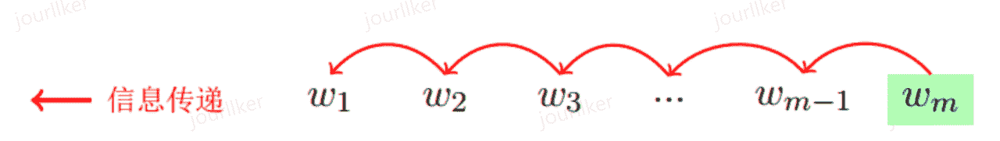
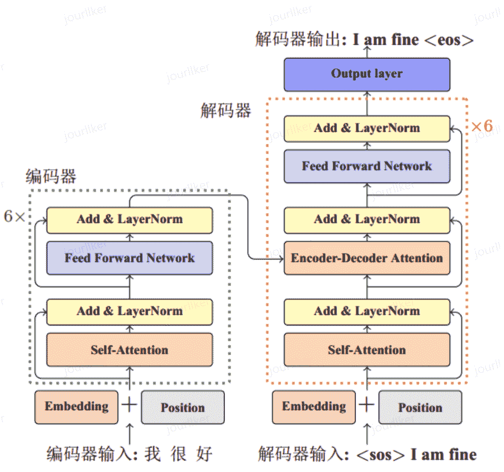
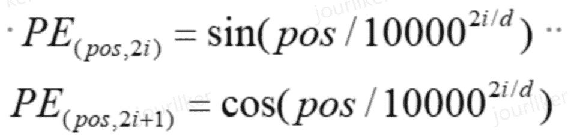
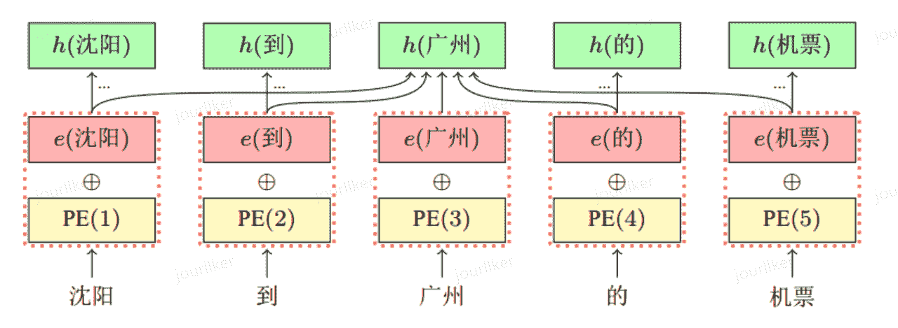
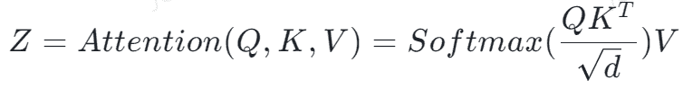
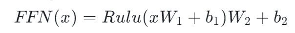
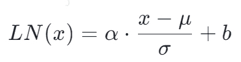
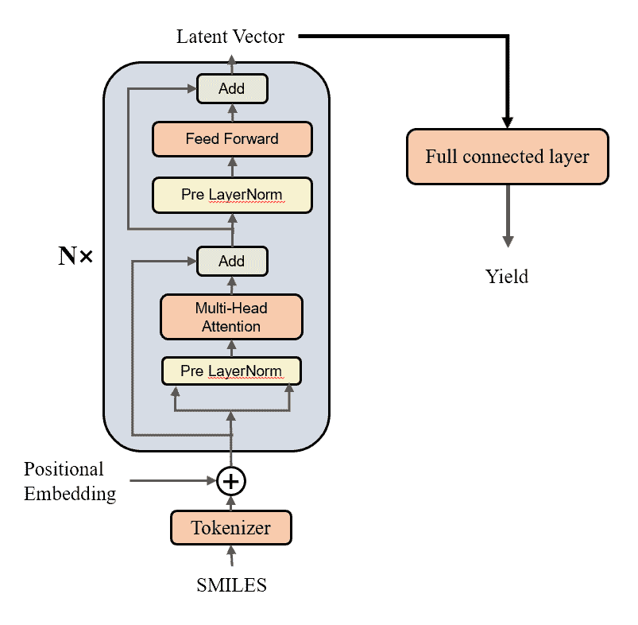
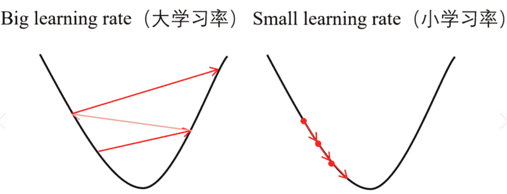
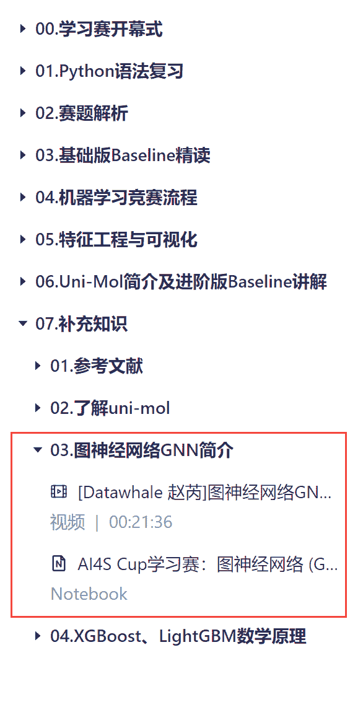

# Task3：Transformer建模SMILES进行反应产率预测

> 来源：[https://datawhaler.feishu.cn/docx/I7PKdwmkrocbn1xaAYAccygOnZc](https://datawhaler.feishu.cn/docx/I7PKdwmkrocbn1xaAYAccygOnZc)

> **教程贡献者说：**

> 在Task2，我们使用RNN建模SMILES，且发现了RNN在处理这类问题的局限性。因此，本节我们学习Transformer这种更加强大和高效的序列建模算法。

> 今天我们的任务是学习和了解Transformer并使用Transformer建模SMILES。

> 你可以从中学会Transformer相关知识，学会用代码实践Transformer建模序列数据。

> 学些代码和动手实践仍然是我们的重要环节，所以，请一定要认真完成这一部分。而且，我们已经学习了很强的建模方法了，大家尽可以动手调试代码，拿下更好成绩。

# 引导思考

Task2中，我们学习了RNN，认识了RNN的缺点，所以RNN的缺点有哪些？你还记得吗？

接下来，我们就跟着本节内容，看看Transformer是如何解决这些缺陷的。

# 正文内容 —— **Transformer**

## transformer诞生的由来

循环神经网络的序列到序列建模方法，在建模文本长程依赖方面都存在一定的局限性。

循环神经网络：由于所有的前文信息都蕴含在一个隐向量里面，这会导致随着序列长度的增加，编码在隐藏状态中的序列早期的上下文信息被逐渐遗忘。

卷积神经网络：受限的上下文窗口在建模长文本方面天然地存在不足。如果需要关注长文本，就需要多层的卷积操作。

图1 循环神经网络中，每个词都会依赖上一个词

## **优势**

完全通过注意力机制完成对序列的全局依赖的建模。并且，这是一种可以高并行的结构，大大增加了计算效率。

## **基本架构示意图**

1.  嵌入层 (embedding layer)

将token转化为向量表示。模型认识的只是向量，所以需要将每个切分好的token转化为向量。

这个过程中，与RNN不同的是，我们在Transformer的嵌入层，会在词嵌入中加入位置编码（Positional Encoding）。

> （为什么需要位置编码？

> —— 在本节后面的讲解中，我们会学习到：transformer使用的多头注意力计算方式，无法获取到序列中各个字符的位置信息，因此需要认为地添加位置信息。）

位置编码通常使用不同频率的正余弦函数：

其中，  表示单词所在的位置，  和 2i+1 表示位置编码向量中的对应维度， 则对应位置编码的总维度。

图2 位置编码的示意图。每个token都会变成token本身+位置信息

> 上述方式编码的好处：

+   首先，正余弦函数的范围是在 $[-1,+1]$，导出的位置编码与原词嵌入相加不会使得结果偏离过远而破坏原有单词的语义信息。

+   其次，依据三角函数的基本性质，可以得知第$pos+k$ 个位置的编码是第 pos 个位置的编码的线性组合，这就意味着位置编码中蕴含着单词之间的距离信息。

1.  自注意力层 （self-attention layer）

引入在注意力机制中：查询 q_{i}（Query） ，键 k_{i}（Key） ，值 v_{i}（Value） 。在编码输入序列中每一个单词的表示的过程中，这三个元素用于计算上下文单词所对应的权重得分。

所谓自注意力就是Q\K\V的值都是输入序列本身。为了防止过大的匹配分数在后续 Softmax 计算过程中导致的梯度爆炸以及收敛效率差的问题，这些得分会除放缩因子 \sqrt{d}  以稳定优化。放缩后的得分经过 Softmax 归一化为概率之后，与其他位置的值向量相乘来聚合希望关注的上下文信息，并最小化不相关信息的干扰。具体公式如下：

其中  ,  ,  分别表示输入序列中的不同单词的   向量拼接组成的矩阵，L 表示序列长度，  表示自注意力操作的输出。

1.  前馈层 (Feed Forward layer)

本质上，就是一个线性层。

实验结果表明，增大前馈子层隐状态的维度有利于提升最终翻译结果的质量，因此，前馈子层隐状态的维度一般比自注意力子层要大。

1.  残差连接

从基本架构图中我们可以看到，每个（LayerNorm layer）都有一个（Add），这就是一个残差连接。它的作用是用一条直连通道直接将对应子层的输入连接到输出上去，从而避免由于网络过深在优化过程中潜在的梯度消失问题。

1.  层归一化 （Layernorm）

我们直到，在神经网络中，我们经常对每一层的输出数据进行归一化，以使得模型更快达到收敛。只不过，前面的归一化方式几乎都是batch normalization，即对不同的batch进行归一化。Transformer在最开始被提出来的时候，采用的也是batch normalization。但是在人们后续的实践中发现，对于transformer而言，每一层间的归一化效果都要更好。

归一化操作的计算表达式：

其中 \mu  和 \sigma 分别表示均值和方差，用于将数据平移缩放到均值为 0，方差为 1 的标准分布，   和  b 是可学习的参数。层归一化技术可以有效地缓解优化过程中潜在的不稳定、收敛速度慢等问题。

目的：为了进一步使得每一层的输入输出范围稳定在一个合理的范围内。

## 利用Transformer的Encoder作为编码器编码

Transformer也是一个经典的编码器-解码器模型（encoder-decoder model）。从基本架构图中也可以看到，编码器部分将输入转化为一个向量之后，再传递到了解码器部分。既然这样，我们完全可以把Transformer的Encoder和Decoder部分拆开，分别拿来使用。其实，在大语言模型中非常具有代表性的BERT和GPT就是这样干的，它俩分别使用了Transformer的Encoder部分和Decoder部分。

既然Encoder部分输出的本身就是一个向量（我们这里称之为向量 ），那么只要模型学习得够好，那么这个向量就一定包含了重要得输入序列得信息。这就是为什么我们可以把Encoder单独拿出来并看作是一个编码器得原因。因此，我们可以将这个代表输入序列的向量 ，再作为其他模型的输入（例如全连接网络等），从而进行我们想要的分类或者回归任务。这样的思路被广泛应用在AI领域的研究和工程中。

在这里，我们使用Transformer的Encoder部分，编码我们的SMILES表达式。然后，再将等到的向量$z$通过一个线性层，输出一个值。我们期望通过模型的学习，这个输出的值就是该化学反应的产率。

# 进一步提升分数

接下来，我们介绍一些常用的调参或者优化模型的方式，以帮助大家进一步提高分数。相信大家在这个过程中，会进一步理解为什么我们常常把这个过程称之为“炼丹”了。

1.  调整epoch：epoch越大，训练得越久，一般而言模型得性能会更好。但是也有可能会出现过拟合现象。

> 所谓过拟合，就是模型过分学习了训练数据，导致泛化能力减弱的现象。一个极端的例子是：模型完全死记硬背记住了所有训练数据，因此在训练数据上的预测结果为满分。但是对于没在训练过程中见过的数据，却完全无能为力。

1.  调整模型大小：也即中间向量的维度、模型得层数、注意力头的个数。一般而言，模型越大学习能力越强，但是同样的也有可能出现过拟合。

1.  数据：对数据做清洗，调整数据分布，做数据增广。对于SMILES一个可行的增广思路是：将一个SMILES换一种写法。

> 前面对SMILES中没提到：其实，对于某个分子的SMILES，可以有多种写法。这其实很好理解，我们知道SMILES是从某个原子开始，依次排列所有原子而得到的。那么选取的初始原子不同，SMILES就会不一样。所以，为了统一，人们在使用的时候往往会将SMILES做一个书写规范，这个过程叫做标准化（canonicalization）。官方给出的数据就是规范化后的。

1.  采用学习率调度策略：在训练模型的过程中，我们发现往往约到后面，需要更小的学习率。例如下图：学习到后面，我们需要收敛的局部最小值点的两边都比较“窄”，如果现在学习率太大，那么在梯度下降的时候，就有可能翻过局部最小点了。因此需要调整学习率变小。在Pytorch中已经定义好了一些常用的学习率调度方法，需要的学习者可以自己从官网上查看如何使用。

1.  **集成学习**：训练多个不同初始化或架构的模型，并使用集成方法（如投票或平均）来产生最终翻译。这可以减少单一模型的过拟合风险，提高翻译的稳定性。

# 实践

[Task3_Transformer.ipynb](https://internal-api-drive-stream.feishu.cn/space/api/box/stream/download/all/Bskybv2NOouxtNxv2TBcjoJOnjf)

经过测试，基于Transformer的序列建模相比于基于RNN的建模在学习能力上更胜一筹。

# 思考

经过这两个Task的建模测试，我们不难发现，将SMILES作为序列进行建模，相比于使用分子指纹进行向量化之后采用传统的机器学习方法，效果还更差。

以下，是笔者的思考：

1.  在前面，我们的处理是：放弃了Additive和Solvent段。因为我们在实践时发现，不同反应的这两个字段非常相似，加入了这两个字段的SMILES模型难以学习。但是，这两个字段对反应的产率也有重要的影响，贸然删除必然会损失一部分信息。

1.  化学分子SMILES具有以下特性：哪怕只有字符级别的很小差别，分子的性质可能会天差地别。

1.  更强大合理的tokenizer和词汇表。我们现在使用的词汇表是原子、离子级别的tokenize。但在化学领域，还有很多经典的子结构：芳环、甲基等。进行更高级别的tokenize或许对提升模型性能有较大帮助。

# 来个小总结

在这个部分，我们学习了基本的Transformer知识，并采用Transformer Encoder部分建模SMIELS，最后通过将encoder编码的隐向量通过一个线性层，实现了对产率的预测。

# 补充：GNN图神经网络建模方法

使用图神经网络建模化学问题需要从图数据，图网络，PyG库等内容开始学习。内容很多，就不再本次学习活动中再展示。这里推荐另外一个同样也是由datawhale成员参与的一个教程：https://bohrium.dp.tech/courses/2718054507?tab=courses

开展学习，主要目录和内容如下：

# ❀ 恭喜看完全部必学知识教程！

<https://datawhaler.feishu.cn/sync/TdhvdKG8psUuznbIsOzcJsSon56>

## 📟 你可以随时回顾我们这次的学习~

<https://datawhaler.feishu.cn/sync/XGMQd4cS3s7L0mbC5lmcHttvnRb>

> 我们还额外编写了[Task4：上手体验大模型解决科学问题](https://datawhaler.feishu.cn/wiki/KgOWw5HWRiinTXkytrEcS0uJnIe)，作为当前对LLM的潮流的一种尝试。在Task4中，我们使用LLM帮助学习SMILES，实现产率预测。感兴趣的小伙伴可尽情前往！！！

## 🎉合影留念墙

感谢很棒的你一路的坚持，让我们在这里给自己点个赞！

期待下期夏令营还能与你再次相遇~

一起合个影 :)

#

> 本教程主要由   写作贡献，

> 融合了多位助教的内测体验和宝贵建议。

> 如果你觉得对你有价值和启发，请在下面点赞和评论哟~

>

### 另外别忘了写笔记打卡呀！！~

### 及时思考、沉淀和产出能让你的学习事半功倍！

>

> **注：本文采用 ****署名—非商业性使用**—相同方式共享 4.0 协议国际版许可协议进行许可。