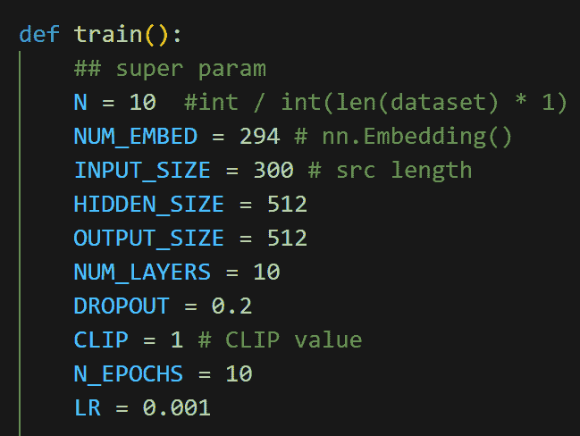

#  QA & 其他彩蛋

> 来源：[https://datawhaler.feishu.cn/docx/K8DbdDS58oFB8NxRpgpcv26Dn1b](https://datawhaler.feishu.cn/docx/K8DbdDS58oFB8NxRpgpcv26Dn1b)

> 别忘了持续上分！我们赛事提交的网址在：

<https://datawhaler.feishu.cn/sync/WbWwdPDRgsjXkWbnpMfcdSajnd2>

# 习题汇总

# QA汇总

# Baseline QA汇总：

| ## 序号 | ## 问题 | ## 回答 |
| --- | --- | --- |
| 1 | dataset是task1的，其他两个自己建 |  |
| 2 | 我的目录是空的，只有传的task2，没有别的了，没有dataset和model还有output | 整个目录是这样的： |
| 3 | 参数在哪呢，如何调试 |  |
| 4 | 没有编程基础，如何进行下一步的学习与比赛 | python基础——》pytorch基础——》深度学习基础——》实践 |
| 5 | 使用cpu训练能训练出来么？ | 对于深度学习任务，cpu训练时间太长，不建议；机器学习任务可以使用cpu。 |
| 6 | 训练时间太长怎么办 | 换用好的显卡，把batch size设置大一点，训练轮数小一点。 |
|  | 优化的方向有哪些？ | 模型上，调整参数和模型架构； |
|  | 有没有跑的快一点的深度学习方法，提高训练效率和拟合速度 | 相对于RNN而言，Transformer有着更好的并行能力。 |
|  |  |  |

code/

dataset/

model/

output/

vocab_full.txt

## Task1 QA汇总：

| ## 序号 | ## 问题 | ## 回答 |
| --- | --- | --- |
| 1 | 怎么看自己报名成功啊 |  |
| 2 | 打卡不了 |  |
| 3 | 拟合是什么意思？ |  |
| 4 | 为什么找不到task1 |  |
| 5 | 也就是说其实大部分代码是在将已有的数据处理为模型可以接受的模式 |  |
| 6 | 请问分子指纹有没有更好的选择呀，能不能详细讲讲分子指纹，不太懂 | 分子指纹种类很多，但是好坏没有一个统一的标准。所以在面对具体的任务的时候，要尝试不同的。 |
| 7 | 哪里打卡和上传笔记呢 |  |
| 8 | 这是回归问题 还是分类 | 回归 |
| 9 | 测试库和样本库有什么区别，分别有什么作用 |  |
| 10 | 为什么我用交叉验证根本跑不出来，时间太久了 |  |
| 11 | 除了调节参数还有没有其他优化方法 |  |
| 12 | 请问转成asc形式后的分子是个什么形式，类似于矩阵吗 |  |
| 13 | 数据具体是在哪里改，参数具体在哪改 |  |
| 14 | 代码最开始的!pip可以删去吗？pip和install有什么区别？ |  |
| 15 | 大赛是以什么形式开展的，还是在这个魔搭平台还什么，需要Python的代码只是吗 |  |
| 16 | 加上参数调优和交叉验证跑的时间太长，跑不出来，还有什么更好的优化方法吗 |  |
| 17 | 这个优化的方向有哪些？每个方向需要考虑的因素有哪些？ |  |
| 18 | 调优怎么确定到底哪个参数合适？ |  |
| 19 | 请问一般不在分子指纹特征提取这里优化嘛 |  |
| 20 | 参数最优搜索的时候，参数的搜索范围如何确定 |  |
| 21 | 我们的这个森林算法是一个固定的模块吗，我们需要深入了解这个算法的内部吗 | 是sklearn的一个模块。只是使用的话不需要详细了解，但最好学习一下这个算法怎么工作的。 |
| 22 | 维度是什么意思？维度是数组的大小吗 |  |
| 23 | 处理原始数据的时候，不需要提取产物这一列吗 | 产物对化学反应很重要，因此想要好的结果，是需要的。 |
| 24 | 除了随机森林还可以用其他模型吗？ | 可以使用多种机器学习模型，选择效果最好的 |
| 25 | 原始数据只有6列，为什么读取转换以后，有8千多列 | 你这里应该指的是转换为分子指纹之后有8千多。因为分子指纹是一个向量，我们这里每个SMILES式子转化为2048维的向量。所以会有8千多。 |
| 26 | 用了LGBM模型进行预测，但是预测出来的效果不是很好，是和调参有关吗？是的话大概需要在哪个范围里面调整呢 |  |
| 27 | 维度是不是高等代数里面的维度啊？ | 机器学习里面的维度一般就指向量的大小。 |
| 28 | 超参数调优和交叉检验并通过特征选择找到最佳特征，用时过长，跑不出来，大家是怎么优化， |  |
| 29 | 完全看不懂代码要怎么进行下一步的学习 | 结合ai一行一行慢慢看呗，功不唐娟 |
|  |  |  |
|  |  |  |

## Task2 QA汇总

| ## 序号 | ## 问题 | ## 回答 |
| --- | --- | --- |
| 1 | 为什么使用深度学习的分数这么低 | 确实RNN目前跑出来的效果不如随机森林。 |
| 2 | 训练时间如何变短提高效率（大概1h），优化的方向有哪些？ | 调参， |
| 3 | 网络结构可以自己改一改吗？ | 鼓励大家按照自己想法更改网络结构，优化模型。 |
| 4 | 有没有跑的快一点的深度学习方法 ？ |  |
| 5 | 请问大佬是如何判断应该使用机器学习还是深度学习啊 | 有的任务适合机器学习；有的任务适合深度学习。这同样是没有一个定论的，需要实践。一般而言，可以首先尝试机器学习方法，如果发现机器学习方法的效果不好，说明问题比较复杂。就可以尝试深度学习方法。 |
| 6 | 为了实现高速运算，深度学习可以集成到fpga上面吗？ |  |
|  | 只要不过拟合，是越细越好吗？ |  |
|  | 为什么跑出来是负分。所有的yield都是一个数。 | 这个情况说明模型并没有很好学习到。模型“偷懒”干脆直接返回了训练集中的均值。一方面是模型给本身学习能力不够，二是可能优化方法有问题（可以调整调整lr），三是数据的问题。我发现本次竞赛数据中，additive和solvent下，非常多的分子在这两个字段是一样的，这造成了数据非常相似，导致模型难以区分。 |
|  |  |  |

为什么运行以后model文件夹为空

## Task3 QA汇总

| ## 序号 | ## 问题 | ## 回答 |
| --- | --- | --- |
| 1 | 为什么使用卷积网络，仅仅100张28×28×1的手写数字图片就可以训练出结果，而且效果很好。但是现在几万条数据却训练不出来，是因为现在的这几万条数据之间相关性很低吗？ |  |
|  |  |  |
|  |  |  |
|  |  |  |

## 上分交流会 QA汇总

| ## 序号 | ## 问题 | ## 回答 |
| --- | --- | --- |
| 1 | 一般多少数据量就可以尝试深度学习 |  |

# 贡献者清单

| **角色** | **姓名** |
| --- | --- |
| **教程贡献者** |  |
| **运营助教** |  |
| **专业助教** |  |
| **优秀学习者** |  |
| **QA贡献者** |  |

# 别忘了随时查看学习规划表~

<https://datawhaler.feishu.cn/sync/XGMQd4cS3s7L0mbC5lmcHttvnRb>

# 给你的学习群点个赞吧~