# Task2：时间序列挖掘+ABM构建学习

> 来源：[https://datawhaler.feishu.cn/docx/RL6ddvR8UoWkOQxKzVrchZYnn8f](https://datawhaler.feishu.cn/docx/RL6ddvR8UoWkOQxKzVrchZYnn8f)

> **教程贡献者说：**

> 前面我们介绍了基本的赛题理解和背景知识，以及一些ABM基础概念，并提供了一键可运行的Baseline。相信大家都已经跑出了自己的第一个分数，并且急切想提分冲刺前排了。

> 本次比赛具有自身的特殊性，既可以用时间序列解决，也可以尝试使用赛方推荐的ABM，因此在这里我们尝试挖掘更多时序上的信息，帮助找到更多提分点。

> 此外，这里还会深入介绍ABM模型的构建方法，借助实际的案例和代码实践，让大家感受到ABM的有趣之处，最后手把手带大家跑通一个经典ABM模型：玻尔兹曼财富模型：模拟现实中的财富不平等

> 话不多说，开始今天的学习吧( ＾∇＾)

# 深入理解赛题——探索性数据分析

> 首先我们先介绍一下什么是EDA：

> **探索性数据分析（Exploratory Data Analysis, EDA）**是一组数据分析技术，旨在总结其主要特征，通常通过可视化手段来实现。EDA 的目标是通过数据的统计摘要和图形展示来发现数据的结构、异常值、模式、趋势、关系以及变量之间的相互作用。

> 现在**的数据挖掘类比赛中，模型和方法选择空间**往往很小，同时存在不少自动机器学习框架（如AutoGulon、AutoSKLearn）会基于一定规则，自动构造特征，采用尽可能多的模型组合来获得好分数。因此最后的关键涨分点落在了对数据的理解上，并由此构造的强特征（对结果有关键影响的变量）。

> 因此在拿到一个数据集后，需要对数据做尽可能多的探索，了解数据所在的领域先验知识，数据本身的特性等，并总结为一系列有用的信息。

> 下面，就让我们对本次比赛的数据做进一步的探索吧(ง •̀_•́)ง。

> `Task2`运行完不会输出`submit`，只提供了上分关键信息，需要根据EDA信息优化自己代码上分

> 由于篇幅限制没有黏贴代码在这里，但提供了EDA的代码和数据，可在下方下载：

请将`electricity_price_parsed`放在`EDA.ipynb`同级的`data`文件夹路径


[`EDA.ipynb`](https://internal-api-drive-stream.feishu.cn/space/api/box/stream/download/all/ZiCAbmFGjo15vuxqvmtc8r79n2c)

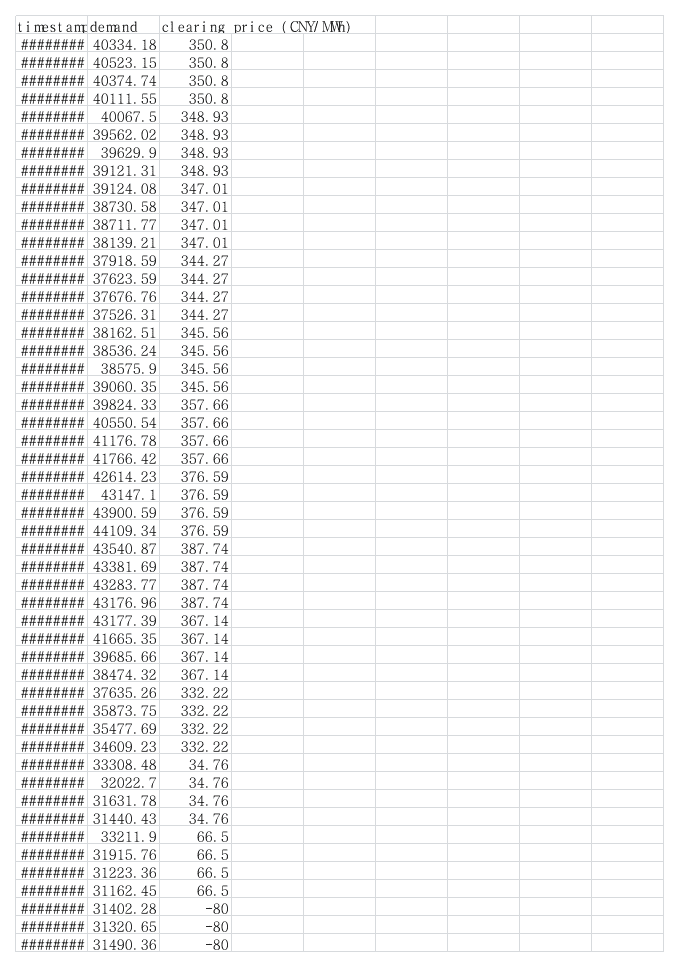

[`electricity_price_parsed.csv`](https://internal-api-drive-stream.feishu.cn/space/api/box/stream/download/all/DqpJb4D9aolL6CxZaczcULVTnBd)

## 基本信息

数据基本介绍已经在[从零入门AI for Science（AI+经济）](https://datawhaler.feishu.cn/wiki/MkHkwQKEZiylVHkmFu8c17xgnbc?table=tblu7vcq7MqL7GC1&view=vewPZpUsYn#QP4fdMR6Zof94Qx5rAbcZDQVnhd)中，这里不再赘述。

进一步查看数据我们可以发现，**出清价格在一小时中是保持不变**的，也就是实际上交易时间是1小时而不是15分钟，但总负荷会在一小时中变化。

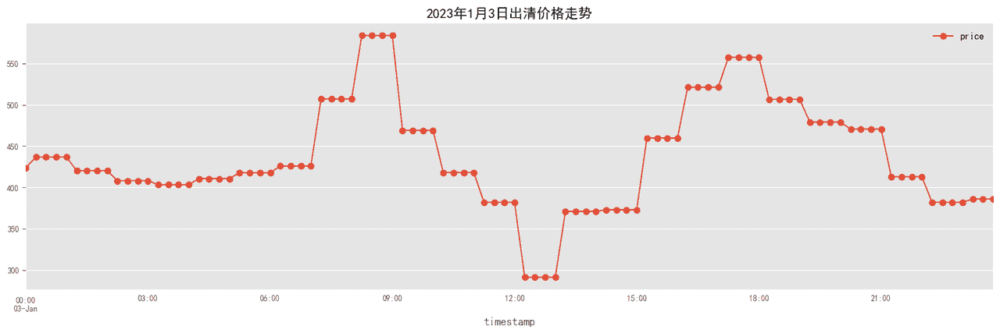

## 统计指标分析

其次我们从**单变量数值关系**入手，探究其统计指标的表现。具体来说可以关注（其中`df`是pandas的dataframe，`df[feature]`能够选中一行）：

+ 数据的集聚趋势

+ 均值：`df[feature].mean()`

+ 中位数 `df[feature].median()`

+ 最大值 `df[feature].max()`

+ 最小值 `df[feature].min()`

+ 众数 `df[feature].mode()`

+ 数据的变异程度

+ 标准差 `df[feature].std()`

+ 极差 `df[feature].apply(lambda x: x.max() - x.min())`

+ 四分位数 `df[feature].quantile([0.25, 0.5, 0.75])`

+ 变异系数 `df[feature].std()/df[feature].mean()`

+ 偏度和峰度 `df[feature].skew(), df[feature].kurtosis()`

+ 变化率：`df[feature].pct_change()` 计算公式为 \dfrac{x_2-x_1}{x_1}

从总负荷和出清价格的数值分布来看，可以发现以下几个特点：

+ 总负荷基本服从正态分布，符合现实中的耗电规律

+ 出清价格中有大量的异常负价格

+ 1-100之间的低价格较多，表明这些时候火电有一定的异常高价（800以上）

这是一个很反常的现象，启发我们去探究负价格形成的原因

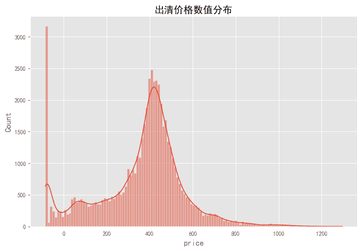

## 分时统计指标分析

### 不同小时的总负荷和电价

既然是时间序列，我们会考虑到指标值在不同时间上的不同表现，去发现时间上的特征趋势。

首先分析不同年份下，一天不同小时的总负荷和电价。我们可以发现，数据中用电存在两个高峰期和一个低谷期

+ 早高峰：一般在6-9点

+ 晚高峰：一般在16-21点

+ 低谷期：10-15点

这**似乎很反常，**理论上10-15点都在进行大量的工业和商业活动，为什么反而电价和总负荷会更低呢，这里需要了解一个概念：“鸭子曲线”

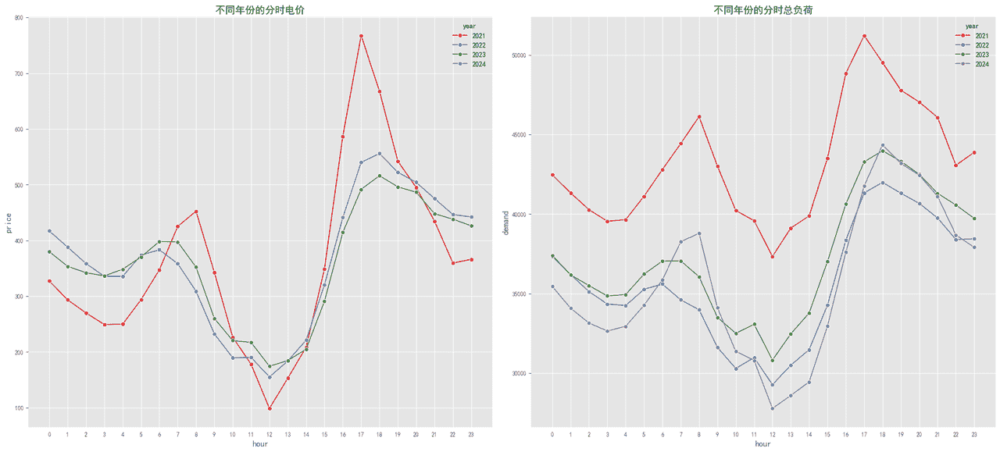

> 鸭子曲线：由于火电和光伏发电互为替代品，当一天太阳出来后，太阳能逐渐开始替代火电，并在14点达到最大，进而导致火电受光伏发电竞争而降价。而在傍晚时太阳落山，光伏机组迅速减小发电，此时火电开始集中发电，价格迅速上升，形成了一天中典型的“两高峰，一低谷”的态势。

对比下图中加利福尼亚的数据和目前的数据，可以发现二者的形式几乎一致，这样我们又增加了几个先验信息：

+ 考虑其他新能源（尤其是光伏）的影响对预测价格意义重大

+ 光伏受天气、季节等因素影响，说明还需要借助外部天气数据辅助预测。

+ 随着时间推移和中国碳中和的发展，光伏必定会在更大程度上替代火电，因此可以猜测2024年的火电价格会进一步下降。

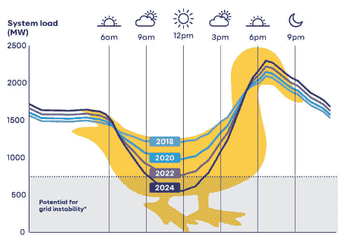

还可以进一步用透视表和热力图来分析不同月份下的电价变化趋势，从中我们可以发现几个趋势

+ 从1月到到5月，出清电价峰谷不断扩大，价格持续走低

+ 6-8月出清电价开始回升，并在8月达到顶峰

+ 9-12月出清电价开始迅速下降，但在11-12月略有回暖

可以根据地理知识做出猜测：

+ **从冬至到夏至，日出时间不**断提早，光伏发电更早抢占火电市场空间，导致火电更早在早高峰期间跌价。同时1-5月是大风期，风电也进一步驱使火电降价。

+ 6-8月为小风期，风电减弱。同时雨带迁移到北方，光伏受天气影响发电量大幅减少，火电迎来高价区（尤其是8月降水最多，火电价格最高）

+ 9-12月为大风期，风电加强。日出开始推迟，火电在低谷期的价格逐渐回升。

**这启发我们除了构造月份特征，还能构造不同时**期的指示变量特征（如1-5月、6-8月）

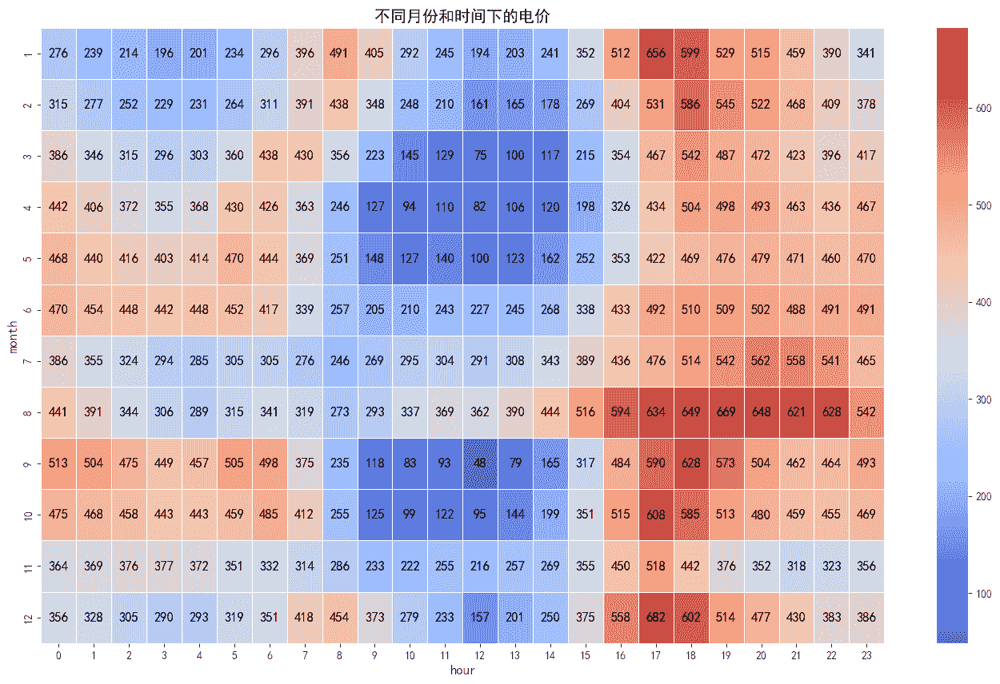

## 负电价与高电价形成原因分析

先前提到，数据中有大量负电价和一部分的异常高价，在这里我们探究其形成原因，并思考如何预测这种模式。

### 负电价

从不同小时下负电价的出现次数来看，低谷期的负电价较为明显，可能是受市场竞争导致电价中标失败，只能亏本售出。

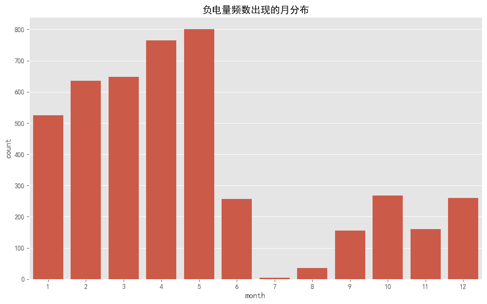

通过按负电价出现频数排序，可以发现最典型的一次集中的负电价发生在2022年的五一假期中，连续出现了7次的负电价。

**猜测**是因为火电厂发电需要人为监控（例如开关机，设置出力，而风电和光伏放着自己发电就好），假期期间大多数员工放假，从而导致火力发电量下降，出现负电价。

我们还可以进一步探究**假期对电价的影响**，例如2022年的大年三十是1月31日，由于调休，1月28日-1月30日上班，1月31日-2月6日放假。果然在春节假期中也出现了大量的负电价。

这说明节假日是判断负电价的重要特征

> 小测试：尝试画出2023年春节放假期间，1月21日-1月27日中的电价波动，并对比2023年的1月28日-2月6日电价情况，这是否更加证明假期特征的重要性？

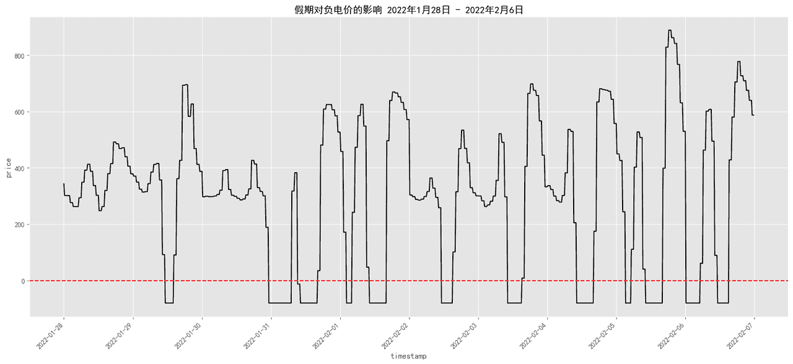

### 高电价

和负电价相反，高电价主要集中在日落后，此时光伏发电下降，火电有较大的竞价空间。

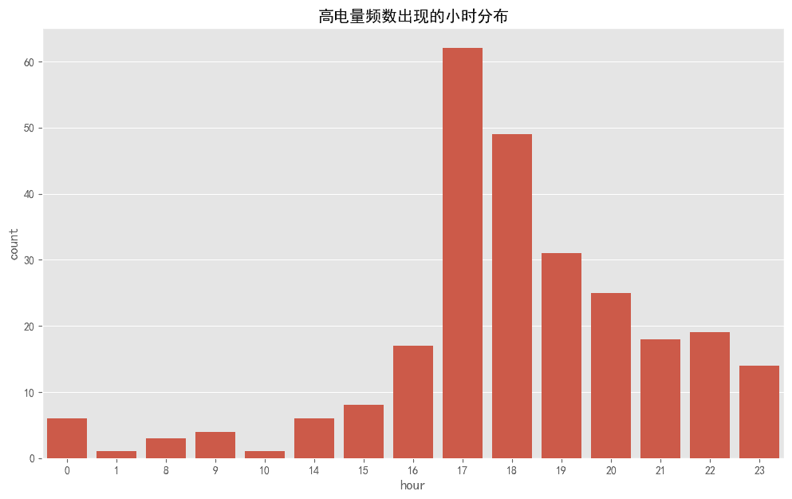

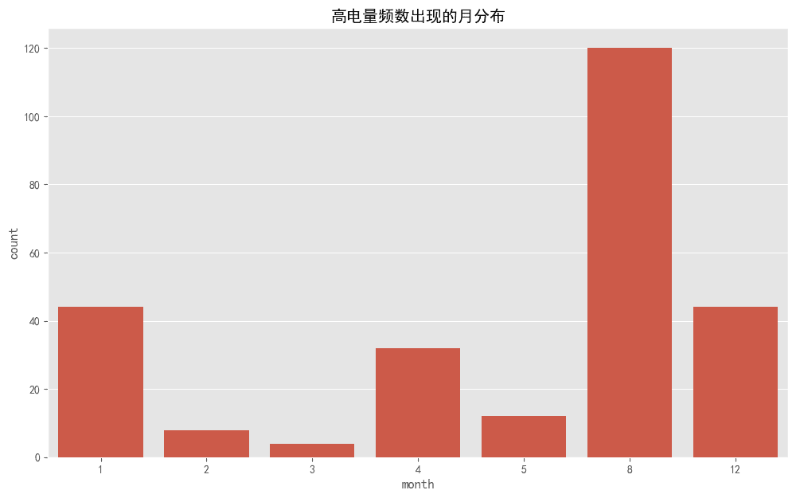

通**过对比明显高价的202**2年8月3日-8月6日之间的数据，可以发现其在总需求上并不突出，甚至比后续日期中总需求更高的时间段价格还高，表明其受到了外部因素的影响

证明利用外部数据也是上分的重要点

> 小挑战：尝试获取华北城市在2022年12月-2024年4月的天气数据，并整理为易于读取的表格。通过对比其降水量/光照量/风速和出清价格，能发现什么规律？查询所有城市的历史天气数据：https://lishi.tianqi.com/

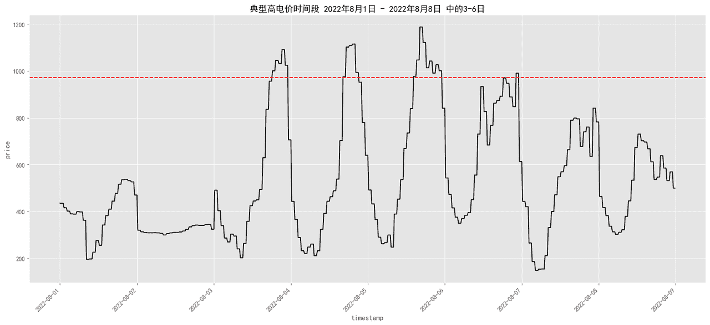

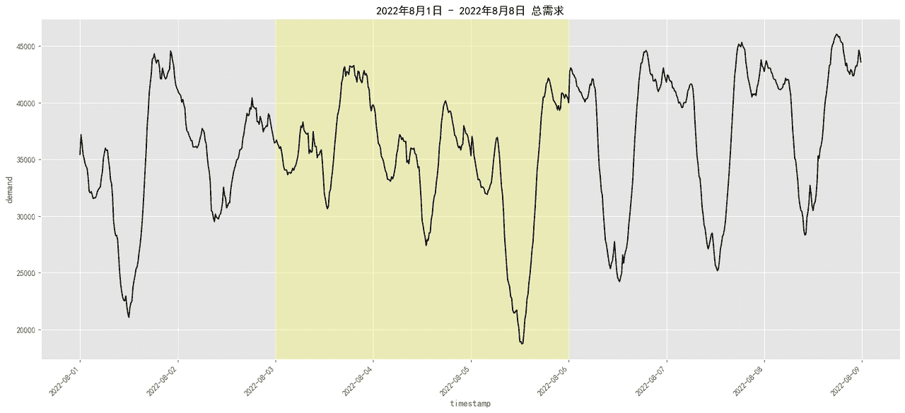

## 双变量分析

本题中特征均为连续型变量，因此我们可以采用画散点图，计算相关系数的方法来观察两个变量的关系。

### 相关系数

Python计算相关系数代码如下，其会得到一个相关系数矩阵

```
ar_1=np.array([3,5,1,12])
ar_2=np.array([1,2,3,4])
np.corrcoef(ar_1,ar_2)
>>> array([[1.        , 0.62026387],
       [0.62026387, 1.        ]])
```

如果是使用pandas的dataframe，可以直接`df[[feature1,feature2]].corr()`求`feature1`和`feature2`的相关系数矩阵。

在本案例中，`demand`和`price`的相关系数为0.34，可以看出二者有较高的线性相关性

并且我们还能发现，在高负荷下，价格变动趋缓

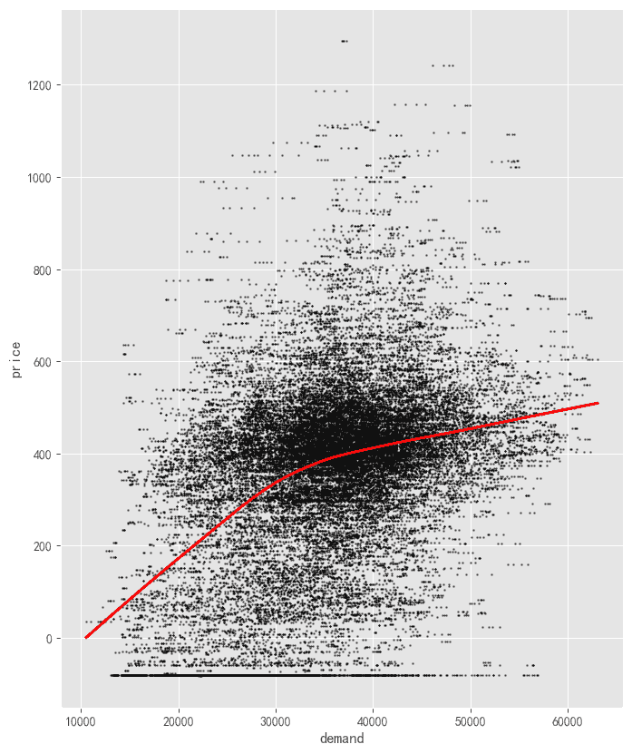

## 总结

综合以上，我们可以总结出几点：

1. 气象状况对出清价格有较大影响

1. 节假日对出清价格有较大影响，易于出现负值

1. 总负荷与出清价格线性关系很高，但总体呈现分段线性的特征

1. 不同月份/小时下的出清价格受市场竞争影响较大

1. 碳中和不断发展，火电价格有总体下降的趋势

本次案例中的EDA只是一部分，旨在提供探索性数据分析的一般步骤。可以自行尝试使用seaborn，plotly等python库做进一步的可视化，挖掘序列的更多信息，从而指导后续的特征构造。

# Baseline精读

具体的第三方库用法请查询对应的文档哦：

1. pandas：https://pandas.pydata.org/

1. https://numpy.org/

1. https://scikit-learn.org/

下面我们一步步解释Baseline都做了什么

1. 导入必要库：`numpy`用于矩阵运算、`pandas`用于表格处理、`pathlib`主要用于文件路径处理、`sklearn`用于机器学习算法，这里主要使用了线性回归`LinearRegression`

1. 读取数据：这里我们主要用了如下几个方法

+ `pd.DataFrame.isna()`：检查`DataFrame`中的缺失值（`NaN`），返回一个布尔值的`DataFrame`，其中`True`表示缺失值。

+ `pd.DataFrame.drop()` ：删除`DataFrame`中的指定列或行，`columns`为需要删除的列的名称，这里为 `"demand"`

```
base_path = Path("data")  # 确保数据都放在同级的data目录下

# 读取市场数据
electricity_price = pd.read_csv(base_path / "electricity price.csv")
# 读取市场主体（各发电机组）数据
unit = pd.read_csv(base_path / "unit.csv")

"""
准备示例提交数据sample_submit
1. electricity_price["clearing price (CNY/MWh)"].isna()找到出清价格为缺失值的行，即要预测的目标
2. 去除demand列，符合最后的提交格式 
"""

sample_submit = electricity_price[electricity_price["clearing price (CNY/MWh)"].isna()].drop(columns="demand")
sample_submit.to_csv(base_path / "sample_submit.csv", index=False)
```

这里之所以能`electricity_price[electricity_price["clearing price (CNY/MWh)"].isna()]`，是因为`pandas`的`DataFrame`支持布尔索引，即像一个掩码一样，`True`的位置数据被保留，`False`的数据会被过滤。

1. 构建时间序列`DataFrame`

这里首先利用`pandas`的向量化特点（即自动逐元素做操作，能够并行处理，比如`[1,2,3]+[2,3,4]==[3,5,7]`）我们将数据的日期和时间拼接起来：`2021/12/1`与`0:15`拼接为`2021/12/1 0:15`。

随后用`pd.to_datetime`转换为时间序列。

> 这里之所以这么做是`pandas`对于时间序列的支持很好，如果索引为时间序列，能方便地按时间戳切片、过滤、提取时间特征、滑窗、差分、降采样升采样等

```
electricity_price["timestamp"] = pd.to_datetime(
    electricity_price["day"] + " " + electricity_price["time"].str.replace("24:00:00", "00:00"))
```

由于`pandas`无法处理`24:00:00`的情况，这里替换为了`00:00:00`，但会导致其对应到前一天的零点，需要手动替换到下一天：

`2023-02-01 24:00:00` -> 字符串替换 ->`2023-02-01 00:00:00` -> 日期转换 -> `2023-02-02 00:00:00`

```
mask = electricity_price['timestamp'].dt.time == pd.Timestamp('00:00:00').time()
# 需要将这些行的日期部分加一天
electricity_price.loc[mask, 'timestamp'] += pd.Timedelta(days=1)
```

1. 按边际成本从低到高依次成交，直到容量之和大于总负荷，取最后一个成交的机组边际成本

这里的目标是复现[从零入门AI for Science（AI+经济）](https://datawhaler.feishu.cn/wiki/MkHkwQKEZiylVHkmFu8c17xgnbc?table=tblu7vcq7MqL7GC1&view=vewPZpUsYn#T0iPdMLjVoNOVwxmof8cmPdHnnd)中的过程，即模拟市场生成出清电价的过程

1. 首先计算各机组按边际成本从低到高的容量和：`sorted_unit['cumulative_capacity'] = sorted_unit['Capacity（MW）'].cumsum()`

`cumsum`为向上累计。例如，对于一个容量序列： ，其向上累计的结果是

。其中： 、 、……、、

1. 向上累计后，使用`sorted_unit['cumulative_capacity'] >= demand`会让向上累计中大于总需求的行被设为`True`，从而可以筛选出这些行。

例如2021年12月1日数据中，总需求为40334.18，`sorted_unit[sorted_unit['cumulative_capacity'] >= demand][["cumulative_capacity","coal consumption (g coal/KWh)"]]`输出为：

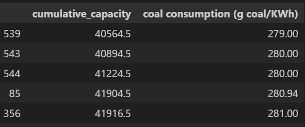


从而40564.5对应的行就是加上最后一个机组的容量后的总供给，其超过了总需求，达到市场出清。最后一个机组的边际成本279作为报价。

```python
# 预先计算 sorted_unit 的累积和
sorted_unit['cumulative_capacity'] = sorted_unit['Capacity（MW）'].cumsum()

prices = []

# 找到最后一个满足总需求的机组报价
for demand in electricity_price["demand"]:
    price = sorted_unit[sorted_unit['cumulative_capacity'] >= demand]["coal consumption (g coal/KWh)"].iloc[0]
    prices.append(price)

print(len(prices))
prices[:5]
```

## 使用线性回归转换报价到现实市场出清价格

1g/KWH相当于1kg/MWH，由于我们没有每千克的煤价，因此尝试用过去出清价格和边际成本报价做线性回归，尽可能贴近现实的出清价格。

这里主要使用了`sklearn`的多元线性回归，其接受样本二维数组和标签二维数组，并对系数进行拟合

```python
# 创建一个线性回归模型的实例
model = LinearRegression()
# 55392为训练集的长度
train_length = 55392
# 将价格列表转换为NumPy数组并重塑为二维数组，确保每个价格值都作为单独的样本
prices = np.array(prices).reshape(-1, 1)
# 训练数据的特征矩阵X，由价格数据组成
X = prices[:train_length]
# 训练数据的目标变量y，为电力市场的出清价格，并重塑为二维数组
y = electricity_price["clearing price (CNY/MWh)"].iloc[:train_length].values.reshape(-1, 1)
# 使用训练数据拟合线性回归模型
model.fit(X, y)
```

## 预测并提交

随后我们就能调用`sklearn`方便的`predict`接口，直接根据类似的输入格式预测标签啦，具体详见[`sklearn`线性回归](https://scikit-learn.org/stable/modules/generated/sklearn.linear_model.LinearRegression.html)。

> 学有余力还可以往前学习哟~

> 我们下一个Task的内容在：[Task3：进阶上分方向讨论](https://datawhaler.feishu.cn/wiki/DafPwzGSriBXd7kaMdtcngQlnzc)

# ABM构建学习与实战

> 在[从零入门AI for Science（AI+经济）](https://datawhaler.feishu.cn/wiki/MkHkwQKEZiylVHkmFu8c17xgnbc?table=tblu7vcq7MqL7GC1&view=vewPZpUsYn#Hk7qdybY2oDWSXxqaBqc95qmnyJ) [中，我们](https://mesa.readthedocs.io/en/stable/)简要介绍了`ABM`的概念，在本节中我们基于`Mesa`库，手把手地实践`ABM`，相信你一定会喜欢上这个神奇的方法（＾∀＾●）

> 当然在本赛题中实现`ABM`的难度较高，因此推荐将本节作为一个入门，了解`ABM`的一般方法，在探究时间序列方法的同时，思考`ABM`的应用方式。

## 安装`mesa`

首先安装本次要用到的`mesa`库，其是一个方便的构建`ABM`的开源框架

### 安装依赖库

```bash
pip install seaborn matplotlib pandas numpy mesa 
```

## 贫富差距与阶层固化——玻尔兹曼财富模型


[`玻尔兹曼财富模型.ipynb`](https://internal-api-drive-stream.feishu.cn/space/api/box/stream/download/all/SzVCbqeWho4WNZxtng0cCAp2nbb)

首先我们思考一个场景，假设有这样一个世界，所有人生而平等，即持有相同的1单位资本。

现在他们按照一个规则行动：如果自身持有资本大于0，将1单位资本随机给一个其他的人

一个社会按这种规则不断演化，会产生什么结果呢，我们试着去模拟一下。

### 构建环境

首先来认识一下`Mesa`中的环境，其定义了`Agent`交互的场所、时间规则等。我们可以认为每当环境做出一次迭代时，所有`Agent`都被唤醒，各自按照其规则执行一步。

首先导入一些依赖库

```python
import numpy as np
import pandas as pd
import seaborn as sns
from tqdm import tqdm
import matplotlib.pylab as plt
plt.style.use('ggplot')
# 设置matplotlib显示中文
plt.rcParams['font.sans-serif'] = ['SimHei'] 
plt.rcParams['axes.unicode_minus'] = False

# Mesa相关库
from mesa.model import Model
from mesa.time import RandomActivation
from mesa.agent import Agent
from mesa.datacollection import DataCollector
```

`Mesa`中的环境必须继承自`mesa.Model`，且必须实现`step()`方法

+ 初始化时需要定义一些环境设置

+ [`super().__init__()`](https://blog.csdn.net/weixin_50804299/article/details/129538980)，调用父类的初始化方法，即继承一些有用的属性和方法（用到了Python面向对象编程的知识）

+ 智能体所处地图：离散方格、连续方格、网络、甚至是下载的RPG地图…… 这里我们没有设置地图。

+ 智能体调度器：描述以何种顺序触发智能体的行为。一般智能体的行动分为异步和同步，本案例定义了一个`RandomActivation`，会先打乱所有智能体的顺序，再按顺序依次让智能体执行自己的动作。

+ （辅助工具）`DataCollector`：主要用于记录实验中的一些数据，例如每个`Agent`的某个属性；也可以传入一个函数，接受`Agent`/`Model`进行某种处理来获取数据。

+ `step`：让环境迭代一次，即模拟所有`Agent`交互一次。可以在这里加入一些数据记录函数（比如存储每个`Agent`的财富，发生某种动作的`Agent`占比等）

```python
class WealthModel(Model):
    """
    模拟财富分布的环境，继承自 Model 类。
    """

    def __init__(self):
        """
        初始化 WealthEnv 环境。
        调用父类的初始化方法，并创建一个随机激活调度器（RandomActivation）。
        调度器每个时间步随机选择代理并激活它们，从而打乱了激活的顺序。例如有四个Agent，可能激活顺序是1,3,2,4
        """
        super().__init__()
        # 创建一个随机激活调度器，用于管理智能体的激活顺序
        self.schedule = RandomActivation(self) 
        # 创建一个数据监视器，用于监控每个Agent的财富情况
        self.datacollector = DataCollector(agent_reporters={"Wealth": "wealth"}) 

    def step(self) -> None:
        """
        进行一步模拟。调用调度器的 step 方法，激活所有代理进行一步操作。
        """
        self.datacollector.collect(self)
        self.schedule.step()  # 调用调度器的 step 方法，激活所有代理进行一步操作
        

    def add_agents(self, agents: list[Agent]):
        """
        添加智能体到环境中。
        """
        for agent in agents:
            self.schedule.add(agent) 
```

### 定义agent

回想之前提到的规则：如果自身持有资本不为0，将1单位资本随机给一个其他的人

可以大致构想，假设我们是这个`Agent`，可能会按下面的流程与其他`Agent`互动：

1. 检查自己的财富状况，如果为0，则什么也不做

1. 如果财富大于0，从除自己外的所有`Agent`中随机抽一个`Agent`

1. 将对方财富加1，自身财富减1（也可以尝试其他数字）

1. 停止行动，等待下一轮环境迭代

`mesa`的`Agent`必须有`unique_id`，`model`两个属性：

+ `unique_id`：用于区分`Agent`

+ `model`：先前定义好的环境

此外`Agent`必须实现`step`方法，表示让`Agent`根据自己规则行动一步

```python
class WealthAgent(Agent):
    def __init__(self, unique_id, model):
        super().__init__(unique_id, model)
        self.wealth = 1

    def step(self):
        if self.wealth > 0: 
            # 如果财富大于0，从除自己外的所有Agent中随机抽一个Agent
            # self.random.choice等价于random库的choice
            # self.model.schedule.agents能获得环境中的agent列表
            other_agent = self.random.choice(self.model.schedule.agents)
            other_agent.wealth += 1
            self.wealth -= 1
```

目前我们就已经完成了`ABM`的构建了，可以用下面代码测试一下：

```python
env = WealthModel() # 初始化模型
# 定义Agent列表，里面每个元素为交互的主体
agents = [WealthAgent(i, env) for i in range(4)] 

env.add_agents(agents) # 将Agent放入环境中
# 初始每个Agent拥有的财富是一样的
[agent.wealth for agent in agents]
>>> [1, 1, 1, 1] 

env.step() # 环境迭代一步
# 迭代一步后Agent各自交互，财富发生变化
[agent.wealth for agent in agents]
>>> [0, 0, 0, 3, 1, 1, 2, 0, 3, 0]
```

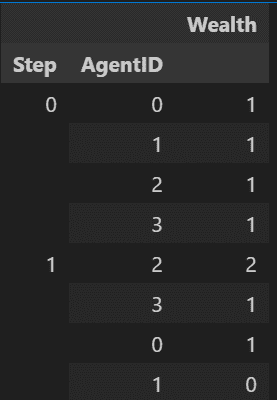

使用`env.datacollector.get_agent_vars_dataframe()`获取监控数据`Dataframe`

第一列固定为模拟的时间步，第二列固定为每个`Agent`的`ID`，后续列为监控的数值

我们用1000个`Agent`运行200个时间步，看看最终的总体财富分布如何：

```python
from tqdm import tqdm
steps = 200

env = WealthModel()
agents = [WealthAgent(i, env) for i in range(1000)]
env.add_agents(agents)

for i in tqdm(range(steps)):
    env.step()
```

可以发现最终财富趋向于两级分化：80%的人持有20%的财富，而20%的人持有80%的财富。

同时我们可以监控基尼系数（衡量财富不平等的统计指标，0为绝对平等，1为绝对不平等）。发现基尼系数迅速达到并稳定在了0.6左右，表示有相当高的贫富差距。

> 可以通过数学证明，最终的财富分布为物理学中的玻尔兹曼分布，试想这是为什么？

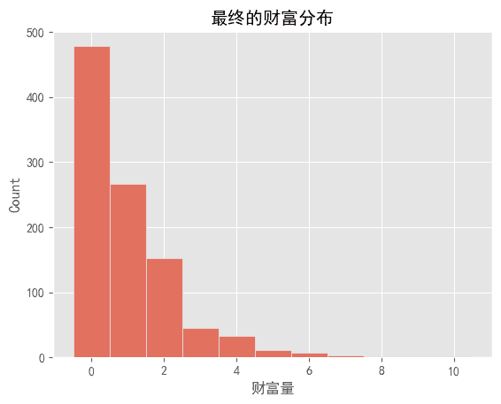

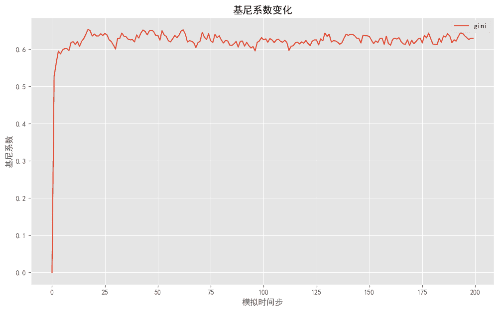

**总结来说构建`ABM`的步骤如下：**

当然，我们还能尝试调整模型/智能体的参数，并观察还会有什么有趣的结果：

+ 富二代模型：现在不是所有智能体生而平等了，有些智能体天生就有更多的财富，倾向于奢侈生活（每次给出2单位资本），但也因为地位而更容易获得资本（一次增加2单位资本）。

通过实验可以发现，当普通智能体初始只有1单位资本的时候，富二代资产迅速下降，主要因为无法从大多数普通智能体获得资本（大多数智能体都不持有2单位资本）

现在我们换成普通智能体一开始持有50元，富二代则是250元，普通智能体初始个数为280，富二代为20，运行5000步：

可以发现现在由于普通智能体都有一定资本了，富二代可以靠吸取底层财富保持自己相对稳定的财富水平，而普通智能体资产很难与他们的财富有交集。当然一些富二代也会因为过度挥霍而沦为普通智能体。

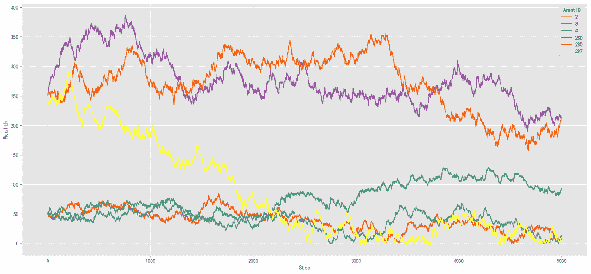

当然你还能尝试其他模型，看看会涌现出什么特性

+ 负债累累模型：现在允许智能体负债，但一旦负债超过100单位，智能体将出局（可以用一个布尔型变量标志智能体是否出局，或是一旦满足条件在环境`step`的时候移除它）。

+ 劫富济贫模型：每10个时间步，最高与最低的智能体财富将会被三七分。

+ 求锦鲤模型：最高财富的智能体将会在每100步中进行一次抽奖，将自身财富10%随机给一个其他智能体，获奖的智能体此后将自身花费增加2单位

是不是感觉很神奇，仅仅一个规则就模拟出了财富分布不均、社会阶层固化等现象。事实上如果参数和交互更加复杂，`ABM`还能更为真实地模拟和解释生活中的其他经济学现象。

[如果对`Mesa`的其他模型](https://github.com/projectmesa/mesa-examples#egg=mesa-models)感兴趣，还可以参考`Mesa` Example做进一步的复现

# 接下来还有更多内容等你来学~

<https://datawhaler.feishu.cn/sync/SrOYdaxlnswqeXbgPGIc4UXNnQe>

> 本教程主要由 写作贡献，

> 融合了多位助教的内测体验和宝贵建议。

> 如果你觉得对你有价值和启发，请在下面点赞和评论哟~

> 如果等不及想提分了，可以查看[Task3：进阶上分方向讨论](https://datawhaler.feishu.cn/wiki/DafPwzGSriBXd7kaMdtcngQlnzc)中的`Baseline2`哦(*╹▽╹*)

### 另外别忘了写笔记打卡呀！！~

### 及时思考、沉淀和产出能让你的学习事半功倍！

>

> **注：本文采用署名—非商业性使用—相同方式共享 4.0 协议国际版许可协议进行许可。**
