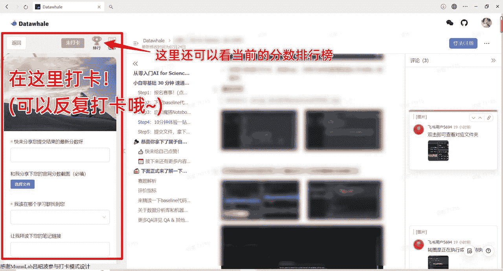

# AI+社会科学 学习手册

> 来源：[https://datawhaler.feishu.cn/docx/XF8EdoFUGoFWRTxlSbccUOypnif](https://datawhaler.feishu.cn/docx/XF8EdoFUGoFWRTxlSbccUOypnif)

# 一、重要链接

**赛事官网**：[**h**](http://competition.sais.com.cn/competitionDetail/532232/format)ttp://competition.sais.com.cn/competitionDetail/532232/format

**教程&****打卡链接**：**https://linklearner**.com/activity/12/2/2（左侧显示栏打卡，电脑端打开链接）

**排行榜（奖学金依据）：**

**学习相关QA汇总文档**：

[ QA & 其他彩蛋](https://datawhaler.feishu.cn/wiki/AOHyw6ftAinHVGkW21OciDoRnwf)

[夏令营优秀笔记](https://exn8g66dnwu.feishu.cn/sheets/M4LFsR8oAhnFKZtGdZHcDJn4ncg?sheet=jBRisf)

# 二、学习规划

| ## 从零入门 AI for Science(AI + 经济)  |  |  |  |
| --- | --- | --- | --- |
| **Task** | **学习任务** | **学习内容** | **学习安排** |
| **Task 1** |  | 1.  赛题分析解读 | 开营直播 |
| **Task 2** |  | 1.  赛题数据探索分析 | baseline精读直播 |
| **Task 3** |  | 进阶上分技巧分享： | 上分思路交流会 |
|  |  |  |  |

> **打怪难度：简单**

> [从零入门AI for Science（AI+经济）](https://datawhaler.feishu.cn/wiki/MkHkwQKEZiylVHkmFu8c17xgnbc)

1.  跑通 **baseline**，拿下第一个分数！

1.  写笔记，完成[**Task1 **](https://linklearner.com/activity/12/2/2)[打卡](https://linklearner.com/activity/12/2/2)

> **打怪难度：⭐️**

> [Task2：时间序列挖掘+ABM构建学习](https://datawhaler.feishu.cn/wiki/VPC6wDI8Si31ZCkKknVcqWftnEf)

1.  精读**baseline和领域背景知识**

1.  写笔记，完成[**Task2 **](https://linklearner.com/activity/12/2/2)[打卡](https://linklearner.com/activity/12/2/2)

> **打怪难度：⭐️⭐️**

> [Task3：进阶上分方向讨论](https://datawhaler.feishu.cn/wiki/DafPwzGSriBXd7kaMdtcngQlnzc)

1.  参与**上分思路交流会**

1.  精读进阶上分技巧

1.  写笔记，完成 [**Task3 **](https://linklearner.com/activity/12/2/2)[打卡](https://linklearner.com/activity/12/2/2)

### 祝大家上分顺利，学习愉快~ 多在群里提问和交流哟！

+   赛事链接：[**第二届世界科学智能大赛 社会科学赛道**](http://competition.sais.com.cn/competitionDetail/532232/format)：市场博弈和价格预测(点击跳转赛事官网)

+   提问前建议先查看** **[ QA & 其他彩蛋](https://datawhaler.feishu.cn/wiki/AOHyw6ftAinHVGkW21OciDoRnwf)** **是否早已解决并收录你的问题~ （QA文档可任意编辑，助教会不定时查看）

+   更多学习活动问题可见：** **[AI+经济学习者手册](https://datawhaler.feishu.cn/wiki/Hlm9wxXQliCxMCky8uvc6a0ynrg)

+   每个任务的教程可直接点击链接跳转

+   每个直播回放也可通过点击直播跳转

每个任务的教程可直接点击链接跳转

每个直播回放也可通过点击直播跳转

# 三、夏令营学习者奖励

<https://datawhaler.feishu.cn/sync/AUzZdGHQ4swaZBbrGQycAfc3nGD>

# 四、常见问题Q&A

## 如何打卡？

+   教程左侧显示栏完成，每个任务打卡表单不一样，排行榜分数取最高分（无效数据会被删除，请仔细核对）。

+   同一个Task任务打卡为覆盖形式，比如填了笔记链接打卡后，再不填笔记链接打卡就会【没有笔记链接】，辛苦大家注意再加一下笔记链接哈

## 如何撰写笔记？

**第一期 第二期优秀笔记合集：**[夏令营优秀笔记](https://exn8g66dnwu.feishu.cn/sheets/M4LFsR8oAhnFKZtGdZHcDJn4ncg?from=from_copylink)

**评选时间**：在7月29日评选第一批笔记，8月1日评选第二批笔记，8月4日评选第三批笔记

第一批笔记提交截止时间是7月28日晚24：00

第二批笔记提交截止时间是7月31日晚24：00

第三批笔记提交截止时间是8月3日晚24：00

**笔记说明：**

本期笔记要求：文章标题带上“Datawhale AI 夏令营”

具体笔记，可按照task来做多份笔记，也可沿用单个笔记持续更新内容

> 学习规则：

1.  打卡规则：

+   官网报名夏令营成功即可参与打卡（官网报名不成功无法参与打卡，只能参与学习），在每个学习任务左侧显示栏打卡

+   在每个任务截止前完成打卡，无补打卡机会

1.  笔记规则：提交公开可查阅的笔记链接，笔记标题带“Datawhale AI夏令营”，不限笔记平台，CSDN、知乎、📕、👸号、掘金等。

1.  **0分笔记情况**：

1.  笔记是AI生成的；

1.  直接提交教程链接；

1.  直接照抄教程内容；

1.  笔记链接错误

1.  笔记直接没有链接，而是一行字

1.  笔记无实质性内容，而是“简单的打卡”

## 如何获得实习证明？

学习者仅能获得实践证明，详见【三、夏令营学习者奖励】

后续参加 **助教/宣传大使/教程共创 **等贡献，表现优秀者可获得实习证明，有兴趣的同学可以咨询负责人