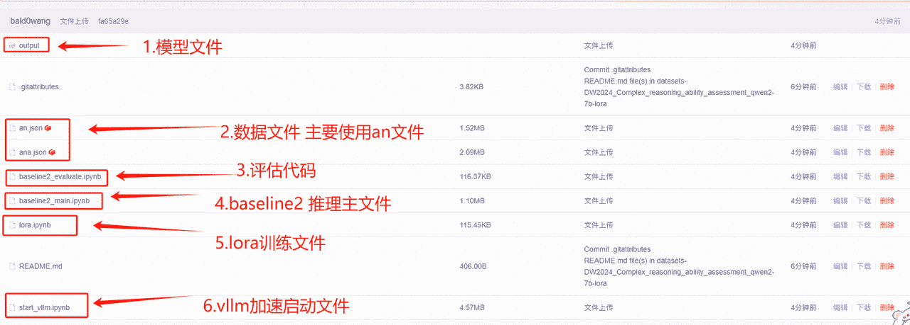
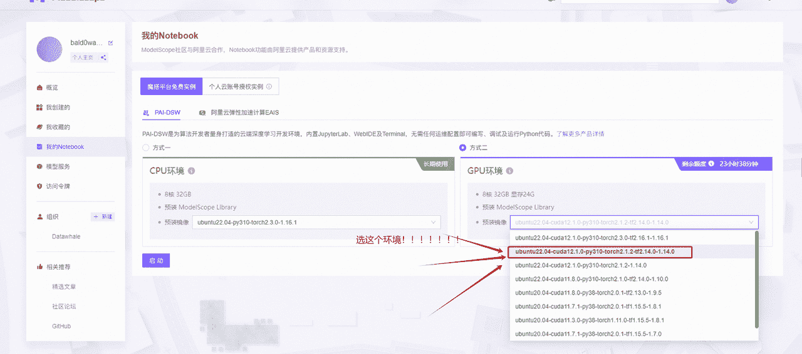
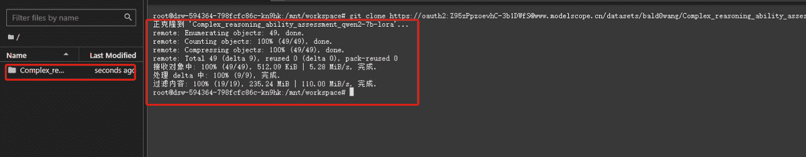
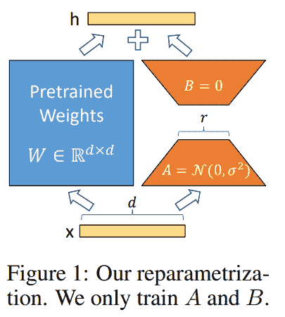
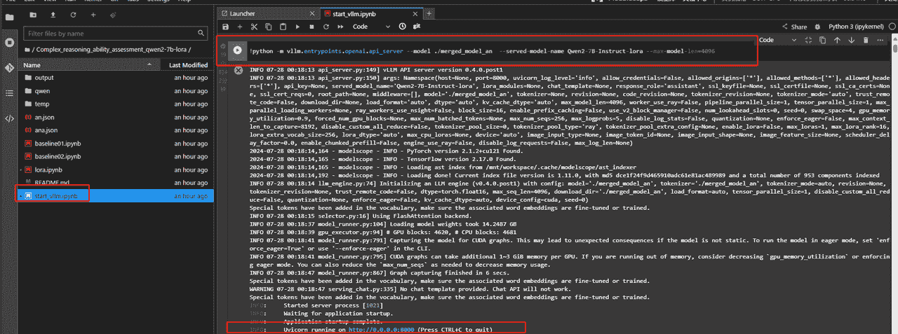

# Task3 baseline02 微调方案

> 来源：[https://datawhaler.feishu.cn/docx/D1egd0M64oOkO8x517fcYWzOndh](https://datawhaler.feishu.cn/docx/D1egd0M64oOkO8x517fcYWzOndh)

> **教程贡献者说：**

> 前面我们介绍了基本的api实现思路。为了满足题目要求，并教会大家LoRA微调的方案，在baseline2里面我们准备了在魔搭notebook的微调的详细教程帮助大家完成微调任务。此外还会教大家使用vllm加速推理，封装成api加速推理。我们还用到了一个提分trick，使用微调的模型进行多路投票，得到更好的结果。

# 微调介绍

## 1.1 大语言模型微调

大模型微调（Fine-tuning）是一种技术，通过在预训练的大型语言模型上使用特定数据集进行进一步训练，使模型能够更好地适应特定任务或领域。

其核心原理在于，机器学习模型只能代表其训练数据的逻辑和理解。对于未见过的数据样本，模型可能无法准确识别或理解。对于大型模型而言，它们虽然能够处理广泛的语言信息并进行流畅的对话，但在特定场景下可能无法提供准确的答案。

例如，一个通用的大型语言模型虽然包含丰富的语言信息，但在医药领域的特定问题上可能表现不佳。如果需要一个能够准确回答患者问题的医药应用，就需要为这个通用模型提供大量新的医药数据进行学习和理解。比如，当患者询问“布洛芬能否与感冒药同时服用？”时，为了确保模型能够给出正确的回答，我们需要对基础模型进行微调。

## 1.2 微调模型对于本次比赛有什么意义

1.  **上下文理解提升**：微调过程中使用的特定数据集可以帮助模型更好地理解特定任务的上下文，从而在推理时能够考虑到更多的相关信息和细节。

1.  **性能优化**：微调可以针对特定任务优化模型的性能，使其在处理该任务时达到更高的准确率和更低的错误率。这对于需要高可靠性和准确性的推理任务尤为重要。

1.  **减少数据需求**：对于一些数据稀缺的领域或任务，微调可以在相对较少的数据量下实现较好的性能提升，因为模型已经具备了大量的通用语言知识。

1.  **适应性增强**：微调使模型能够更好地适应特定用户或场景的需求，提供更加个性化和定制化的推理服务。

# 微调任务介绍

本次教程参考self-llm中Qwen2-7b的微调教程，特别鸣谢self-llm开发者们的大力支持。如果大家需要学习大语言模型如何封装、微调等工作可以来这个项目学习。

本次微调我们的数据使用训练集文件round1_train_data.jsonl，将每个问题中的子问题和答案构建成问答对。例如下方。

```
 {
        &quot;instruction&quot;: &quot;你是一个逻辑推理专家，擅长解决逻辑推理问题。以下是一个逻辑推理的题目，形式为单项选择题。所有的问题都是（close-world assumption）闭世界假设，即未观测事实都为假。请逐步分析问题并在最后一行输出答案，最后一行的格式为\&quot;答案是：A\&quot;。题目如下：\n\n### 题目:\n假设您需要构建一个二叉搜索树，其中每个节点或者是一个空的节点（称为\&quot;空节点\&quot;），或者是一个包含一个整数值和两个子树的节点（称为\&quot;数值节点\&quot;）。以下是构建这棵树的规则：\n\n1. 树中不存在重复的元素。\n2. 对于每个数值节点，其左子树的所有值都小于该节点的值，其右子树的所有值都大于该节点的值。\n3. 插入一个新值到一个\&quot;空节点\&quot;时，该\&quot;空节点\&quot;会被一个包含新值的新的数值节点取代。\n4. 插入一个已存在的数值将不会改变树。\n\n请基于以上规则，回答以下选择题：\n\n### 问题:\n选择题 1：\n给定一个空的二叉搜索树，插入下列数字: [5, 9, 2, 10, 11, 3]，下面哪个选项正确描述了结果树的结构？\nA. tree(5, tree(2, tree(3, nil, nil), nil), tree(9, tree(10, nil, nil), tree(11, nil, nil)))\nB. tree(5, tree(2, nil, tree(3, nil, nil)), tree(9, nil, tree(10, nil, tree(11, nil, nil))))\nC. tree(5, tree(3, tree(2, nil, nil), nil), tree(9, nil, tree(10, tree(11, nil, nil), nil)))\nD. tree(5, nil, tree(2, nil, tree(3, nil, nil)), tree(9, tree(11, nil, nil), tree(10, nil, nil)))\n&quot;,
        &quot;input&quot;: &quot;&quot;,
        &quot;output&quot;: &quot;B&quot;
    },
```

抽取的文件已经准备好啦，大家可以直接使用。


[an.json](https://internal-api-drive-stream.feishu.cn/space/api/box/stream/download/all/Z5L6bA2b5oB5UIxjm4KcahrTnPf)

## 2.1 环境配置

这次我们将需[要的数据、模型文件、代码文件统一放到了【Datawhale](https://www.modelscope.cn/datasets/Datawhale/DW2024_Complex_reasoning_ability_assessment_qwen2-7b-lora)2024年第二届世界科学智能大赛逻辑推理赛道：复杂推理能力评估baseline2】（点击访问）仓库下。



首先进入环境，这次我们选择[PAI-DSW](https://www.modelscope.cn/my/mynotebook/preset)（点击可跳转）的**u**buntu22.04-cuda12.1.0-py310-torch2.1.2-tf2.14.0-1.14.0环境。



## 2.2 数据准备

除了刚才介绍的an文件，这里还通过qwen2-72b模型在train数据集上跑得正确结果并分析的答案，得到了ana.json数据文件。

拿出一条给大家看看。

```
    {
        &quot;instruction&quot;: &quot;你是一个逻辑推理专家，擅长解决逻辑推理问题。以下是一个逻辑推理的题目，形式为单项选择题。所有的问题都是（close-world assumption）闭世界假设，即未观测事实都为假。请逐步分析问题并在最后一行输出答案，最后一行的格式为\&quot;答案是：A\&quot;。题目如下：\n\n### 题目:\n假设您需要构建一个二叉搜索树，其中每个节点或者是一个空的节点（称为\&quot;空节点\&quot;），或者是一个包含一个整数值和两个子树的节点（称为\&quot;数值节点\&quot;）。以下是构建这棵树的规则：\n\n1. 树中不存在重复的元素。\n2. 对于每个数值节点，其左子树的所有值都小于该节点的值，其右子树的所有值都大于该节点的值。\n3. 插入一个新值到一个\&quot;空节点\&quot;时，该\&quot;空节点\&quot;会被一个包含新值的新的数值节点取代。\n4. 插入一个已存在的数值将不会改变树。\n\n请基于以上规则，回答以下选择题：\n\n### 问题:\n选择题 1：\n给定一个空的二叉搜索树，插入下列数字: [5, 9, 2, 10, 11, 3]，下面哪个选项正确描述了结果树的结构？\nA. tree(5, tree(2, tree(3, nil, nil), nil), tree(9, tree(10, nil, nil), tree(11, nil, nil)))\nB. tree(5, tree(2, nil, tree(3, nil, nil)), tree(9, nil, tree(10, nil, tree(11, nil, nil))))\nC. tree(5, tree(3, tree(2, nil, nil), nil), tree(9, nil, tree(10, tree(11, nil, nil), nil)))\nD. tree(5, nil, tree(2, nil, tree(3, nil, nil)), tree(9, tree(11, nil, nil), tree(10, nil, nil)))\n&quot;,
        &quot;input&quot;: &quot;&quot;,
        &quot;output&quot;: &quot;根据题目中的规则，我们依次插入数字 [5, 9, 2, 10, 11, 3] 来构建二叉搜索树。\n\n首先插入数字 5，树为：\n```\ntree(5, nil, nil)\n```\n\n然后插入数字 9，由于 9 &gt; 5，因此插入到右子树：\n```\ntree(5, nil, tree(9, nil, nil))\n```\n\n接下来插入数字 2，由于 2 &lt; 5，因此插入到左子树：\n```\ntree(5, tree(2, nil, nil), tree(9, nil, nil))\n```\n\n再插入数字 10，由于 10 &gt; 5 并且 10 &gt; 9，所以插入到 9 的右子树：\n```\ntree(5, tree(2, nil, nil), tree(9, nil, tree(10, nil, nil)))\n```\n\n继续插入数字 11，由于 11 &gt; 5 并且 11 &gt; 9 和 11 &gt; 10，所以插入到 10 的右子树：\n```\ntree(5, tree(2, nil, nil), tree(9, nil, tree(10, nil, tree(11, nil, nil))))\n```\n\n最后插入数字 3，由于 3 &lt; 5 但是 3 &gt; 2，所以插入到 2 的右子树：\n```\ntree(5, tree(2, nil, tree(3, nil, nil)), tree(9, nil, tree(10, nil, tree(11, nil, nil))))\n```\n\n比较这个最终结果与给定的选项，可以看到选项 B 正确地描述了结果树的结构。\n\n答案是：B&quot;
    },
```


[ana.json](https://internal-api-drive-stream.feishu.cn/space/api/box/stream/download/all/AKvRbKetmozgMbx76dhcQBTYnP9)

接下来我们进入界面。


请大家选择terminal，需要下载一下我们的数据文件。

进入后使用快捷键复制并粘贴下面的命令，按下回车。

```
git clone https://www.modelscope.cn/datasets/Datawhale/DW2024_Complex_reasoning_ability_assessment_qwen2-7b-lora.git
```



跑完后双击到左边的**DW2024_Complex_reasoning_abil****ity_asse**ssment_qwen2-7b-lora文件。

baseline2**启动顺序**

## 2.3 LoRA微调

### LoRA介绍

LoRA（Low-Rank Adaptation）微调是一种高效的模型微调技术，特别适用于大型预训练语言模型的适应性调整。LoRA的核心思想是通过引入低秩矩阵来调整模型的权重，从而在不显著增加模型参数数量的情况下，实现对模型的微调。

#### **LoRA 的优势**

- 可以针对不同的下游任务构建小型 LoRA 模块，从而在共享预训练模型参数基础上有效地切换下游任务。

- LoRA 使用自适应优化器（Adaptive Optimizer），不需要计算梯度或维护大多数参数的优化器状态，训练更有效、硬件门槛更低。

- LoRA 使用简单的线性设计，在部署时将可训练矩阵与冻结权重合并，不存在推理延迟。

- LoRA 与其他方法正交，可以组合。

#### **LoRA 的原理**



- https://github.com/microsoft/LoRA?tab=readme-ov-file

- https://arxiv.org/pdf/2106.09685

- https://huggingface.co/docs/peft/quicktour

### 代码介绍

双击lora.ipynb文件。

安装需要的代码运行环境。（两分钟左右）

```
!pip install modelscope==1.9.5
!pip install &quot;transformers&gt;=4.39.0&quot;
!pip install streamlit==1.24.0
!pip install sentencepiece==0.1.99
!pip install transformers_stream_generator==0.0.4
!pip install datasets==2.18.0
!pip install peft==0.10.0
!pip install openai==1.17.1
!pip install tqdm==4.64.1
!pip install transformers==4.39.3
!python -m pip install setuptools==69.5.1
!pip install vllm==0.4.0.post1
!pip install nest-asyncio
!pip install accelerate
!pip install tf-keras
```

**下载模型文件，这里我们下载魔搭社区的Qw**en2-7B-Instruct模型参数。

```
import torch
from modelscope import snapshot_download, AutoModel, AutoTokenizer
import os
model_dir = snapshot_download(&#x27;qwen/Qwen2-7B-Instruct&#x27;, cache_dir=&#x27;./&#x27;, revision=&#x27;master&#x27;)
```

这一步请重启notebook

**接下来加载需要微调的环境**

```
from datasets import Dataset
import pandas as pd
from transformers import AutoTokenizer, AutoModelForCausalLM, DataCollatorForSeq2Seq, TrainingArguments, Trainer, GenerationConfig
```

**导入文件，这里记得使用an文件**

```
# 将JSON文件转换为CSV文件
df = pd.read_json(&#x27;an.json&#x27;)
ds = Dataset.from_pandas(df)
```

**加载tokenlizer**

```
tokenizer = AutoTokenizer.from_pretrained(&#x27;./qwen/Qwen2-7B-Instruct&#x27;, use_fast=False, trust_remote_code=True)
tokenizer
```

**数据格式化**

Lora 训练的数据是需要经过格式化、编码之后再输入给模型进行训练的，如果是熟悉 Pytorch 模型训练流程的同学会知道，我们一般需要将输入文本编码为 input_ids，将输出文本编码为 labels，编码之后的结果都是多维的向量。我们首先定义一个预处理函数，这个函数用于对每一个样本，编码其输入、输出文本并返回一个编码后的字典：

```
def process_func(example):
    MAX_LENGTH = 1800    # Llama分词器会将一个中文字切分为多个token，因此需要放开一些最大长度，保证数据的完整性
    input_ids, attention_mask, labels = [], [], []
    instruction = tokenizer(f&quot;&lt;|im_start|&gt;system\n你是一个逻辑推理专家，擅长解决逻辑推理问题。&lt;|im_end|&gt;\n&lt;|im_start|&gt;user\n{example[&#x27;instruction&#x27;] + example[&#x27;input&#x27;]}&lt;|im_end|&gt;\n&lt;|im_start|&gt;assistant\n&quot;, add_special_tokens=False)  # add_special_tokens 不在开头加 special_tokens
    response = tokenizer(f&quot;{example[&#x27;output&#x27;]}&quot;, add_special_tokens=False)
    input_ids = instruction[&quot;input_ids&quot;] + response[&quot;input_ids&quot;] + [tokenizer.pad_token_id]
    attention_mask = instruction[&quot;attention_mask&quot;] + response[&quot;attention_mask&quot;] + [1]  # 因为eos token咱们也是要关注的所以 补充为1
    labels = [-100] * len(instruction[&quot;input_ids&quot;]) + response[&quot;input_ids&quot;] + [tokenizer.pad_token_id]  
    if len(input_ids) &gt; MAX_LENGTH:  # 做一个截断
        input_ids = input_ids[:MAX_LENGTH]
        attention_mask = attention_mask[:MAX_LENGTH]
        labels = labels[:MAX_LENGTH]
    return {
        &quot;input_ids&quot;: input_ids,
        &quot;attention_mask&quot;: attention_mask,
        &quot;labels&quot;: labels
    }
```

**调用****process_func****函数处理数据，并进行****decode****数据检查**

```
tokenized_id = ds.map(process_func, remove_columns=ds.column_names)
tokenized_id

tokenizer.decode(tokenized_id[0][&#x27;input_ids&#x27;])


tokenizer.decode(list(filter(lambda x: x != -100, tokenized_id[1][&quot;labels&quot;])))

```

**打印模型结构**

```
import torch

model = AutoModelForCausalLM.from_pretrained(&#x27;./qwen/Qwen2-7B-Instruct&#x27;, device_map=&quot;auto&quot;,torch_dtype=torch.bfloat16)
model
```

**定义LoraConfig**

LoraConfig这个类中可以设置很多参数，但主要的参数没多少，简单讲一讲，感兴趣的同学可以直接看源码。

+   task_type：模型类型

+   target_modules：需要训练的模型层的名字，主要就是attention部分的层，不同的模型对应的层的名字不同，可以传入数组，也可以字符串，也可以正则表达式。

+   r：lora的秩，具体可以看Lora原理

+   lora_alpha：Lora alaph，具体作用参见 Lora 原理

Lora的缩放是啥嘞？当然不是r（秩），这个缩放就是lora_alpha/r, 在这个LoraConfig中缩放就是4倍。

```
from peft import LoraConfig, TaskType, get_peft_model

config = LoraConfig(
    task_type=TaskType.CAUSAL_LM, 
    target_modules=[&quot;q_proj&quot;, &quot;k_proj&quot;, &quot;v_proj&quot;, &quot;o_proj&quot;, &quot;gate_proj&quot;, &quot;up_proj&quot;, &quot;down_proj&quot;],
    inference_mode=False, # 训练模式
    r=8, # Lora 秩
    lora_alpha=32, # Lora alaph，具体作用参见 Lora 原理
    lora_dropout=0.1# Dropout 比例
)
config
```

**创建PeftModel**

使用 get_peft_model() 函数创建一个 PeftModel。

它需要一个基本模型（您可以从 Transformers 库加载）和 LoraConfig，其中包含如何配置模型以使用 LoRA 进行训练的参数。

```
model = get_peft_model(model, config)
config
```

```
model.print_trainable_parameters()
```

自定义 TrainingArguments 参数

TrainingArguments这个类的源码也介绍了每个参数的具体作用，当然大家可以来自行探索，这里就简单说几个常用的。

+   output_dir：模型的输出路径

+   per_device_train_batch_size：顾名思义 batch_size

+   gradient_accumulation_steps: 梯度累加，如果你的显存比较小，那可以把 batch_size 设置小一点，梯度累加增大一些。

+   logging_steps：多少步，输出一次log

+   num_train_epochs：顾名思义 epoch

+   gradient_checkpointing：梯度检查，这个一旦开启，模型就必须执行model.enable_input_require_grads()，这个原理大家可以自行探索

```
args = TrainingArguments(
    output_dir=&quot;./output/Qwen2_instruct_lora&quot;,
    per_device_train_batch_size=1,
    gradient_accumulation_steps=4,
    logging_steps=10,
    num_train_epochs=1,
    save_steps=100, 
    learning_rate=1e-4,
    save_on_each_node=True,
    gradient_checkpointing=True
)
```

**模型训练 **

预计10min就能跑完。

```
trainer = Trainer(
    model=model,
    args=args,
    train_dataset=tokenized_id,
    data_collator=DataCollatorForSeq2Seq(tokenizer=tokenizer, padding=True),
)
```

```
torch.backends.cuda.enable_mem_efficient_sdp(False)
```

```
trainer.train()
```

## 2.4 微调模型测试

通过模型调用生成测试结果，大家可以修改lora_path 看看不同的答案。

```
from transformers import AutoModelForCausalLM, AutoTokenizer
import torch
from peft import PeftModel

mode_path = &#x27;./qwen/Qwen2-7B-Instruct/&#x27;
lora_path = &#x27;./output/Qwen2_instruct_lora_an/checkpoint-100&#x27; # 这里改称你的 lora 输出对应 checkpoint 地址

# 加载tokenizer
tokenizer = AutoTokenizer.from_pretrained(mode_path, trust_remote_code=True)

# 加载模型
model = AutoModelForCausalLM.from_pretrained(mode_path, device_map=&quot;auto&quot;,torch_dtype=torch.float16, trust_remote_code=True).eval()

# 加载lora权重
model = PeftModel.from_pretrained(model, model_id=lora_path)

prompt = &#x27;&#x27;&#x27;你是一个逻辑推理专家，擅长解决逻辑推理问题。以下是一个逻辑推理的题目，形式为单项选择题。所有的问题都是（close-world assumption）闭世界假设，即未观测事实都为假。请逐步分析问题并在最后一行输出答案，最后一行的格式为&quot;答案是：A&quot;。题目如下：\n\n### 题目:\n假设您需要构建一个二叉搜索树，其中每个节点或者是一个空的节点（称为&quot;空节点&quot;），或者是一个包含一个整数值和两个子树的节点（称为&quot;数值节点&quot;）。以下是构建这棵树的规则：\n\n1. 树中不存在重复的元素。\n2. 对于每个数值节点，其左子树的所有值都小于该节点的值，其右子树的所有值都大于该节点的值。\n3. 插入一个新值到一个&quot;空节点&quot;时，该&quot;空节点&quot;会被一个包含新值的新的数值节点取代。\n4. 插入一个已存在的数值将不会改变树。\n\n请基于以上规则，回答以下选择题：\n\n### 问题:\n选择题 1：\n给定一个空的二叉搜索树，插入下列数字: [5, 9, 2, 10, 11, 3]，下面哪个选项正确描述了结果树的结构？\nA. tree(5, tree(2, tree(3, nil, nil), nil), tree(9, tree(10, nil, nil), tree(11, nil, nil)))\nB. tree(5, tree(2, nil, tree(3, nil, nil)), tree(9, nil, tree(10, nil, tree(11, nil, nil))))\nC. tree(5, tree(3, tree(2, nil, nil), nil), tree(9, nil, tree(10, tree(11, nil, nil), nil)))\nD. tree(5, nil, tree(2, nil, tree(3, nil, nil)), tree(9, tree(11, nil, nil), tree(10, nil, nil)))&#x27;&#x27;&#x27;
inputs = tokenizer.apply_chat_template([{&quot;role&quot;: &quot;user&quot;, &quot;content&quot;: &quot;你是一个逻辑推理专家，擅长解决逻辑推理问题。&quot;},{&quot;role&quot;: &quot;user&quot;, &quot;content&quot;: prompt}],
                                       add_generation_prompt=True,
                                       tokenize=True,
                                       return_tensors=&quot;pt&quot;,
                                       return_dict=True
                                       ).to(&#x27;cuda&#x27;)


gen_kwargs = {&quot;max_length&quot;: 2500, &quot;do_sample&quot;: True, &quot;top_k&quot;: 1}
with torch.no_grad():
    outputs = model.generate(**inputs, **gen_kwargs)
    outputs = outputs[:, inputs[&#x27;input_ids&#x27;].shape[1]:]
    print(tokenizer.decode(outputs[0], skip_special_tokens=True))
```

## 2.5 模型合并存储

这里将lora微调后的模型融入到原模型中。

```
# 模型合并存储

new_model_directory = &quot;./merged_model_an&quot;
merged_model = model.merge_and_unload()
# 将权重保存为safetensors格式的权重, 且每个权重文件最大不超过2GB(2048MB)
merged_model.save_pretrained(new_model_directory, max_shard_size=&quot;2048MB&quot;, safe_serialization=True)
```

```
!cp ./qwen/Qwen2-7B-Instruct/tokenizer.json ./merged_model_an/
```

切记这里需要重启notebook释放显存，否则影响vllm启动。

# vllm加速

## 3.1 vllm介绍

vLLM（Virtual Large Language Model）是一个由伯克利大学LMSYS组织开源的大规模语言模型高速推理框架。它的设计目标是在实时应用场景中大幅提升语言模型服务的吞吐量和内存使用效率。vLLM的特点包括易于使用、与Hugging Face等流行工具无缝集成以及高效的性能。

## 3.2 vllm服务启动

接下来请打开start_vllm.ipynb，执行后我们通过vllm的类openai接口成功将微调后的模型部署到8000端口。



## 3.3 vllm api调用

我们改写了baseline中的call_qwen_api代码，该文调用本地类openai的qwen微调模型接口。

```
def call_qwen_api(MODEL_NAME, query):
    # 这里采用dashscope的api调用模型推理，通过http传输的json封装返回结果
    
    client = OpenAI(
        base_url=&quot;http://localhost:8000/v1&quot;,
        api_key=&quot;sk-xxx&quot;, # 随便填写，只是为了通过接口参数校验
    )
    completion = client.chat.completions.create(
      model=MODEL_NAME,
      messages=[
                # {&#x27;role&#x27;:&#x27;system&#x27;,&#x27;content&#x27;:&#x27;你是一个解决推理任务的专家，你需要分析出问题中的每个实体以及响应关系。然后根据问题一步步推理出结果。并且给出正确的结论。&#x27;},

        {&quot;role&quot;: &quot;user&quot;, &quot;content&quot;: query}
      ]
    )
    return completion.choices[0].message.content
```

# 多路LLM投票

## 4.1 思路介绍

所谓的“多路召回策略”就是指采用不同的策略、特征或者简单模型，分别召回一部分候选集，然后再把这些候选集混合在一起后供后续排序模型使用的策略。

## 4.2 实现原理

### 设计投票函数：

通过三次结果推理，将选择答案最多的结果作为最终结果：

```
def most_frequent_char(char1, char2, char3):
    # 创建一个字典来存储每个字符的出现次数
    frequency = {char1: 0, char2: 0, char3: 0}
    
    # 增加每个字符的出现次数
    frequency[char1] += 1
    frequency[char2] += 1
    frequency[char3] += 1
    
    # 找到出现次数最多的字符
    most_frequent = max(frequency, key=frequency.get)
    
    return most_frequent

```

### 设计多路LLM：

改写process函数，三次调用llm，做出现次数统计，最终返回投票数最多的结果。

```
def process_datas(datas,MODEL_NAME):
    results = []

    # 送入多线程任务
    for data in tqdm(datas, desc=&quot;Submitting tasks&quot;, total=len(datas)):
        problem = data[&#x27;problem&#x27;]
        for id,question in enumerate(data[&#x27;questions&#x27;]):
            prompt = get_prompt(problem, 
                                question[&#x27;question&#x27;], 
                                question[&#x27;options&#x27;],
                                    )
            # 统一使用llm 三次调用
            res,res1,res2 = api_retry(MODEL_NAME, prompt),api_retry(MODEL_NAME, prompt),api_retry(MODEL_NAME, prompt)
            # 统一做结果抽取
            extract_response,extract_response1,extract_response2 = extract(res),extract(res1),extract(res2)
            # 通过投票函数获取最终结果并返回
            ans = most_frequent_char(extract_response,extract_response1,extract_response2)
            data[&#x27;questions&#x27;][id][&#x27;answer&#x27;] = ans
            results.append(data) 
    return results
```

整体推理代码就是baseline2_main.ipynb。当微调结束后，启动vllm后(启动strat_vllm.ipynb放在后台不要动)，运行baseline2_main.ipynb就可以可以推理完成后直接返回最终结果。大家提交'upload.jsonl'文件即可。

# 总结

这一个task我们学习了如何使用LoRA微调，并且使用vllm加速。这里和大家同步一下微调后模型的性能。

原模型为Qwen2-7B-Instruct模型

LoRA_an为使用an数据集对Qwen2-7B-Instruct  lora微调后的模型

LoRA_an_投票为使用an数据集对Qwen2-7B-Instruct  lora微调后再进行多路投票的模型

当然我们目前没有调整prompt等上分思路，其实还有很大上分空间。通过本节的学习，大家已经掌握了很多关于大模型解决推理任务的技巧和能力，目前的baseline给大家留下许多可以改进和升级的地方，看到这儿你是不是有很多奇思妙想等待实现呢？这里作者也推荐大家组队完成后续的比赛，推理任务是一个综合性很强的任务，而且本次比赛有一定的限制和难度。

当微调结束后，大家不要着急做别的任务，不妨试试baseline2_evaluate.ipynb文件在train上测试一下效果。（当然我们的微调数据就是train，在用这套做验证也有一些自欺欺人。）不过大语言模型是概率模型，也可以做一个简单的参考解决提交次数。

# 作业

请自行尝试微调，以ana.json为微调模型提交结果。可能在运行 baseline2_main.ipynb时会出现一些小问题，相信聪明的你可以很快解决。想想这两种数据微调的区别在哪？后面还可以怎么优化？

# 继续迎接接下来的挑战吧！

<https://datawhaler.feishu.cn/sync/KI9PdPe6lsZXWsbMjiXcMBeOn7g>

> 本教程主要由   写作贡献，

> 融合了多位助教的内测体验和宝贵建议。

> 如果你觉得对你有价值和启发，请在下面点赞和评论哟~

>

### 另外别忘了写笔记打卡呀！！~

### 及时思考、沉淀和产出能让你的学习事半功倍！

>

> **注：本文采用 ****署名—非商业性使用**—相同方式共享 4.0 协议国际版许可协议进行许可。