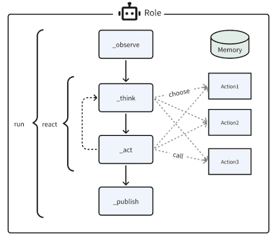
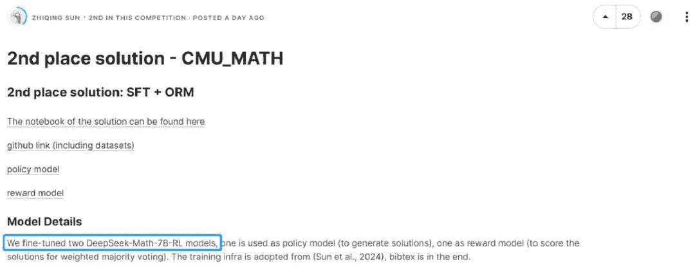
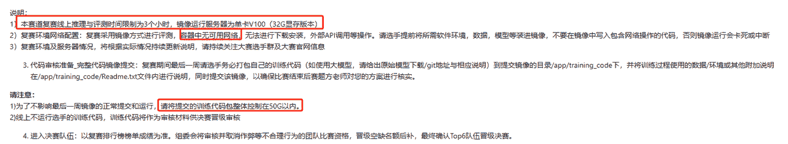

# Task4 上分加油站

> 来源：`https://datawhaler.feishu.cn/docx/D4vud9Pl2oGmaCxh9xJc3jvVnXe`

> **教程贡献者说：**

> 前面我们介绍了实现推理任务的基础思路`baseline1`和微调思路`baseline2`。能走到这一步大家已经很不容易啦。先给自己点个赞！到这里都是厉害宝宝！不过对于这个比赛来说，看到这可能才刚开始。这一节主要是为了辅助大家上分，简单介绍了提分思路、`agent`设计案例、`Docker`相关资料、赛题一些限制和模型选择、数据集扩充这样的思路。从现在开始，有很多东西需要大家开始自发学习与实践！

>

> 好！废话不多说我们冲起来！

# 提分思路

本次任务主要采用大语言模型解决推理任务，如何使用大语言模型实现top方案呢？

一是训练＆微调模型提升解决逻辑推理问题的能力。

二是使用各种`prompt`工程、`agent`系统方案，达到模型解决逻辑推理问题的能力边界。

我们从这两个方面向大家介绍如何提分，有哪些方案可以选择，可以参考哪些资料。

## 1.1 模型训练＆微调

相信大家在`task03`中已经尝试了`baseline2`，这里面介绍了如何实现微调。并且大家在微调后模型的推理速度也有一定的提升。那么除了`baseline2`中讲的`lora`微调，大家还有哪些可以在微调中可做的工作呢？

+ 大家可以通过`prompt`调整进行最简单的入手。

+ 除了`lora`其实还有很多微调的方案，我们可以都试试看。

`lora`相关微调的方案一览：

`https://blog.csdn.net/deephub/article/details/136735670`

那么我们上节用到了`pfet`库，也介绍了很多微调的方法~

`https://huggingface.co/docs/peft/conceptual_guides/adapter`

当然大家可以试试全量微调。

+ 微调思路改进。除了我们直接使用答案作为微调数据，还有哪些呢？比如你可以使用大模型的推理思路吗？你可以使用推理方向吗？这些都值得大家思考。

+ 微调数据够了吗？我们所有的问题总共有1321个，这些数据大家觉得够吗？如果不够是不是可以再加点？

## 1.2 prompt & agent

### prompt优化思路

说到`prompt`我知道有很多同学已经有了自己的尝试，而且取得了一定的进展。那么`prompt`还有哪些值得思考的地方呢？我们datawhale有推出了一份学习`prompt`以及相关内容的课程。大家可以快速补充`prompt`相关的知识~

我这里也有一份珍藏的资料~分享给大家哈哈。

`https://www.promptingguide.ai/zh`

大家还是有点懵怎么办？我这里有个试验给大家抛砖引玉~你可以根据提示和评分，大概知道哪些`prompt`对我们的任务有用，哪些会带来负面影响。试试看~

`https://www.promptingguide.ai/zh/applications/workplace_casestudy`

### agent如何优化

#### agent是什么？

我们把`Agent`想象成环境中的数字人，其中

`Agent = 大语言模型（LLM）` + 观察 + 思考 + 行动 + 记忆

这个公式概括了智能体的功能本质。为了理解每个组成部分，让我们将其与人类进行类比：

1. `大语言模型（LLM）`：`LLM`作为智能体的“大脑”部分，使其能够处理信息，从交互中学习，做出决策并执行行动。

1. `观察`：这是智能体的感知机制，使其能够感知其环境。智能体可能会接收来自另一个智能体的文本消息、来自监视摄像头的视觉数据或来自客户服务录音的音频等一系列信号。这些观察构成了所有后续行动的基础。

1. `思考`：思考过程涉及分析观察结果和记忆内容并考虑可能的行动。这是智能体内部的决策过程，其可能由`LLM`进行驱动。

1. `行动`：这些是智能体对其思考和观察的显式响应。行动可以是利用 `LLM` 生成代码，或是手动预定义的操作，如阅读本地文件。此外，智能体还可以执行使用工具的操作，包括在互联网上搜索天气，使用计算器进行数学计算等。

1. `记忆`：智能体的记忆存储过去的经验。这对学习至关重要，因为它允许智能体参考先前的结果并据此调整未来的行动。

例如在`MetaGPT`中定义的一个`agent`运行示例如下：



+ 一个`agent`在启动后他会观察自己能获取到的信息，加入自己的记忆中

+ 下一步进行思考，决定下一步的行动，也就是从`Action1`、`Action2`、`Action3`中选择执行的`Action`

+ 决定行动后，紧接着就执行对应行动，得到这个环节的结果

比如在`MetaGPT`内 `Role` 类是智能体的逻辑抽象。一个 `Role` 能执行特定的 `Action`，拥有记忆、思考并采用各种策略行动。基本上，它充当一个将所有这些组件联系在一起的凝聚实体。

#### 学习agent

这里我们和`MetaGPT`项目共创了学习教程，大家可以来快速上手试试。

#### 推理agent如何设计

设计思路1：

使用`baseline2`的多次召回方案，使用多个`agent`回答问题，但是需要`agent`给出回答理由，你需要再设计一个`agent`对结果打分后得到最高分。

思路来源：

全球首届人工智能数学奥林匹克竞赛（AIMO）`deepseek`介绍

🥈第**二名：**



> 我们微调了两个 `DeepSeek-Math-7B-RL` 模型，一个用作策略模型（生成答案），另一个作为奖励模型，对回答进行评分以调整答案的顺序。

设计思路2：

你可以只做一个可以接入应用`tool`的`agent`，在处理计算类问题时直接使用计算机给出结果。同时接入`rag`，当遇到每个问题时在题库中匹配相应问题做回答参考。

> 悄悄说一句，数学类大模型的比赛多看看，和推理思路很像。

# agent设计思路以判别器agent设计思路为例

## 2.1 agent设计思路

`agent1_分析器`：对题目进行分析，给出可能的结果。

`agent2_评分器`：对答案的合理性排序，最后给出可能性最大的答案。

## 2.2 agent prompt参考

`agent1_分析器`：

```
你是一个逻辑推理专家，擅长解决逻辑推理问题。以下是一个逻辑推理的题目，形式为单项选择题。所有的问题都是（close-world assumption）闭世界假设，即未观测事实都为假。请根据问题给出5步以内的思考思路。并给出可能的结果：

### 题目:
以下是一个关于温度转换的问题，其中有一个函数用来将摄氏温度转换成华氏温度，并评估该温度是&quot;太高&quot;、&quot;高&quot;、&quot;寒冷&quot;还是&quot;宜人&quot;。

该函数的工作原理如下：
- 把摄氏度（C）乘以9/5，然后加上32，得到华氏度（F）。
- 然后根据华氏度的数值评估温度状态：
  - 如果华氏度大于150，则输出&quot;温度太高&quot;。
  - 如果华氏度介于90到150之间，则输出&quot;温度高&quot;。
  - 如果华氏度低于30，则输出&quot;温度寒冷&quot;。
  - 否则输出&quot;温度宜人&quot;。

根据以上信息回答以下选择题：

### 问题:
选择题 1：
当摄氏度为5度时，对应的华氏度是多少？
A. 23.0
B. 36.0
C. 41.0
D. 54.0
```

agent1结果

```
### 思考思路：

1. **理解转换公式**：摄氏度（C）转换成华氏度（F）的公式是 \( F = C \times \frac{9}{5} + 32 \)。
2. **代入具体数值**：将摄氏度 \( C = 5 \) 代入公式中。
3. **计算**：计算 \( 5 \times \frac{9}{5} + 32 \)。
4. **简化计算**：首先计算 \( 5 \times \frac{9}{5} = 9 \)，然后加上32，得到 \( 9 + 32 = 41 \)。
5. **选择正确答案**：根据计算结果，选择正确的选项。

### 可能的结果：
根据以上计算，当摄氏度为5度时，对应的华氏度是41.0。因此，正确答案是C。
```

`agent2_评分器`：

```
你是一个逻辑推理专家，擅长解决逻辑推理问题。以下是一个逻辑推理的题目，形式为单项选择题。所有的问题都是（close-world assumption）闭世界假设，即未观测事实都为假。根据思考思路，将每个答案带入问题，你可以参考参考结果，如果觉得不正确可以更正结果，给出最可能的答案，最后一行的格式为&quot;答案是：A&quot;。

### 题目:
以下是一个关于温度转换的问题，其中有一个函数用来将摄氏温度转换成华氏温度，并评估该温度是&quot;太高&quot;、&quot;高&quot;、&quot;寒冷&quot;还是&quot;宜人&quot;。

该函数的工作原理如下：
- 把摄氏度（C）乘以9/5，然后加上32，得到华氏度（F）。
- 然后根据华氏度的数值评估温度状态：
  - 如果华氏度大于150，则输出&quot;温度太高&quot;。
  - 如果华氏度介于90到150之间，则输出&quot;温度高&quot;。
  - 如果华氏度低于30，则输出&quot;温度寒冷&quot;。
  - 否则输出&quot;温度宜人&quot;。

根据以上信息回答以下选择题：

### 问题:
选择题 1：
当摄氏度为5度时，对应的华氏度是多少？
A. 23.0
B. 36.0
C. 41.0
D. 54.0

### 思考思路：

1. **理解转换公式**：摄氏度（C）转换成华氏度（F）的公式是 \( F = C \times \frac{9}{5} + 32 \)。
2. **代入具体数值**：将摄氏度 \( C = 5 \) 代入公式中。
3. **计算**：计算 \( 5 \times \frac{9}{5} + 32 \)。
4. **简化计算**：首先计算 \( 5 \times \frac{9}{5} = 9 \)，然后加上32，得到 \( 9 + 32 = 41 \)。
5. **选择正确答案**：根据计算结果，选择正确的选项。

### 可能的结果：
根据以上计算，当摄氏度为5度时，对应的华氏度是41.0。因此，正确答案是C。
```

agent2结果：

```
答案是：C
```

## 2.3 如何让agent速度更快

你需要使用更强大的大模型做好训练数据，以`train`的数据集作为输入样例（切记不要用`test`数据，因为`test`训练后作为微调数据送入是犯规行为，会被立即取消成绩！）

得到第一个`agent`结果后封装送入第二个`agent`在生成，最后将两套数据准备好。按照`baseline2`的流程进行训练。最后在设备上先后调用两个`agent`的到结果。如果不进行训练，可能最后提交任务无法在3小时内完成，复赛提交便会失败。

这里只是抛砖引玉的一个`agent`设计思路，其实最好的方案莫过于微调与`agent`结合。

当你需要更多干货时请看看下面的论文集：

# Docker 存储与部署

大家可以以下面的`docker`教程安装`docker`环境并学习如何打包（请提前学习！）：

# 赛题限制与模型选择方案

核心限制有三部分：



## 4.1 提交`docker`内存限制50G

50G以内一般的模型限制在20b之内，例如书生·浦语2-20B，模型文件为40G。`Qwen1.5-14b`，模型文件为30G。

所以我们推荐模型使用20b以下。

## 4.2 推理与评测时间限制为3个小时，镜像运行服务器为单卡`V100`（32G显存版本）

这里需要在32G内显存可以运行的模型，例如书生·浦语2-20B需要40G内存，如果跑通需要量化。但是还要满足在3小时内跑通。

## 4.3 容器中无可用网络

本次运行无法使用`api`，`baseline1`大家测试出一定分数后大家可以通过`baseline2`提交。

## 4.4 开源大模型榜单

# 数据集扩充思路

## 5.1 数据集子问题扩充

参考训练集500条中的每个问题背景，在提出的子问题之外再生成一些问题。

Prompt：

```
你是一个逻辑推理问题出题专家，以下json是一个problem，对应一些子问题。除了这些子问题外再生成三个其他子问题，保持格式一致并给出参考答案。

{&quot;problem&quot;: &quot;在下列人物中，有两名男性：Henry和Tom。据了解，Tom已结婚。以下问题基于这些信息：&quot;, &quot;questions&quot;: [{&quot;question&quot;: &quot;选择题 1：\n以下哪位是单身汉？&quot;, &quot;options&quot;: [&quot;Henry&quot;, &quot;Tom&quot;, &quot;都不是&quot;, &quot;都是&quot;], &quot;answer&quot;: &quot;A&quot;}, {&quot;question&quot;: &quot;选择题 2：\nHenry是否是单身汉？&quot;, &quot;options&quot;: [&quot;是&quot;, &quot;否&quot;], &quot;answer&quot;: &quot;A&quot;}, {&quot;question&quot;: &quot;选择题 3：\nTom是否是单身汉？&quot;, &quot;options&quot;: [&quot;是&quot;, &quot;否&quot;], &quot;answer&quot;: &quot;B&quot;}], &quot;id&quot;: &quot;round1_train_data_019&quot;}
```

deepseek回答：

```
{
  &quot;problem&quot;: &quot;在下列人物中，有两名男性：Henry和Tom。据了解，Tom已结婚。以下问题基于这些信息：&quot;,
  &quot;questions&quot;: [
    {&quot;question&quot;: &quot;选择题 1：\n以下哪位是单身汉？&quot;, &quot;options&quot;: [&quot;Henry&quot;, &quot;Tom&quot;, &quot;都不是&quot;, &quot;都是&quot;], &quot;answer&quot;: &quot;A&quot;},
    {&quot;question&quot;: &quot;选择题 2：\nHenry是否是单身汉？&quot;, &quot;options&quot;: [&quot;是&quot;, &quot;否&quot;], &quot;answer&quot;: &quot;A&quot;},
    {&quot;question&quot;: &quot;选择题 3：\nTom是否是单身汉？&quot;, &quot;options&quot;: [&quot;是&quot;, &quot;否&quot;], &quot;answer&quot;: &quot;B&quot;},
    {&quot;question&quot;: &quot;选择题 4：\n以下哪位已婚？&quot;, &quot;options&quot;: [&quot;Henry&quot;, &quot;Tom&quot;, &quot;都不是&quot;, &quot;都是&quot;], &quot;answer&quot;: &quot;B&quot;},
    {&quot;question&quot;: &quot;选择题 5：\nHenry是否已婚？&quot;, &quot;options&quot;: [&quot;是&quot;, &quot;否&quot;], &quot;answer&quot;: &quot;B&quot;},
    {&quot;question&quot;: &quot;选择题 6：\nTom是否已婚？&quot;, &quot;options&quot;: [&quot;是&quot;, &quot;否&quot;], &quot;answer&quot;: &quot;A&quot;}
  ],
  &quot;id&quot;: &quot;round1_train_data_019&quot;
}
```

## 5.2 数据集问题扩充

参考训练集500条中的每个问题，再生成类似的`problem`，`question`。

Prompt：


你是一个逻辑推理问题出题专家，参考下方json再生成类似的json问题，也需要有一个`problem`，问题列表及正确答案，保持格式一致并给出参考答案。

### 参考json

```
{&quot;problem&quot;: &quot;在下列人物中，有两名男性：Henry和Tom。据了解，Tom已结婚。以下问题基于这些信息：&quot;, &quot;questions&quot;: [{&quot;question&quot;: &quot;选择题 1：\n以下哪位是单身汉？&quot;, &quot;options&quot;: [&quot;Henry&quot;, &quot;Tom&quot;, &quot;都不是&quot;, &quot;都是&quot;], &quot;answer&quot;: &quot;A&quot;}, {&quot;question&quot;: &quot;选择题 2：\nHenry是否是单身汉？&quot;, &quot;options&quot;: [&quot;是&quot;, &quot;否&quot;], &quot;answer&quot;: &quot;A&quot;}, {&quot;question&quot;: &quot;选择题 3：\nTom是否是单身汉？&quot;, &quot;options&quot;: [&quot;是&quot;, &quot;否&quot;], &quot;answer&quot;: &quot;B&quot;}], &quot;id&quot;: &quot;round1_train_data_019&quot;}
```

deepseek 回答：

```
{
  &quot;problem&quot;: &quot;在下列人物中，有三名女性：Alice、Bob和Charlie。据了解，Alice和Charlie是姐妹，Bob是她们的表亲。以下问题基于这些信息：&quot;,
  &quot;questions&quot;: [
    {&quot;question&quot;: &quot;选择题 1：\n以下哪位是Alice的姐妹？&quot;, &quot;options&quot;: [&quot;Bob&quot;, &quot;Charlie&quot;, &quot;都不是&quot;, &quot;都是&quot;], &quot;answer&quot;: &quot;B&quot;},
    {&quot;question&quot;: &quot;选择题 2：\nCharlie是否是Alice的姐妹？&quot;, &quot;options&quot;: [&quot;是&quot;, &quot;否&quot;], &quot;answer&quot;: &quot;A&quot;},
    {&quot;question&quot;: &quot;选择题 3：\nBob是否是Alice的姐妹？&quot;, &quot;options&quot;: [&quot;是&quot;, &quot;否&quot;], &quot;answer&quot;: &quot;B&quot;}
  ],
  &quot;id&quot;: &quot;round1_train_data_020&quot;
}
```

你可以通过上面两种扩充思路构建更大的数据集，除此之外你可以找找其他数据库中如果有类似的逻辑推理问题，通过大模型对数据集进行扩充。

> 悄悄说一句，这里的数据构建完不光能微调用，可以作为RAG放到prompt用。

# ❀ 恭喜看完全部知识教程！

<https://datawhaler.feishu.cn/sync/TdhvdKG8psUuznbIsOzcJsSon56>

## 🎉 合影留念墙

感谢很棒的你一路的坚持，让我们在这里给自己点个赞！

期待下期夏令营还能与你再次相遇~

一起合个影 :)

# 欢迎随时回顾我们这次的学习内容~

<https://datawhaler.feishu.cn/sync/KI9PdPe6lsZXWsbMjiXcMBeOn7g>

> 本教程主要由   写作贡献，

> 融合了多位助教的内测体验和宝贵建议。

> 如果你觉得对你有价值和启发，请在下面点赞和评论哟~

## 另外别忘了写笔记打卡呀！！~

## 及时思考、沉淀和产出能让你的学习事半功倍！

> 注：本文采用 署名—非商业性使用—相同方式共享 4.0 协议国际版许可协议进行许可。
