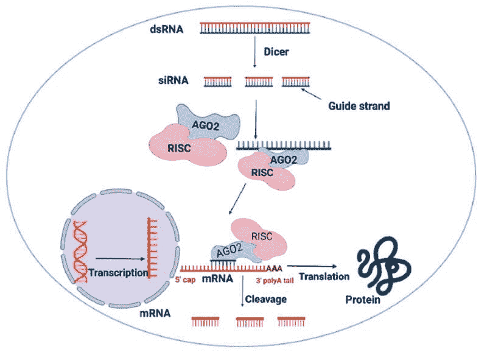

# Task1：赛题解析&背景入门

> 来源：[https://datawhaler.feishu.cn/docx/Kyjyd1Xv5oRxy2xc3f4cpQvWnLc](https://datawhaler.feishu.cn/docx/Kyjyd1Xv5oRxy2xc3f4cpQvWnLc)

> **教程贡献者说：**

> 近年来，mRNA疫苗在新冠预防领域取得巨大成功，推动了核酸类药物的研发。本次比赛旨在利用机器学习与深度学习相关技术，通过化学修饰后的siRNA序列预测RNA干扰（RNAi）机制下对靶基因的沉默效率。RNAi是一种通过抑制靶基因表达来调控基因表达的天然机制，在基因治疗和疾病治疗中具有广泛应用。本次比赛的数据集包括公开文献中的siRNA修饰序列及实验条件数据，初赛阶段提供约85%用于训练，15%用于验证。复赛将增加未公开专利数据，评估模型在新靶基因上的预测能力。本次比赛提供的baseline代码涵盖了数据处理、词汇表构建、序列编码和RNN模型训练等内容，帮助参赛者快速入门。通过本次比赛，参赛者将深入了解化学修饰对siRNA功能的影响，学习深度学习模型和序列处理技术。

> 我们期待你的参与，希望你在挑战中不断创新和突破，探索siRNA设计的全新可能性，为核酸药物的研发贡献力量！

# 必知概念入门

1.  RNA干扰（RNAi）

RNA干扰（RNAi）是一种天然存在的基因表达调控机制，通过小干扰RNA（siRNA）等分子来沉默特定基因的表达。这一机制在细胞中起着重要作用，能精确地抑制目标基因的表达，从而减少相应蛋白质的产生。siRNA通过与靶mRNA结合，诱导RNA诱导沉默复合物（RISC）切割mRNA，最终导致mRNA降解和基因沉默。在基因治疗和疾病治疗中，RNAi技术有望通过沉默致病基因来发挥治疗作用。

1.  化学修饰siRNA

化学修饰siRNA是指在siRNA分子中引入化学修饰，以增强其稳定性、靶向性和有效性。这些修饰可以增加siRNA在体内的稳定性，减少其毒性和副作用，提高其基因沉默效率。常见的化学修饰包括磷酸酯骨架修饰、核苷酸修饰和末端修饰等。这些修饰不仅能提高siRNA的药效，还能减少非特异性沉默，提升siRNA药物的临床应用潜力。

1.  深度学习与RNN

深度学习是一种基于人工神经网络的机器学习方法，擅长处理复杂的非线性关系和高维数据。递归神经网络（RNN）是一类深度学习模型，特别适用于处理序列数据。RNN通过在隐藏层中引入循环连接，可以有效捕捉序列中的时间依赖关系。在RNAi效率预测任务中，RNN能够通过学习siRNA序列和靶mRNA序列之间的复杂关系，准确预测其基因沉默效果。

1.  词汇表与序列编码

在处理基因序列数据时，通常需要将核酸序列转换为数值表示形式，以便输入到深度学习模型中。词汇表（vocab）是一种将序列中的每个元素（如核苷酸或核苷酸组合）映射到一个唯一的数值索引的结构。在本文中，使用了一个基于3-gram的词汇表，这意味着每三个连续的核苷酸组合成一个“单词”。这种方法能够捕捉序列中的局部模式，并提高模型的预测能力。

1.  数据处理与特征选择

数据处理是机器学习中的关键步骤，包含数据清洗、预处理和特征选择。在本次比赛中，需要对原始数据进行清洗，去除缺失值和异常值。特征选择则是选择最能代表数据特征的字段，以提高模型的性能和训练效率。这里的特征包括siRNA序列、修饰后的siRNA序列、靶mRNA序列以及实验条件（如药物浓度、细胞系、转染方式等）。

1.  模型训练与评估

模型训练是指通过优化算法（如Adam优化器）调整模型参数，使其在训练数据上表现良好。评估模型性能时，常用的指标包括均方误差（MSE）、平均绝对误差（MAE）、精确率（Precision）和召回率（Recall）。在本次比赛中，模型的最终得分由MAE和预测值在一定范围内的F1指标（F1）综合计算而得。训练过程中需要监控验证集上的模型表现，以防止过拟合。

1.  PyTorch框架

PyTorch是一个开源的深度学习框架，广泛用于研究和生产环境中。它提供了灵活的动态计算图，使得模型的定义和训练更加直观和便捷。在本次比赛的baseline代码中，使用了PyTorch构建和训练RNN模型，包括数据加载、序列编码、模型定义、训练循环和评估等步骤。PyTorch的优势在于其简洁的API和强大的功能，能够快速实现复杂的深度学习模型。

# 引导思考

为了在此次比赛中取得优异成绩，参赛者需要深入理解问题的本质，并通过系统的方法逐步优化模型。以下是在此次竞赛中有可能遇到的一些思考问题，在此提出，帮助大家更好地系统性学习。

#### 1. 理解赛题背景与目标

+   什么是RNAi机制？它在基因治疗中的作用是什么？ 深入了解RNAi机制及其在基因治疗中的应用，特别是化学修饰siRNA的作用和重要性，能够帮助你更好地理解赛题背景和目标。

+   **比赛的核心目标是什么？** 明确本次比赛的目标是通过机器学习模型预测化学修饰siRNA对靶基因的沉默效率，这一目标决定了数据处理、特征选择和模型设计的方向。

#### 2. 数据探索与预处理

+   数据集中有哪些特征？它们之间有怎样的关联？ 使用数据可视化工具（如Pandas和Matplotlib）对数据集进行探索，了解数据分布、特征关联和潜在异常值。

+   如何处理数据中的缺失值和异常值？ 处理缺失值和异常值，确保训练数据的质量。注意实验条件（如药物浓度、细胞系、转染方式）对目标变量的影响。

+   哪些特征可能对模型性能有重要影响？ 在提供的特征基础上，探索可能的特征组合和交互关系，提升模型的表达能力。特征工程是提高模型性能的关键步骤。

#### 3. 构建与优化模型

+   **哪种模型最适合当前的任务？** 在baseline提供的RNN模型基础上，尝试不同的深度学习模型（如LSTM、Transformer）和传统机器学习模型（如随机森林、XGBoost）。比较不同模型的性能，选择最佳模型。

+   **如何调优模型的超参数？** 利用网格搜索或随机搜索方法调整模型的超参数（如学习率、隐藏层数、嵌入维度等），找到最优的超参数组合。

+   **模型集成能否提升性能？** 考虑集成多个模型的预测结果，如投票法、平均法等，进一步提高预测准确性。

#### 4. 模型训练与评估

+   如何确保模型具有良好的泛化能力？ 在训练过程中，使用交叉验证方法评估模型的泛化能力。通过早停法（Early Stopping）防止过拟合。

+   哪些评估指标最能反映模型的优劣？ 关注比赛的评估指标（如MAE和F1分数），不断优化模型以提高这些指标的得分。是否可以分阶段的优化MAE和F1分数？

#### 5. 使用外部数据与数据增强

+   **有哪些可用的外部数据源？** 充分利用公开的siRNA数据库，扩大训练数据集。注意在提交代码时注明外部数据的来源。

+   如何通过数据增强提高模型的鲁棒性？ 通过序列随机截断、拼接等方法增强数据，增加模型的鲁棒性和泛化能力。

#### 6. 实验记录与分析

+   **如何系统地记录实验过程？** 详细记录每次实验的超参数设置、模型性能和代码版本。通过分析实验记录，找到影响模型性能的关键因素。

+   **如何分析模型的预测结果？** 对模型的预测结果进行深入分析，找出模型的优势和不足，针对性地进行改进。

# 正文内容

## 1、赛题介绍

本次比赛旨在利用机器学习技术，预测化学修饰后的siRNA序列在RNA干扰（RNAi）机制下对靶基因的沉默效率。RNAi是一种重要的基因表达调控机制，通过干扰特定基因的表达，可以用于疾病治疗。这次比赛的目标是通过构建并优化模型，准确预测siRNA的沉默效率，从而提升药物设计的效率和效果。

**比赛流程**

+   **初赛阶段**：提供一部分公开文献中提取的siRNA修饰序列和实验数据，参赛者需要使用这些数据训练模型并提交预测结果。初赛的重点是评估在训练集中出现过的目标mRNA序列，不同siRNA的沉默效率预测的准确性。

+   **复赛阶段**：在初赛基础上，增加部分尚未公开的专利数据作为测试数据，评估模型在未见过的目标mRNA序列上的预测准确性。

**数据集**

数据集包括siRNA裸序列、经过化学修饰的siRNA序列、目标mRNA序列以及实验条件（如药物浓度、细胞系、转染方式等）。最重要的字段是mRNA_remaining_pct，这是我们模型的训练目标，表示siRNA对靶基因沉默后的剩余mRNA百分比，值越低表示沉默效率越好。

## 2、评分机制

> 在这个部分，我们会仔细介绍**官方评分方案**，让大家更加了解赛事官方平台是如何给我们的提交结果打分的~

在这次比赛中，模型的评分由多个指标共同决定，以全面评估模型的性能。这些指标包括平均绝对误差（MAE）、区间内的平均绝对误差（Range MAE和和F1得分（F1 Score）。这些指标分别衡量模型在预测上的准确性和稳定性，以及在区间内的表现。最终的评分（Score）是综合这些指标的加权结果。通过下述代码，我们可以更加了解本次赛题的评分细节。

```
# score = 50% × (1−MAE/100) + 50% × F1 × (1−Range-MAE/100)
def calculate_metrics(y_true, y_pred, threshold=30):
    mae = np.mean(np.abs(y_true - y_pred))

    y_true_binary = (y_true &lt; threshold).astype(int)
    y_pred_binary = (y_pred &lt; threshold).astype(int)

    mask = (y_pred &gt;= 0) &amp; (y_pred &lt;= threshold)
    range_mae = mean_absolute_error(y_true[mask], y_pred[mask]) if mask.sum() &gt; 0 else 100

    precision = precision_score(y_true_binary, y_pred_binary, average=&#x27;binary&#x27;)
    recall = recall_score(y_true_binary, y_pred_binary, average=&#x27;binary&#x27;)
    f1 = 2 * precision * recall / (precision + recall)
    score = (1 - mae / 100) * 0.5 + (1 - range_mae / 100) * f1 * 0.5
    return score
```

### 代码实现解释

1.  **平均绝对误差（MAE）**：

```
# 预测值和真实值之间绝对误差的平均值，衡量了模型预测的总体准确性。
mae = np.mean(np.abs(y_true - y_pred))
```

1.  **二值化处理**：

```
# 这里将真实值和预测值进行二值化处理：如果值小于阈值（30），则为1，否则为0。
y_true_binary = (y_true &lt; threshold).astype(int)
y_pred_binary = (y_pred &lt; threshold).astype(int)
```

1.  区间内的平均绝对误差（Range MAE）：

```
# 这里计算在特定区间（0到阈值30）内的平均绝对误差。如果预测值在这个区间内，才计算其误差，否则设为100。这个指标评估了模型在重要预测区间内的表现。
mask = (y_pred &gt;= 0) &amp; (y_pred &lt;= threshold)
range_mae = mean_absolute_error(y_true[mask], y_pred[mask]) if mask.sum() &gt; 0 else 100
```

1.  **F1 分数**

```
# 精确率是正确预测为正的样本占所有预测为正的样本的比例，召回率是正确预测为正的样本占所有真实为正的样本的比例。F1得分是精确率和召回率的调和平均数，综合考虑了两者的平衡。
precision = precision_score(y_true_binary, y_pred_binary, average=&#x27;binary&#x27;)
recall = recall_score(y_true_binary, y_pred_binary, average=&#x27;binary&#x27;)
f1 = 2precision * recall / (precision + recall)
```

1.  **综合评分（Score）**

```
score = (1 - mae / 100) * 0.5 + (1 - range_mae / 100) * f1 * 0.5
```

最终的评分结合了MAE和区间内MAE的反比例值，以及F1得分。MAE和Range MAE越小，1减去它们的比值越大，表明误差小，模型表现好。F1得分高则表示模型分类性能好。最终评分是这几个值的加权平均数，权重各占50%。

## 3、相关生物背景知识

### **AI与制药**

长期以来，药物研发领域流传着“双十定律”，即从新药研发开始到产品获批上市，平均耗时十年，投入成本约十亿美元。所幸的是，大数据与人工智能（Artificial Intelligence，AI）的兴起，有望新药的研发走出这个“双十”困局，使药物研发的进度得以加速，成功率得以提高，同时成本也得以大大降低。如提升候选药物品质（改善靶点确证和先导分子优化流程、调整药物用途），优化临床试验设计（基于生物标志物的筛查、患者分级）等。AI制药企业英矽智能通过生成式人工智能筛选靶点并设计的小分子TNIK抑制剂候选药物INS018_055已完成Ⅱ期临床试验首例患者给药，给数以百万计特发性肺纤维化（IPF）病人群带去福音，其从靶点发现到人体临床开启仅用了18个月。AI辅助制药与生命科学研究已经成为一种新的范式。

小干扰RNA (small interfering RNA,siRNA)生物学最重要生物技术之一，是发现能够通过一种被称为RNA干扰(RNA interference, RNAi)的现象来调节基因的表达。siRNA可用作研究体内和体外单基因功能的工具，是一类有吸引力的新型疗法，特别是针对治疗癌症和其他疾病的不可成药靶点。2018年，在结合靶向递送系统和经过高级化学修饰之后，全球首个siRNA药物Patisiran获批上市。如今，越来越多siRNA逐渐进入试验阶段甚至步入临床，这标志着临床领域实现精准医疗将不再只是一句口号，最终惠及更多患者。

了解生物作用的机理与背景有助于设计更好的AI模型，来辅助siRNA的设计与优化。

### **RNAi作用机制**

生物体内，RNAi首先将较长的双链RNA加工和切割成 siRNA，通常在每条链的3'末端带有2个核苷酸突出端。负责这种加工的酶是一种RNase III样酶，称为Dicer。形成后，siRNA与一种称为RNA诱导的沉默复合物（RNAinduced silencing complex, RISC）的多蛋白组分复合物结合。在RISC复合物中，siRNA链被分离，具有更稳定的5′末端的链通常被整合到活性RISC复合物中。然后，反义单链siRNA组分引导并排列在靶mRNA上，并通过催化RISC蛋白（Argonaute family（Ago2））的作用，mRNA被切割，即对应基因被沉默，表达蛋白能力削弱。



### **传统siRNA设计原则与知识**

siRNA的沉默效率与众多因素相关，例如siRNA的稳定性、修饰、转染方法等。一些经验的生物知识可用于特征构建和AI模型的设计。在siRNA一般设计过程中有以下知识和原则：

1.  siRNA序列（一般为反义链）与靶向RNA互补。

1.  siRNA序列长度一般在19～29nt之间。研究表明21nt相比27nt对靶基因的最大抑制率更容易达到。

1.  一般来说，从靶基因起始密码子AUG下游50～100个核苷酸，或位于终止密码子50-100个核苷酸范围内的序列（确保转录基因为沉默状态）搜寻理想的siRNA序列，越靠近靶基因的3′端，其基因沉默效果可能越好。

1.  一般设计好的潜在siRNA序列，会在GenBank数据库进行BLAST，去掉其他基因有显著同源性的靶序列（错误靶向）。

1.  具体序列而言，最好为AA+(Nn)UU(N代表任意碱基，n为碱基数目)，其次是NA(Nn)UU和NA(Nn)NN。

1.  一般情况下，siRNA的稳定性直接影响其最终在细胞中的敲低效率。在siRNA的反义链5’端第一个碱基尽量可能是为A或U; siRNA正义链的5’端第一个碱基尽量为G或C。

1.  一般情况下，3′端的2个碱基使用突出的dTdT（deoxythymidine dinucleotide）取代，能够增强siRNA 双链复合体的稳定性，进而增加siRNA的敲低效率。

1.  G/C含量在30%～52%的siRNA序列，其沉默基因效果较好。研究表明40–55％ GC的含量敲低效率高于GC含量高于55%的。

1.  一般来说，siRNA序列中连续2个及以上G/C能够降低双链RNA内在稳定性，从而降低siRNA在细胞中的敲低效率；而连续3个以上的A和U可能终止由RNA Polymerase III介导的转录作用。siRNA序列中的重复序列或回文结构可能形成发夹状结构，这种结构的存在可以降低siRNA敲低效率。

## 4、AI在生命科学领域应用

在现代生命科学研究中，人工智能（AI）正日益成为不可或缺的工具，通过其强大的数据处理和分析能力，显著推动了多个领域的发展，下面是几个AI在生命科学中应用的典型例子：

### 药物发现

在药物发现中，人工智能（AI）技术发挥着越来越重要的作用。传统的药物开发过程通常耗时长、成本高，且成功率较低。然而，AI的引入大大改变了这一现状。通过机器学习和深度学习算法，研究人员可以从大量化合物中快速筛选出潜在的药物候选物，从而缩短药物开发周期，降低研发成本。例如，AI模型可以处理和分析大量数据，包括化合物的化学结构和生物活性数据。通过学习这些特性，AI能够预测哪些化合物可能具有药物活性，并筛选出最有前景的药物分子。此外，AI不仅可以预测化合物的药效，还可以预测其潜在的毒性。通过分析化合物的化学结构和生物活性，AI模型能够识别出可能对人体有害的成分，从而在早期阶段就淘汰这些化合物，提高药物开发的效率和安全性。

### 基因组学

在基因组学研究中，AI技术同样展现出了巨大的潜力。基因组学涉及对大量基因组数据的分析和处理，这一过程传统上需要大量的人力和时间投入。AI技术通过其强大的数据处理能力，能够帮助科学家快速、准确地分析这些大规模基因组数据，识别基因变异和疾病相关的基因。例如，通过机器学习算法，研究人员可以揭示基因与疾病之间的复杂关系，推动个性化医疗的发展。AI可以通过分析基因组测序数据，预测患者对某些药物的反应，制定个性化治疗方案。这不仅提高了治疗的有效性，还减少了不良反应的发生，促进了精准医疗的实现。

### 影像分析

AI在医学影像分析中的应用非常广泛。医学影像（如X光、CT、MRI）是现代医学诊断的重要工具，但其分析过程通常依赖于医生的经验和判断，存在一定的主观性和误差。通过深度学习算法，AI可以自动分析医学影像，提高诊断的准确性和效率。例如，AI模型可以通过学习大量标注的影像数据，自动检测癌症、心脏病等疾病的早期征兆，辅助医生进行诊断和治疗决策。AI在影像分析中的应用不仅提高了诊断的准确性，还显著减少了医生的工作量，使得医疗资源得到了更有效的利用。

### 蛋白质结构预测

蛋白质的三维结构决定了其功能，通过预测蛋白质的结构，可以揭示其功能和作用机制。在这一领域，AI技术取得了重要突破。特别是DeepMind的AlphaFold模型，利用深度学习技术，显著提高了蛋白质结构预测的准确性。传统的蛋白质结构预测方法通常依赖于实验手段，耗时长且成本高。AlphaFold通过学习大量已知蛋白质结构数据，能够准确预测新的蛋白质结构，为生物学研究和药物设计提供了强有力的工具。这一突破不仅推动了基础生物学研究的发展，还在药物设计、疾病研究等方面具有重要的应用价值。

### 免疫疗法

AI在免疫疗法研究中也发挥着重要作用。免疫疗法是一种通过激活或抑制免疫系统来治疗疾病的方法，近年来在癌症治疗中取得了显著进展。通过机器学习算法，研究人员可以分析免疫系统的复杂数据，揭示免疫反应的机制。例如，AI可以通过分析肿瘤细胞和免疫细胞的相互作用，预测患者对免疫疗法的反应，优化治疗方案。这不仅提高了免疫疗法的有效性，还减少了治疗过程中的不良反应。AI在免疫疗法中的应用，促进了个性化治疗的发展，为患者提供了更有效、更安全的治疗选择。

# 来个小总结

本task主要介绍了相关的背景知识，以及对赛题评分机制进行了解读。此外，还给出了本次赛题中需要掌握的内容，通过这些内容的学习，相信大家都能够很好的完成baseline的提交。祝大家参赛愉快，徜徉在知识的海洋里~

如果你对诸多专业概念感到一头雾水，直播中还有小姐姐带领大家进行“中译中”的轻松版解读，轻松补充赛题所需的生物医学知识。Task1 环节的直播PPT在这里：


[开营直播.pdf](https://internal-api-drive-stream.feishu.cn/space/api/box/stream/download/all/OyBwbekFJonjBIxZ3VecDhidnzN)

不过，“中译中”版本的目的是为了让大家轻松理解赛题背景，了解数据含义，用词并不严谨。所以，看过“中译中”版本后，可以再回过头研读专业概念，相信你一定会收获满满！

# 接下来还有更多挑战等你~

> 学有余力还可以往前学习哟~

<https://datawhaler.feishu.cn/sync/VzINd7TdxstuUkbAqWJcLhV6nMN>

> 本教程主要由   、 、 、 写作贡献，

> 融合了多位助教的内测体验和宝贵建议。

> 如果你觉得对你有价值和启发，请在下面点赞和评论哟~

>

### 另外别忘了写笔记打卡呀！！~

### 及时思考、沉淀和产出能让你的学习事半功倍！

>

> **注：本文采用 ****署名—非商业性使用**—相同方式共享 4.0 协议国际版许可协议进行许可。