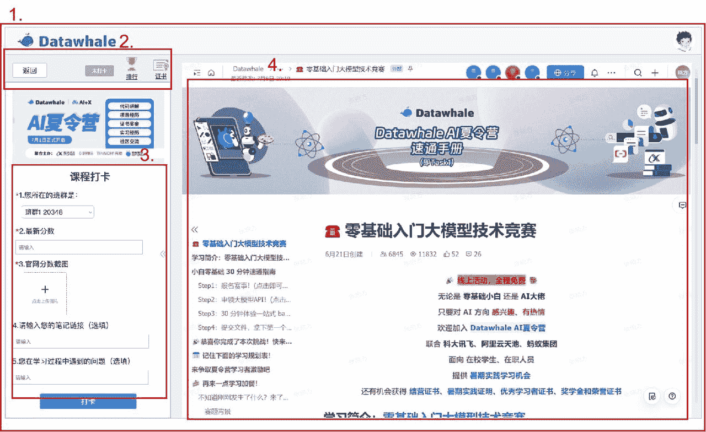

# AI+地球科学学习者手册

> 来源：[https://datawhaler.feishu.cn/docx/J6OPdqMBaoJAkWx1pLTcKs0intd](https://datawhaler.feishu.cn/docx/J6OPdqMBaoJAkWx1pLTcKs0intd)

# 一、重要链接

**赛事官网**：[**h**](http://competition.sais.com.cn/competitionDetail/532234/format)ttp://competition.sais.com.cn/competitionDetail/532234/format

**打卡链接：****https://linklearner.**com/activity/12/5/17

**排行榜（奖学金依据）****[打卡处可以看到]：****https://linklearner.**com/activity/12/5/17

**优秀笔记合集：**[夏令营优秀笔记](https://exn8g66dnwu.feishu.cn/sheets/M4LFsR8oAhnFKZtGdZHcDJn4ncg?sheet=f8d046&range=QTE6SDE)

**学习相关QA汇总文档：**[ QA & 其他彩蛋](https://datawhaler.feishu.cn/wiki/CGrEwDgKHinjmPkEBK3c5mxpnEg?from=from_copylink)

# 二、学习规划

每个任务的教程可直接点击链接跳转

每个直播回放也可通过点击直播跳转

<https://datawhaler.feishu.cn/sync/DScSdpeF4sY0cGbwBxRcETT7n8g>

# 三、夏令营学习者奖励

<https://datawhaler.feishu.cn/sync/AUzZdGHQ4swaZBbrGQycAfc3nGD>

# 四、常见问题Q&A

## 如何打卡？

**打卡说明**：官网打卡

+   教程左侧显示栏完成，每个任务打卡表单不一样，排行榜分数取最高分（无效数据会被删除，请仔细核对）。

+   同一个Task任务打卡为覆盖形式，比如填了笔记链接打卡后，再不填笔记链接打卡就会【没有笔记链接】，辛苦大家注意再加一下笔记链接哈

## 如何撰写笔记？

**优秀笔记合集：**[夏令营优秀笔记](https://exn8g66dnwu.feishu.cn/sheets/M4LFsR8oAhnFKZtGdZHcDJn4ncg?from=from_copylink)

**评选时间**：在7月29日评选第一批笔记，8月1日评选第二批笔记，8月4日评选第三批笔记

第一批笔记提交截止时间是7月28日晚24：00

第二批笔记提交截止时间是7月31日晚24：00

第三批笔记提交截止时间是8月3日晚24：00

**笔记说明：**

本期笔记要求：文章标题带上“Datawhale AI 夏令营”

具体笔记，可按照task来做多份笔记，也可沿用单个笔记持续更新内容

打卡时提交标题带“Datawhale AI 夏令营”的可公开查看的笔记链接，不限笔记平台，CSDN、知乎、📕、👸号、掘金等

> 笔记规则：提交公开可查阅的笔记链接，笔记标题带“Datawhale AI夏令营”，不限笔记平台，CSDN、知乎、📕、👸号、掘金等。

1.  **0分笔记情况**：

1.  笔记是AI生成的；

1.  直接提交教程链接；

1.  直接照抄教程内容；

1.  笔记链接错误

1.  笔记直接没有链接，而是一行字

1.  笔记无实质性内容，而是“简单的打卡”

## 如何获得实习证明？

学习者仅能获得实践证明，详见【三、夏令营学习者奖励】

后续参加 **助教/宣传大使/教程共创 **等贡献，表现优秀者可获得实习证明，有兴趣的同学可以咨询负责人