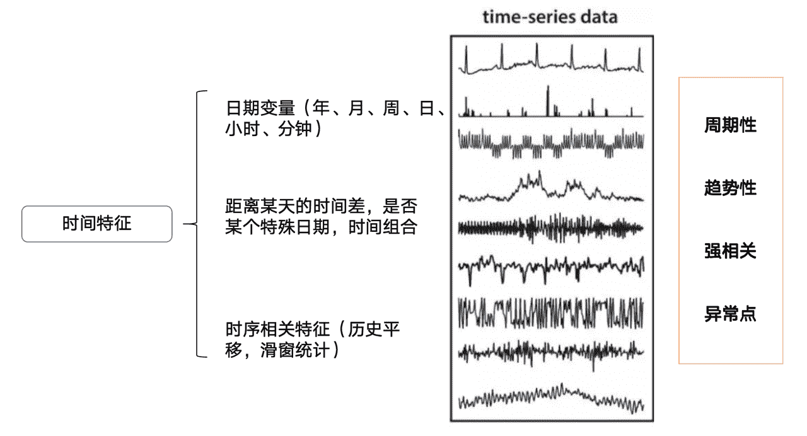
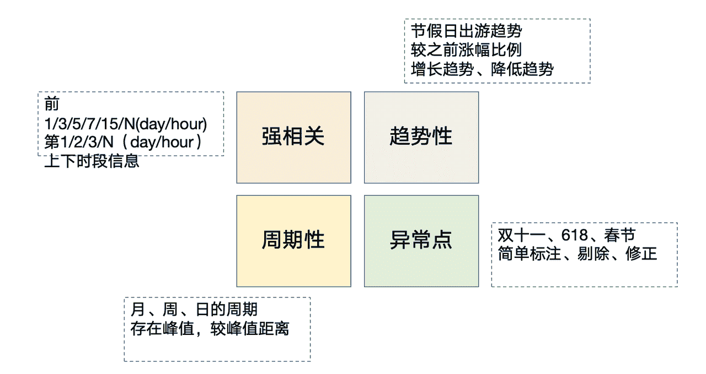
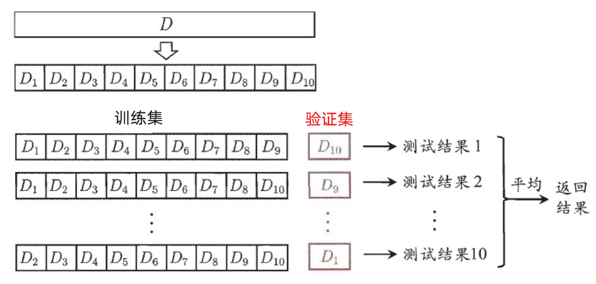
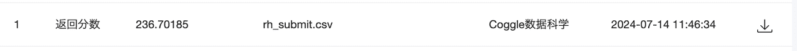
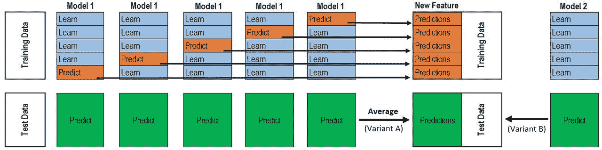
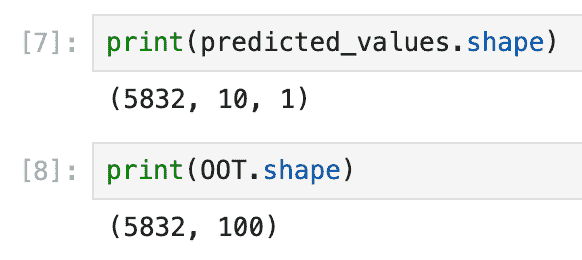

# Task3：尝试使用深度学习方案

> 来源：[https://datawhaler.feishu.cn/docx/BLtbdzusBo8StMxUsEzcpqGLnvb](https://datawhaler.feishu.cn/docx/BLtbdzusBo8StMxUsEzcpqGLnvb)

> **教程贡献者说：**

> 前面我们介绍了如何使用经验模型以及常见的lightgbm决策树模型来解决本次时间序列问题。

> 今天我们的任务是尝试构建深度学习模型来解决赛题

> 你可以从中学会

+   如何进行时间序列的进阶特征提取与分析

+   如何构建深度学习方案

>

> 祝你食用快乐~学得开心~

## 时间序列预测特征提取和分析方法



在进行时间序列分析时，特征提取是一个至关重要的步骤，因为它直接影响到模型的性能。以下是关键特征提取和分析方式的详细介绍：

1.  **日期变量**：时间序列数据通常包含日期或时间信息。这可以细分为不同的时间尺度，如年、月、周、日、小时、分钟等。在特征提取时，可以将这些日期变量转换为数值型特征，以便于模型处理。

1.  **周期性**：许多时间序列数据表现出周期性，例如，一天中的小时数、一周中的天数、一年中的月份等。识别并利用这些周期性特征可以帮助模型捕捉数据的内在规律。

1.  **趋势性**：趋势性是指时间序列数据随时间推移呈现的上升或下降的总体模式。这可以通过诸如移动平均或线性回归等方法来提取，并作为特征输入模型。

1.  **距离某天的时间差**：这涉及到从特定日期（如产品发布日、重要事件日等）计算时间差。这种特征可以帮助模型了解数据点与特定事件的相对位置。

1.  **时间特征组合**：将不同的时间单位组合起来（如年和周、月和日）可以提供更丰富的时间上下文信息，有助于揭示数据中的复杂模式。

1.  **特殊日期**：识别时间序列中的特殊日期或事件（如节假日、促销活动等）并将其作为特征，可以帮助模型解释与这些事件相关的数据波动。

1.  **异常点**：时间序列中可能存在异常点，这些点与其他数据点显著不同。正确识别并处理这些异常点对于提高预测精度至关重要。

1.  **时序相关特征**：

+   **历史平移**：将过去的值作为当前值的函数，例如，使用前一天的值来预测后一天的值。

+   **滑窗统计**：使用时间窗口内的统计数据（如平均值、中位数、标准差等）作为特征，这有助于捕捉局部时间范围内的数据特性。

1.  **强相关特征**：识别与目标变量强烈相关的特征，并利用这些特征来构建预测模型。



这张图片提供了一系列关于时间序列预测中构建关键特征的要点，包括强相关性特征、趋势性特征、周期性特征和异常点特征。以下是对这些特征的详细介绍：

1.  **强相关性特征**：

+   强相关性特征是指与目标变量有明显线性或非线性关系的输入特征。在时间序列中，这些特征可能包括：

+   **滞后特征**：使用过去的值作为当前预测的特征，例如，使用前一天的销售数据来预测后一天的销售。

+   **滚动统计特征**：计算时间序列的滚动窗口内的统计量，如平均值、最大值、最小值、总和等。

1.  **趋势性特征**：

+   趋势性特征反映了时间序列随时间推移的长期变化方向或速率。

+   构建趋势性特征的方法包括：

+   **时间戳转换**：将时间戳转换为数值，如从时间戳中提取年份、月份、星期等。

+   **移动平均**：使用时间序列的移动平均值来平滑短期波动，突出长期趋势。

+   **多项式拟合**：拟合一个多项式模型来捕捉趋势。

1.  **周期性特征**：

+   周期性特征反映了时间序列数据在固定时间间隔内重复出现的模式。

+   构建周期性特征的方法包括：

+   **时间戳的周期性转换**：将时间戳转换为周期性变量，如一周中的星期几、一月中的日子等。

+   **季节性分解**：使用季节性分解方法来识别和提取时间序列的季节性成分。

+   **周期性函数**：使用正弦和余弦函数来模拟周期性变化。

1.  **异常点特征**：

+   异常点是指与正常数据模式显著不同的数据点，它们可能由错误、突变或特殊事件引起。

+   处理异常点的方法包括：

+   **简单标注**：在数据集中标记异常点，以便在分析时考虑。

+   **剔除**：从数据集中删除异常点，特别是在它们可能影响模型训练的情况下。

+   **修正**：更正异常点，如果它们是由于可识别的错误造成的。

1.  **特殊事件特征**：

+   特殊事件如“双十一”、“618”、“春节”等，会在时间序列中产生显著的峰值。

+   构建特殊事件特征的方法包括：

+   **事件指示器**：创建一个二进制特征，当时间序列中的点与特殊事件对应时，该特征值为1，否则为0。

+   **事件前后的时间窗口**：考虑事件前后的时间窗口，以捕捉事件的影响。

1.  **上下时段信息**：

+   上下时段信息指的是在时间序列中，特定时间段之前或之后的数据点。

+   这可以通过创建特征来表示数据点与特定时间段的距离来实现。

1.  **存在峰值与峰值距离**：

+   识别时间序列中的峰值点，并计算其他数据点与这些峰值点的距离，可以作为特征输入模型。

1.  **时间尺度特征**：

+   根据需要预测的时间尺度（如1天、3天、5天等），创建相应的滞后特征和滚动统计特征。

通过结合这些特征，可以构建一个强大的时间序列预测模型。在实际应用中，需要根据具体问题和数据特性来选择和调整特征工程的策略。此外，特征的选择和构建应该与模型的选择和调优过程相结合，以实现最佳的预测性能。

# 优化方案详解

在提分实践部分，将在原有Baseline基础上做更多优化，一般优化思路，从特征工程与模型中来思考。

**优化方法建议：**

1.  **提取更多特征：**在数据挖掘比赛中，**特征**总是最终制胜法宝，去思考什么信息可以帮助我们提高预测精准度，然后将其转化为特征输入到模型。

1.  **尝试不同的模型：****模型**间存在很大的差异，预测结果也会不一样，比赛的过程就是不断的实验和试错的过程，通过不断的实验寻找最佳模型，同时帮助自身加强模型的理解能力。

## 特征优化

这里主要构建了历史平移特征、差分特征、和窗口统计特征；每种特征都是有理可据的，具体说明如下：

**（1）历史平移特征：**通过历史平移获取上个阶段的信息；

**（2）差分特征：**可以帮助获取相邻阶段的增长差异，描述数据的涨减变化情况。在此基础上还可以构建相邻数据比值变化、二阶差分等；

**（3）窗口统计特征：**窗口统计可以构建不同的窗口大小，然后基于窗口范围进统计均值、最大值、最小值、中位数、方差的信息，可以反映最近阶段数据的变化情况。

**参考代码如下：**

```
# 合并训练数据和测试数据
data = pd.concat([train, test], axis=0).reset_index(drop=True)
data = data.sort_values([&#x27;id&#x27;,&#x27;dt&#x27;], ascending=False).reset_index(drop=True)

# 历史平移
for i in range(10,36):
    data[f&#x27;target_shift{i}&#x27;] = data.groupby(&#x27;id&#x27;)[&#x27;target&#x27;].shift(i)

# 历史平移 + 差分特征
for i in range(1,4):
    data[f&#x27;target_shift10_diff{i}&#x27;] = data.groupby(&#x27;id&#x27;)[&#x27;target_shift10&#x27;].diff(i)
    
# 窗口统计
for win in [15,30,50,70]:
    data[f&#x27;target_win{win}_mean&#x27;] = data.groupby(&#x27;id&#x27;)[&#x27;target&#x27;].rolling(window=win, min_periods=3, closed=&#x27;left&#x27;).mean().values
    data[f&#x27;target_win{win}_max&#x27;] = data.groupby(&#x27;id&#x27;)[&#x27;target&#x27;].rolling(window=win, min_periods=3, closed=&#x27;left&#x27;).max().values
    data[f&#x27;target_win{win}_min&#x27;] = data.groupby(&#x27;id&#x27;)[&#x27;target&#x27;].rolling(window=win, min_periods=3, closed=&#x27;left&#x27;).min().values
    data[f&#x27;target_win{win}_std&#x27;] = data.groupby(&#x27;id&#x27;)[&#x27;target&#x27;].rolling(window=win, min_periods=3, closed=&#x27;left&#x27;).std().values

# 历史平移 + 窗口统计
for win in [7,14,28,35,50,70]:
    data[f&#x27;target_shift10_win{win}_mean&#x27;] = data.groupby(&#x27;id&#x27;)[&#x27;target_shift10&#x27;].rolling(window=win, min_periods=3, closed=&#x27;left&#x27;).mean().values
    data[f&#x27;target_shift10_win{win}_max&#x27;] = data.groupby(&#x27;id&#x27;)[&#x27;target_shift10&#x27;].rolling(window=win, min_periods=3, closed=&#x27;left&#x27;).max().values
    data[f&#x27;target_shift10_win{win}_min&#x27;] = data.groupby(&#x27;id&#x27;)[&#x27;target_shift10&#x27;].rolling(window=win, min_periods=3, closed=&#x27;left&#x27;).min().values
    data[f&#x27;target_shift10_win{win}_sum&#x27;] = data.groupby(&#x27;id&#x27;)[&#x27;target_shift10&#x27;].rolling(window=win, min_periods=3, closed=&#x27;left&#x27;).sum().values
    data[f&#x27;target_shift710win{win}_std&#x27;] = data.groupby(&#x27;id&#x27;)[&#x27;target_shift10&#x27;].rolling(window=win, min_periods=3, closed=&#x27;left&#x27;).std().values
```

## 模型融合

进行模型融合的前提是有多个模型的输出结果，比如使用catboost、xgboost和lightgbm三个模型分别输出三个结果，这时就可以将三个结果进行融合，最常见的是将结果直接进行加权平均融合。

下面我们构建了cv_model函数，内部可以选择使用lightgbm、xgboost和catboost模型，可以依次跑完这三个模型，然后将三个模型的结果进行取平均进行融合。

对于每个模型均选择经典的K折交叉验证方法进行离线评估，大体流程如下：

1、K折交叉验证会把样本数据随机的分成K份；

2、每次随机的选择K-1份作为训练集，剩下的1份做验证集；

3、当这一轮完成后，重新随机选择K-1份来训练数据；

4、最后将K折预测结果取平均作为最终提交结果。



```
from sklearn.model_selection import StratifiedKFold, KFold, GroupKFold
import lightgbm as lgb
import xgboost as xgb
from catboost import CatBoostRegressor
from sklearn.metrics import mean_squared_error, mean_absolute_error
def cv_model(clf, train_x, train_y, test_x, clf_name, seed = 2024):
    &#x27;&#x27;&#x27;
    clf：调用模型
    train_x：训练数据
    train_y：训练数据对应标签
    test_x：测试数据
    clf_name：选择使用模型名
    seed：随机种子
    &#x27;&#x27;&#x27;
    folds = 5
    kf = KFold(n_splits=folds, shuffle=True, random_state=seed)
    oof = np.zeros(train_x.shape[0])
    test_predict = np.zeros(test_x.shape[0])
    cv_scores = []
    
    for i, (train_index, valid_index) in enumerate(kf.split(train_x, train_y)):
        print(&#x27;************************************ {} ************************************&#x27;.format(str(i+1)))
        trn_x, trn_y, val_x, val_y = train_x.iloc[train_index], train_y[train_index], train_x.iloc[valid_index], train_y[valid_index]
        
        if clf_name == &quot;lgb&quot;:
            train_matrix = clf.Dataset(trn_x, label=trn_y)
            valid_matrix = clf.Dataset(val_x, label=val_y)
            params = {
                &#x27;boosting_type&#x27;: &#x27;gbdt&#x27;,
                &#x27;objective&#x27;: &#x27;regression&#x27;,
                &#x27;metric&#x27;: &#x27;mae&#x27;,
                &#x27;min_child_weight&#x27;: 6,
                &#x27;num_leaves&#x27;: 2 ** 6,
                &#x27;lambda_l2&#x27;: 10,
                &#x27;feature_fraction&#x27;: 0.8,
                &#x27;bagging_fraction&#x27;: 0.8,
                &#x27;bagging_freq&#x27;: 4,
                &#x27;learning_rate&#x27;: 0.1,
                &#x27;seed&#x27;: 2023,
                &#x27;nthread&#x27; : 16,
                &#x27;verbose&#x27; : -1,
            }
            model = clf.train(params, train_matrix, 1000, valid_sets=[train_matrix, valid_matrix],
                              categorical_feature=[], verbose_eval=200, early_stopping_rounds=100)
            val_pred = model.predict(val_x, num_iteration=model.best_iteration)
            test_pred = model.predict(test_x, num_iteration=model.best_iteration)
        
        if clf_name == &quot;xgb&quot;:
            xgb_params = {
              &#x27;booster&#x27;: &#x27;gbtree&#x27;, 
              &#x27;objective&#x27;: &#x27;reg:squarederror&#x27;,
              &#x27;eval_metric&#x27;: &#x27;mae&#x27;,
              &#x27;max_depth&#x27;: 5,
              &#x27;lambda&#x27;: 10,
              &#x27;subsample&#x27;: 0.7,
              &#x27;colsample_bytree&#x27;: 0.7,
              &#x27;colsample_bylevel&#x27;: 0.7,
              &#x27;eta&#x27;: 0.1,
              &#x27;tree_method&#x27;: &#x27;hist&#x27;,
              &#x27;seed&#x27;: 520,
              &#x27;nthread&#x27;: 16
              }
            train_matrix = clf.DMatrix(trn_x , label=trn_y)
            valid_matrix = clf.DMatrix(val_x , label=val_y)
            test_matrix = clf.DMatrix(test_x)
            
            watchlist = [(train_matrix, &#x27;train&#x27;),(valid_matrix, &#x27;eval&#x27;)]
            
            model = clf.train(xgb_params, train_matrix, num_boost_round=1000, evals=watchlist, verbose_eval=200, early_stopping_rounds=100)
            val_pred  = model.predict(valid_matrix)
            test_pred = model.predict(test_matrix)
            
        if clf_name == &quot;cat&quot;:
            params = {&#x27;learning_rate&#x27;: 0.1, &#x27;depth&#x27;: 5, &#x27;bootstrap_type&#x27;:&#x27;Bernoulli&#x27;,&#x27;random_seed&#x27;:2023,
                      &#x27;od_type&#x27;: &#x27;Iter&#x27;, &#x27;od_wait&#x27;: 100, &#x27;random_seed&#x27;: 11, &#x27;allow_writing_files&#x27;: False}
            
            model = clf(iterations=1000, **params)
            model.fit(trn_x, trn_y, eval_set=(val_x, val_y),
                      metric_period=200,
                      use_best_model=True, 
                      cat_features=[],
                      verbose=1)
            
            val_pred  = model.predict(val_x)
            test_pred = model.predict(test_x)
        
        oof[valid_index] = val_pred
        test_predict += test_pred / kf.n_splits
        
        score = mean_absolute_error(val_y, val_pred)
        cv_scores.append(score)
        print(cv_scores)
        
    return oof, test_predict

# 选择lightgbm模型
lgb_oof, lgb_test = cv_model(lgb, train[train_cols], train[&#x27;target&#x27;], test[train_cols], &#x27;lgb&#x27;)
# 选择xgboost模型
xgb_oof, xgb_test = cv_model(xgb, train[train_cols], train[&#x27;target&#x27;], test[train_cols], &#x27;xgb&#x27;)
# 选择catboost模型
cat_oof, cat_test = cv_model(CatBoostRegressor, train[train_cols], train[&#x27;target&#x27;], test[train_cols], &#x27;cat&#x27;)

# 进行取平均融合
final_test = (lgb_test + xgb_test + cat_test) / 3
```



另外一种就是stacking融合，stacking是一种分层模型集成框架。以两层为例，第一层由多个基学习器组成，其输入为原始训练集，第二层的模型则是以第一层基学习器的输出作为特征加入训练集进行再训练，从而得到完整的stacking模型。



第一层：（类比cv_model函数）

1.  划分训练数据为K折（5折为例，每次选择其中四份作为训练集，一份作为验证集）；

1.  针对各个**模型RF、ET、GBDT、XGB，分别进行5次训练，每次训练保留一份样本用作训**练时的验证，训练完成后分别对Validation set，Test set进行预测，对于Test set一个模型会对应5个预测结果，将这5个结果取平均；对于Validation set一个模型经过5次交叉验证后，所有验证集数据都含有一个标签。此步骤结束后：5个验证集（总数相当于训练集全部）在每个模型下分别有一个预测标签，每行数据共有4个标签（4个算法模型），测试集每行数据也拥有四个标签（4个模型分别预测得到的）

第二层：（类比stack_model函数）

1.  **将训练集中的四个标签外加真****实标签当作五列新的特征作为新**的训练集，选取一个训练模型，根据新的训练集进行训练，然后应用测试集的四个标签组成的测试集进行预测作为最终的result。

**Stacking参考代码：**

```
def stack_model(oof_1, oof_2, oof_3, predictions_1, predictions_2, predictions_3, y):
    &#x27;&#x27;&#x27;
    输入的oof_1, oof_2, oof_3可以对应lgb_oof，xgb_oof，cat_oof
    predictions_1, predictions_2, predictions_3对应lgb_test，xgb_test，cat_test
    &#x27;&#x27;&#x27;
    train_stack = pd.concat([oof_1, oof_2, oof_3], axis=1) # （len(train),3）
    test_stack = pd.concat([predictions_1, predictions_2, predictions_3], axis=1) #(len(test),3)
    
    oof = np.zeros((train_stack.shape[0],))
    predictions = np.zeros((test_stack.shape[0],))
    scores = []
    
    from sklearn.model_selection import RepeatedKFold
    folds = RepeatedKFold(n_splits=5, n_repeats=2, random_state=2021)
    
    for fold_, (trn_idx, val_idx) in enumerate(folds.split(train_stack, train_stack)): 
        print(&quot;fold n°{}&quot;.format(fold_+1))
        trn_data, trn_y = train_stack.loc[trn_idx], y[trn_idx]
        val_data, val_y = train_stack.loc[val_idx], y[val_idx]
        
        clf = Ridge(random_state=2021)
        clf.fit(trn_data, trn_y)

        oof[val_idx] = clf.predict(val_data)
        predictions += clf.predict(test_stack) / (5 * 2)
        
        score_single = mean_absolute_error(val_y, oof[val_idx])
        scores.append(score_single)
        print(f&#x27;{fold_+1}/{5}&#x27;, score_single)
    print(&#x27;mean: &#x27;,np.mean(scores))
   
    return oof, predictions
    
stack_oof, stack_pred = stack_model(pd.DataFrame(lgb_oof), pd.DataFrame(xgb_oof), pd.DataFrame(cat_oof), 
                                    pd.DataFrame(lgb_test), pd.DataFrame(xgb_test), pd.DataFrame(cat_test), train[&#x27;target&#x27;])
```

## 深度学习方案尝试

```
import numpy as np
import pandas as pd
from sklearn.preprocessing import MinMaxScaler
from keras.models import Sequential
from keras.layers import LSTM, Dense, RepeatVector, TimeDistributed
from keras.optimizers import Adam

train = pd.read_csv(&#x27;train.csv&#x27;)
test = pd.read_csv(&#x27;test.csv&#x27;)

# 数据预处理
def preprocess_data(df, look_back=100):
    # 将数据按照id进行分组
    grouped = df.groupby(&#x27;id&#x27;)
    datasets = {}
    for id, group in grouped:
        datasets[id] = group.values
        
    # 准备训练数据集
    X, Y = [], []
    for id, data in datasets.items():
        for i in range(10, 15): # 每个id构建5个序列
            a = data[i:(i + look_back), 3]
            a = np.append(a, np.array([0]*(100-len(a))))
            X.append(a[::-1])
            Y.append(data[i-10:i, 3][::-1])
    
    # 准备测试数据集
    OOT = []
    for id, data in datasets.items():
        a = data[:100, 3]
        a = np.append(a, np.array([0]*(100-len(a))))
        OOT.append(a[::-1])
    
    return np.array(X, dtype=np.float64), np.array(Y, dtype=np.float64), np.array(OOT, dtype=np.float64)

# 定义模型
def build_model(look_back, n_features, n_output):
    model = Sequential()
    model.add(LSTM(50, input_shape=(look_back, n_features)))
    model.add(RepeatVector(n_output))
    model.add(LSTM(50, return_sequences=True))
    model.add(TimeDistributed(Dense(1)))
    model.compile(loss=&#x27;mean_squared_error&#x27;, optimizer=Adam(0.001))
    return model

# 构建和训练模型
look_back = 100  # 序列长度
n_features = 1  # 假设每个时间点只有一个特征
n_output = 10  # 预测未来10个时间单位的值

# 预处理数据
X, Y, OOT = preprocess_data(train, look_back=look_back)

# 构建模型
model = build_model(look_back, n_features, n_output)

# 训练模型
model.fit(X, Y, epochs=10, batch_size=64, verbose=1)

# 进行预测
predicted_values = model.predict(OOT)
```

以下是代码的详细解释：

1.  **导入库**：代码开始处导入了所需的库，包括数据处理库NumPy和Pandas，以及用于构建LSTM模型的Keras库。

1.  **读取数据**：使用Pandas的read_csv函数读取训练数据集train.csv和测试数据集test.csv。

1.  **定义数据预处理函数**：

+   preprocess_data函数用于准备训练和测试数据。

+   数据按id列进行分组。

+   对于每个id，提取特定列（索引为3的列）的数据作为时间序列。

+   创建多个序列，每个序列长度为look_back，默认为100。

+   序列被反转，并且如果序列长度不足100，则用0填充。

+   训练数据集的标签Y是序列的一部分，同样进行反转。

+   测试数据集（OOT，Out-Of-Time）也被反转并用0填充以满足序列长度要求。

1.  **定义模型构建函数**：

+   build_model函数用于构建LSTM模型。

+   模型包括一个LSTM层，用于学习时间序列数据的特征，以及一个重复向量层RepeatVector，用于复制上一个LSTM层的输出以供下一个LSTM层使用。

+   再次使用LSTM层和时间分布的密集层来预测序列的下一个值。

+   模型使用均方误差作为损失函数，并使用Adam优化器。

1.  **构建和训练模型**：

+   设置序列长度look_back、特征数n_features和输出时间单位数n_output。

+   调用preprocess_data函数预处理训练数据。

+   使用build_model函数构建模型。

+   使用模型的fit方法训练模型，指定迭代次数（epochs）和批量大小（batch_size）。

1.  **进行预测**：

+   使用训练好的模型对测试数据集进行预测。

+   这里需要注意注意自行将预测结果转化为提交格式



# 总结

时间序列预测是一个不断发展的领域，随着技术的进步，我们可以期待更多的优化方法和模型的出现。深度学习模型，特别是LSTM和其变体，已经在许多时间序列预测任务中显示出了优越的性能。未来的研究可能会集中在以下几个方面：

+   **更复杂的模型结构**：如引入注意力机制的LSTM模型，以更好地捕捉时间序列中的长期依赖关系。

+   **多模态数据融合**：结合时间序列数据和其他类型的数据，如文本或图像，以提供更全面的分析。

+   **模型解释性**：提高模型的可解释性，以便更好地理解预测结果。

+   **自动化特征工程**：开发自动化的特征工程工具，以减少手动特征提取的工作量。

+   **实时预测**：提高模型在实时数据流上的预测能力。

+   **模型鲁棒性**：提高模型对异常值和噪声的鲁棒性。

随着技术的不断发展，我们可以期待时间序列预测在准确性、效率和应用范围上都会有显著的提升。

# [别忘了在官网提交~](https://challenge.xfyun.cn/h5/detail?type=electricity-demand&ch=dw24_uGS8Gs)

# 学习规划表

<https://datawhaler.feishu.cn/sync/KeQvdtCR6sr0nIb8UTRc1dmfneb>

# ❀ 恭喜看完全部知识教程！

> 咱们本次7天的学习就快要结束啦，你成功拿下更高的分数了没？有没有用心写过一篇笔记？

> 是否找到了自己的方向？是否找到了学习的节奏和AI竞赛乐趣呢？

> 你对于这次的学习体验又是如何？欢迎留言&在群里跟大家一起聊聊呀！

> Datawhale想与你一同见证更好的自己，永远”“For the Learner，For the Dreamer”！

### 🎉合影留念墙

感谢很棒的你一路的坚持，让我们在这里给自己点个赞！

期待下期夏令营还能与你再次相遇~

一起合个影 :)

#

> 本教程主要由 [**@鱼遇雨欲语与余**](https://www.zhihu.com/people/wang-he-13-93) 写作贡献，经过多位助教内测和建议修改，期待你的点赞和评论～