# QA & 其他彩蛋

> 来源：`https://datawhaler.feishu.cn/docx/SnoGdf5oboioFpx6R1JcO0xXnXb`

## 欢迎来到 QA 共创板块

> 我们将共同整理和总结学习过程中的重点内容、问题和解答

> 欢迎随时分享你的笔记和心得，你的任何一小段的尝试和思考都有其参考价值和独特的意义！

> 我们期待并不仅限于如下内容主题：

> 🎥 直播笔记 & 📒 优秀笔记

> ⚙ 技术概念解析 & 💓 学习感悟

> ❓ 学习过程中的QA & 📚共创教程

> 我们鼓励大家在学习群里：

> ① 主动分享，激发大家思考和交流；

> ② 互相求助和答疑，礼貌交流；

> 此文档的内容完全开源，全网可编辑

> 感谢答疑的讲师——

> 感谢积极学习答疑的优秀学习者/助教——

## Task2 直播间问题汇总

| 序号 | 问题 | 回复 |
| --- | --- | --- |
| 1 | 佬。能多说说时序的常用处理嘛？ | |
| 2 | 这里蓝色柱子和绿色柱子没看明白代表什么 | 视觉区分而已，横坐标都是不同的type |
| 3 | 可以多讲讲时序特征的处理嘛？ | |
| 4 | 不暴力的方式怎么构建的平移特征呢？ | |
| 5 | 验证集中。如果测试集dt有20天。那验证集是不是除了测试集最近的20天，离线可以用cv来参考线下分数嘛？ | |
| 6 | 这个能做超参数优化吗 | |
|  | 什么要把训练数据和测试数据合并处理？ | /、。 |
|  | 出现这个报错是为什么，要重新配置环境吗？ | 你没有安装`lightgbm`，要先`!pip install lightgbm==3.3.0` |
|  | 可以用其他的模型吗，比如决策树，随机森林之类的 | |
|  | 如何调整随机森林回归树的参数，使结果最优？有哪些优化方法？ | |

## Task1 QA汇总

### 什么是baseline？

> Answer：Baseline意思是基线，相当于一个基础方案，通过这个`baseline`可以获得一个赛事结果，并以此为参考基准，比较修改后的方案是否有改进效果。

> `Baseline`是一份简易的入门教程，可以帮助同学们迈出 AI 训练大师之路的第一步。建议入门的同学可以暂时不用着急去弄懂各个代码的原理，先跑通代码，动手实践，看到成绩。

### 评分是电脑运行能力吗？

> Answer：提交文件到官网得出的评分，计算规则如下图（具体可到官网链接`https://challenge.xfyun.cn/topic/info?type=electricity-demand&option=ssgy&ch=dw24_uGS8Gs`查看赛事概要）

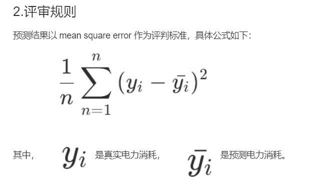

### 为什么测试1-10，用的是11-20的数据？

> Answer：因为1-10是你要给出的答案，`baseline`是计算11-20的平均值作为答案。

### 高中毕业想看科普视频了解一下应该怎么搜索关键词？

> Answer：太想进步了学弟/学妹。可以在b站搜索Kaggle数据竞赛，数据竞赛，数据挖掘竞赛这类的词，也可以在阿里天池竞赛、科大讯飞数据竞赛，Kaggle里面了解竞赛的更多相关信息。如果是希望了解机器学习的相关知识的话建议阅读《机器学习实战》、《机器学习（周志华）》、《统计学习方法（李航）》，当然这些内容都需要有一定大学数学的基础，可以先了解高等数学、线性代数、统计学这三个方向的数学知识再进一步学习机器学习相关知识。

### 分数出现和别人不一样是随机的吗

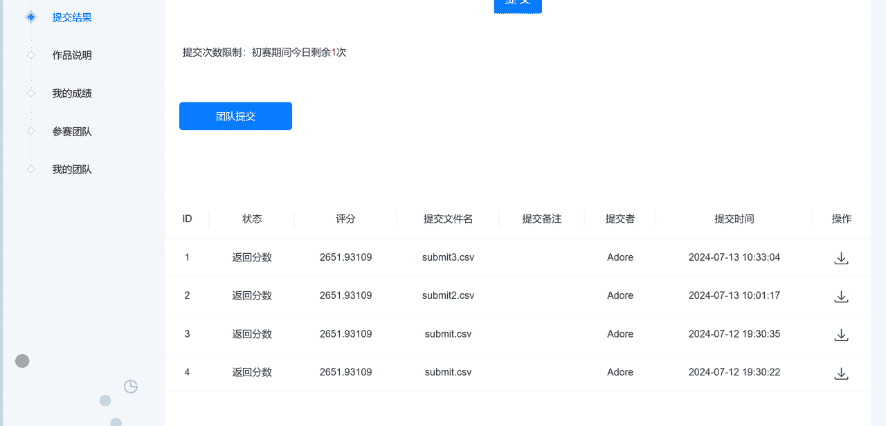

> Answer：不是啊，你需要在本地或者飞桨上面跑一下，`baseline`得分一般是300多，不会这样的。除非你修改了模型参数或者做了特征才会出现分数变化。

### 是不是就是用Python数据分析，越详细越好

> 如果你想要详细的回答，那么问题就必须要详细，你需要把各种前设条件都说清楚，我们才能告诉你“详细”的回答。前设条件包括：你是谁（做分析的人，是分析师/同学/大学老师/项目经理/...），做什么（分析什么，常规描述性分析/专题分析/预测分析/...），为什么（为什么是这个工具，python/excel/spss/sql/...）。

> 针对这个问题，我们能给出一个笼统的答复就是，Python只是一个工具，一个做数据分析的工具。工具嘛有很多，不止python这一种。但是Python做分析有优势。大概如此。

### 结营证书的要求就是打卡吗

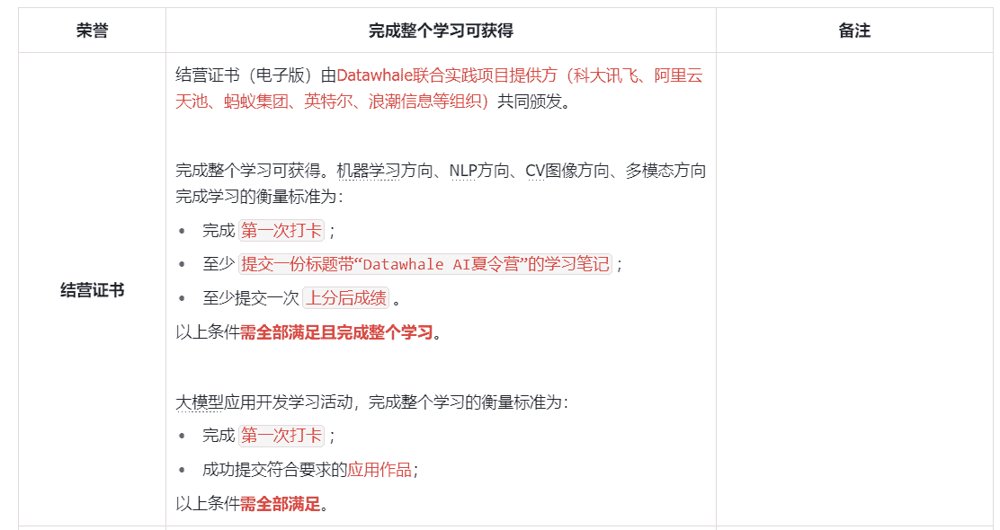

### 助教会将激励措施发在群里

### 能同时参加两个赛事吗，比如机器学习和nlp同时参加

可以，参加完两个赛事可以获得实践证明。

### 学习笔记在哪儿上传？笔记Word文档嘛，上传哪里啊

[AI夏令营-电力需求预测赛学习者手册](`https://datawhaler.feishu.cn/wiki/JVO6wY1BaiR6Vnkh50hcJoydnBh`)

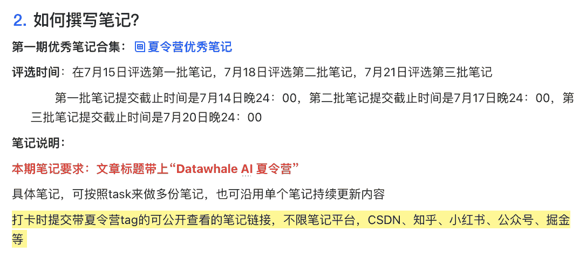

### 能打表吗？

这个描述不是很清晰，具体问题可以发在学习群at助教

### C语言行不行？

> 可以的，当然可以大胆尝试

### 请问一下可以多次打卡吗？可以的话有效打卡算哪次呢？

> 大家每次打卡都是同一个链接，只需要在右上角修改记录，修改分数和笔记链接 即可

### 零基础小白可以学到什么？直接把文件下载过去没学到东西呀

> 第一块是跑`baseline`，后面有精读和提升的直播讲解，可以关注一下

> 师傅领进门，修行靠个人，勤思考、勤分析，遇到问题解决问题，想更仔细了解详情可以再自己找一找资料学习，看我们具体的学习文档里写了很多内容，其实要吃透，没个十天半个月是很难的

> 需要具体看大家怎么学了，想学什么了，任何对你学习有帮助的问题，随时可以在群里问

> 另外是你学习过程中有什么经验或者感想，也随时欢迎在群里分享，让更多学习者收益

### 没有python基础怎么办？

> datawhale的：聪明办法学python

> 另外还可以借助大模型的力量

### 这个赛题是要做什么？

> 本赛题是一个典型的时间序列问题。时间序列问题是指对按时间顺序排列的数据点进行分析和预测的问题，往往用来做未来的趋势预测。比如，基于历史股票每天的股价，预测未来股票的价格走向。

> 时间序列预测问题可以通过多种建模方法来解决，包括传统的时间序列模型、机器学习模型和深度学习模型。

> 简单来说，本次赛题的目标很简单清晰——【训练 时序预测模型 助力电力需求预测】

### 时序问题是什么？

> 时间序列问题是指对按时间顺序排列的数据点进行分析和预测的问题，往往用来做未来的趋势预测。比如，基于历史股票每天的股价，预测未来股票的价格走向。

### 可以讲解一下baseline代码吗？

> 关注一下直播baseline精读

### 已经打卡了没放笔记，现在怎么补笔记？

> 打卡链接右上角修改即可

### 修改打卡的地方在哪？可以演示一下吗？

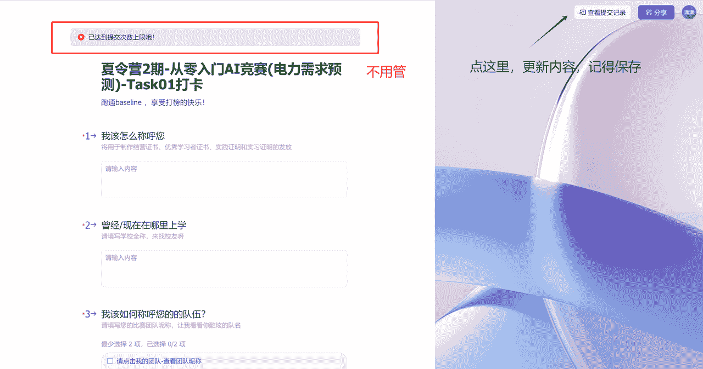

### 请问现在上传的笔记是做到task1就好嘛？

> 是的，task1截止日期：7月14晚上24：00

### 代码一定要在服务器上跑吗？可以在本地跑吗，本地跑要用训练集数据文件在哪里、需要下载什么IDE嘛、运行总是崩 只能用paddle感觉不方便，请问需要下载些什么软件吗？

> 代码可以复制到本地来跑，本地训练的数据文件可以在Paddle项目页面本项目的数据集选项中找到，包含`train.csv`、`test.csv`、`submit.csv`三个数据文件，IDE的话可根据个人喜好选择可以使用Jupyter Notebook、Jupyter Lab、VScode等等，具体的软件配置过程可以自行检索。

### 需要组队吗，有团队项目吗

> 不推荐组队，个人每天可上传3次

### 为啥用lstm运行 总是崩

> 这个描述不是很清晰，具体问题可以发在学习群at助教

### 会学监督学习嘛，线性回归模型和逻辑回归模型之类的

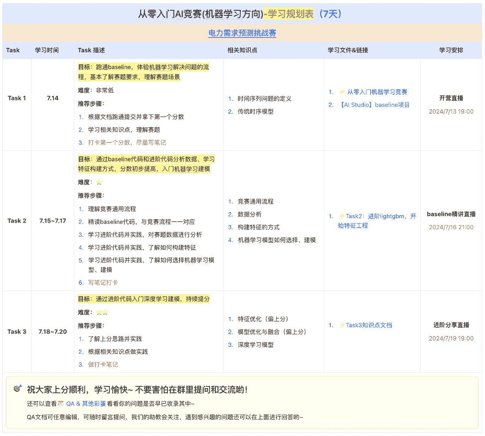

### 结营证书什么时候发

> 结营后，时间安排见学习手册，即群公告的baseline链接

### 本期的机器学习和nlp都获得结营证书就会有实践证明是嘛

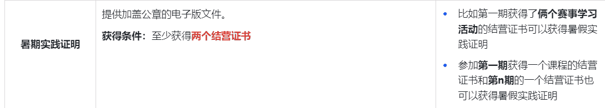

### 报名有点晚还没进群 怎么进群哇~

> datawhale🛰️👸号推文有报名方式，添加思语班班🛰️

### task1那个提交什么呀，感觉没有什么笔记，可以后续提交笔记吗

> 没有笔记模板，有上一期优秀笔记参考

> 只要能展示你的思考和收获即可

### 有录播吗？——有

### 评分越低是不是代表了所预测的数据跟实际数据更接近

> 是的，参考问题2的评分详解

### 请问需要下载些什么软件吗

### 这个分数计算会不会比较局限，因为统计上误差有多种计算方式

### 上一期笔记在哪里啊？

> 可以在学习群问一下助教，助教会发出来

### 就是每一个task都要交一份笔记是吗，还是最后交一个就行

> 有三次task，都需要提交笔记，加油！提交完被评为优秀笔记有机会评为优秀学习者

> 但是笔记可以写在一个文档里

### 提交的csv文件列号必须是id，dt，target顺序吗

> 是的，提交评分必须按照官方指定格式，否则会评测失败

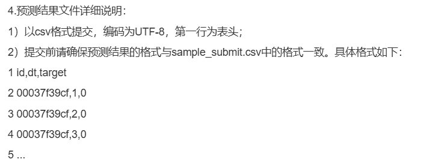

### 除了这个项目，小白还推荐参加这一期的另外哪个项目、CPU大模型部署推荐吗

> 感兴趣的话可以去看看隔壁nlp赛道

### task2现在能做了？

> 做完了task1可以尝试task2

### 请问明天什么时候开始直播

> 下一次是7月16晚上21点

### 香港身份平台实名认证审核很慢怎么办

> 申请工单问问

### 参加的那个电力需求预测赛有最终成绩吗，可以作为一次竞赛经历吗

> 可以啊

### 自己训练大模型和现有GPT模型相比有什么优势

> 首先本次机器学习赛道的模型和GPT是完全不一样的模型，是用来解决不同问题的

> 另外，不推荐自己训练大模型，需要的算力成本很高，更多细节你可以在学习群里跟大家讨论

### 在本地运行的话，推荐什么python版本？

> 3.7，只要和你包版本匹配就行

### 提交上分后成绩是什么，在哪里提交

> [AI夏令营-电力需求预测赛学习者手册](`https://datawhaler.feishu.cn/wiki/JVO6wY1BaiR6Vnkh50hcJoydnBh`)

### 这个窗口统计的操作能用`rolling`函数代替吗？

### 对得出的分数不是很能理解：

> 可以看看官网的赛事规则简介，评分标准是`MSE`

### 应该是用时序模型的吧？没什么构建特征的思路。

> 对的；构建特征的思路可以看后面任务的教程。

### 写笔记有点困难，感觉不是很会整理：

> 没关系，慢慢来，这就是让大家写笔记的原因，不仅要学习新知识，[夏令营优秀笔记](`https://exn8g66dnwu.feishu.cn/sheets/M4LFsR8oAhnFKZtGdZHcDJn4ncg?sheet=EkSbXI`）要学会整理，可以参考上一期的优秀笔记： 。

### 想更系统地学：

> 可以关注Datawhale的官网，有非常系统的学习路线和教程：`https://www.linklearner.com/home`

### 不知道如何提高分数，task2不知道如何部署，希望能详细讲讲，我现在一本西瓜书，应该怎么深入了解呢，需要从头开始学习吗：

> 参考上一条，另外可以关注明晚task2的baseline直播精讲，不明白的地方现场Q&A。

### 如果获得暑期实习证明，需要审核得多久？

> 学习者可以获得暑期实践证明，但是没有实习证明噢，后续参加 助教/宣传大使/教程共创 等贡献，表现优秀者可获得实习证明，有兴趣的同学可以咨询负责人

## Task2 QA汇总

### 运行时报这个错

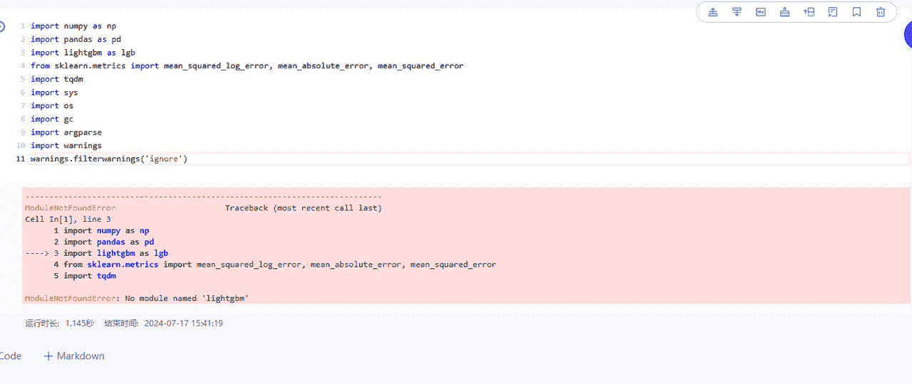

> Answer：在前面添加一行代码：

### 在运行lgb的pipeline的时候进行历史平移和窗口统计之后 data值不知道为啥都变成了NAN值 ？

> Answer：`data`变成`NaN`是因为时间序列数据往前移动了N步，`index`为`[data.len-N+1 - data.len]`

> 因为其后面没有数据（没有`data.len+1`到`data.len+N`的数据），所以变成了`NaN`。

### 为什么我的lgb包的train函数里没有我们task2里面的函数参数呀（最后两个参数没有）？

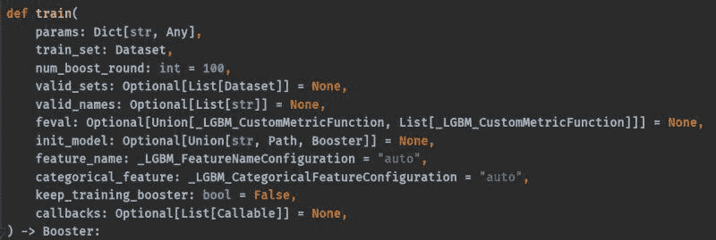

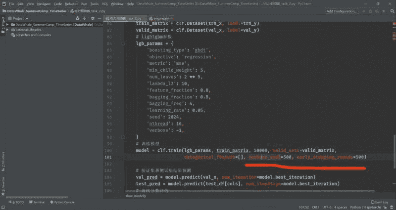

> Answer：可以试下这个方法传参，看训练的结果如何

> `https://blog.csdn.net/weixin_51723388/article/details/124578560`

### 文档里面的喂给lgb的验证集用的是[训练集+验证集]，这个是有什么特殊的用意么

> Answer：验证集中使用了[训练集+验证集]，其中训练集是为了让模型了解训练过程中的拟合情况，验证集是为了提高模型的泛化能力

> 设置验证集用的是[训练集+验证集]，可以让模型训练过程中分别输出训练集和验证集的拟合程度，如果训练集的分数表现很好，而在验证集上的误差开始增加，那么有可能这是一个过拟合的信号，此刻就需要考虑调整训练参数等方法来优化模型了

### 有大佬知道吗 总是报这个错误

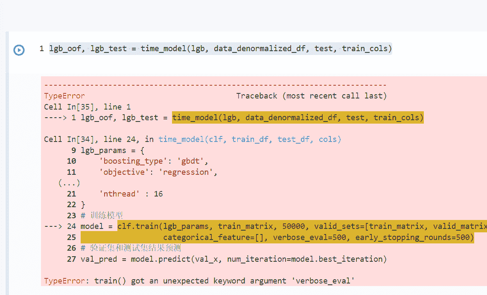

> Answer：`7`

> 补充：我自己也报了这个错误，除了csdn链接中提到的重装特定版本`lgbm`，还需要重启一下内核（PS：kaggle上重启内核还是最新版本，BML平台上重启后则可以正常运行）

> 最新版本的`lightgbm`可以考虑修改训练模型的代码如下：

```
model = lgb.train(lgb_params, train_matrix, 50000, valid_sets=[train_matrix, valid_matrix], categorical_feature=[], callbacks=[lgb.early_stopping(500), lgb.log_evaluation(500)])
```

### 本地跑了分数不高，在想还有好的方法吗以及如何进行优化上分？

> Answer：`https://blog.csdn.net/chrisleequeen/article/details/140337118`

> 我们可以给予`lgbm`方法进行优化，可以参考一下笔记，提到了一些优化思路

> 后续也有分享交流会，分享进阶上分思路

### lgbm如何使用GPU加速？

> 在参数中添加`'device_type' : 'gpu'`字段。

### task2 的代码只有这个教程里的这些吗，如何到飞桨AI studio里运行呢？

文章里并没有提供task2的飞桨ai项目，仅仅复制代码找不到所使用的数据文件吧

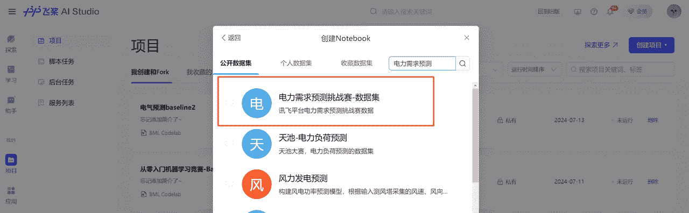

Task2确实没有提供一站式的跑代码链接，但是可以从AI Studio创建项目，数据集可以搜索关键词找到

### 必须在飞桨的环境下运行下吗，我在Jupyter notebook运行手册给出的代码会报错

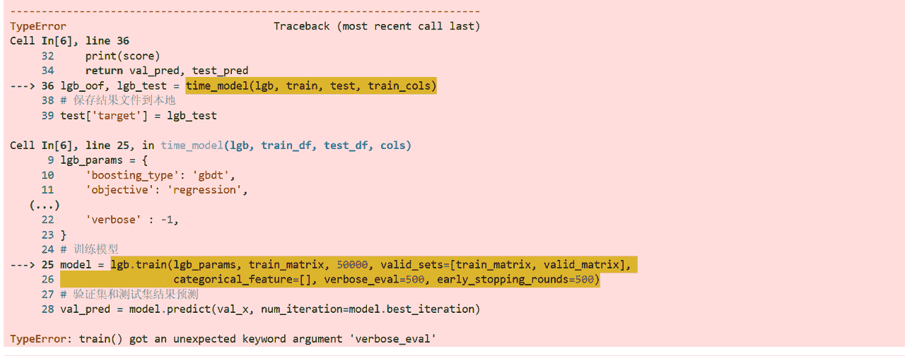

> 上面有这个问题了

### Jupyter notebook里面下载submit的csv格式文件会自动变成xls格式的，有什么办法解决吗

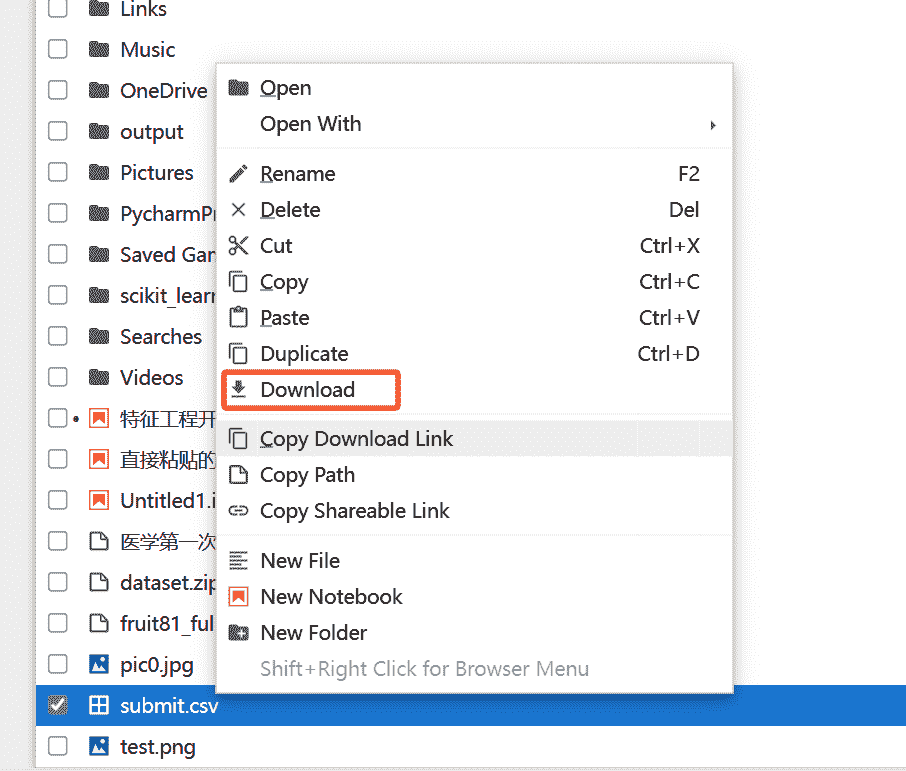

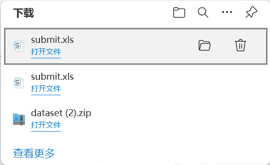

> 两个方法：1、直接进去Jupyter的文档目录下面去把`csv`文件复制出来，你需要去找到你Jupyter的文档目录；2、下载成`xls`文件也没事，因为`csv`和`xls`都是默认excel文件的，你可以直接把后缀名改成`csv`，应该没问题

### 分数是越高越好，还是越低越好啊，为什么用了特征工程之后分数变低了

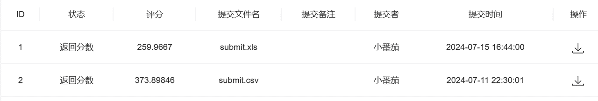

> 越低越好，预测结果以 `MSE` 均方差作为评判标准

### 一开始在环境配置的时候，出现这个问题怎么解决呢？


> 这个不是报错问题，环境安装包是正常安装的，可以忽略

### GPU算力不够怎么办

> 参考算力白嫖指南`https://blog.csdn.net/weixin_46490859/article/details/140463192`

### 这是什么问题

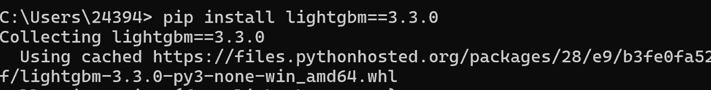

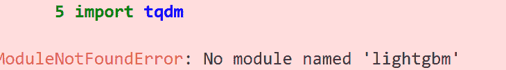

> 没有下载`lightgbm`，可以参考这个链接，如果之前下了其他版本要先卸载

> `https://blog.csdn.net/happylele77/article/details/134525054`


# Task3 QA汇总

## LightGBM GPU 加速错误：GPU Tree Learner 未启用

1.  参照上方的使用GPU加速的方法遇到了这个问题:`LightGBMError: GPU Tree Learner was not enabled in this build.Please recompile with CMake option -DUSE_GPU=1`具体该怎么解决呀

## 好像内存不足了，该怎么办呢

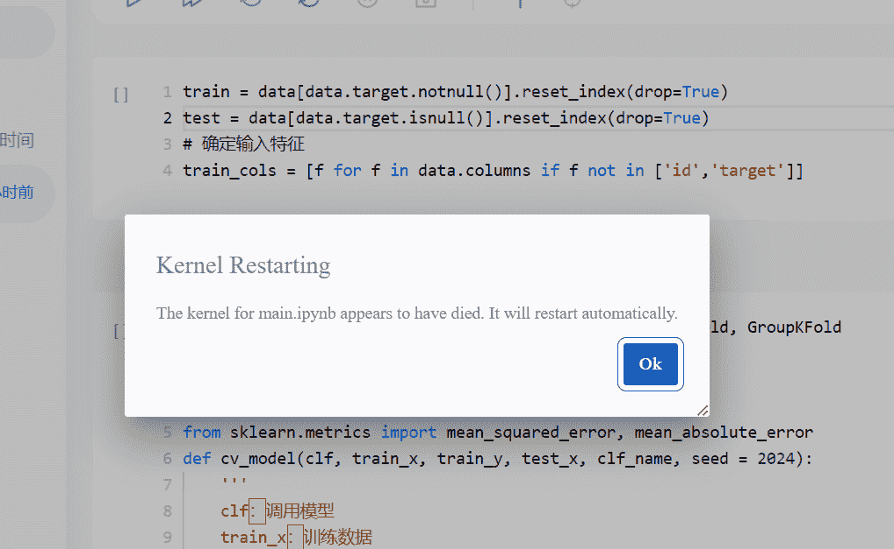

## 我在程序之前加了 `cat boost`，但是看起来好像没装进去。

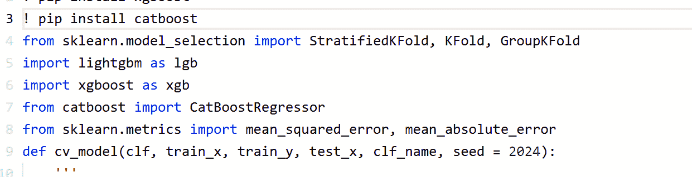

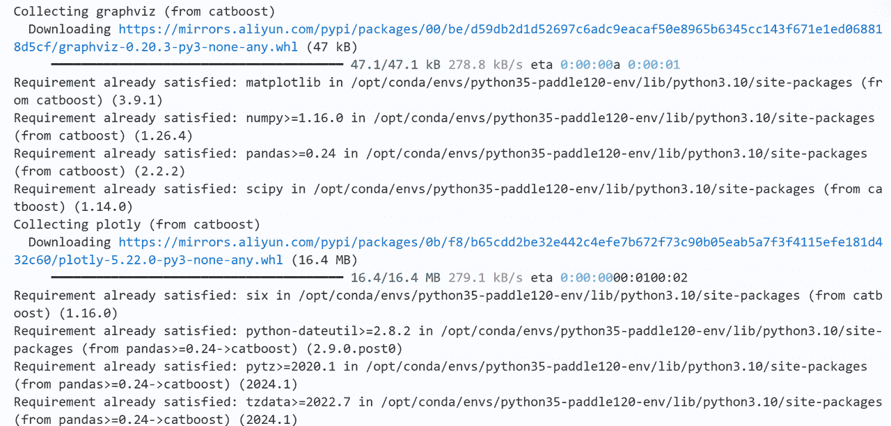

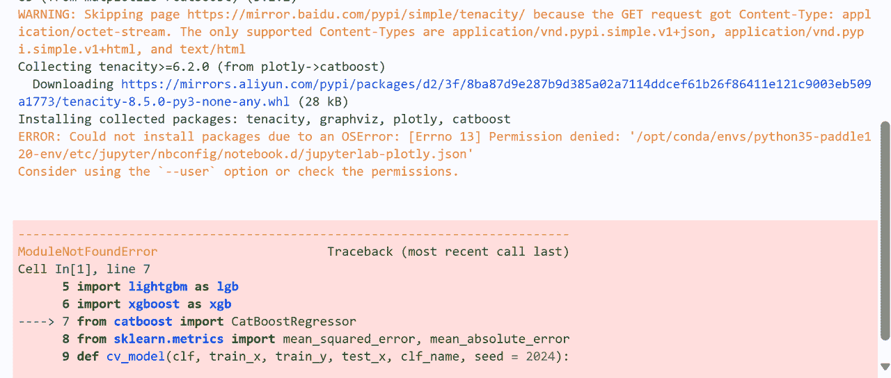

这种情况怎么处理。

系统访问权限被拒绝，所以只能为当前用户安装，代码如下：

```
!pip install --user xgboost -i https://mirror.baidu.com/pypi/simple
!pip install --user catboost -i https://mirror.baidu.com/pypi/simple
```

如果装了一遍后再次出现`ModuleNotFoundError`，则重启内核

## `train_cols` 没有定义的报错问题（注：根据教程的代码跑出来的报错）

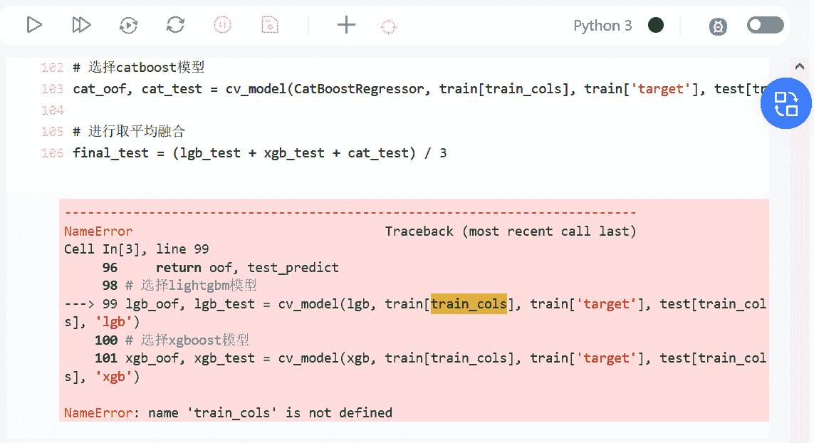

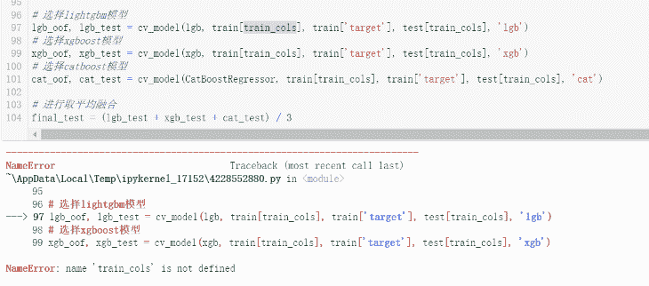

## `tensorflow` 模块怎么安装？

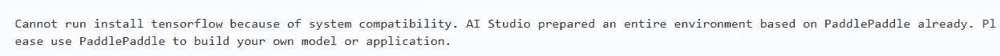

AI Studio是百度开发的，深度学习框架大概只能用`paddlepaddle`

## `sklearn` 怎么安装

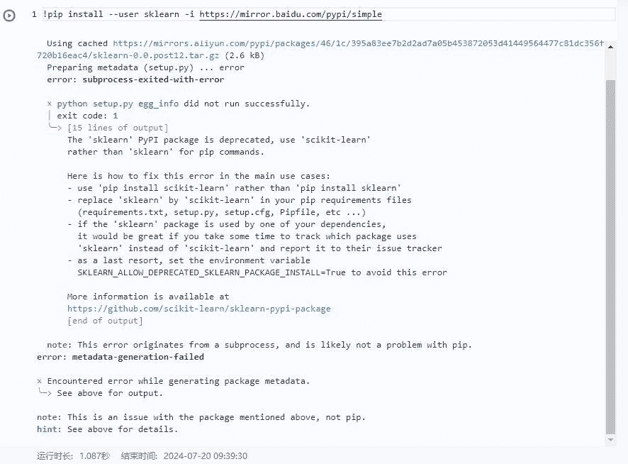

## `keras` 用不了

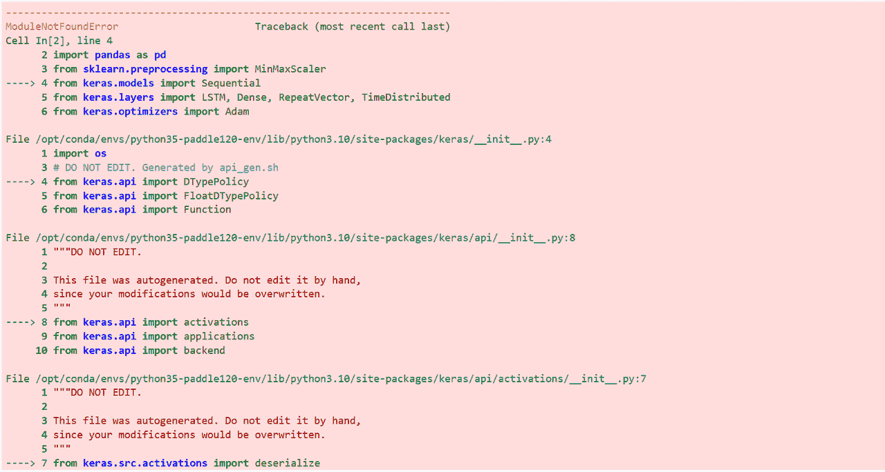

## 怎么确定所构建的特征是有效的呢

离线增长

## task2 的代码的分数出现问题了。现在700多。不知道怎么回事。是换数据了嘛？

关注一下离线

## 能对模型做泛化实现对不同站点预测嘛，有什么泛化方法嘛

观察训练集+验证集的分数

## 在特征统计为什么先历史平移

### 1. 如果在训练模型之前想知道特征的重要性来筛选，除了和`target`相关系数来设置阈值来选还有什么办法吗

### 12. 比赛方给的数据集里面有负数怎么处理

# 开营直播问题汇总

1. 如果不知道加了团队，可以转个人吗？该怎么操作呢？

> 如果不知道加了团队，可以转个人吗？该怎么操作呢？

2. 笔记截止时间是指的优秀笔记评选的截止时间吗，时间过了还可以提交1和2的笔记吗，但不参与优秀笔记评选是吗

# 贡献者清单

| 角色 | 姓名 |
| --- | --- |
| 课程设计者 | [@鱼遇雨欲语与余](https://www.zhihu.com/people/wang-he-13-93) |
| 运营助教 | 李雨芹、霍潇潇、陈丽群 |
| 专业助教 | 张宏辉、邢思宇、陈杰豪、蒋馨怡 |
| 优秀学习者 |  |
| QA贡献者 | Amy姐、高淼 |

# 学习规划表

<https://datawhaler.feishu.cn/sync/KeQvdtCR6sr0nIb8UTRc1dmfneb>

# 学习群报道墙~
