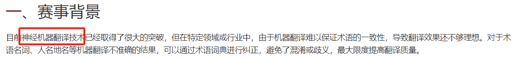
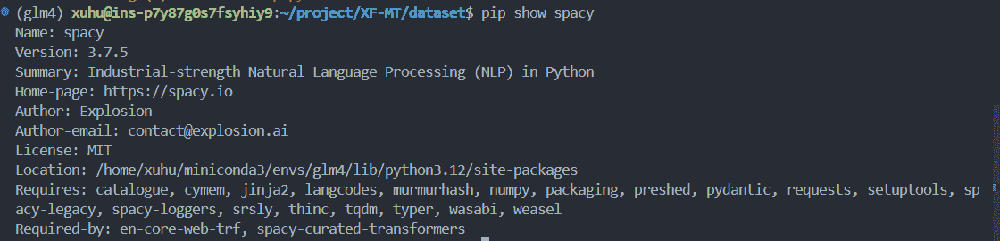
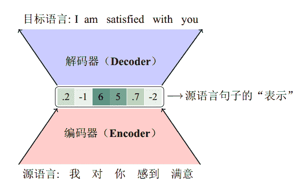
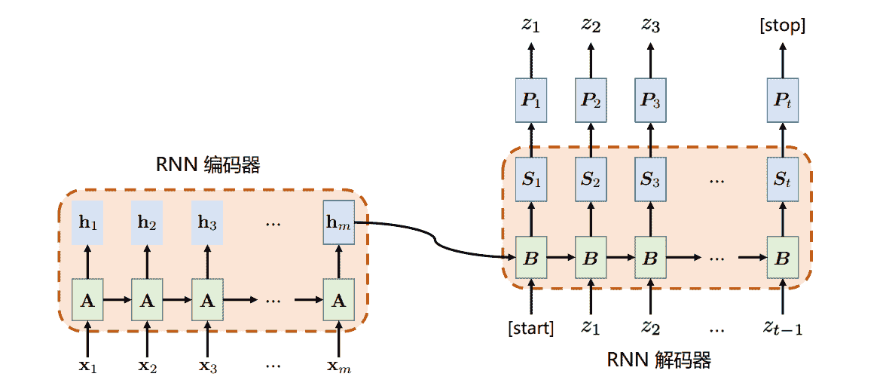
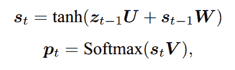
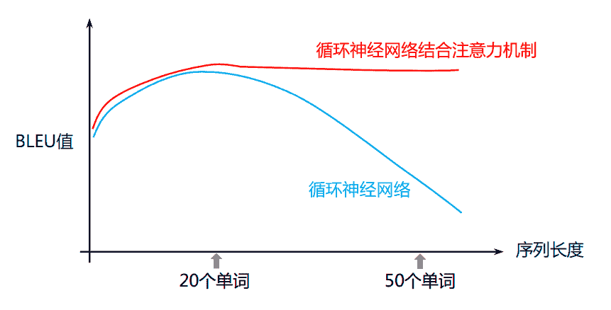
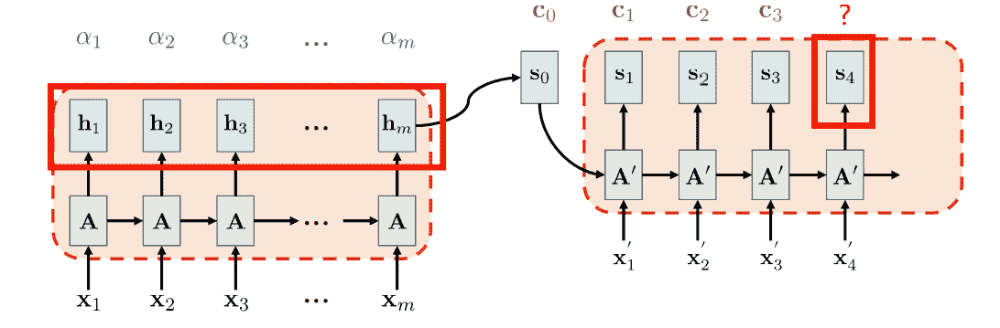
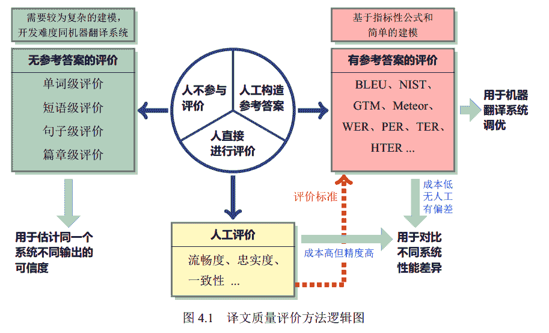

# Task2：从baseline代码详解入门深度学习

> 来源：[https://datawhaler.feishu.cn/docx/MVwsd1Dk9oRkd2xPcwBcXyjentb](https://datawhaler.feishu.cn/docx/MVwsd1Dk9oRkd2xPcwBcXyjentb)

> **教程贡献者说：**

> 前面我们介绍了如何**一键跑通 baseline****和初步理解赛题，**详情可以回顾 [从零入门NLP竞赛](https://datawhaler.feishu.cn/wiki/TObSwHZdFi2y0XktauWcolpcnyf)和 [Task1：了解机器翻译 & 理解赛题](https://datawhaler.feishu.cn/wiki/FVs2wAVN5iqHMqk5lW2ckfhAncb)。

> 今天我们的任务是**对baseline****代**码做具体解析，让你知其然更知其所以然！

> 你可以从中学会 **S**eq2Seq模型结构、中英文分词、循环神经网络（RNN）、门控循环单元（Gated Recurrent Unit，GRU）等。

> 让你的上分之路更加顺畅~

## 基于 **Seq2Seq 的 **Baseline 详解

**在 task**1 中我们已经提到了，当前机器翻译任务的主流解决方案是基于神经网络进行建模，依据赛题背景中意思，也是希望我们能用神经网络解决此英文翻译中文的任务。



通常我们基于神经网络解决机器翻译任务的流程如下：

本节使用代码如下：


[Task2-baseline-2024-07-16.ipynb](https://internal-api-drive-stream.feishu.cn/space/api/box/stream/download/all/AsVRbti36oPz1Cxt8xhcWciCnQh)

---

### 配置环境

运行环境我们还是基于[魔搭](https://modelscope.cn/my/mynotebook/preset)平台进行模型训练，这里不再重复说明。另外，有几个包需要额外安装：

+   **torchtext** ：是一个用于自然语言处理（NLP）任务的库，它提供了丰富的功能，包括数据预处理、词汇构建、序列化和批处理等，特别适合于文本分类、情感分析、机器翻译等任务

+   **jieba****：**是一个中文分词库，用于将中文文本切分成有意义的词语

+   **sacrebleu**：用于评估机器翻译质量的工具，主要通过计算BLEU（Bilingual Evaluation Understudy）得分来衡量生成文本与参考译文之间的相似度

```
!pip install torchtext    
!pip install jieba
!pip install sacrebleu
```

+   **spacy**：是一个强大的自然语言处理库，支持70+语言的分词与训练

**这里，我们需要安装 spacy 用于英文的 tok**enizer（分词，就是将句子、段落、文章这种长文本，分解为以字词为单位的数据结构，方便后续的处理分析工作），不同环境的安装请参考：https://spacy.io/usage，如果使用魔搭平台，可按照下图中的配置进行安装：

> 需要注意的是，使用命令!python -m spacy down**load en_core**_web_tr**f安装 ****e**n_core_web_sm 语言包非常的慢，经常会安装失败，这里我们可以离线安装。由于en_core_web_sm 对 spacy 的版本有较强的依赖性，你可以使用 pip show spacy 命令在终端查看你的版本，可以看到我的是 3.7.5 版本的 spacy。



> 然后我们从该路径下：https://github.com/explosion/spacy-models/releases 安装对应版本的 en_core_web_trf 语言包，可以看到我的 en_core_web_trf 3.7.3 版本的要求 spaCy >=3.7.2,<3.8.0，刚好满足我的 3.7.5的 spacy!

将下载到本地的压缩包上传到你的魔搭平台上的  dataset 目录下:

然后使用 !pip install ../dataset/en_core_web_trf安装英文语言包：

```
!pip install -U pip setuptools wheel -i https://pypi.tuna.tsinghua.edu.cn/simple
pip install -U &#x27;spacy[cuda12x,transformers,lookups]&#x27; -i https://pypi.tuna.tsinghua.edu.cn/simple
!pip install ../dataset/en_core_web_trf-3.7.3-py3-none-any.whl
```

### 数据预处理

机器翻译任务的预处理是确保模型能够有效学习源语言到目标语言映射的关键步骤。预处理阶段通常包括多个步骤，旨在清理、标准化和转换数据，使之适合模型训练。以下是机器翻译任务预处理中常见的几个处理步骤：

+   **清洗和规范化数据**

+   **去除无关信息**：删除HTML标签、特殊字符、非文本内容等，确保文本的纯净性（本赛题的训练集中出现了非常多的脏数据，如“Joey.        （掌声） （掌声） 乔伊”、“Thank you.        （马嘶声） 谢谢你们”等这种声音词）

+   **统一格式**：转换所有文本为小写，确保一致性；标准化日期、数字等格式。

+   **分句和分段**：将长文本分割成句子或段落，便于处理和训练。

+   **分词**

+   **分词**：将句子分解成**单词或词素**（构成单词的基本组成部分，一个词素可以是一个完整的单词，也可以是单词的一部分，但每一个词素都至少携带一部分语义或语法信息），这是NLP中最基本的步骤之一。我们这里使用了使用jieba 对中文进行分词，使用spaCy对英文进行分词。

+   **构建词汇表和词向量**

+   **词汇表构建**：从训练数据中收集所有出现过的词汇，构建词汇表，并为每个词分配一个唯一的索引。

+   **词向量**：使用预训练的词向量或自己训练词向量，将词汇表中的词映射到高维空间中的向量，以捕捉语义信息（当前大模型领域训练的 embedding 模型就是用来完成此任务的）。

+   **序列截断和填充**

+   **序列截断**：限制输入序列的长度，过长的序列可能增加计算成本，同时也可能包含冗余信息。

+   **序列填充**：将所有序列**填充至相同的长度，便于批量处理**。通常使用<PAD>标记填充。

+   **添加特殊标记**

+   **序列开始和结束标记**：在**序列两端**添加<SOS>（Sequ**ence Start**）和<EOS>（Sequence End）标记，帮助模型识别序列的起始和结束。

+   **未知词标记**：为不在词汇表中的词添加<UNK>**（Unknown**）标记，使模型能够处理未见过的词汇。

+   **数据增强**

+   **随机替换或删除词**：在训练数据中随机替换或删除一些词，增强模型的鲁棒性。

+   **同义词替换**：使用同义词替换原文中的词，增加训练数据的多样性。

+   **数据分割**

+   **划分数据集**：将数据划分为训练集、验证集和测试集，分别用于模型训练、参数调整和最终性能评估（该赛题中已划分好，不需要自己进行划分）

### 模型训练

说到**神经机器翻译**就不得不提**编码器-解码器模型**，或编码器-解码器框架（EncoderDecoder Paradigm）。本质上，编码器­解码器模型是描述输入­输出之间关系的一种方式。编码器­解码器这个概念在日常生活中并不少见。

例如，在电视系统上为了便于视频的传播，会使用各种编码器将视频编码成数字信号，在客户端，相应的解码器组件会把收到的数字信号解码为视频。另外一个更贴近生活的例子是电话，它通过对声波和电信号进行相互转换，达到传递声音的目的。

这种“**先编码，再解码**”的思想被应用到密码学、信息论等多个领域。不难看出，机器翻译问题也完美的贴合编码器­解码器结构的特点。可以将源语言编码为类似信息传输中的数字信号，然后利用解码器对其进行转换，生成目标语言。下面就来看一下神经机器翻译是如何在编码器­解码器框架下进行工作的。

下面是一个应用编码器­解码器结构来解决汉译英的例子：



> **给定一**个中文句子“我/对/你**/感到**/满意”，编码器会将这句话编码成一个实数向量(0.2, −1, 6, 5, 0.7, −2)，这个向量就是源语言句子的“表示”结果。虽然有些不可思议，但是神经机器翻译模型把这个向量等同于输入序列。向量中的数字并没有实际的意义，然而解码器却能从中提取到源语言句子中所包含的信息。也有研究人员把向量的每一个维度看作是一个“特征”，这样源语言句子就被表示成多个“特征”的联合，而且这些特征可以被自动学习。有了这样的源语言句子的“表示”，解码器可以把这个实数向量作为输入，然后逐词生成目标语言句子“I am satisfied with you”。

在源语言句子的表示形式确定之后，需要设计相应的编码器和解码器结构。在当今主流的神经机器翻译系统中，编码器由词嵌入层和中间网络层组成：

+   当输入一串单词序列**时，词**嵌入层(embedding)会将每个单词映射到多维实数表示空间，这个过程也被称为词嵌入。

+   之后**中间层**会对词嵌入向量进行更深层的抽象，得到输入单词序列的中间表示。中间层的实现方式有很多，比如：循环神经网络、卷积神经网络、自注意力机制等都是模型常用的结构。

解码器的结构基本上和编码器是一致的，在基于循环神经网络的翻译模型中，解码器只比编码器多了输出层，用于输出每个目标语言位置的单词生成概率，而在基于自注意力机制的翻译模型中，除了输出层，解码器还比编码器多一个编码­解码注意力子层，用于帮助模型更好地利用源语言信息。

我们以 基于循环神经网络的机器翻译模**型为例，说**明其整体结构。其中，左侧为编码器部分，源语言单词按照其在文本序列中的先后顺序被依次送入到循环神经网络（RNN）当中。在每个时间步 t 中，模型依据送入的源语言单词 对应修改并维护其模型内部的隐状态  ，这个隐状态编码了输入的源语言序列前 t 个时刻的所有必要信息。按照这种方式当 m 个输入全部被送入到编码器之后，所对应的  可以认为包含了源语言序列的所有信息。



右半部分是 **RNN 解码器部分**，它接收编码器输出的编码源语言句子信息的向量  作为初始隐状态  。由于 RNN 的循环过程在每个时间步都要求一个输入单词，为了启动解码过程，一般会使用一个保留的特殊符号 “[Start]” 作为翻译开始的标记送入到 RNN 解码器当中并解码出目标语言序列的第一个单词  。接下来，  会作为下一个时刻的输入被送入到循环神经网络当中，并按照不断迭代产生后续的预测。由于目标语言序列的长度无法被提前预知，因此使用另一个保留符号 “[Stop]” 作为预测结束的标志。当某一个时刻 t 预测出的目标语言单词为 zt =“[Stop]” 时，解码过程动态地停止。在上述过程当中，主要涉及到两步运算，第一步是 RNN 接收前一时刻隐状态   并依据当前时刻输入  （目标语言单词   对应的语义嵌入）对隐状态进行维护并生成 的运算过程，第二步是依据当前时刻隐状态生成目标语言单词的过程：



**其中 U,W,V 是可学习的参数。U**,W 负责维护循环状态，而 V 负责将当前时刻状态转换到词表大小的概率分布

，从中可以采样得到目标语言单词  。

通过循环网络对源语言文本进行编码，并生成**目标语言翻译结果的过程十****分****简单。然而，它仅仅使用一个定长的向量   编码整个源语言序列。这对于**较短的源语言文本没有什么问题，但随着文本序列长度的逐渐加长，单一的一个向量 hm 可能不足以承载源语言序列当中的所有信息。



蓝色的线代表上述简单循环神经网络性能随源语言文本长度的变化趋势。当文本长度在 20 个单词以内时，单一向量能够承载源语言文本中的必要信息。随着文本序列的进一步增加，翻译性能的评价指标 BLEU 的值就开始出现明显地下降。因此，这就启发我们使用更加有效地机制从编码器向解码器传递源语言信息，这就是接下来要讲到的注意力机制。

引**入注意力机制的循环机器翻译架构与**基于简单循环网络的机器翻译模型大体结构相似，均采用循环神经网络作为编码器与解码器的实现。关键的不同点在于注意力机制的引入使得不再需要把原始文本中的所有必要信息压缩到一个向量当中。引入注意力机制的循环神经网络机器翻译架构如图所示:



> 传统的 Seq2Seq 模型在解码阶段仅**依赖于编码器产生的最**后一个隐藏状态，这在处理长序列时效果不佳。注意力机制允许解码器在生成每个输**出词时，关注编码器产生的所有中间状**态，从而更好地利用源序列的信息。具体来说，给定源语言序列经过编码器输出的向量序列  ，注意力机制旨在依据解码端翻译的需要，自适应地从这个向量序列中查找对应的信息。

**我们的 baseline 代码中实现了一个经典的序列到序列(Seq2Seq)模型，中间层使用的GRU网络，并且网络中加入了注意力机制(A**ttention Mechanism)，请你参考上述基于注意力机制的循环神经网络机器翻译，以及GRU的相关知识，画出基于注意力机制的 GRU 神经网络机器翻译！

+   GRU 知识讲解：https://zh.d2l.ai/chapter_recurrent-modern/gru.html

### 翻译质量评价

**人们在使用机器翻译系**统时需要**评估系统输出**结果的质**量**。这个过程也被称作机器翻译译文质量评价，简称为译文质量评价（Quality Evaluation of Translation）。在机器翻译的发展进程中，译文质量评价有着非常重要的作用。不论在系统研发的反复迭代中，还是在诸多的机器翻译应用场景中，都存在大量的译文质量评价环节。从某种意义上说，没有译文质量评价，机器翻译也不会发展成今天的样子。比如，本世纪初研究人员提出了译文质量自动评价方法 BLEU（Bilingual Evaluation Understudy）（Task 1知识文档已详细介绍过）。该方法使得机器翻译系统的评价变得自动、快速、便捷，而且评价过程可以重复。正是由于 BLEU 等自动评价方法的提出，机器翻译研究人员可以在更短的时间内得到译文质量的评价结果，加速系统研发的进程。

传统观点把翻译分为**“信”、“达”、“雅”**三个层次，而**忠诚度**体现的是一种“信”的思想，而**流畅度**体现的是一种“达”的思想。不过“雅”在机器翻译评价中还不是一个常用的标准，而且机器翻译还没有达到“雅”的水平，是未来所追求的目标。给定评价标准，译文质量评价有很多实现方式，下图给出了机器翻译译文评价方法的逻辑关系图：



+   人工评价。当需要对系统进行准确的评估时，往往采用人工评价。比如，对于机器翻译的一些互联网应用，在系统上线前都会采用人工评价对机器翻译系统性能进行测试。当然，这种方法的时间和人力成本是最高的。

+   有参考答案的自动评价。由于机器翻译系统研发过程中需要频繁地对系统性能进行评价，这时可以让人标注一些正确的译文，之后把这些译文作为参考答案与机器翻译系统输出的结果进行比对。这种自动评价的结果获取成本低，可以多次重复，而且可以用于对系统结果的快速反馈，指导系统优化的方向。

+   无参考答案的自动评价。在很多应用场景中，在系统输出译文时，使用者希望提前知道译文的质量，即使这时并没有可比对的参考答案。这样，系统使用者可以根据这个对质量的“估计”结果有选择地使用机器翻译译文。严格意义上说，这并不是一个传统的译文质量评价方法，而是一种对译文置信度和可能性的估计。

# 别忘了学习规划表

> 学有余力还可以自己先往前面学哟~

> [Task3知识点文档](https://datawhaler.feishu.cn/wiki/OgQWwkYkviPfpwkE1ZmcXwcWnAh)们只剩最后一个必修的Task了！——

<https://datawhaler.feishu.cn/sync/VLmpdf8hGskXBWbJnefcN8cHnte>

#

> 本教程主要由   写作贡献，经过多位助教内测和建议修改，期待你的点赞和评论～