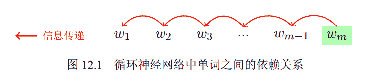
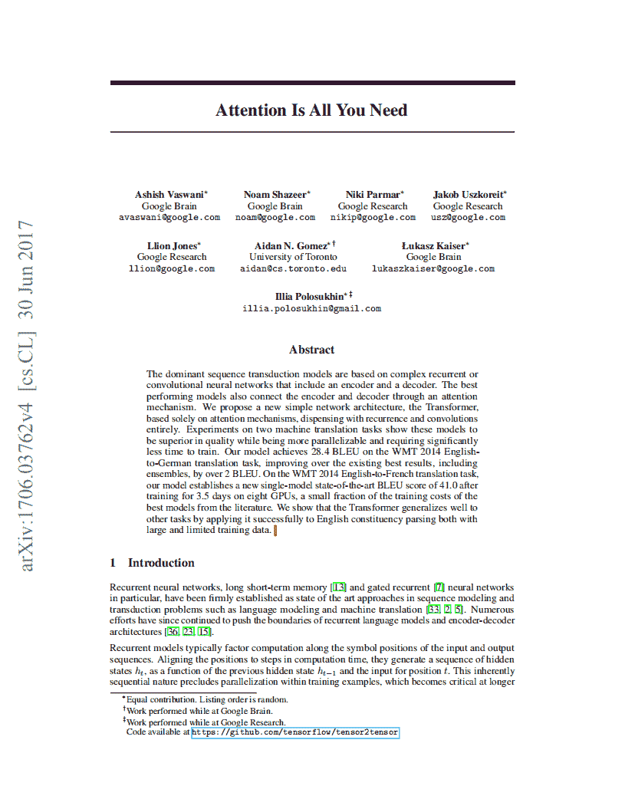
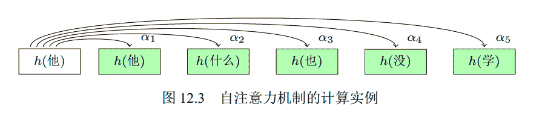
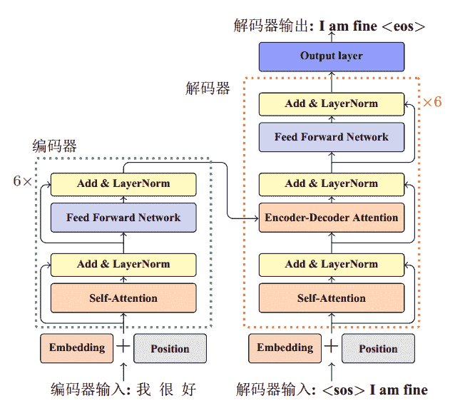
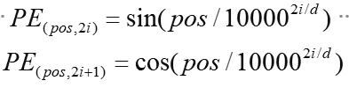
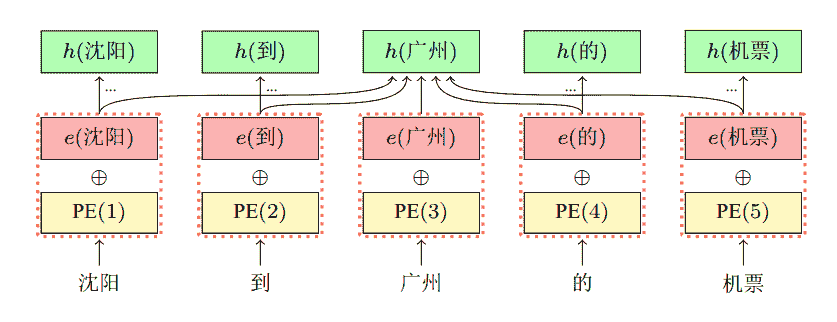

# Task3：基于Transformer解决机器翻译任务

> 来源：[https://datawhaler.feishu.cn/docx/RCLVdgZ5moN337x7AmrcIDnennC](https://datawhaler.feishu.cn/docx/RCLVdgZ5moN337x7AmrcIDnennC)

> 教程贡献者说：

> 前面我们介绍了 Seq2Seq 这种编码器、解码器架构，中间层使用的GRU网络，并且网络中加入了注意力机制(Attention Mechanism)

> 今天我们的任务是了解 Transformer 模型，并基于 Transformer 模型实现在机器翻译任务上的应用！

> 你可以从中学会 Transformer的关键模块（位置编码、多头注意力机制、残差网络和层标准化等）

## 一、Transformer 介绍

基于循环或卷积神经网络的序列到序列建模方法是现存机器翻译任务中的经典方法。然而，它们在建模文本长程依赖方面都存在一定的局限性。

+ 对于卷积神经网络来说，受限的上下文窗口在建模长文本方面天然地存在不足。如果要对长距离依赖进行描述，需要多层卷积操作，而且不同层之间信息传递也可能有损失，这些都限制了模型的能力。

+ 而对于循环神经网络来说，上下文的语义依赖是通过维护循环单元中的隐状态实现的。在编码过程中，每一个时间步的输入建模都涉及到对隐藏状态的修改。随着序列长度的增加，编码在隐藏状态中的序列早期的上下文信息被逐渐遗忘。尽管注意力机制的引入在一定程度上缓解了这个问题，但循环网络在编码效率方面仍存在很大的不足之处。由于编码端和解码端的每一个时间步的隐藏状态都依赖于前一时间步的计算结果，这就造成了在训练和推断阶段的低效。



循环神经网络中单词之间的依赖关系

为了更好地描述文字序列，谷歌的研究人员在 2017 年提出了一种新的模型 Transformer，学有余力的同学可以阅读一下原论文《Attention Is All You Need》，也可以直接看李沐老师的B站讲解：



[Vaswani 等 - 2017 - Attention Is All You Need.pdf](https://internal-api-drive-stream.feishu.cn/space/api/box/stream/download/all/ZDlrbS61Zo9J2txqtjgc0fIknMe)

[Transformer论文逐段精读](https://www.bilibili.com/video/BV1pu411o7BE/?spm_id_from=333.337.search-card.all.click&vd_source=57d58ebb10da27d2a5cc9f4134efb2b8)【论文精读】_哔哩哔哩_bilibili

Transformer 在原论文中第一次提出就是将其应用到机器翻译领域，它的出现使得机器翻译的性能和效率迈向了一个新的阶段。它摒弃了循环结构，并完全通过注意力机制完成对源语言序列和目标语言序列全局依赖的建模。在抽取每个单词的上下文特征时，Transformer 通过自注意力机制（self-attention）衡量上下文中每一个单词对当前单词的重要程度。



自注意力机制的计算实例

在这个过程当中没有任何的循环单元参与计算。这种高度可并行化的编码过程使得模型的运行变得十分高效。当前几乎大部分的大语言模型都是基于 Transformer 结构，本节以应用于机器翻译的基于Transformer 的编码器和解码器介绍该模型。

Transformer的主要组件包括编码器(Encoder)、解码器(Decoder)和注意力层。其核心是利用多头自注意力机制（Multi-Head Self-Attention），使每个位置的表示不仅依赖于当前位置，还能够直接获取其他位置的表示。自从提出以来，Transformer模型在机器翻译、文本生成等自然语言处理任务中均取得了突破性进展，成为NLP领域新的主流模型。

> Transformer 是各种笔试面试中必考的一个地方，里面设计的考点很多，建议大家要好好学哦！

> 学完之后可以尝试回答以下20道题：https://blog.csdn.net/m0_51879931/article/details/134142492

下图展示了 Transformer 模型的基本架构:



从宏观角度来看，Transformer的编码器是由多个相同的层叠加而成的，每个层都有两个子层（子层表示为sublayer）。第一个子层是多头自注意力（multi-head self-attention）汇聚；第二个子层是基于位置的前馈网络（positionwise feed-forward network）。主要涉及到如下几个模块：

### 1. 嵌入表示层

对于输入文本序列，先通过一个输入嵌入层（Input Embedding）将每个单词转换为其相对应的向量表示。通常直接对每个单词创建一个向量表示。由于 Transformer 模型不再使用基于循环的方式建模文本输入，序列中不再有任何信息能够提示模型单词之间的相对位置关系。在送入编码器端建模其上下文语义之前，一个非常重要的操作是在词嵌入中加入位置编码（Positional Encoding）这一特征。具体来说，序列中每一个单词所在的位置都对应一个向量。这一向量会与单词表示对应相加并送入到后续模块中做进一步处理。在训练的过程当中，模型会自动地学习到如何利用这部分位置信息。为了得到不同位置对应的编码，Transformer 模型使用不同频率的正余弦函数如下所示：



其中，  表示单词所在的位置，  和   表示位置编码向量中的对应维度， 则对应位置编码的总维度。

通过上面这种方式计算位置编码有这样几个好处：

+ 首先，正余弦函数的范围是在  ，导出的位置编码与原词嵌入相加不会使得结果偏离过远而破坏原有单词的语义信息。

+ 其次，依据三角函数的基本性质，可以得知第  个位置的编码是第   个位置的编码的线性组合，这就意味着位置编码中蕴含着单词之间的距离信息。



位置编码的维度和词嵌入向量的维度相同（ 均为 `d_model`），模型通过将二者相加作为模型输入

### 2. 注意力层

自注意力（Self-Attention）操作是基于Transformer 的机器翻译模型的基本操作，在源语言的编码和目标语言的生成中频繁地被使用以建模源语言、目标语言任意两个单词之间的依赖关系。给定由单词语义嵌入及其位置编码叠加得到的输入表示  ，为了实现对上下文语义依赖的建模，进一步引入在自注意力机制中涉及到的三个元素：查询   ，键   ，值   。在编码输入序列中每一个单词的表示的过程中，这三个元素用于计算上下文单词所对应的权重得分。直观地说，这些权重反映了在编码当前单词的表示时，对于上下文不同部分所需要的关注程度。

为了得到编码单词时所需要关注的上下文信息，通过位置查询向量与其他位置的键向量做点积得到匹配分数。为了防止过大的匹配分数在后续 Softmax 计算过程中导致的梯度爆炸以及收敛效率差的问题，这些得分会除放缩因子   以稳定优化。放缩后的得分经过 Softmax 归一化为概率之后，与其他位置的值向量相乘来聚合希望关注的上下文信息，并最小化不相关信息的干扰。上述计算过程可以被形式化地表述如下：

其中  ,  ,  分别表示输入序列中的不同单词的   向量拼接组成的矩阵，L 表示序列长度，  表示自注意力操作的输出。

### 3. 前馈层

前馈层接受自注意力子层的输出作为输入，并通过一个带有 Relu 激活函数的两层全连接网络对输入进行更加复杂的非线性变换。实验证明，这一非线性变换会对模型最终的性能产生十分重要的影响。

其中  表示前馈子层的参数。另外，以往的训练发现，增大前馈子层隐状态的维度有利于提升最终翻译结果的质量，因此，前馈子层隐状态的维度一般比自注意力子层要大。

### 4. 残差连接与层归一化

由 Transformer 结构组成的网络结构通常都是非常庞大。编码器和解码器均由很多层基本的Transformer 块组成，每一层当中都包含复杂的非线性映射，这就导致模型的训练比较困难。因此，研究者们在 Transformer 块中进一步引入了残差连接与层归一化技术以进一步提升训练的稳定性。具体来说，残差连接主要是指使用一条直连通道直接将对应子层的输入连接到输出上去，从而避免由于网络过深在优化过程中潜在的梯度消失问题：

其中   表示第   层的输入， 表示一个映射函数。此外，为了进一步使得每一层的输入输出范围稳定在一个合理的范围内，层归一化技术被进一步引入每个 Transformer 块的当中：

其中    和   分别表示均值和方差，用于将数据平移缩放到均值为 0，方差为 1 的标准分布，    和    是可学习的参数。层归一化技术可以有效地缓解优化过程中潜在的不稳定、收敛速度慢等问题。

### 5. 编码器和解码器结构

根据给出的网络架构，编码器端可以较为容易实现。但相比于编码器端，解码器端要更复杂一些。具体来说，解码器的每个 Transformer 块的第一个自注意力子层额外增加了注意力掩码，对应图中的掩码多头注意力（Masked Multi-Head Attention）部分。这主要是因为在翻译的过程中，编码器端主要用于编码源语言序列的信息，而这个序列是完全已知的，因而编码器仅需要考虑如何融合上下文语义信息即可。而解码端则负责生成目标语言序列，这一生成过程是自回归的，即对于每一个单词的生成过程，仅有当前单词之前的目标语言序列是可以被观测的，因此这一额外增加的掩码是用来掩盖后续的文本信息，以防模型在训练阶段直接看到后续的文本序列进而无法得到有效地训练。

此外，解码器端还额外增加了一个多头注意力（Multi-Head Attention）模块，使用交叉注意力（Cross-attention）方法，同时接收来自编码器端的输出以及当前 Transformer 块的前一个掩码注意力层的输出。查询是通过解码器前一层的输出进行投影的，而键和值是使用编码器的输出进行投影的。它的作用是在翻译的过程当中，为了生成合理的目标语言序列需要观测待翻译的源语言序列是什么。基于上述的编码器和解码器结构，待翻译的源语言文本，先经过编码器端的每个Transformer 块对其上下文语义的层层抽象，然后输出每一个源语言单词上下文相关的表示。解码器端以自回归的方式生成目标语言文本，即在每个时间步 t ，根据编码器端输出的源语言文本表示，以及前 t-1 个时刻生成的目标语言文本，生成当前时刻的目标语言单词。

## 二、基于 task2 的 baseline 修改代码

我们还是以 task2 给出的 baseline 代码为基础，进行修改，主要修改模型结构部分的代码：

```
# 位置编码
class PositionalEncoding(nn.Module):
    def __init__(self, d_model, dropout=0.1, max_len=5000):
        super(PositionalEncoding, self).__init__()
        self.dropout = nn.Dropout(p=dropout)

        pe = torch.zeros(max_len, d_model)
        position = torch.arange(0, max_len, dtype=torch.float).unsqueeze(1)
        div_term = torch.exp(torch.arange(0, d_model, 2).float() * (-math.log(10000.0) / d_model))
        pe[:, 0::2] = torch.sin(position * div_term)
        pe[:, 1::2] = torch.cos(position * div_term)
        pe = pe.unsqueeze(0).transpose(0, 1)
        self.register_buffer('pe', pe)

    def forward(self, x):
        x = x + self.pe[:x.size(0), :]
        return self.dropout(x)

# Transformer
class TransformerModel(nn.Module):
    def __init__(self, src_vocab, tgt_vocab, d_model, nhead, num_encoder_layers, num_decoder_layers, dim_feedforward, dropout):
        super(TransformerModel, self).__init__()
        self.transformer = nn.Transformer(d_model, nhead, num_encoder_layers, num_decoder_layers, dim_feedforward, dropout)
        self.src_embedding = nn.Embedding(len(src_vocab), d_model)
        self.tgt_embedding = nn.Embedding(len(tgt_vocab), d_model)
        self.positional_encoding = PositionalEncoding(d_model, dropout)
        self.fc_out = nn.Linear(d_model, len(tgt_vocab))
        self.src_vocab = src_vocab
        self.tgt_vocab = tgt_vocab
        self.d_model = d_model

    def forward(self, src, tgt):
        # 调整src和tgt的维度
        src = src.transpose(0, 1)  # (seq_len, batch_size)
        tgt = tgt.transpose(0, 1)  # (seq_len, batch_size)

        src_mask = self.transformer.generate_square_subsequent_mask(src.size(0)).to(src.device)
        tgt_mask = self.transformer.generate_square_subsequent_mask(tgt.size(0)).to(tgt.device)

        src_padding_mask = (src == self.src_vocab['<pad>']).transpose(0, 1)
        tgt_padding_mask = (tgt == self.tgt_vocab['<pad>']).transpose(0, 1)

        src_embedded = self.positional_encoding(self.src_embedding(src) * math.sqrt(self.d_model))
        tgt_embedded = self.positional_encoding(self.tgt_embedding(tgt) * math.sqrt(self.d_model))

        output = self.transformer(src_embedded, tgt_embedded,
                                  src_mask, tgt_mask, None, src_padding_mask, tgt_padding_mask, src_padding_mask)
        return self.fc_out(output).transpose(0, 1)
```

然后在主函数里定义 Transformer 模型调用：

```
model = TransformerModel(src_vocab, tgt_vocab, d_model, nhead, num_encoder_layers, num_decoder_layers, dim_feedforward, dropout)
```

为了方便学习者运行，我们直接给出修改后的代码：


[Task3-Transformer-2024-07-16.ipynb](https://internal-api-drive-stream.feishu.cn/space/api/box/stream/download/all/OtZWbiJjIoOE5wxVeIxcl5HPn5c)

## 三、其他上分技巧


+ 最简单的就是调参，将 `epochs` 调大一点，使用全部训练集，以及调整模型的参数，如 `head`、`layers` 等。如果数据量允许，增加模型的深度（更多的编码器/解码器层）或宽度（更大的隐藏层尺寸），这通常可以提高模型的表达能力和翻译质量，尤其是在处理复杂或专业内容时。

+ **加入术语词典**，这是在此竞赛中比较有效的方法，加入术语词典的方法策略也有很多，如：

  + 在**模型生成的翻译输出中替换术语**，这是最简单的方法

  + 整合到**数据预处理流程**，确保它们在翻译中保持一致

  + **在模型内部动态地调整术语的嵌入**，这涉及到在模型中加入一个额外的层，该层负责查找术语词典中的术语，并为其生成专门的嵌入向量，然后将这些向量与常规的词嵌入结合使用

+ 认真做**数据清洗**，我们在 Task2 已经提到过当前训练集存在脏数据的问题，会影响我们的模型训练

+ **数据扩增**：

  + 回译（`back-translation`）：将源语言文本先翻译成目标语言，再将目标语言文本翻译回源语言，生成的新文本作为额外的训练数据

  + 同义词替换：随机选择句子中的词，并用其同义词替换

  + 使用句法分析和语义解析技术重新表述句子，保持原意不变

  + 将文本翻译成多种语言后再翻译回原语言，以获得多样化翻译

+ **采用更精细的学习率调度策略**（baseline我们使用的是固定学习率）：

  + `Noam Scheduler`：结合了`warmup`（预热）阶段和衰减阶段

  + `Step Decay`：最简单的一种学习率衰减策略，每隔一定数量的 `epoch`，学习率按固定比例衰减

  + `Cosine Annealing`：学习率随周期性变化，通常从初始值下降到接近零，然后再逐渐上升

+ 自己**训练一个小的预训练模型**，尽量选择 1B 以下小模型，对 GPU 资源要求比较高，仅仅使用魔搭平台可能就满足不了

+ 将训练集上训练出来的模型拿到开发集（`dev dataset`）上 `finetune` 可以提高测试集（`test dataset`）的得分，因为开发集与测试集的分布比较相近

+ 在开发集和测试集上训一个语言模型，用这个语言模型给训练集中的句子打分，选出一些高分句子

+ **集成学习**：训练多个不同初始化或架构的模型，并使用集成方法（如投票或平均）来产生最终翻译。这可以减少单一模型的过拟合风险，提高翻译的稳定性。

> 建议学习者先尝试第一种方法，提升有限之后可以考虑第二种和第三种方法，理想情况下会得到比较大的提高！！其他方法可视自己的情况进行尝试，祝大家都能取得一个理想的成绩！

# ❀ 恭喜看完全部知识教程！

> 咱们本次7天的学习就快要结束啦，时间飞逝，
> 但还好我们不负时光，一起走在学习的路上~
> 还记得你最初立下的`Flag`吗？
>
> 你成功拿下更高的分数了没？有没有用心写过一篇笔记？
> 你有没有被评选上**优秀学习者**呢？
> 你是否找到了自己的方向？是否找到了学习的节奏和AI竞赛乐趣呢？
> 你是否找到了志同道合的小伙伴，能在后续并肩作战，砥砺前行？
>
> **你这次的学习体验**感受如何？欢迎 留言 & 在群里 跟大家一起聊聊呀！
> 你的 结营证书 和 优秀学习者证书 正在赶来的路上！！！
> 助教们正在马不停蹄为你加急，不要着急哟~
>
> 另外，也祝愿你能继续努力，持续上分！冲进复赛甚至决赛！！！
> 虽然学习活动结束了，但Datawhale的学习群，持续为你开放不打烊！！！
> Datawhale想与你一同见证更好的自己，
> 永远—— “For the Learner，For the Dreamer”！

## 你可以随时回顾所有学习内容

> 期待你能找到自己的节奏，不断上分！

<https://datawhaler.feishu.cn/sync/VLmpdf8hGskXBWbJnefcN8cHnte>

## 🎉合影留念墙

感谢很棒的你一路的坚持，让我们在这里给自己点个赞！

期待下期夏令营还能与你再次相遇~

一起合个影 :)

> 本教程主要由 写作贡献，经过多位助教内测和建议修改，期待你的点赞和评论～
