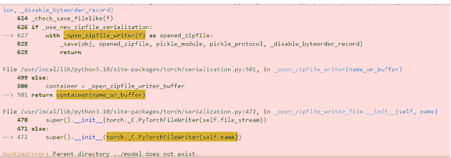
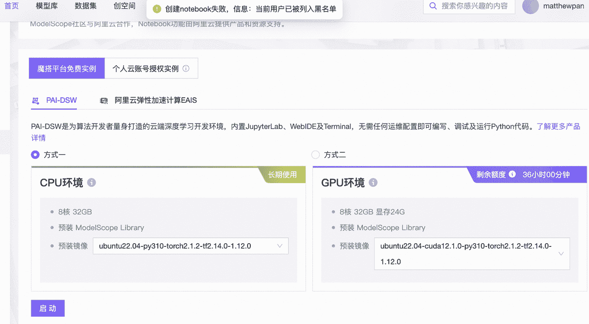
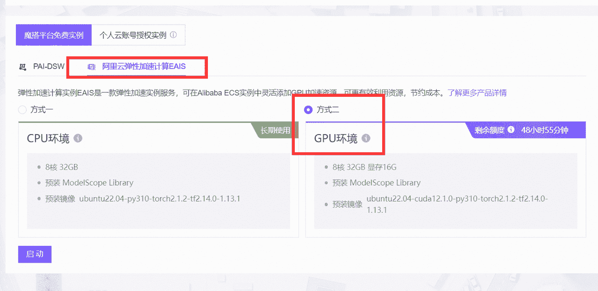
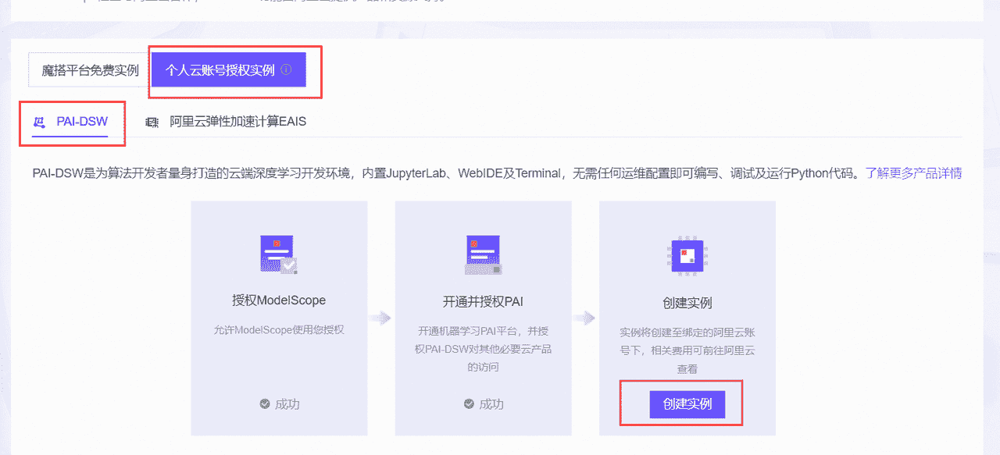
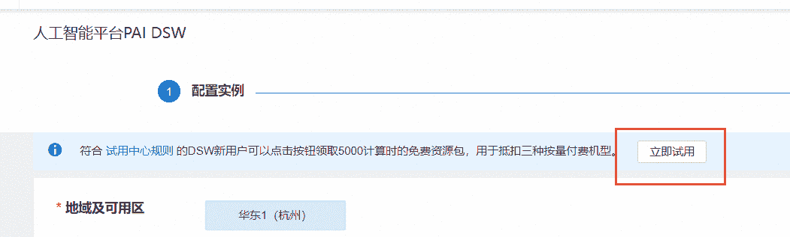

#  QA & 其他彩蛋

> 来源：[https://datawhaler.feishu.cn/docx/L1umd7HmdoylrZxE4hScUaaanMv](https://datawhaler.feishu.cn/docx/L1umd7HmdoylrZxE4hScUaaanMv)

### 欢迎来到 **QA共创**** **板块！ 此文档的内容完全开源，全网可编辑

> **我们将共同整理和总结**学习过程中的重点内容、问题和解答

> 欢迎随时分享你的**笔记和心得**，你的任何一小段的尝试和思考都有其参考价值和独特的意义！

> 我们期待并不仅限于如下内容主题：

> **🎥 文献笔记    &**** **     📒 优秀笔记

> **⚙ 技术概念解析    ****&**      💓 学习感悟

> **❓ 学习过程中的QA    ****&**      📚共创教程

# Task3 直播间问题汇总

| 序号 | 问题 | 回复 |
| --- | --- | --- |
| 1 | 在大模型中有时会出现为分词分配token不当而导致一些离谱的错误，那么在transform模型中其自注意力机制在为分词分配权重时是否会出现类似情况导致上下文丢失从而导致错误？如果有该如何优化这种问题？ |  |
| 2 | 翻译中的重复现象怎么出现的，如何减少这种现象？ |  |
| 3 | task3代码训练过一次结果正常；之后再训练得到模型一直只输出同一个字。 |  |
| 4 | 提了很多问题，首先非常感谢大佬的解答，下面是问题，辛苦了！ |  |
| 5 | 个人对注意力机制不太理解，老师可以大概说一下原理吗？ |  |
| 6 | Task03 数据清洗完之后出现index error怎么办？需要把N改一下吗？ |  |
| 7 | 复赛是什么情况，所有人都要参加吗？可以不参加吗？ |  |
| 8 | 加入术语词典可以提高翻译效果的原理是什么，能否简单展示下要怎么操作？ |  |
| 9 | 为什么数据增强回译后会出现not enough value to unpack |  |
| 10 | 第一个问题其实想问：在自注意力机制中，权重不是会影响分词的位置和出现吗。如果某个分词在浅层对应的权重就不正常，会导致到深层将这种异常传递下去从而后续都错误吗，如果有这种情况，影响是否严重，有没有什么方法可以在中途做校验。 |  |

# Task2 直播间问题汇总

| 序号 | 问题 | 回复 |
| --- | --- | --- |
| 1 | trf和sm有什么区别 | 效率和精确度不同，各有专长 |
| 2 | 请问大概什么水平可以进复赛 |  |
| 3 | 可以自己训练吗（不用预训练参数）？ |  |
| 4 | 真想学机器学习可以买本西瓜书然后找资源啃 | √ |
| 5 | 可以用镜像下载（spacy）嘛？ | 可以，但注意版本要正确 |
| 6 | (忘记什么了)不是1000条吗? | 口误 |
| 7 | 截断丢失了文本信息怎么办 | 够长就行，丢不了太多 |
| 8 | 训练题的词汇表要不要和词典的词汇表合并 | 可以试试 |
| 9 | 主函数运行时报错 | 要建这个文件夹 |
| 10 | 这是什么编译环境？阿里云魔塔 ？ |  |
|  | task3里提到的上分技巧翻译成别的语言这个不太理解，比赛不是英文翻成中文吗 | 扩充训练数据，提高性能 |

# Task2 QA汇总

| ## **Question** | ## **Answer** |
| --- | --- |
| 魔搭的notebook被拉黑怎么解决？ |  |
|  |  |
| Parent directory ../model does not exist. |  |

钉钉扫码加群

> 去魔塔钉钉售后群(用钉钉扫码)，@技术人员 你的用户名 解除就可以了

# 开营直播QA汇总

1.  比赛可以用预训练模型吗，还是从头训练？

1.  训练模型的神经网络用的是啥呀？

> seq2seq

1.  过拟合是不是训练集效果很好，但是测试集效果不好

是的

1.  满分是多少呀

1.  可以在自己电脑的Jupyter环境上跑吗

> 可以

1.  后续会涉及BERT吗

1.  把验证集也用于训练可以吗

1.  可以在比赛给的数据集中搞数据增强吗

1.  夏令营期间的笔记该怎么写啊？老师可以详细讲一下吗？

> 学习群里问助教要夏令营1期的优秀笔记合集，可以参考学习一下

1.  直播会有录屏吗

11.可以引入外部训练集一起训练吗.这个检测不出来吧，如果用外部的

12.同一代码不同时间跑的结果不一样是怎么回事

13.机器学习怎么入门啊

> Datawhale👸号-作者精选 有培养方案，提供了学习路线

14.可以看看十多分的txt和line吗

15.这次笔记提交什么时候截止

> Task01是今晚截止，

16.如果想修改一些模型结构，有哪些代码参考吗

17.打过卡但是没有交笔记有影响吗

18.想问一下实习/实践证明/证书是只要完成了学习打卡内容就能拿到么？

19.想问一下前三个包是在那里找，还需要操作下载的吗，是和spacy一样的操作流程（找相关官网本地下载）吗？

# Task1 QA汇总

1.  跑完后页面卡顿问题：

> **可以**尝试刷新，如果还不行，可以尝试清理浏览器缓存，但是后果是你刚刚训练结果都没有了，只剩下代码文件，得重新跑

1.  退出魔搭平台后，重新进入无dataset.zip的问题：

> 重新走一遍相关流程：把dataset.zip压缩包移入平台，并且要 cd MT,否则会解压缩失败。

1.  为什么在submit跑出来的时候无法下载文件：

> 尝试以下任意方式解决：

> 1，更换浏览器。（避免使用Mac系统的safari浏览器）

> 2，右键-在新的浏览器标签页打开，然后ctrl+s。

1.  如在比赛官网提交结果之后，出现“评测失败“等字样：

> 查看网址是否正确，保证自己赛道是正确赛道。

1.  如果在跑速通baseline的时候，出现时间超级长的情况：

> 请查看自己环境是否配对正确（是GPU而不是CPU）。

1.  如关掉魔搭平台之后重新开发现除了jupyter book 之外都被删掉怎么办：

> 因为魔搭平台免费算力有限带来的限制。关闭实例时，.ipynb 以外的文件不会自动存储，请仔细检查并保存重要文件。所以需要及时保存输出文件。

1.  讯飞平台实名认证/提交文件后出不了结果

> 我们非常希望能帮上忙，但是讯飞平台的问题超出了我[们的权限](https://challenge.xfyun.cn/topic/info?type=machine-translation-2024&option=sqjl&ch=dw24_AtTCK9)范围和处理能力，同学可以尝试联系讯飞平台处理。（尝试点击讯飞的赛题交流群或者右下方的联系邮箱）

1.  魔搭资源紧张，进不去

> 来试试看阿里云弹性加速计算EAIS

1.  魔搭额度不够用了

快来领取免费试用

https://modelscope.cn/my/mynotebook/authorization

# 贡献者清单

| **角色** | **姓名** |
| --- | --- |
| **课程设计者** |  |
| **运营助教** | 张亚萍、孙博辰 |
| **专业助教** | 何欣远、谢彩承 |
| **优秀学习者** |  |
| **QA贡献者** | 谢彩承 |

# 学习规划表

<https://datawhaler.feishu.cn/sync/VLmpdf8hGskXBWbJnefcN8cHnte>