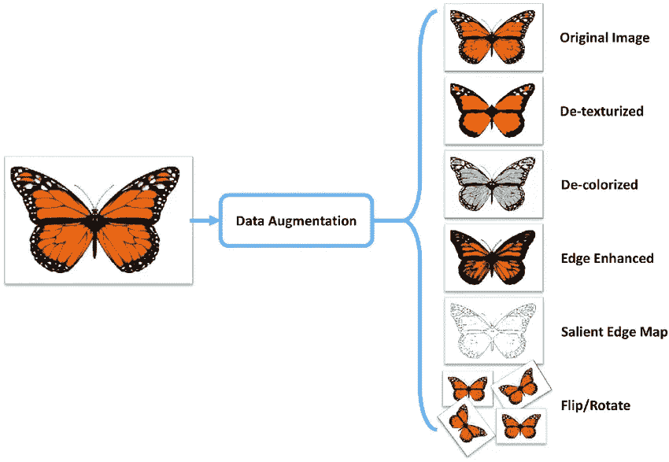
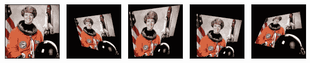
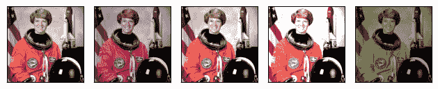
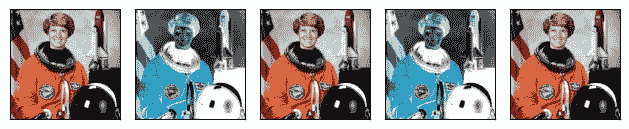
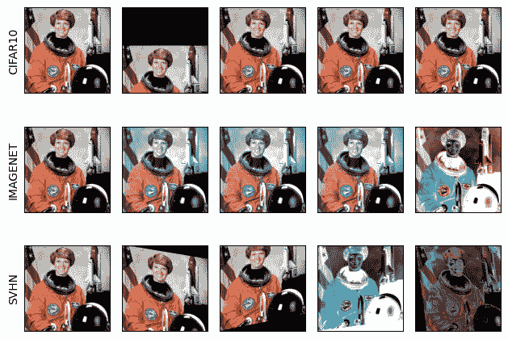
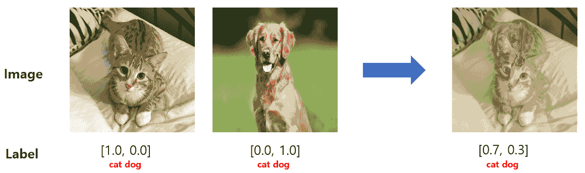
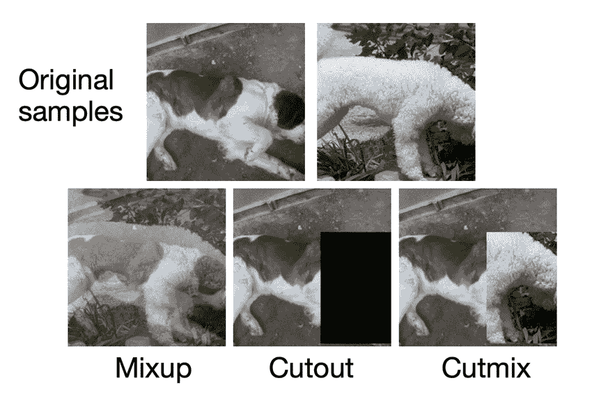

# Task3：数据增强，提升模型表现

> 来源：[https://datawhaler.feishu.cn/docx/K7qSdhcWcohDlwxVKKtcjIm6naf](https://datawhaler.feishu.cn/docx/K7qSdhcWcohDlwxVKKtcjIm6naf)

> **教程贡献者说：**

> 之前我们探讨了deepfake任务以及常见的网络结构。今天，我们将聚焦于数据增强方法，这是一项关键的技术，可以让您学会各种数据变换操作。数据增强不仅是深度学习训练过程中的重要环节，而且在参赛时也是提高模型精度的重要策略。

>

> 通过对训练数据进行多样化的变换，我们可以模拟更真实的世界场景，从而帮助模型更好地泛化，这在提升模型在未见数据上的表现方面起着至关重要的作用。在竞赛和实际应用中，精心设计的数据增强方案往往能够成为获胜的关键。

> **实操代码地址**

+   [九月]Deepfake-FFDI-图像赛题 ch3 Modified by Hong: https://www.kaggle.com/code/chg0901/deepfake-ffdi-ch3-modified-by-hong

+   [九月]Deepfake-FFDI-plot_transforms_illustrations: https://www.kaggle.com/code/chg0901/deepfake-ffdi-plot-transforms-illustrations

+   original：https://www.kaggle.com/finlay/deepfake-ffdi-ch3

# Part1 数据增强基础

数据增强是一种在机器学习和深度学习领域常**用**的技术，尤其是在处理图像和视频数据时。数据增强的目的是通过人工方式增加训练数据的多样性，从而提高模型的泛化能力，使其能够在未见过的数据上表现得更好。数据增强涉及对原始数据进行一系列的变换操作，生成新的训练样本。这些变换模拟了真实世界中的变化，对于图像而言，数据增强包括例如视角、光照、遮挡等情况，使得模型能够学习到更加鲁棒的特征表示。



如果数据增强的变换操作与目标任务的实际场景不符，比如在不需要旋转的图像任务中过度使用旋转，那么这些变换可能会引入无关的噪音。此外过度的数据增强，比如极端的亮度调整、对比度变化或大量的噪声添加，可能会导致图像失真，使得模型难以学习到有效的特征。

在之前的代码中我们使用PyTorch框架来加载和增强图像数据：

1.  图像大小调整：使用transforms.Resize((256, 256))将所有图像调整到256x256像素的尺寸，这有助于确保输入数据的一致性。

1.  随机水平翻转：transforms.RandomHorizontalFlip()随机地水平翻转图像，这种变换可以模拟物体在不同方向上的观察，从而增强模型的泛化能力。

1.  随机垂直翻转：transforms.RandomVerticalFlip()随机地垂直翻转图像，这同样是为了增加数据多样性，让模型能够学习到不同视角下的特征。

1.  转换为张量：transforms.ToTensor()将图像数据转换为PyTorch的Tensor格式，这是在深度学习中处理图像数据的常用格式。

1.  归一化：transforms.Normalize([0.485, 0.456, 0.406], [0.229, 0.224, 0.225])对图像进行归一化处理，这里的均值和标准差是根据ImageNet数据集计算得出的，用于将图像像素值标准化，这有助于模型的训练稳定性和收敛速度。

```
train_loader = torch.utils.data.DataLoader(
    FFDIDataset(train_label[&#x27;path&#x27;].head(1000), train_label[&#x27;target&#x27;].head(1000), 
            transforms.Compose([
                        transforms.Resize((256, 256)),
                        transforms.RandomHorizontalFlip(),
                        transforms.RandomVerticalFlip(),
                        transforms.ToTensor(),
                        transforms.Normalize([0.485, 0.456, 0.406], [0.229, 0.224, 0.225])
        ])
    ), batch_size=40, shuffle=True, num_workers=4, pin_memory=True
)

val_loader = torch.utils.data.DataLoader(
    FFDIDataset(val_label[&#x27;path&#x27;].head(1000), val_label[&#x27;target&#x27;].head(1000), 
            transforms.Compose([
                        transforms.Resize((256, 256)),
                        transforms.ToTensor(),
                        transforms.Normalize([0.485, 0.456, 0.406], [0.229, 0.224, 0.225])
        ])
    ), batch_size=40, shuffle=False, num_workers=4, pin_memory=True
)
```

在深度学习中，对输入数据进行归一化是一个标准步骤。归一化有助**于**加快模型的收敛速度，并提高数值稳定性。对于验证集，应该避免使用如随机翻转等可能引入不必要噪音的增强方法。通常，验证集只需要进行必要的预处理，如调整大小和归一化。

# Part2 常见数据增强方法

torchvision是一个流行的开源Python包，它提供了许多用于深度学习计算机视觉任务的工具和预训练模型。在torchvision中，数据增强方法主要位于torchvision.transforms和torchvision.transforms.v2模块中。这些增强方法可以用于图像分类、目标检测、图像分割和视频分类等各种任务。

## 几何变换





+   调整大小: Resize可以将图像调整到指定的大小。

+   随机裁剪: RandomCrop和RandomResizedCrop可以随机裁剪图像。

+   中心裁剪: CenterCrop从图像的中心裁剪出指定大小。

+   五裁剪和十裁剪: FiveCrop和TenCrop分别裁剪出图像的四个角和中心区域。

+   翻转: RandomHorizontalFlip和RandomVerticalFlip可以水平或垂直翻转图像。

+   旋转: RandomRotation可以随机旋转图像。

+   仿射变换: RandomAffine可以进行随机的仿射变换。

+   透视变换: RandomPerspective可以进行随机的透视变换。

## 颜色变换





+   颜色抖动: ColorJitter可以随机改变图像的亮度、对比度、饱和度和色调。

+   灰度化: Grayscale和RandomGrayscale可以将图像转换为灰度图。

+   高斯模糊: GaussianBlur可以对图像进行高斯模糊。

+   颜色反转: RandomInvert可以随机反转图像的颜色。

+   颜色 posterize: RandomPosterize可以减少图像中每个颜色通道的位数。

+   颜色 solarize: RandomSolarize可以反转图像中所有高于阈值的像素值。

## 自动增强



+   自动增强: AutoAugment可以根据数据集自动学习数据增强策略。

+   随机增强: RandAugment可以随机应用一系列数据增强操作。

+   TrivialAugmentWide:提供与数据集无关的数据增强。

+   AugMix:通过混合多个增强操作进行数据增强。

# Part3 进阶数据增强方法

## Mixup

MixUp是一种数据增强技术，其原理是通过将两个不同的图像及其标签按照一定的比例混合，从而创建一个新的训练样本。这种方法可以增加训练数据的多样性，提高模型的泛化能力，并减少过拟合的风险。MixUp方法中混合比例是一个超参数，通常称为alpha。alpha是一个在0到1之间的值，表示混合的比例。例如，alpha=0.5意味着两个图像各占新图像的一半。



MixUp的混合过程包括以下步骤：

1.  从训练集中随机选择两个图像和它们的标签。

1.  将这两个图像按照alpha的比例混合，得到一个新的图像。

1.  将这两个标签按照相同的alpha比例混合，得到一个新的标签。

MixUp方法具有以下几个优点：

1.  增加数据多样性：通过混合不同的图像和标签，MixUp可以创建更多样化的训练样本，帮助模型学习到更加鲁棒的特征表示。

1.  减少过拟合：MixUp可以减少模型对特定训练样本的依赖，从而降低过拟合的风险。

1.  提高泛化能力：MixUp可以帮助模型学习到更加泛化的特征表示，从而提高模型在未见过的数据上的表现。

## Cutmix

CutMix是一种数据增强技术，它通过将一个图像的一部分剪切并粘贴到另一个图像上来创建新的训练样本。同时，它也会根据剪切区域的大小来调整两个图像的标签。

CutMix方法中，剪切和粘贴操作是关键步骤。具体来说，剪切和粘贴过程包括以下步骤：

1.  从训练集中随机选择两个图像和它们的标签。

1.  随机选择一个剪切区域的大小和位置。

1.  将第一个图像的剪切区域粘贴到第二个图像上，得到一个新的图像。

1.  根据剪切区域的大小，计算两个图像的标签的加权平均值，得到一个新的标签。



# ❀ 恭喜看完全部知识教程！

<https://datawhaler.feishu.cn/sync/TdhvdKG8psUuznbIsOzcJsSon56>

## 📟 你可以随时回顾我们这次的学习~

<https://datawhaler.feishu.cn/sync/HnQTd9ka1sHYR4bybE8cll5cnef>

## 🎉合影留念墙

感谢很棒的你一路的坚持，让我们在这里给自己点个赞！

期待下期夏令营还能与你再次相遇~

一起合个影 :)

#

> 本教程主要由Datawhale小伙伴写作贡献，经过多位助教内测和建议修改，期待你的点赞和评论～