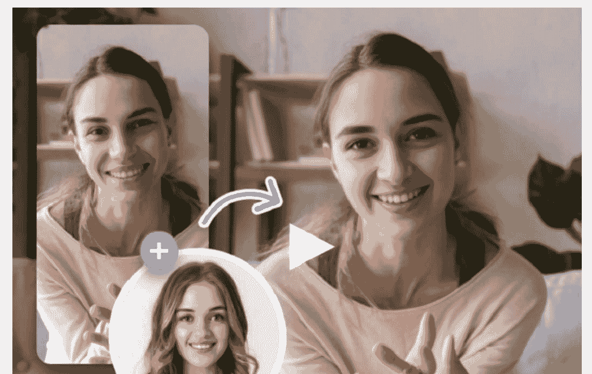
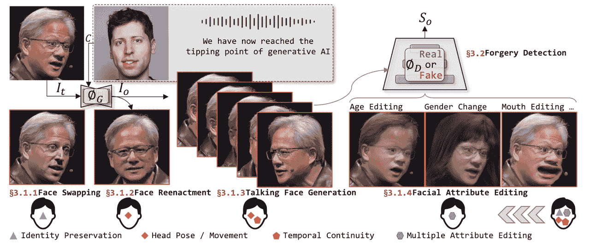
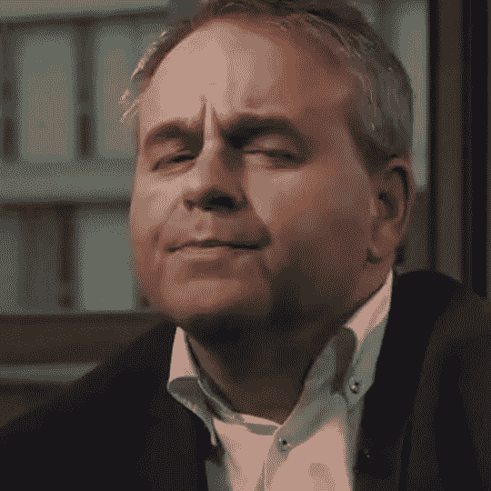
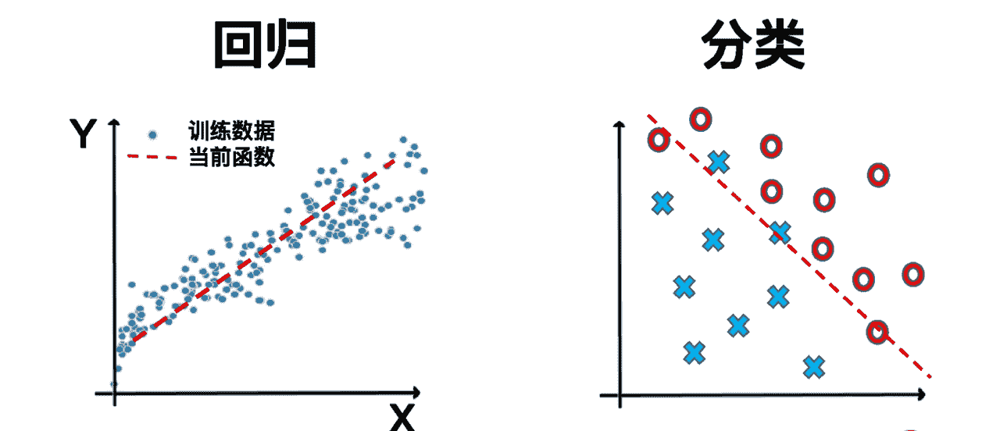
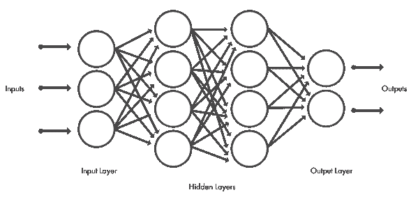
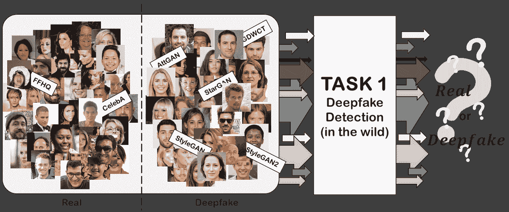
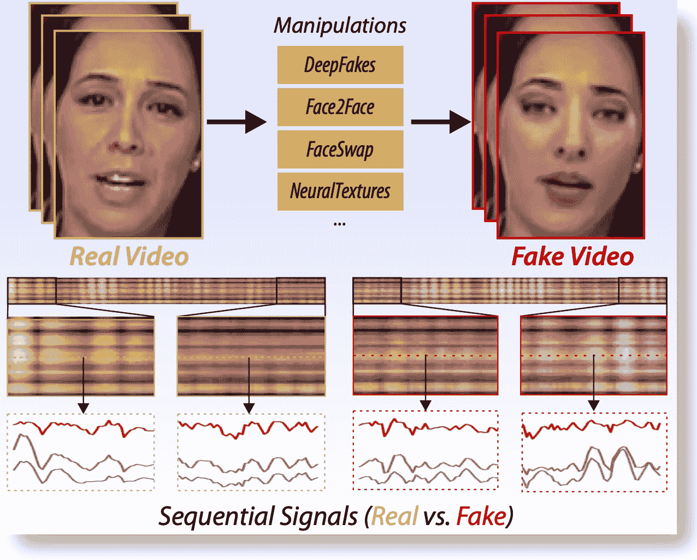

# Task1：入门Deepfake & 初步熟悉Baseline

> 来源：[https://datawhaler.feishu.cn/docx/Saytd1gIYomj5jxCtALc8YtenXd](https://datawhaler.feishu.cn/docx/Saytd1gIYomj5jxCtALc8YtenXd)

> **教程贡献者说：**

> 在当今数字化时代，人工智能（AI）正以前所未有的速度和规模改变着我们的世界。其中，一项特别引人注目的技术就是深度伪造（Deepfake）。这不仅是一项前沿技术，更是一种强大的工具，它能够以惊人的真实感生成或操纵音视频内容。

>

> 在本课程中，我们将深入探讨Deepfake技术的原理、应用案例以及检测方法。通过实践项目和案例研究，你们将有机会亲自动手，体验Deepfake技术的制作过程，并学习如何辨别Deepfake内容。

# Part1 Deepfake是什么？

Deepfake是一种使用人工智能技术生成的伪造媒体，特别是视频和音频，它们看起来或听起来非常真实，但实际上是由计算机生成的。这种技术通常涉及到深度学习算法，特别是生成对抗网络（GANs），它们能够学习真实数据的特征，并生成新的、逼真的数据。



Deepfake技术虽然在多个领域展现出其创新潜力，但其滥用也带来了一系列严重的危害。在政治领域，Deepfake可能被用来制造假新闻或操纵舆论，影响选举结果和政治稳定。经济上，它可能破坏企业形象，引发市场恐慌，甚至操纵股市。法律体系也面临挑战，因为伪造的证据可能误导司法判断。此外，深度伪造技术还可能加剧身份盗窃的风险，成为恐怖分子的新工具，煽动暴力和社会动荡，威胁国家安全。

深度伪造技术通常可以分为四个主流研究方向：

+   面部交换专注于在两个人的图像之间执行身份交换；

+   面部重演强调转移源运动和姿态；

+   说话面部生成专注于在角色生成中实现口型与文本内容的自然匹配；

+   面部属性编辑旨在修改目标图像的特定面部属性；



# Part2 如何识别Deepfake？

如果想要人工识别Deepfake的图片，可以通过以下逻辑步骤进行：

+   首先，**观察图片的细节**。仔细检查人物的面部特征，尤其是眼睛和嘴巴，看是否有不自然的眨眼频率或口型与说话内容不同步的现象。

+   接着，**检查光线和阴影**。分析图片中的光源是否一致，阴影的方向是否与光源相符，不自然的光线或阴影可能是图片被修改的迹象。

+   然后，**分析像素**。放大图片，寻找是否有模糊或像素化的部分，这可能是Deepfake技术留下的瑕疵。

+   此外，**注意背景**。检查背景中是否有不协调的元素，比如物体边缘是否平滑，背景中是否有不自然的重复模式。

> 好的，现在来考一考你，下面哪一个视频是伪造的呢？

|  |  |
| --- | --- |


[下载.mp4](https://internal-api-drive-stream.feishu.cn/space/api/box/stream/download/all/LJ4Zbgu2woT70jxbBAfcmHnhnNg)



[下载 (1).mp4](https://internal-api-drive-stream.feishu.cn/space/api/box/stream/download/all/HQfmbZkrioDOLtxi8a6cyL2Zngh)

其实右视频是是伪造的人脸图，其有俩个明显不协调的地方：

+   人物表情呆滞，并且人脸和背景变化很大；

+   画面和音频不协调，并且音频中单词重复多次；

# Part3 深度学习与Deepfake

## 机器学习与深度学习

机器学习是人工智能的一个分支，它使计算机系统利用数据来不断改进性能，而无需进行明确的编程。

**核心思想**：通过算法和统计模型，机器学习允许计算机从经验中学习，识别模式，并做出预测或决策。

+   **监督学习**：算法从标记的训练数据中学习，这些数据包含了输入和期望的输出。

+   **无监督学习**：算法处理未标记的数据，试图找出数据中的结构和模式。



深度学习是机器学习的一个子集，它使用类似于人脑的神经网络结构，特别是深层神经网络，来模拟人类学习过程。深度学习模型通过模拟人脑处理信息的方式来识别数据中的复杂模式和特征。



> 机器学习 vs 深度学习

+   机器学习算法相对简单，如线性回归、决策树等，它们可以解决各种问题，但可能不擅长处理非常复杂的数据。

+   深度学习算法通常更复杂，依赖于多层的神经网络结构，能够处理和学习高维度和复杂的数据模式。

## 深度学习与Deepfake

深度学习是一种强大的机器学习技术，它通过模拟人脑处理信息的方式，使计算机能够从大量数据中自动学习和识别模式。深度学习模型，尤其是卷积神经网络（CNN），能够识别图像和视频中的复杂特征。在Deepfake检测中，模型可以学习识别伪造内容中可能存在的微妙异常。

**为了**训练有效的Deepfake检测模型，需要构建包含各种Deepfake和真实样本的数据集（本次比赛的数据集就是按照这种方式进行组织）。深度学习模型通过这些数据集学习区分真假内容。



# Part4 Baseline 关键步骤

1.  **数据准备**：使用Pandas库读取训练集和验证集的标签，并将图片路径与标签结合，以便于后续处理。

1.  **定义生成MEL频谱图的函数**：generate_mel_spectrogram函数用于从视频文件中提取音频，并生成MEL频谱图，然后将其转换为图像格式。

1.  **定义训练、验证和预测函数**：train、validate和predict函数分别用于模型的训练、在验证集上评估模型性能以及生成预测结果。

1.  **模型初始化和训练**：初始化resnet18模型，并使用Adam优化器和交叉熵损失函数进行训练。训练过程中使用了学习率调度器，并在每个epoch结束时在验证集上评估模型性能。

1.  **保存最佳模型**：在验证过程中，如果模型的性能超过了之前的最佳性能，则保存模型的权重。

1.  **生成预测结果**：使用训练好的模型对验证集进行预测，并将预测结果保存到submit.csv文件中。

1.  **提交结果**：最后，代码将预测的分数与原始的提交模板合并，并保存为最终的提交文件。

## 加载预训练模型

预训练模型是指在特定的大型数据集（如ImageNet）上预先训练好的神经网络模型。这些模型已经学习到了丰富的特征表示，能够识别和处理图像中的多种模式。使用预训练模型的好处是，它们可以在新数据集或新任务上进行微调（Fine-tuning），从而加快训练过程并提高模型性能，尤其是当可用的数据量有限时。

**ResNet**（残差网络）是一种深度卷积神经网络，由微软研究院的Kaiming He等人在2015年提出。ResNet的核心思想是引入了“残差学习”框架，通过添加跳过一层或多层的连接（即残差连接或快捷连接），解决了随着网络深度增加时训练困难的问题。

在下面代码中，timm.create_model('resnet18', pretrained=True, num_classes=2)这行代码就是加载了一个预训练的ResNet-18模型，其中pretrained=True表示使用在ImageNet数据集上预训练的权重，num_classes=2表示模型的输出层被修改为有2个类别的输出，以适应二分类任务（例如区分真实和Deepfake图像）。通过model = model.cuda()将模型移动到GPU上进行加速。

```
import timm
model = timm.create_model(&#x27;resnet18&#x27;, pretrained=True, num_classes=2)
model = model.cuda()
```

## 提取音频特征

在识别Deepfake视频时，音频分析之所以简单，是因为Deepfake技术生成的视频中，音频可能存在不自然或重复的模式，例如重复的单词或短语。通过分析音频的频谱图，可以更容易地发现这些异常，从而帮助识别视频是否经过了深度伪造处理。



MEL频谱图（Mel-spectrogram）是一种在音频信号处理领域常用的可视化工具，它基于人耳的听觉特性来表示音频信号的频率内容。梅尔刻度是一种对频率进行非线性缩放的方法，它将线性频率映射到梅尔频率上，使得梅尔刻度上的间隔更接近人耳感知的间隔。梅尔刻度是以物理学家H. Fletcher和W. A. Munson的名字命名的。

```
def generate_mel_spectrogram(video_path, n_mels=128, fmax=8000, target_size=(256, 256)):
    # 提取音频
    audio_path = &#x27;extracted_audio.wav&#x27;
    video = mp.VideoFileClip(video_path)
    video.audio.write_audiofile(audio_path, verbose=False, logger=None)

    # 加载音频文件
    y, sr = librosa.load(audio_path)

    # 生成MEL频谱图
    S = librosa.feature.melspectrogram(y=y, sr=sr, n_mels=n_mels)

    # 将频谱图转换为dB单位
    S_dB = librosa.power_to_db(S, ref=np.max)

    # 归一化到0-255之间
    S_dB_normalized = cv2.normalize(S_dB, None, 0, 255, cv2.NORM_MINMAX)
    
    # 将浮点数转换为无符号8位整型
    S_dB_normalized = S_dB_normalized.astype(np.uint8)

    # 缩放到目标大小
    img_resized = cv2.resize(S_dB_normalized, target_size, interpolation=cv2.INTER_LINEAR)

    return img_resized
```

## 定义模型训练步骤

在深度学习中，模型训练通常需要进行多次迭代，而不是单次完成。深度学习模型的训练本质上是一个优化问题，目标是最小化损失函数。梯度下降算法通过计算损失函数相对于模型参数的梯度来更新参数。由于每次参数更新只能基于一个数据批次来计算梯度，因此需要多次迭代，每次处理一个新的数据批次，以确保模型在整个数据集上都能得到优化。

模型训练的流程如下：

1.  **设置训练模式**：通过调用model.train()将模型设置为训练模式。在训练模式下，模型的某些层（如BatchNorm和Dropout）会按照它们在训练期间应有的方式运行。

1.  **遍历数据加载器**：使用enumerate(train_loader)遍历train_loader提供的数据批次。input是批次中的图像数据，target是对应的标签。

1.  **数据移动到GPU**：通过.cuda(non_blocking=True)将数据和标签移动到GPU上。non_blocking参数设置为True意味着如果数据正在被复制到GPU，此操作会立即返回，不会等待数据传输完成。

1.  **前向传播**：通过output = model(input)进行前向传播，计算模型对输入数据的预测。

1.  **计算损失**：使用损失函数loss = criterion(output, target)计算预测输出和目标标签之间的差异。

1.  **梯度归零**：在每次迭代开始前，通过optimizer.zero_grad()清空（重置）之前的梯度，以防止梯度累积。

1.  **反向传播**：调用loss.backward()计算损失相对于模型参数的梯度。

1.  **参数更新**：通过optimizer.step()根据计算得到的梯度更新模型的参数。

```
def train(train_loader, model, criterion, optimizer, epoch):

    # switch to train mode
    model.train()

    end = time.time()
    for i, (input, target) in enumerate(train_loader):
        input = input.cuda(non_blocking=True)
        target = target.cuda(non_blocking=True)

        # compute output
        output = model(input)
        loss = criterion(output, target)

        optimizer.zero_grad()
        loss.backward()
        optimizer.step()
```

## 数据集增强

数**据增强是一种在**机器学习和深度学习中提升模型性能的重要技术。它通过应用一系列随机变换来增加训练数据的多样性，从而提高模型的泛化能力。增加数据多样性是数据增强的核心目的。通过对原始图像进行如旋转、缩放、翻转等操作，可以生成新的训练样本，使模型学习到更丰富的特征表示。

transforms.Compose: 这是一个转换操作的组合，它将多个图像预处理步骤串联起来：

+   transforms.Resize((256, 256))：将所有图像调整为256x256像素的大小。

+   transforms.RandomHorizontalFlip()：随机水平翻转图像。

+   transforms.RandomVerticalFlip()：随机垂直翻转图像。

+   transforms.ToTensor()：将PIL图像或Numpy数组转换为torch.FloatTensor类型，并除以255以将像素值范围从[0, 255]缩放到[0, 1]。

+   transforms.Normalize([0.485, 0.456, 0.406], [0.229, 0.224, 0.225])：对图像进行标准化，使用ImageNet数据集的均值和标准差。

```
train_loader = torch.utils.data.DataLoader(
    FFDIDataset(train_label[&#x27;path&#x27;], train_label[&#x27;target&#x27;], 
            transforms.Compose([
                        transforms.Resize((256, 256)),
                        transforms.RandomHorizontalFlip(),
                        transforms.RandomVerticalFlip(),
                        transforms.ToTensor(),
                        transforms.Normalize([0.485, 0.456, 0.406], [0.229, 0.224, 0.225])
        ])
    ), batch_size=40, shuffle=True, num_workers=4, pin_memory=True
)
```

> 本教程主要由Datawhale小伙伴贡献，经过多位助教内测和建议修改，期待你的点赞和评论～