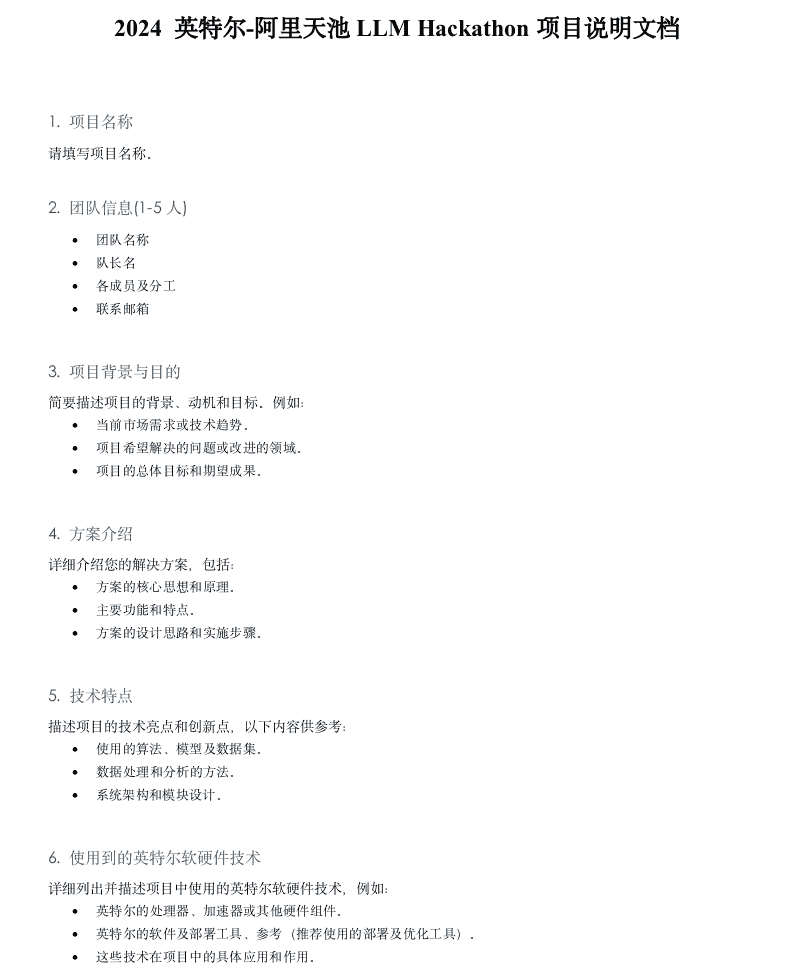
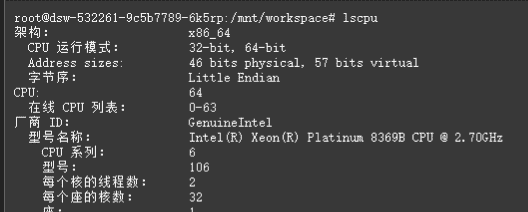
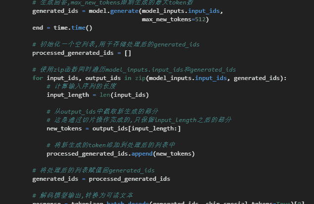

# Task1：了解模型获取和IPEX-LLM部署工具

> 来源：[https://datawhaler.feishu.cn/docx/JJxVdrgjhoUOsaxHqe8cvGpwnNh](https://datawhaler.feishu.cn/docx/JJxVdrgjhoUOsaxHqe8cvGpwnNh)

> **教程贡献者说：**

> 在今天的学习中，你将和我一起成为 Intel 大模型推理专家，让我们一起来拥有让大语言模型走进千家万户的能力。你会发现，原来我们可以让大语言模型不再是 GPU 的专属，我们能够让他在 CPU 上同样高效运行。

# 写在开头

欢迎大家来到从零入门CPU部署大模型夏令营学习的 task1 环节，在本环节，我们将一起学习如何从零部署一个大语言模型。

很多朋友可能想过，是否只有英伟达显卡，才能运行现如今大家所熟知的大语言模型。但我们需要注意一点，计算机的世界没有魔法，深度学习的世界可能有但并不多——对于任意一个深度学习模型，他所需要的仅仅是对权重的加载、对权重的推理，就可以得到你想要的推理结果。那么对于一个大语言模型也是如此，只要我们支持机器和硬件设备支持加载权重到实时缓存中，再提供权重推理所需要的计算单元的支持，也就是算子的支持，那么他就一定能在任意所选设备上运行；而基于这一原理，我们也自然能够在 CPU 上运行任意深度学习模型，包括大语言模型，只要 CPU 支持了对应的模型算子实现。

但是，世界上没有白给的午餐；如果没有强大的软件栈的支持，我们也无法高效的推理神经网络，不同计算内核和过程的实现会让推理速度天差地别；我们需要高效利用硬件设备访存缓存特性、指令集计算加速特性才能让神经网络拥有更高效的推理速度。幸运的是，今天我们将介绍大家学会 Intel 针对大语言模型加速的神经网络加速框架 IPEX-LLM，有了强大的加速框架的支持，我们可以让 1.5B 甚至 7B 大语言模型在 8 核 CPU 上流畅运行。

让我们抱着愉快的心情进入今天的学习。

# 赛题解读

## **赛题简介**

> 参赛者基于推荐或自选的开源大语言模型，开发及展示面向通用或特定领域的应用/服务的原型进行提交，并在基于阿里云服务平台的英特尔至强可扩展处理器的实例上完成部署及高效运行。

## 推荐使用工具

> **基于开源大语言模型 ：**

> 作品开发应基于开源大语言模型进行，可以同时使用其他适合的辅助模型及数据集。模型可使用原始发布的模型或经过微调后的模型，包括但不局限于以下模型：

+   通义千问Qwen系列

+   智谱ChatGLM及GLM4系列

+   百川2系列

+   英特尔发布的各种模型的微调版本

> **基于intel部署及优化工具：**

> 提交作品中，需至少使用1个下方给出的部署及优化工具（不分先后）

+   OpenVINO™ Toolkit

+   [++IPEX-LLM (Intel® LLM Li](https://github.com/intel-analytics/ipex-llm-tutorial/tree/main)brary for PyTorch)++

+   Intel® Extension for Transformers ++或其组件 (Neural Chat)++

+   xFasterTransformer

+   Intel Extension for Pytorch

> **可选微调及部署技术：**

+   权重调整

+   低精度量化

+   RAG

+   其他各种模型微调及优化技术

# **硬件平台**

> **初赛阶段：**

> 开发者在部署时，可使用魔搭社区的云环境（参赛者可到魔搭社区，注册并申请使用基于英特尔硬件的免费CPU环境，进行代码原型开发及测试）；开发者也可使用自备的基于英特尔处理器的设备或云环境。

> **使用魔搭社区云环境步骤：**

+   通过登录并使用魔搭平台及注册时关联阿里云账号获得的免费CPU云计算资源

+   通过启动Jupyter Notebook或相应环境镜像进入相应的项目部署环境。

+   根据相应模型的部署文档，确认或完成运行环境的准备，并在导入Notebook及相应模型后，完成模型的直接部署，或根据部署文档中的模型优化方式在完成模型低精度量化或格式转换后进行部署。

+   请注意项目代码的保存及免费实例**活跃时间**。

>

> **复赛阶段：**

> 开发者在进行项目原型的部署及调优时，由主办方提供一定时长的基于英特尔至强可扩展处理器的阿里云g8i型实例供免费使用。

# 提交说明

## **初赛提交说明：**

> **参赛选手需要提交资料包，需压缩为一个Zip文件提交，命**名【作品名-团队名】，需要包含如下资料：

1.  **【必需】****项目说明文档**（包括方案介绍，**技术特点，使用到的英特**尔软硬件技术，成果说明和对照），填写 （官方文档模板）即可。

提交案例可见 [Task2：赛事提交模板](https://datawhaler.feishu.cn/wiki/Yv5sw5LqgifkG1kFEmYcNhYFnvh)

还可提供更多支持材料，如演示视频等。



[2024 英特尔 天池 LLM Hackathon.docx](https://internal-api-drive-stream.feishu.cn/space/api/box/stream/download/all/M8fAbtJgGolofhxxMAac089GnSb)

1.  【可选】应用程序源代码、必要的编译产物和依赖库、程序运行指引文档README等，确保递交代码完整可复现。（提交更易进入复赛）

>

## **复赛提交说明：**

> **参赛选手需要提交资料包，需压缩为一个Zip文件提交，命**名【作品名-团队名】，需要包含如下资料：

1.  **【必需】**项目说明文档（包括方案介绍，技术特点，使用到的英特尔软硬件技术，成果说明和对照），请下载文档模板填写。还可提供更多支持材料，如演示视频等。

1.  **【必需】**应用程序源代码、必要的编译产物和依赖库、程序运行指引文档README等，确保递交代码完整可复现。

1.  **【必需】**作品发布链接（可将方案描述发布到 github, CSDN, 魔搭等公开网站上，发布的内容需包含使用的英特尔硬件，英特尔软件工具以及相关的全部或部分实现代码。内容可脱敏）。

>

## 评选标准

## **初赛评选标准：**

> **创意和应用价值：**

+   创意性： 作品的创新性和独特性，包括对大语言模型的应用创意和解决方案的独特性。

+   应用价值： 作品对特定领域的应用潜力和价值，如健康服务、适老服务、教育等，是否满足社会发展需要，以及是否能够在行业快速落地。

> **技术实现和优化利用：**

+   技术特点和工具使用： 作品中使用的技术特点和工具，包括是否有效地利用了英特尔的开源软件优化工具（参见推荐使用的部署及优化工具）。

>

> 更多内容详见 [赛事官网(点击即可跳转)](https://tianchi.aliyun.com/competition/entrance/532239/)。

# 如何优雅的获取模型、使用魔搭社区

## 从 huggingface 获取模型

### 使用 huggingface-cli 下载

huggingface-cli download 仓库地址 --local-dir=./models/ --local-dir-use-symlinks=False --resume-download

### 使用snapshot下载

如何下载官方仓库等：

[https://zhuanlan.z](https://zhuanlan.zhihu.com/p/475260268)hihu.com/p/475260268

pip install huggingface_hub

```
from huggingface_hub import snapshot_download
snapshot_download(repo_id=&quot;decapoda-research/llama-13b-hf&quot;,cache_dir=&quot;./cache&quot;, local_dir=&quot;./model_weights/llama-13b-hf&quot;)
```

### 设置镜像下载【推荐】

```
import os

设置环境变量
os.environ[&#x27;HF_HOME&#x27;] = &#x27;./cache/&#x27;
os.environ[&#x27;HF_ENDPOINT&#x27;] = &#x27;https://hf-mirror.com&#x27;
下载模型
os.system(&#x27;huggingface-cli download --resume-download sentence-transformers/paraphrase-multilingual-MiniLM-L12-v2 --local-dir /root/data/model/sentence-transformer&#x27;)
```

### 设置下载地址

通过设置cache_dir的形式 （推荐）os.environ['HF_HOME'] = './hf-cache'

from pretrained的api里面也可以加入cache_dir这个参数，效果是一样的。

```
from huggingface_hub import snapshot_download

snapshot_download(repo_id=&quot;bert-base-chinese&quot;,cache_dir=&quot;输入你想下载到的地址&quot;)
```

通过环境变量的方式

export HF_HOME=./cache/ export HF_ENDPOINT='https://hf-mirror.com'

具体参考文档

```
Cache Setup:
Pretrained models are downloaded and locally cached at ~/.cache/huggingface/transformers/. 
This is the default directory given by the shell environment variable TRANSFORMERS_CACHE. 
On Windows, the default directory is given by C:\Users\username\.cache\huggingface\transformers. 
You can change the shell environment variables shown below, in order of priority, to specify a different cache directory:
Shell Environment Variable (default): TRANSFORMERS_CACHE
Shell Environment Variable: HF_HOME+/transformers/
Shell Environment Variable: XDG_CACHE_HOME+/huggingface/transformers.
```

## 从 modelscope 获取模型

从魔搭下载模型有命令行和python SDK两种方式，以Qwen2-7B-Instruct为例：

### **命令行CLI下载**

```
modelscope download --model=qwen/Qwen2-7B-Instruct --local_dir . qwen2-7b-instruct-q8_0.gguf
```

### python SDK下载

```
import torch
from modelscope import snapshot_download, AutoModel, AutoTokenizer
import os
model_dir = snapshot_download(&#x27;qwen/Qwen2-7B-Instruct&#x27;, cache_dir=&#x27;/root/autodl-tmp&#x27;, revision=&#x27;master&#x27;)
```

## 如何利用魔搭社区

魔搭社区分为模型库、数据集、创空间、讨论区等不同板块，每个板块都有对应的github代码链接和相关内容介绍。以“模型库”为例，包含了“LLM专题页”“智能通行”“基础视觉模型及应用”“信息抽取”等板块，点击对应的板块内容，找到所需要的模型，然后进入社区提供的github代码链接，找到对应的代码即可。

# 英特尔神经网络 CPU 部署工具链

我们可以使用英特尔组件跑通大模型推理与 RAG 应用，甚至使用它加速运行常见你想要运行的任何 pytroch 模型（包括 RAG 中的 embedding 模型）, 其中不限于：

+   Intel® LLM library for PyTorch*

+   https://github.com/intel-analytics/ipex-llm/

+   OpenVINO Toolkit

+   https://github.com/openvinotoolkit/openvino

+   Intel@ Extension for Transformers 或其组件(Neural Chat)

+   https://github.com/intel/intel-extension-for-transformers

+   [A](https://medium.com/intel-analytics-software/accelerating-qwen2-models-with-intel-extension-for-transformers-99403de82f68)ccelerating Qwen2 Models with Intel Extension for Transformers

+   xFasterTransformer

+   https://github.com/intel/xFasterTransformer

我们在相应官方仓库可以找到对应的工具链运行demo，这能帮我们很快上手相应部署工具，在本次教程中，我们将以 Intel® LLM library for PyTorch*  为例，又称 IPEX-LLM ，为大家演示如何在 CPU 上简单快速的部署 Qwen2 大语言模型，并运行 RAG 知识库问答，相信大家在经过本期的学习后，可以部署自己喜欢的任意常见大模型，如 GLM4、llama3 等等。

# 使用 IPEX-LLM 部署工具加速大模型推理

## 模型加载

在大模型推理环节,我们将实现 Qwen2 开源大语言模型在 CPU 计算设备上的高性能推理.


Qwen2是阿里云最新推出的开源大型语言模型系列，相比Qwen1.5，Qwen2实现了整体性能的代际飞跃，大幅提升了代码、数学、推理、指令遵循、多语言理解等能力。

包含5个尺寸的预训练和指令微调模型：Qwen2-0.5B、Qwen2-1.5B、Qwen2-7B、Qwen2-57B-A14B 和 Qwen2-72B，其中Qwen2-57B-A14B为混合专家模型（MoE）。所有尺寸模型都使用了GQA（分组查询注意力）机制，以便让用户体验到GQA带来的推理加速和显存占用降低的优势。

在中文、英语的基础上，训练数据中增加了27种语言相关的高质量数据。增大了上下文长度支持，最高达到128K tokens（Qwen2-72B-Instruct）。

在 baseline 中，我们将使用 Qwen/Qwen2-1.5B-Instruct 的模型参数版本来体验 Qwen2 的强大能力。

你可以在下列地址中获取不同版本的 Qwen2 模型：

https://www.modelscope.cn/models?name=qwen2

## 模型保存与推理

终于！ 我们准备好了需要推理的 Qwen2 模型，紧接着我们将对 qwen2 模型进行低精度量化,并将量化后的 int4 模型保存到指定地址。

低精度量化（Low Precision Quantization）是指将浮点数转换为低位宽的整数（这里是 int4 ），以减少计算资源的需求和提高系统的效率。这种技术在深度学习模型中尤其重要，它可以在硬件上实现快速、低功耗的推理，也可以加快模型加载的速度。

我们可以很容易利用 Intel IPEX-LLM 对应的模型加载 api 对任意模型进行加 from ipex_llm.transformers import AutoModelForCausalLM， 并通过 load_in_low_bit='sym_int4' 将模型量化到 int4 ，英特尔 IPEX-LLM 支持 sym_int4, asym_int4, sym_int5, asym_int5 或 sym_int8选项，其中 sym 和 asym 用于区分对称量化与非对称量化。 最后，我们将使用 save_low_bit api 将转换后的模型权重保存到指定文件夹。

当然, 你也可以跳过这一步,直接在最后一步修改加载代码为加载量化前的模型, 一样可以顺利运行目标模型。

除此之外，你还可以加载不同量化方式得到的量化权重，比如 GGUF, AWQ, GPTQ，例如通过 AutoModelForCaus[alLM](https://github.com/intel-analytics/ipex-llm/tree/main/python/llm/example/GPU/HF-Transformers-AutoModels/Advanced-Quantizations).from_gguf 可以直接加载指定 GGUF 权重文件，而 AWQ 与 GPTQ 可以直接通过 AutoModelForCausalLM.from_pretrained api进行加载，具体示例可以参考官方文档。

在推理环节，需要注意的是指定 OpenMP 线程数值 os.environ["OMP_NUM_THREADS"] = "8"，OpenMP是一个跨平台的多线程实现，主线程(顺序的执行指令)生成一系列的子线程，并将任务划分给这些子线程进行执行。这些子线程并行的运行，由运行时环境将线程分配给不同的处理器。由于平台虚拟化技术和处理器信息暴露的不同，实际可使用 CPU 也许与直接获取的信息不同，当前我们在 lscpu 打印后看到的是 32核心，



但我们可以看到启动时显示的是 8 核处理器，


[也许这会对 Open](https://www.intel.com/content/www/us/en/docs/onemkl/developer-guide-windows/2023-0/improving-performance-with-threading.html)MP 默认值造成一定的影响，注意到英特尔 oneAPI 文档中提到：By default, Intel® oneAPI Math Kernel Library uses the number ofOpenMP threads equal to the number of physical cores on the system.，故我们需要设定恰当的值让程序运行达到最佳速度。

在推理结束后，我们还需要对输出信息进行适度解码，跳过聊天模板区域；如果你不这么做，你可能会看到输出中仍存在输入的聊天模板。



除此之外，我们还会利用 gradio 以及 streamlit python前端框架实现对 Qwen2 的可交互式部署，具体内容你可以直[接参考代码中的内容；如](https://www.gradio.app/docs)果你[不熟悉，推荐你与大模型对话写](https://docs.streamlit.io/)作搞懂每一行的具体作用（可以通过消融不同组件来实现对每一个模块的深入理解）。或者你可以参考对应的官方文档，gradio 官方文档、 streamlit 官方文档。

为了更高性能的部署服务，也许你还可以尝试使用 VLL[M 部署来观察吞吐量的提](https://github.com/intel-analytics/ipex-llm/tree/main/python/llm/example/CPU/vLLM-Serving)升，这里推荐参考 VLLM 部署官方文档进行操作。

# 总结

> 恭喜你完成今天的学习！ 我们不仅通过 [从零入门CPU部署大模型&应用开发](https://datawhaler.feishu.cn/wiki/SuppwSfFZi5KvYkiffUcygVNnPe)**(速通手册) **完成了CPU部署大模型和应用开发，还一起探索了如何优雅地使用魔搭社区和获取模型，还了解了英特尔提供的强大工具链。

>

> 希望这些内容能让同学们学会如何自己在CPU上部署任何自己想要部署的大语言模型。

>

> 当你遇到困难时,别忘了回顾今天学到的知识，以及深入到baseline文件中去分析其中的代码和详细细节~

>

> 动手实践是提升技能的最好方法，记得多多尝试！

>

> 有任何无法独立解决的疑问，别忘记可以学习群里交流学习~

> 期待在下一次任务再见到你们~

# 别忘了学习规划表~

> 学有余力可以自行向前探索~

> 我们下一个Task是：[Task2：头脑风暴会](https://datawhaler.feishu.cn/wiki/PUyiw4imoiGy55kM7w5cV3isnqe) & [Task2：赛事提交模板](https://datawhaler.feishu.cn/wiki/Yv5sw5LqgifkG1kFEmYcNhYFnvh)

<https://datawhaler.feishu.cn/sync/Vht1dg6jXsUKnObkj03cm9RGnTc>

#

> 本教程主要由  、  写作贡献，经过多位助教内测和建议修改，期待你的点赞和评论～