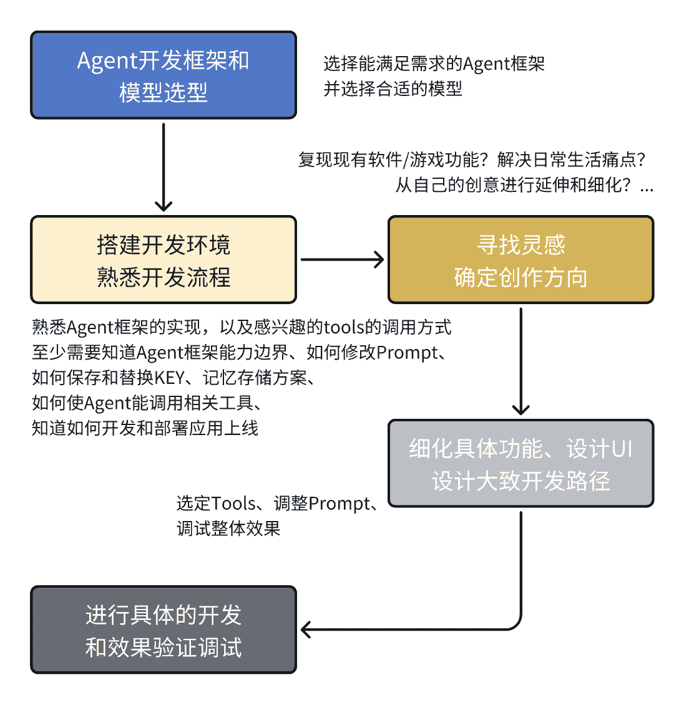
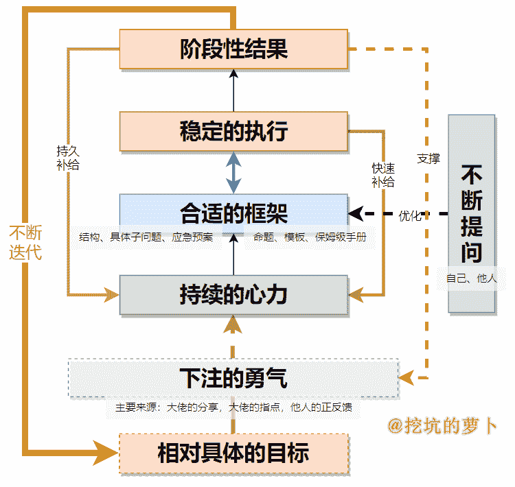
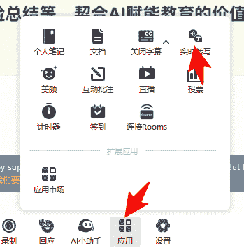
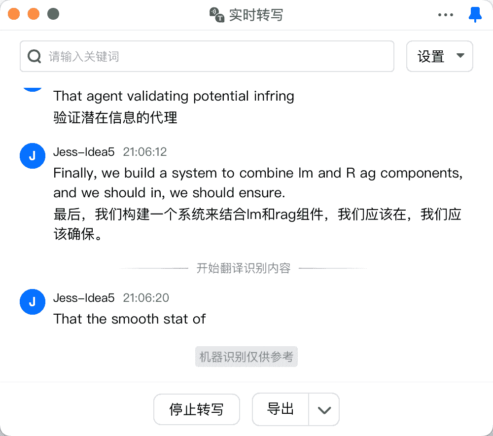
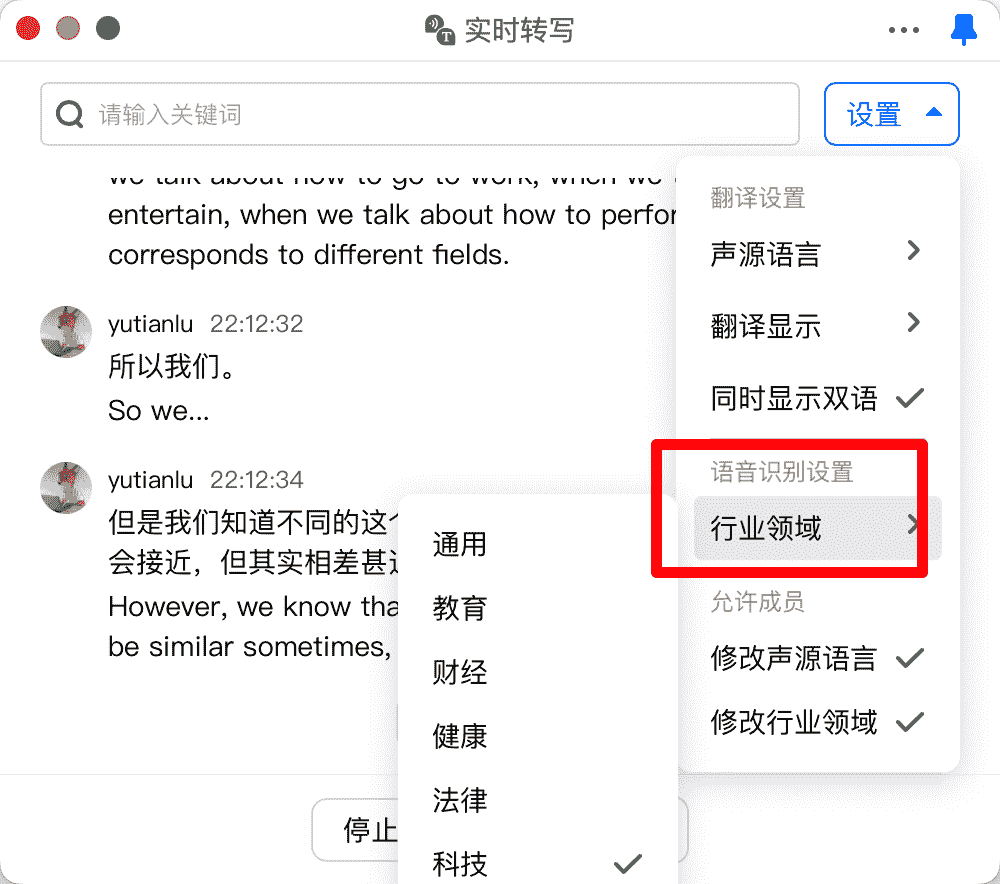

# Task2：头脑风暴会

> 来源：[https://datawhaler.feishu.cn/docx/U4Qpd93S2oobGhxKGmqc2bmBnUd](https://datawhaler.feishu.cn/docx/U4Qpd93S2oobGhxKGmqc2bmBnUd)

# 没有Idea可以先看看下面的思路

1.  各大汇总网站的AI应用产品，尝试这些AI应用，尝试拆解和在群里讨论分析

1.  在各大AI智能体平台，查看那些热门的智能体，并尝试从中分析

## 这里还有一些Datawhale往期学习者的作品

<https://datawhaler.feishu.cn/share/base/view/shrcnSN5ff9Y0MrFVMGpVDgAX8e?iframeFrom=docx&ccm_open=iframe>

# 头脑风暴会会议记录

> **会议主题**：

> **会议时间**：7/14

> **会议地点**：

> **会议录制**：

| # idea1: 施工方案的自动生成 |  |  |
| --- | --- | --- |
| **讨论点** | **重要结论** | **组队招募信息** |
| 1.  会有多次迭代过程 | 1.  任务的输出内容较长，达到上万 |  |
|  |  |  |
|  |  |  |
| # idea2: 西游狐记 |  |  |
| **讨论点** | **重要结论** | **组队招募信息** |
| 1.  只做聊天吗？ | 1.  想做一个RPG游戏，(玩家是)西游的新增人物 | vx是k1480561520 |
|  |  |  |
|  |  |  |
| # idea3: AutoBots |  |  |
| **讨论点** | **重要结论** | **组队招募信息** |
| 1.  通用性的吗 | 1.  自动执行的copilot | vx: xuyutom |
|  |  |  |
|  |  |  |
| # idea4: ScholarlyAI |  |  |
| **讨论点** | **重要结论** | **组队招募信息** |
| 1.  学术伦理 | 1.  基于反思流工作 |  |
|  |  |  |
|  |  |  |

1.  但是AI慢慢熟练之后，自定制还是很舒服的

1.  有一些最新的论文，有一些memoryGPT的解决方案

1.  多智能体框架

1.  我粗浅的理解，AI率是根据token切割的方式来检查的。所以只要用了AI，其token切割方式就类似

1.  考虑细化场景：文献综述和研究背景方向

1.  帮忙检查论文有没有可能的格式问题或者逻辑瑕疵

1.  可以先将论文解析为对应的格式，例如，引言，数据表格，文字的可以用llm解决，数据表格可以用代码调整

| # idea5: Copyguard AI |  |  |
| --- | --- | --- |
| **讨论点** | **重要结论** | **组队招募信息** |
| 1.  前面AI写作的克星 | 1.  NLP |  |
|  |  |  |

并不真正处理误报和漏报。如数据侵犯版权

1.  How to improve correctness? 有哪些方法提高correctness

另一个问题是用户隐私的 保障

Not so private, use API, otherwise, local LLM

对数据敏感性分级，不敏感的可以用api，不那么敏感的考虑本地私有模型

目标客户是谁

| # idea6: Chat2LearnX |  |  |
| --- | --- | --- |
| **讨论点** | **重要结论** | **组队招募信息** |
| 1.  想过结合 B 站学习视频。 | 1.  教育领域，深度学习 |  |
|  |  |  |
|  |  |  |
| # Idea 7: 疾病图片识别 |  |  |
| **讨论点** | **重要结论** | **组队招募信息** |
| 1.  多模态RAG的怎么实现？图片+文字的RAG | 1.  GPT-4o图片识别&amp;监测，疾病诊断，识别结果做任务 |  |
|  |  |  |
|  |  |  |
|  |  |  |

1.  AI 主要负责生成学习计划或者大纲，然后用户按照学习计划逐步探索。

1.  很多知识是比较严谨的，ai多模态随机性太强

1.  以学生为主导，需要明确学习目标

1.  不了解这个知识的时候，可能真的不知道要怎么询问

1.  可能不是不会提问，而是不知道即将学习的领域有哪些是可以询问的——有一些思维套路

1.  我觉得需要我们自己编写可视化工具，当前AI还没有精确到那个地步吧，AI负责调用就行

1.  一开始就给一个知识结构，根据需要掌握的技术点深入这个技术点和大模型讨论，思考获取大模型的对自己问题的意见

1.  需要先寻找总结性的视频，比如电影解说那种。。。比如几分钟看懂 C++代码这种。

1.  然后再分解，总结性的讲解某一类函数。

1.  再到感兴趣某一具体函数再找详解的视频。

1.  我觉得 rag 就把各种考试大纲放进去就行

1.  大范围的学习估计还是需要巨型的知识图谱，rag+llm方案还是不大行，纯文字还凑合，多模态是不行的

1.  能不能去衡量它？回答的一个准确度，有没有一个评价标准，你让我们在它的大模型的回答和真实的，比如说光处之间去衡量它的正确比，比如说能达到95%或者99%。

1.  大模型可能没有一些真正意义上的轻重之分，它可能更纠结，于是更泛，因为他SFT后的效果可能会导致他的这个帮助能力太强，导致他的回复没有重点，就像一个人讲话没讲重点一样，所以怎么样才能够让我们去规范化。SFT后的效果可能会导致他的这个帮助能力太强，导致他的回复没有重点，就像一个人讲话没讲重点一样，所以怎么样才能够让我们去规范化。

1.  对比真实答案的成本——用现有的题库，客观题

1.  那怎么确定裁判模型的评分水准呢 哪怕是gpt4o也不能保证效果吧

1.  （

1.  RAG不仅限于文本，LLM只能接收文本

1.  场合，多模态embedding、领域

1.  特征识别，什么场景？

1.  涉及背景、用户知识背景和场合...

1.  推荐系统是意图识别吗？是成熟的意图识别吗？

1.  为什么GPT-4o能实现？参数量更大、训练数据更大

1.  intern-LM、Cloud-3.5可能也行

1.  差一点的模型能不能实现类似效果？

1.  question匹配向量数据库、图片也能embedding，但我们需要图片理解的结果

1.  图片理解(图片embedding->取字典文字)->文字question->匹配向量数据库

1.  本质：把图片和标准数据库匹配上就好了

| # Idea 8: LLM地图故事 |  |  |
| --- | --- | --- |
| **讨论点** | **重要结论** | **组队招募信息** |
| 1.   | 1.   |  |