# Task3：实现 RAG 应用

> 来源：[https://datawhaler.feishu.cn/docx/Z36xd0w2UoNnZpxjO1wcaQZlnde](https://datawhaler.feishu.cn/docx/Z36xd0w2UoNnZpxjO1wcaQZlnde)

> **教程贡献者说：**

> 在今天的学习中，你将和我一起入门简单的前端部署及RAG系统的开发，我们可以很容易在魔搭社区平台上部署一个简单的向量数据库及对应的检索增强系统。什么？你不知道什么是 RAG，没关系！让我们今天把它轻松拿下。

# 写在开头

欢迎大家来到从零入门CPU部署大模型夏令营学习的 task3 环节，在本环节，我们将一起学习如何从零部署一个 RAG 系统。

在当下，运行大语言模型已经是再平凡不过的事情。但随着大家对 LLM 使用的加深，我们发现，在使用过程中，大模型会有很多幻觉出现。为了解决幻觉，科研人员提出了各种各样的方案，努力提高长上下文下的召回精度，但就成本与效果而言，在目前都不如简单粗暴的检索增强生成（RAG）。

通过 RAG 系统的构建，我们能够以最小的成本获得最准确的信息，降低成本；它也是大模型应用开发中最简单的一种应用，结合了大语言模型效果微调、向量数据库部署、流程设计等多方面的要素，能够帮助你快速了解可落地应用的最简开发流程。

那么，RAG 系统究竟是怎么构建的呢？我们又该如何构建好的 RAG 系统？带着这些问题，希望你能够在 task3 中找到属于你的答案！

# Gradio技术入门

在开始之前， 我们先来复习在赛事流程中，我们所应用到的python前端开发框架。

[Gradio ](https://www.gradio.app/)是一个开源的 Python 库，用于快速构建机器学习和数据科学演示应用。它使得开发者可以在几行代码中创建一个简单、可调整的用户界面，用于展示机器学习模型或数据科学工作流程。Gradio 支持多种输入输出组件，如文本、图片、视频、音频等，并且可以轻松地分享应用，包括在互联网上分享和在局域网内分享.

简单来说,利用 Gradio 库,我们可以很容易实现一个具有对话功能的前端页面，实现最简单人机交互功能。


在目前的深度学习软件开发中，使用gradio熟练展示demo已经成为了基础必备技能，你可以在任何地方（无论是学术还是工业界）见到 gradio 展示，但我们本次可以只从一个简单的对话demo开始，来逐渐展开gradio的熟悉之旅。

我们可以简单的理解为 gradio 就是在搭积木，或者说简单理解为所有的前端框架都是在利用一块块积木创造出最好的效果。

在gradio中，我们可以把每个组件创建在 gr.Blocks() 包裹的块当中，你可以把它当作一个展示台，我们可以在展示台上放满不同的组件（比如这里的 gr.Button, gr.Textbox 等等），你可以自由组合组件来实现想要的目标。此外，在gradio中同样也有各类可注册事件，这有助于我们在和组件互动时、互动后来指定我们想要发生的事情（比如执行一段函数），比如我们希望按钮按下后执行一个函数，然后根据某些组件的输入输出做反应，我们就可以像下面的 .click 以及 .submit 一样注册相应的事件，根据绑定的函数创作出更多样的可能。

最后，我们只需要 launch 我们的”展示台“，就可以看到gradio前端展示画面。

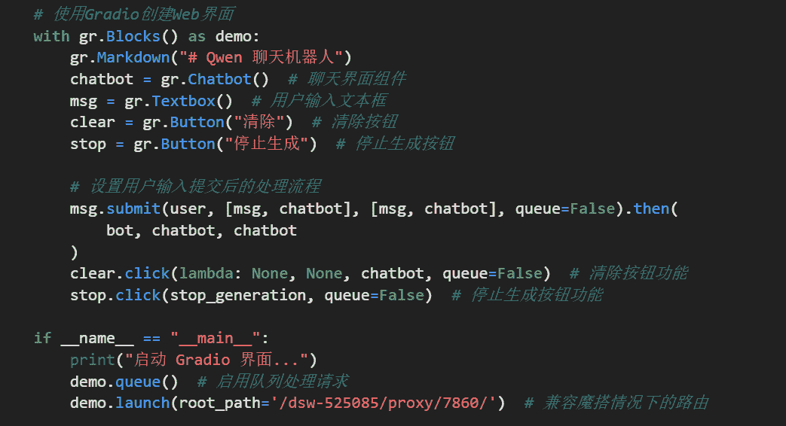

接下来，我们一起看看在实战过程中我们需要注意哪些要点：

注意! 在运行之前,我们需要安装 gradio 库依赖环境, 你需要在终端执行:

```
cd /mnt/workspace
conda activate ipex
pip install gradio
```

需要强调的是，在运行之前我们还需要对启动命令进行修改才能正常使用 gradio 前端, 我们可以看到最后一句 gradio 的启动命令  demo.launch(root_path='/dsw-525085/proxy/7860/') ,但每个人对应的不都是 dsw-525085,也许是 dsw-233333, 这取决于此时你的网页 url 链接上显示的地址是否是类似 https://dsw-gateway-cn-hangzhou.data.aliyun.com/dsw-525085/ 的字眼,根据你显示 url 的对应数字不同,你需要把下面的 gradio 代码 root_path 中的 dsw标识修改为正确对应的数字,才能在运行后看到正确的 gradio 页面.

在修改完 root_path 后,我们可以在终端中顺利运行 gradio 窗口:

```
cd /mnt/workspace
conda activate ipex
python3 run_gradio_stream.py
```

# Streamlit技术入门

简单来说, [Streamlit](https://streamlit.io/)是一个Python库，用于快速构建交互式Web应用程序。它提供了一个简单的API，允许开发者使用Python代码来创建Web应用程序，而无需学习复杂的Web开发技术. 这听上去是不是与 gradio 差不多? 你可以选择自己喜欢的一款前端库来完成对应 AI  应用的开发, 如果聪明的你稍加精进，我们甚至可以创造出五彩缤纷的前端界面：

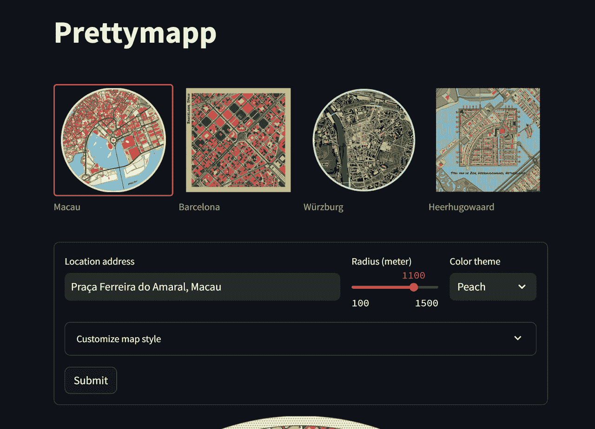


在这里由于时间关系，不会做过多的讲解展示，你可以参考官方的文档以及示例 https://streamlit.io/components ，面向代码 / 大语言模型问答学习：https://docs.streamlit.io/develop/concepts

接下来，我们一起看看在实战过程中我们需要注意哪些要点.在运行之前,我们需要安装 streamlit 库依赖环境

```
cd /mnt/workspace
conda activate ipex
pip install streamlit
```

与 gradio 不同的是， streamlit 不需要复杂的 root_path 路由修改操作，我们只需要简单的运行就可以得到结果。

# RAG应用与 llamaIndex

## 什么是 RAG

什么是 Retrieval-Augmented Generation（RAG）检索增强生成应用? 检索增强生成顾名思义,就是利用检索来增强大模型的生成结果.

具体而言, RAG 主要是在这样的场景下被需要的:想象一下,当你有一个冷门的知识需要理解,但大模型没有基于这个知识训练过,或者说你想把这个知识全部输入大模型进行问答,但是大模型的上下文没有那么长;那么,我们需要一个好的方法让大模型可以基于我们新的知识进行对话,这就是 RAG的意义所在.

检索增强生成 (RAG) 通过向量数据库检索的方式来获取我们问题预期想要回答涉及的知识,然后结合这个知识让大模型基于知识生成最后的问答结果,满足了我们对提问的真实性需求.

在理解 RAG 之前,我们还需要理解什么是 Embedding.

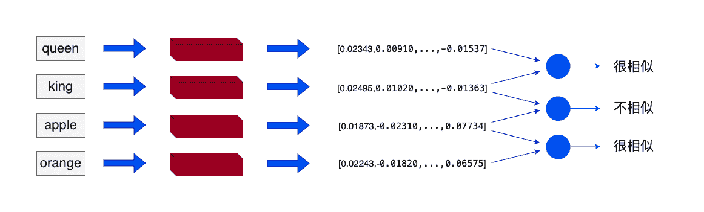

在机器学习和自然语言处理（NLP）中，Embedding 是一种将非结构化数据,如单词、句子或者整个文档，转化为实数向量的技术。这些实数向量可以被计算机更好地理解和处理.我们可以把一个词(token)表示成有限维度空间中的表示.

比如, 我们可以把苹果映射成 (5,5) ,把梨子映射成 (4,5),把芯片映射到 (1,2). 在这里,坐标的相近表示梨子和苹果的语义有很大的重复成分,而芯片与苹果的距离,自然比梨子与苹果的距离要远. 此时这些数字坐标映射就可以理解为简单的 Embedding.

我们可以通过 Embedding 模型,将一个词很方便映射到对应的实数多维表示空间,这个映射关系是提前训练得到的,越准确的 Embedding 模型可以让我们越好的区别不同语义特征的差异性,这也就对 RAG 的准确检索带来了更大的好处.

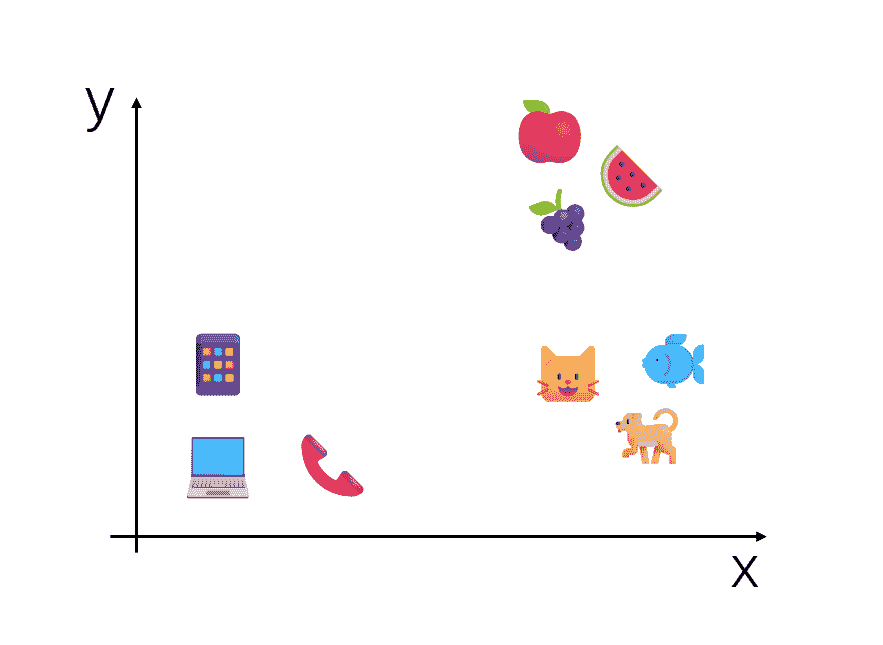

在搭建 RAG 系统时，我们往往可以通过使用 Embedding 模型来构建词向量，我们可以选择使用各个公司的在线 Embedding API,也可以使用本地嵌入模型将数据构建为词向量;由于我们通常是对文档操作,这里的向量化是对文档块(chunk)进行;我们可以将一个文档分成多个段落,每个段落分别进行 Embedding 操作,得到结果后存储到对应的数据库中保存,以便后续的检索即可.

而对于数据库,在 RAG 中,我们通常使用的也就是 Embedding 相关的数据库 - 向量数据库. 向量数据库是一种基于向量空间模型的数据库系统,它能够利用向量运算进行数据检索的高效处理,常见的向量数据库包括 Faiss、Annoy、Milvus 等等。这些向量数据库通常与 LLM 结合使用,以提高数据检索和处理的效率。

至此,在理解了 Embedding 之后,我们就理解了 RAG 中的一大核心要素.那么,我们将如何构建一个 RAG 系统?


具体而言, RAG 有很多的实现方式,在这里我们使用最简单的实现方法,他遵循最传统的规则,包括索引创建（Indexing）、检索（Retrieval）和生成（Generation）,总的来说包括以下三个关键步骤：

+   语料库被划分成一个个分散的块(chunk)，然后使用embedding模型构建向量索引,并存储到向量数据库.

+   RAG 根据 query (当前提问)与索引块（Indexed Chunk）的向量相似度识别并对块进行检索。

+   模型根据检索块（Retrieved Chunk）中获取的上下文信息生成答案。

RAG 也可以被简单的分成几大模块:

+   向量化模块，用来将文档片段向量化。

+   文档加载和切分的模块工具，用来加载文档并切分成文档片段。

+   向量数据库模块,用于将向量化后的文档存储到数据库中.

+   检索模块，根据 Query （问题）检索相关的文档片段。

+   大模型模块，结合 Query 及检索出来的文档回答用户的问题。

我们可以用一张图简单理解 RAG 系统做了哪些事情:

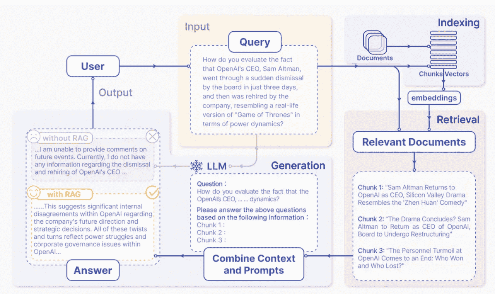

由图可知,我们通过基于提问检索出的知识块,和提问一起拼接输入到大模型问答后,让大模型的回答更加接近我们的提问预期,可靠性大幅度增加.但这也并非 RAG 技术的终点,我们可以通过更多额外方式增强 RAG 的效果,譬如:

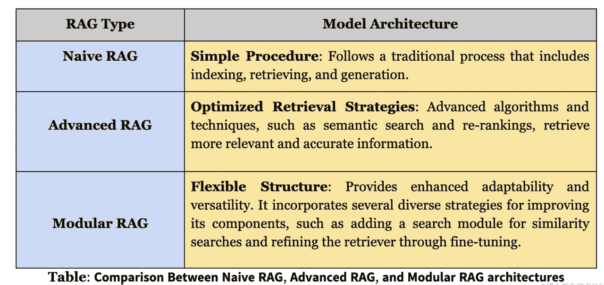

以最简单的"重排技术"为例,我们可以通过检索后重新排布检索的结果,从而提高提高打算使用的检索块与提问的关联度,最终提高问答的生成质量。在 RAG 架构下，引入重排步骤可以有效改进召回效果，提升LLM（大语言模型）生成答案的质量。我们可以通过一张图简单理解这一过程:

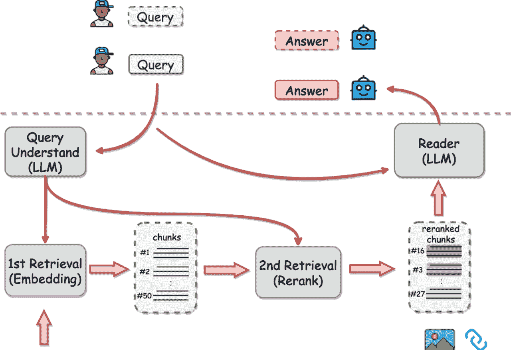

总之,我们可以利用 RAG 技术提高大模型问答最后的生成水平,在强事实要求与上下文不足的情况下仅仅依靠 RAG 就能实现满足预期的效果. 接下来, 让我们从初级 RAG 开始, 一步步探索检索增强生成的应用之路.

## 什么是 LlamaIndex

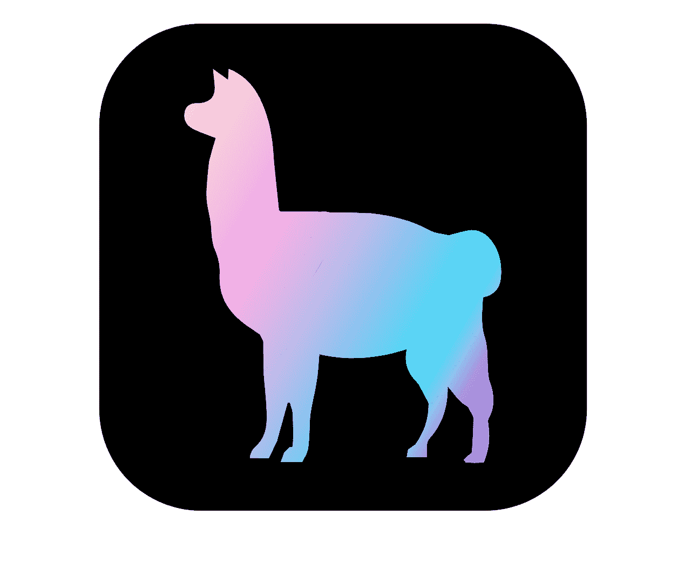

我们将使用[ LlamaIndex ](https://docs.llamaindex.ai/en/stable/)进行初级 RAG 系统的搭建演示。LlamaIndex是一个AI框架，用于简化将私有数据与公共数据集成到大型语言模型（LLM）中的应用程序中。它提供了数据 ingestion、 indexing 和查询的工具，使其成为生成式AI需求的可靠解决方案。

LlamaIndex主要包括以下几个组件:

+   数据连接器：帮助连接现有数据源和数据格式（如API、PDF等），并将这些数据转换为LlamaIndex可用的格式。

+   数据索引：帮助结构化数据以适应不同的用例。加载了来自不同数据源的数据后，如何将它们分割、定义关系和组织，以便无论您想要解决的问题（问答、摘要等），都可以使用索引来检索相关信息。

+   查询接口：是输入查询并从LLM中获取知识增强输出的接口。

其中，LlamaIndex 有几个重要的高层次抽象结构需要我们理解：

1.  [Indexing](https://docs.llamaindex.ai/en/stable/module_guides/indexing/)

Indexing 是一种数据结构，它允许我们快速检索我们所查询的相关上下文，你可以把它简单理解为一种对 "node"  的抽象组织方式，在 llamaindex 中存在多种不同的组织 node 的方式。 Indexing  将数据存储在Node对象（代表原始文档的 chunk ）中 ，并公开支持额外配置和自动化的Retriever接口。当我们看到 Node 对象的时候，你可以把他简单理解为 chunk。对于LlamaIndex，它是检索增强生成（RAG）用例的核心基础。

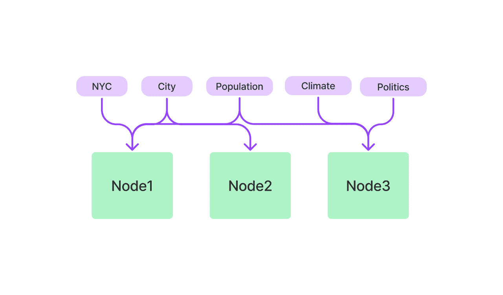

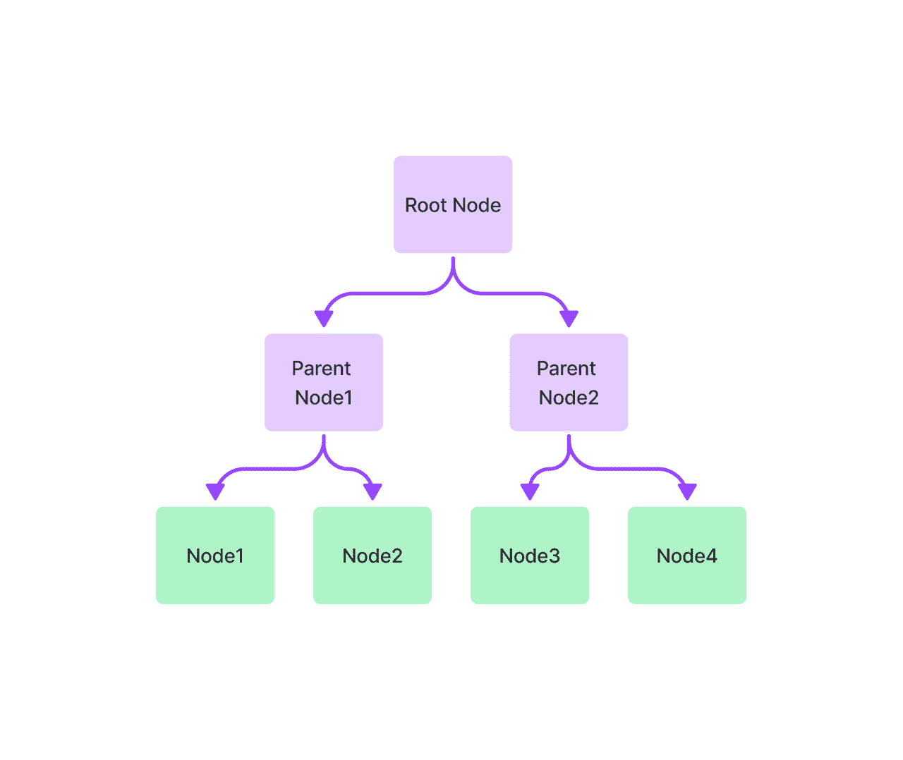

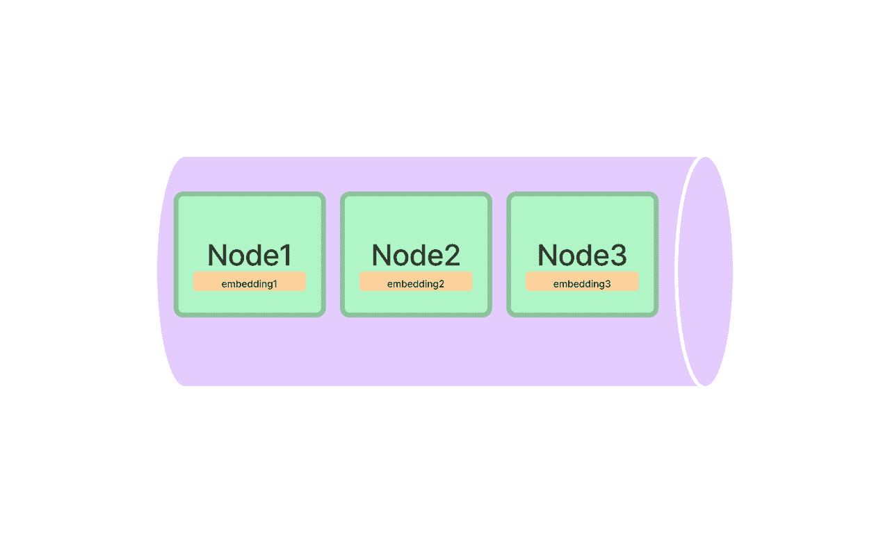

在高层次上，Indexing  是从Documents 构建的 node 组成的。它们用于构建 Query Engine 等，可以通过您的数据进行问答和聊天。

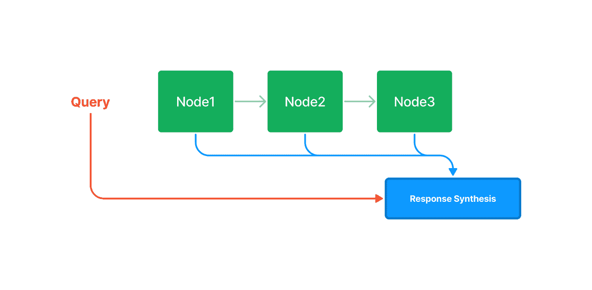

1.  [Vector Stores](https://docs.llamaindex.ai/en/stable/module_guides/storing/vector_stores/)

Vector Stores 负责收纳 chunks 的嵌入向量。默认情况下，LlamaIndex使用一个简单的内存向量存储，非常适合快速实验。它们可以通过调用 vector_store.persist() 进行持久化。

你也可以更换不同的向量数据库进行实验， LlamaIndex 支持多种向量数据库输入

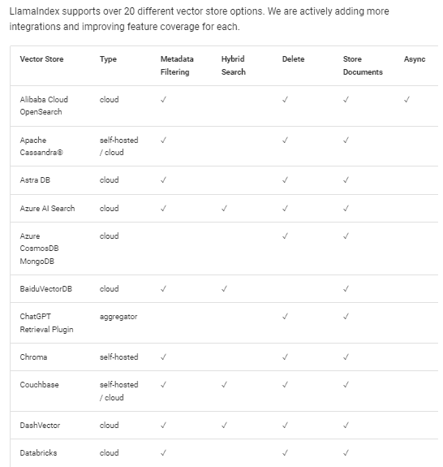

1.  [Query Engine](https://docs.llamaindex.ai/en/stable/module_guides/deploying/query_engine/)

Query Engine 是 LlamaIndex 中的另一个重要的高级抽象基础设施。Query Engine 是一个通用接口，允许您对数据提出问题。Query Engine 引擎接收自然语言查询，它通常（但不总是）通过检索器建立在一个或多个 indexing 上。您可以组合多个 Query Engine 来实现更高级的功能。

简单而言，我们可以通过以下方式快速基于某个 index 数据结构构建一个查询引擎，并对他进行查询。

```
query_engine = index.as_query_engine()
response = query_engine.query(&quot;Who is Paul Graham.&quot;)
# 流式调用
query_engine = index.as_query_engine(streaming=True)
streaming_response = query_engine.query(&quot;Who is Paul Graham.&quot;)
streaming_response.print_response_stream()
```

通过 index 、vector store、 query engine 的构建，我们可以很容易针对不同抽象组织的 chunk 进行我们想要的检索、查询操作，最终得到高质量的 RAG 系统。

看了那么多有关 LlamaIndex 的介绍,我们还是不能学会如何结合它与 IPEX-LLM 实现一个简单的 RAG 系统,所以,让我们直接进入到代码的阅读环节.

我们可以来看一个简单的 LlamaIndex 示例,它直观展示了如何构建一个 RAG 体系:

假设你有如下的文件组织:

```
├── starter.py
└── data
    └── paul_graham_essay.txt
```

核心代码为:

```
# 导入需要的模块和类
from llama_index.core import VectorStoreIndex, SimpleDirectoryReader, Settings
from llama_index.embeddings.huggingface import HuggingFaceEmbedding
from llama_index.llms.ollama import Ollama

# 1. 使用 SimpleDirectoryReader 加载数据
# SimpleDirectoryReader 是一个简单的目录读取器，能从指定目录中读取所有文件的数据
documents = SimpleDirectoryReader(&quot;data&quot;).load_data()

# 2. 设置嵌入模型为 bge-base
# HuggingFaceEmbedding 是一个嵌入模型类，用于将文本转换为向量表示
# 这里我们使用的是 &quot;BAAI/bge-base-en-v1.5&quot; 模型
Settings.embed_model = HuggingFaceEmbedding(model_name=&quot;BAAI/bge-base-en-v1.5&quot;)

# 3. 使用 Ollama 快速接入大语言模型
# Ollama 是一个模型的快速调用框架
# 这里我们指定使用 &quot;llama3&quot; 模型，并设置请求超时时间为 360 秒
Settings.llm = Ollama(model=&quot;llama3&quot;, request_timeout=360.0)

# 4. 创建一个向量存储索引
# VectorStoreIndex 是一个用于存储和查询向量的索引类
# from_documents 方法是从文档数据创建索引
index = VectorStoreIndex.from_documents(documents)

# 5. 将索引转换为查询引擎
# as_query_engine 方法将现有的向量存储索引转换为一个查询引擎
# 查询引擎是一个通用接口，允许您对数据提出问题。
query_engine = index.as_query_engine()

# 6. 使用查询引擎进行查询
# query 方法接受一个查询字符串，并返回一个响应对象
# 这里我们查询 &quot;作者小时候做了什么？&quot;
response = query_engine.query(&quot;What did the author do growing up?&quot;)

# 7. 打印查询结果
# 打印从查询引擎返回的响应
print(response)
```

从代码中,我们可以很容易看到 RAG 系统构建过程。首先我们需要一个读取器，以便我们获取目标目录的对应数据，接着需要对这个数据进行 embedding 化即创建索引，把他转为可存储的向量表示。最后就可以用设定好的大模型，结合查询引擎进行检索增强生成的对话。

## 实现一个自己的 RAG

如[**果你觉得 LlamaInd**](https://github.com/datawhalechina/tiny-universe/tree/main/content/TinyRAG)**e**x的封装还不够称心如意, 在这里我们还能够实现自己的 RAG 框架, 借助于 tiny-universe , 我们可以很容易实现一个属于自己的 RAG 框架,

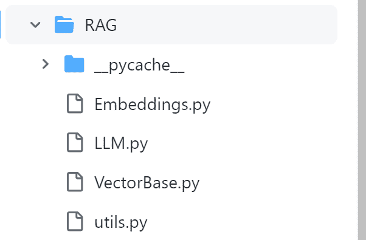

基于简单的结构,我们能够很容易实现属于自己的 Embedding 抽取, 持久化,  检索与对话; 由于代码比较简单易懂, 十分欢迎试试实现一个属于自己的 RAG 系统组件, 你可以更加灵活的配置不同模块的输入与输出, 从而更高效地实现预期检索增强生成相关功能。

在代码中，我们还实现了第三方的检索器以及 node（chunk）构建过程，你可以根据上述所说并结合 LlmaIndex 文档，通过观察输入与输出熟练掌握这一过程。

至此，恭喜你完成了所有的学习过程，欢迎你在文档中探索更深入有趣前沿的功能与特性，也非常欢迎你接着看完之后的所有彩蛋。

# 思考题

+   🤔 更多的模态

在前面，我们提到的都是语言检索增强生成的方法；但当我们重新审视检索增强这一名词，会发现他并没有指定检索的信息就是语言。

事实上，检索增强——对应的只是通过检索输入最近的向量编码，再利用向量编码提供大模型作为上下文基础信息。

那么，我们是否能够检索更多不同模态的向量编码，让我们实现更多模态的 RAG 系统？

比如，我们是否能够实现一个简单的图文对话工具，不需要视觉大模型，而利用一个 图文字典 向量数据库，通过匹配输入图找到对应的向量数据库最接近的图像 embedding，然后返回该图对应的真实文本解释给大语言模型；此时我们实现的就是图像多模态的 RAG 系统。

也许我们可以做的更多？ 图像、音频、视频、蛋白质......任何可编码对象都是我们能够检索的，甚至跨不同模态进行检索。

在向量的世界中，他们一视同仁，只有远近之分。

+   🍉 更可控的效果

RAG 在当前的发展中，已经极大的提高了大模型问答的精确程度，但我们仍担忧返回错误答案。我们是否有什么方式可以进一步提高检索精度？

+   从知识库的组织让检索更精确

+   从大模型的能力提高让检索更精确

+   通过多模型检查结果实现自动化测试精度

+   通过更多传统语义匹配、混淆度检测方式让回答结果更加固定

+   通过调节参数（温度值等）让回复更可控

RAG的效果已然不错，但我们还需要让他更进一步，这会让AI产品化的爆发临界线越来越近。

# 彩蛋 - 英特尔与八仙童的故事

参考：https://zh.wikipedia.org/wiki/%E8%8B%B1%E7%89%B9%E5%B0%94

1955年，“晶体管之父”威廉·肖克利（William Bradford Shockley）离开贝尔实验室，创建肖克利半导体实验室（Shockley Semiconductor Laboratory）。他吸引了很多富有才华的年轻科学家加盟。但是很快，肖克利的管理方法和怪异行为引起员工的不满。其中八人决定一同辞职（这就是大家传说的”八仙童“），他们是罗伯特·诺伊斯（Robert Noyce）、高登·摩尔（Gordon Moore）、朱利亚斯·布兰克（Julius Blank）、尤金·克莱尔（Eugene Kleiner）、金·赫尔尼（Jean Hoerni）、杰·拉斯特（Jay Last）、谢尔顿·罗伯茨（Sheldon Roberts）和维克托·格里尼克（Victor Grinich）。后来他们被肖克利称为“八叛逆”。八人接受位于纽约的“仙童摄影器材公司”（Fairchild Camera and Instrument）的资助，于1957年创办了仙童半导体公司。

由于仙童半导体快速发展，导致内部组织管理与产品问题日益失衡。1968年7月，仙童半导体其中两位共同创办人罗伯特·诺伊斯、高登·摩尔请辞，并于同年7月16日以“集成电子”一名共同创办英特尔公司。安迪·葛洛夫也志愿跟随高登·摩尔的脚步，成为英特尔第3位员工。在安迪·葛洛夫的口述自传中表示，如果以“他是英特尔第3位员工”的角度来看，他是“英特尔创办人之一”。但若以所有权来说，因未受邀1美元价格购股，所以是首位自愿加入的员工。

在刚创立新公司时，高登·摩尔与罗伯特·诺伊斯想要将新公司命名为“摩尔·诺宜斯”（Moore Noyce）。不过这个名称却像是“more noise”，不太适合用于电子公司。于是在决定以INTegrated ELectronics的前缀组成的“Intel”之前，大约有一年的时间他们使用“NM电子”来做公司名称。不过当时Intel的品牌已经被一家连锁旅馆注册，所以当时他们就买下Intel商标才成为现今的Intel公司。

有**趣的是！硅谷大约70家半导体公司中的半数是仙童半导体的直接或**间接后裔。许多著名的半导体公司创始人都来自仙童半导体。就像充满冒险精神的蒲公英，八仙童们间接鼓励了硅谷的科技繁荣，而Intel便是故事中最著名的结晶之一。

# 彩蛋 - 英特尔芯片的故事

恭喜你完整看到了教程的最后！在此衷心的祝愿你比赛顺利，学有所成。

在 AI 时代，席卷而来的不仅仅是人工智能给人的替代压力，而是在大时代下人展现出那颗勇往直前、永远奔腾不息的心。

在故事的最后，不如让我们一起来看看"奔腾的芯"，它是如何从最小的芯片成长到如今支持大语言模型高效推理的通用处理器。(参考:https://zhuanlan.zhihu.com/p/464413953 与 intel 官方文档)

英特尔公司(Intel)推出的第一款微处理器，也是全球第一款微处理器；于1971年11月15日发布.

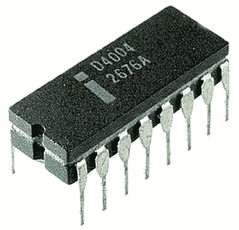

1978和1979年，Intel公司先后推出了8086和8088芯片，它们都是16位微处理器，内含29000个晶体管，时钟频率为4.77MHz，地址总线为20位，可使用1MB内存。内部数据总线是16位，外部数据总线8088是8位，8086是16位。1981年8088，芯片首次用于IBMPC机中，开创了全新的微机时代。


Intel公司于1993年03月22 日，发布了P5架构的80586，其正式名称为PENTIUM (中文名:奔腾)。PENTIUM含有310万个晶体管，L1为16KB（8+8）时钟频率最初为60MHZ和66MHZ，Socket 4 ( 273 針腳 PGA 封裝)，电压5V，采用0.8um BiCMOS工艺制造。

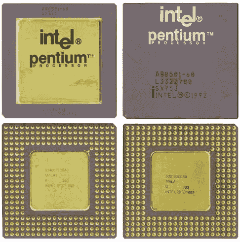

1997年，在奔腾（P54C）和P6的基础上又有了新的发展，一块奔腾（P54C），加上57条多媒体指令，就得到了多能奔腾（P55C），相对P54C，P55C在以下几方面做了改进：（1）支持称为MMX多媒体扩展的新指令集，有57条新指令，用于高效地处理图形、视频、音频数据；（2）内部Cache从16KB增加到32KB。（3）优化了CPU的执行核心。


在奔腾开创了 CPU 的新时代后, 新架构的 CPU 紧随其后不断涌现:

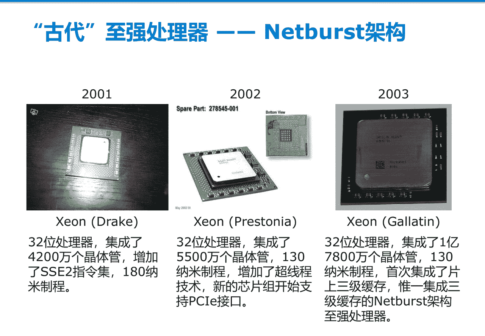

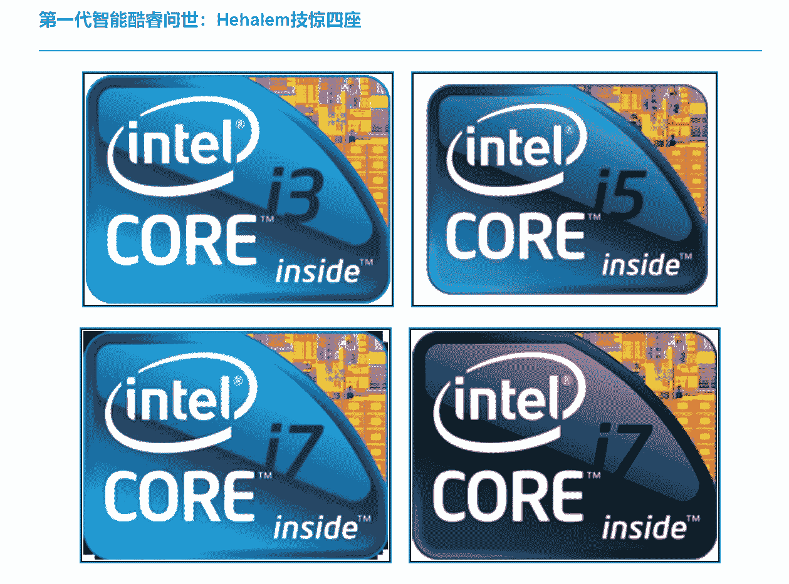

时光来到2024年,小小的奔腾已然演化出繁荣多样的 Intel 芯片体系:

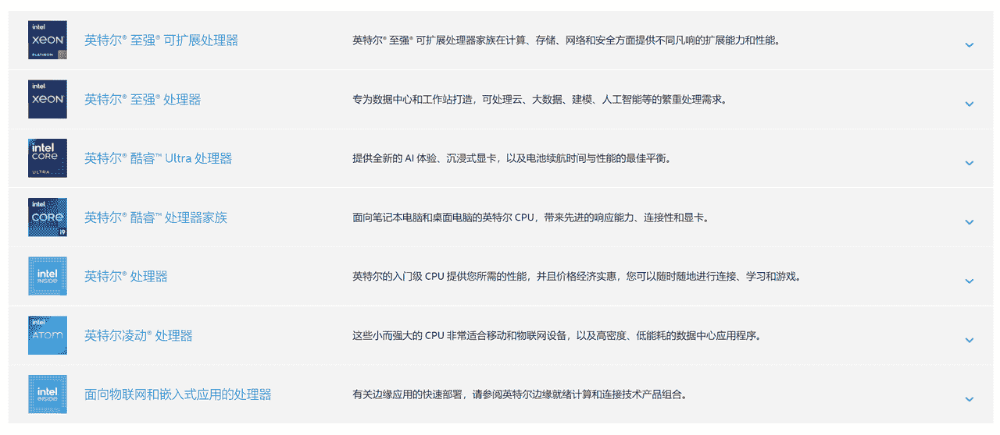

酷睿（Core）是英特尔公司推出的面向中高端消费者、工作站和发烧友的一系列CPU。酷睿替代了曾经是中高端的奔腾（PenTium），将奔腾移至入门级，并将赛扬（Celeron）处理器推向低端。当前常见的I3I5I5就是这个系列，I7还出过至尊版Intel Core i7 Extreme EdiTIon，还有I9处理器。

奔腾（Pen[Ti](https://link.zhihu.com/?target=http%3A//bbs.elecfans.com/zhuti_715_1.html)um）是英特尔公司的一个注册商标，作为其x86处理器品牌之一，于1993年推出。之前奔腾是英特尔的唯一的x86处理器产品线，后来随着其产品线的扩展衍生出低端的赛扬（Celeron）系列、供服务器以及工作站使用的至强（Xeon）系列。2006年英特尔推出酷睿（Core）系列处理器产品线，取代原奔腾处理器系列的市场定位。如今奔腾定位中端系列，介于赛扬和酷睿之间。

赛扬（Celeron）是英特尔公司中央处理器的一个注册商标。赛扬处理器是Intel旗下经济型产品，于1998年推出。

至强（Xeon）是Intel的一个中央处理器品牌，主要供服务器及工作站使用，亦有超级计算机采用此处理器。Intel XeonE3-1230曾因高性价比而受到电脑DIYer的热捧，有“i5的价格，i7的性能”的美誉。

安腾（Itanium），是英特尔安腾架构（IA-64）的64位处理器。第一款安腾于2001年推出，该处理器的市场定位是在于企业服务器与高性能运算系统。

凌动（Atom）开发代号Silverthorne，是Intel的一个超低电压处理器系列。该处理器的市场定位是在于智能手机、平板电脑和低成本PC，上网本等。

除此之外，英特尔还有许多 GPU 相关的产品线，我们同样也能够通过 IPEX-LLM 以及其他英特尔深度学习框架，将大语言模型高效地运行在我们的端侧设备上。

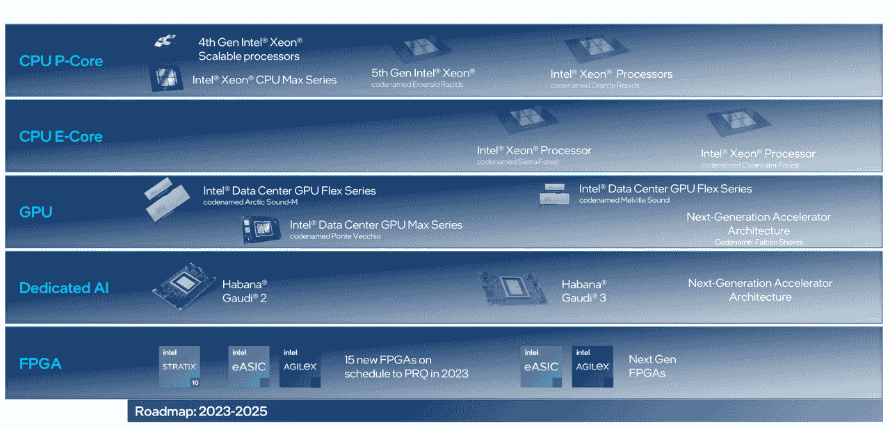

相信读者在看过结语后，会对英特尔芯片有更深入的理解。虽然奔腾的芯早于远去，但每一位致力于更好的计算、致力于计算更好的未来的人们，奔腾的心永远不会停息 :) 。

# ❀ 恭喜看完全部知识教程！

> 我们的学习也已接近过半！接下来，就都是你们团队开发的时间！

> 后面我们也会继续展开技术交流会，有任何疑难杂症，欢迎一起探讨~

> 比赛不结束，我们不散场！比赛结束了，我们依旧不散场！依旧可以交流idea、交流demo！

# 把时间交给你们，期待你们的应用惊艳全场！！！

>

> **填**写打卡链接，加入作品交流群持续迭代作品https://doc.weixin.qq.com/forms/AFwAjwcuADYAbUASwbqAMYeQyuVfbjR9f

## 你还可以随时回顾学习内容~

<https://datawhaler.feishu.cn/sync/Vht1dg6jXsUKnObkj03cm9RGnTc>

### 🎉合影留念墙

感谢很棒的你一路的坚持，让我们在这里给自己点个赞！

一起合个影 :)

> 本教程主要由   写作贡献，经过多位助教内测和建议修改，期待你的点赞和评论～