# 教程：AI 财务分析与可视化

> 来源：[https://datawhaler.feishu.cn/docx/QWzIds9CfoYLQxxKOfocIjJ6nSb](https://datawhaler.feishu.cn/docx/QWzIds9CfoYLQxxKOfocIjJ6nSb)

> ✍️  作者：[纪伦的个人说明书](https://datawhaler.feishu.cn/wiki/AKxvw88QMiyg6NkxtYzc9evGnfc?from=from_copylink)

## 学前须知

+   **学习时间**：1~3天

+   **学习难度**：建议会一点代码，至少会运行python或者VBA

+   **学习方式**：

1.  在场景细分图中，找到自己需要的场景

1.  找到对应的案例学习（参考小作业与参考教程）

1.  学习优秀打卡案例，查漏补缺

1.  选择感兴趣的小作业，跟着案例自己尝试做一遍。

1.  尝试熟悉流程后，应用到实际工作中

>

> 打卡核实后**「可获得证书」**，优秀打卡内容将被**「展出」**，特别优秀者会邀请来**「一起完善学习文档」**

> 具体打卡要求详见：[【说明文档】打卡（非必须）](https://datawhaler.feishu.cn/wiki/UR4bwTSjJiAKFLkfqdCc8Dlgnld?from=from_copylink)

## 场景细分图

## 参考小作业

多维表格（AO9JbRHMFaEo24srI6VctejAn7d_tbl9tkMwoV5ilwdF）

## 参考教程

### 【场景一】快速数据分析

#### 【方案一】没啥分析思路？用AI一键分析试试

使用WPS打开excel，调用WPS AI，一键分析

目前是一键分析，适用于拿到一批数据，不知道从哪个方向下手，让它先开始

打开WPS侧边栏

一键洞察分析

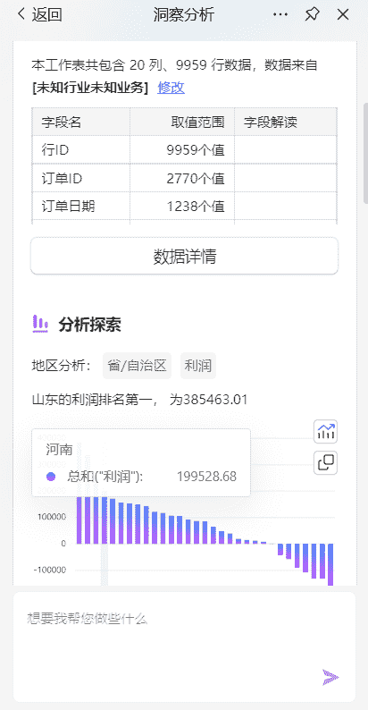

点开分析探索，可添加分析字段，切换维度

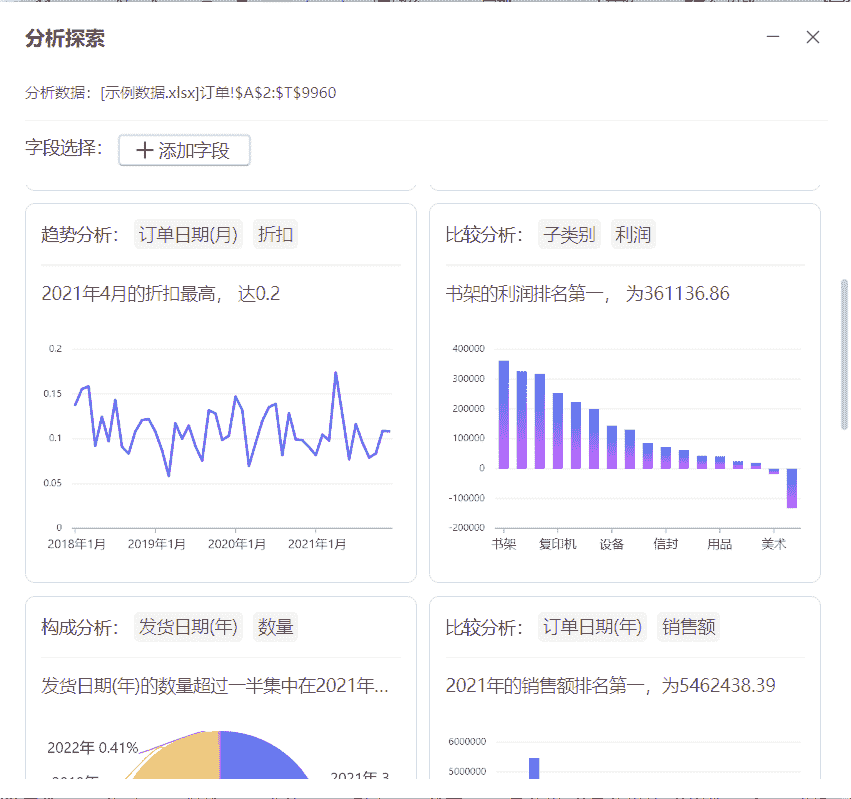

然后生成洞察结论，看看可能的问题与结论，仅供参考

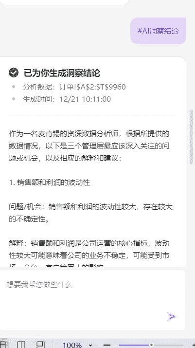

还可以针对某个方向，生成新的分析

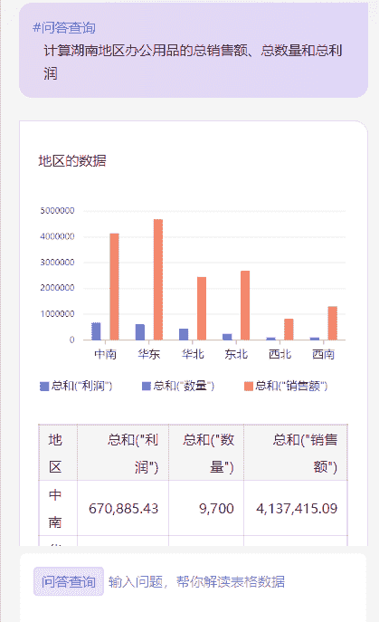

做好的图表可一键粘贴出来

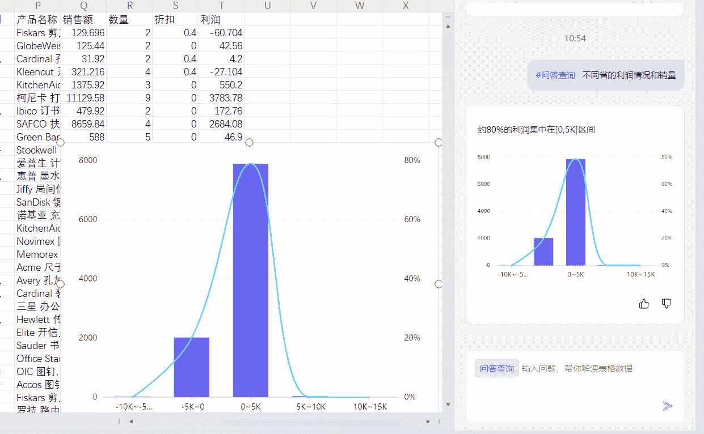

#### 【方案二】文件交给大模型进行分析

**用智谱清言的数据分析进行建模**

(1月16日更新)

参考prompt

> 对于我上传的一个excel文件，站在财务的角度来做分析，主要关注收入、利润的趋势，从不同维度，比如细分、城市、地区、类别来做

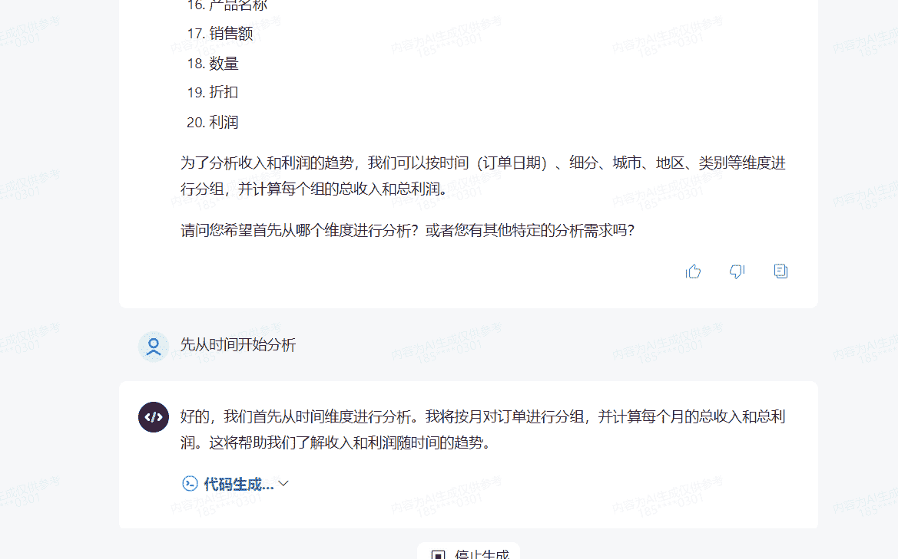

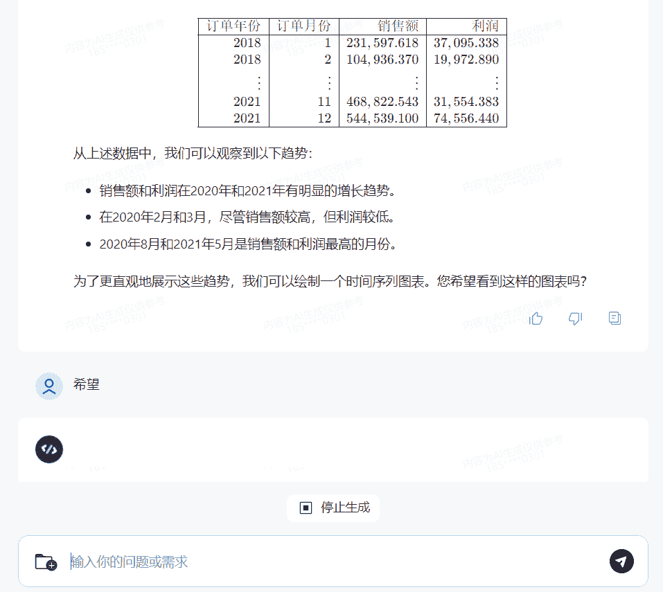

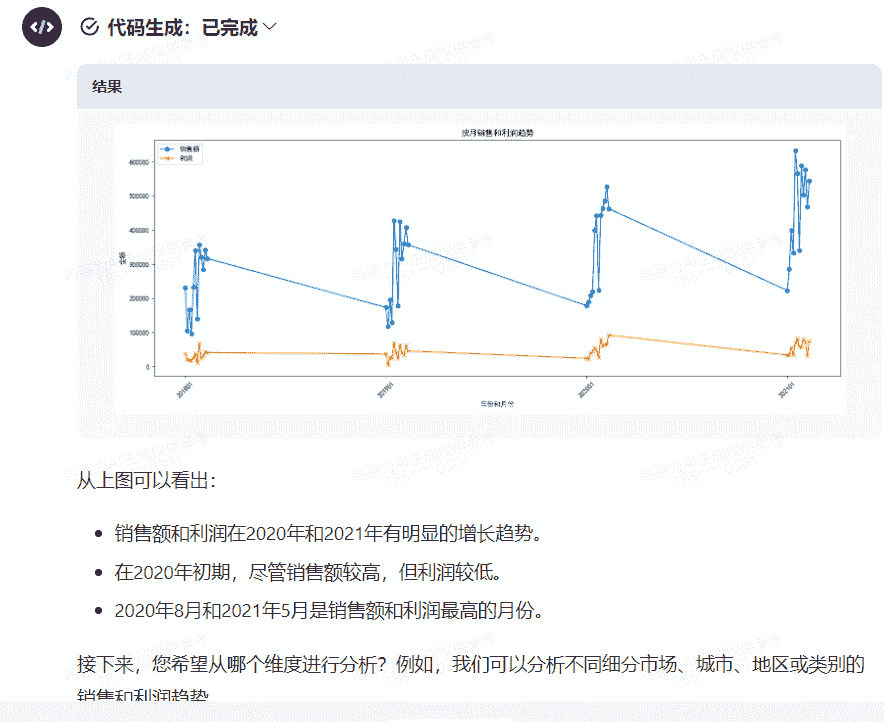

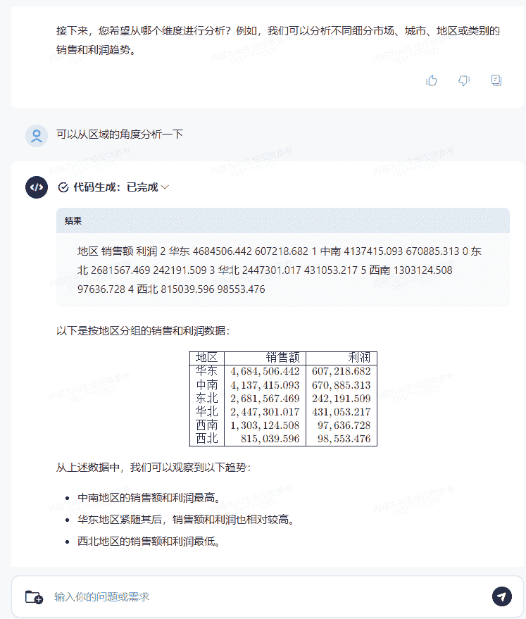

**用GPT4分析**

> 无法使用GPT4的小伙伴可以不看这个

里面会直接执行代码阅读文件进行分析，准确率较高

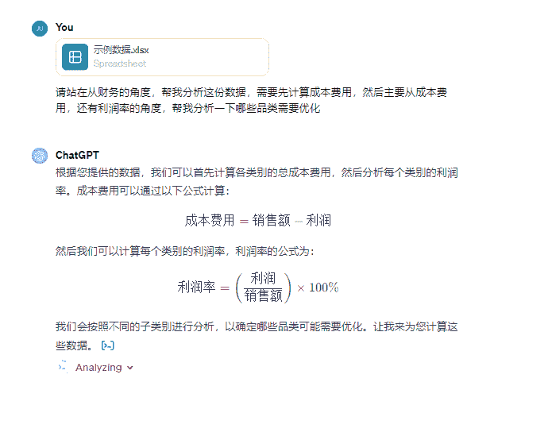

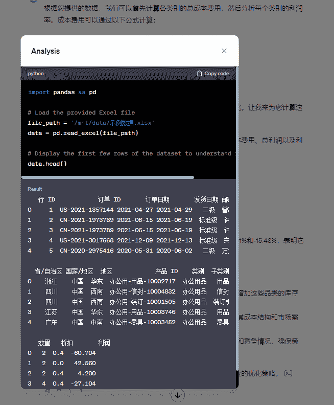

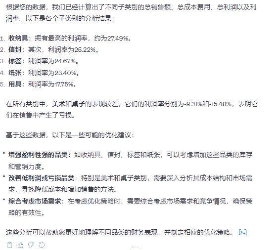

制作图表并提供分析结论，但是目前运行环境里似乎不支持中文

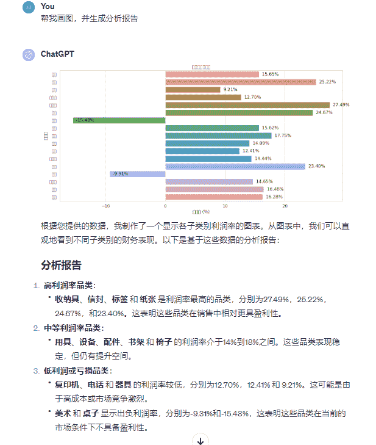

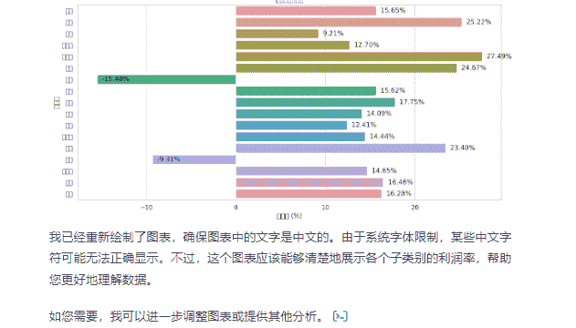

### 【场景二】根据模板进行自动工作流的数据分析

#### 【方案一】详细描述需求给大模型类工具，生成一套代码

## AI工具表

> 持续添加中，欢迎大家在文档处评论分享一些自己使用觉得不错的工具。

## 参考资料

> 公域上一些不错的，对大家学习用AI处理数据，可能有帮助的内容，也欢迎大家评论补充

## 优秀学习案例

> 非常值得一看的内容！如果你也觉得不错，记得给他们点个赞

##