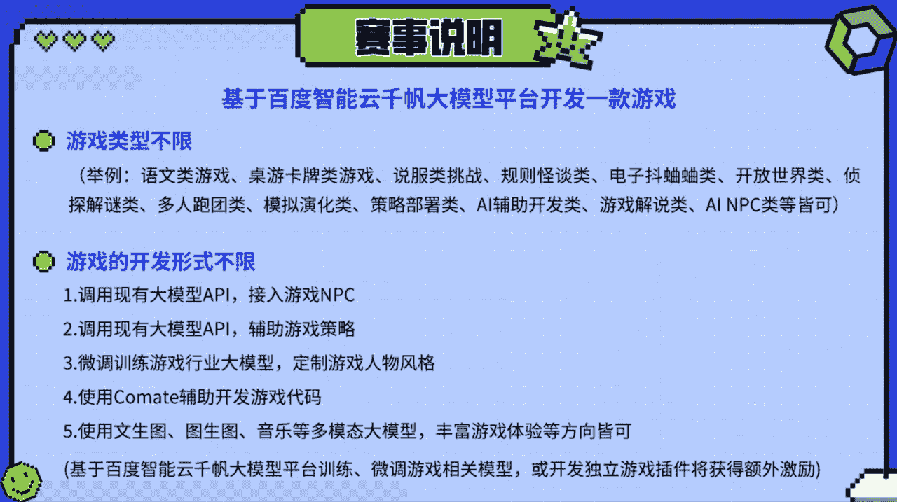

# AI + 游戏

> 来源：[https://datawhaler.feishu.cn/docx/K28SdCzswoEV46xpexucIxj6nEc](https://datawhaler.feishu.cn/docx/K28SdCzswoEV46xpexucIxj6nEc)

> 本文档原为 **寻找游戏大模王** 比赛收集的参考资料

> 原**学习手册（学习&赛事已结束）**： [大模型游戏应用开发（学习手册）](https://datawhaler.feishu.cn/docx/QVqddVgeKo0F2Rxk1WbcPemmnHb)

# 🎮 从零开始制作一个属于你自己的游戏

## **建立游戏开发基本认知：**

1.  【游戏行业科普 · 四】有哪些游戏品类，如何划分

1.  如何从0开始准备一个游戏设计项目

1.  游戏开发如何入门？零基础想学做游戏从什么地方开始？附学习路线和教程

## **学习基础的实操演示：**

1.  用unity复现Flappy bird 【如何不写代码却能制作你人生中的第一个游戏】

1.  动手开发一个RPG游戏： [RPG maker mz入门教程](https://datawhaler.feishu.cn/wiki/MqGDwigXhimGALkuGAccOGxrnkf)

1.  用python接入千帆大模型 public-note/用Python接入千帆大模型

[用Python接入千帆大模型.zip](https://internal-api-drive-stream.feishu.cn/space/api/box/stream/download/all/BGRIbkDr3o0cnvx8CbIc4reKnjf)

1.  unity接入千帆：https://github.com/zhangliwei7758/unity-AI-Chat-Toolkit

1.  Unity+百度文心大模型驱动AI小姐姐数字人

## **借鉴和可做对标的作品集：**

1.  【十款游戏】[书籍：](https://webgamedeveloperscookbook.com/)[《网页游戏开发秘籍》](https://webgamedeveloperscookbook.com/)

1.  FUNPLUSer Game Jam作品展

# 完成游戏开发的参考流程

1.  分析需要，组队调研&确定大致分工：入门游戏开发入门，出demo，感知游戏设计与开发的流程

1.  [【寻找游戏大模王】开营仪式](https://www.bilibili.com/video/BV1qw411p7f3)

1.  [大模型游戏应用开发（学习手册）](https://datawhaler.feishu.cn/docx/QVqddVgeKo0F2Rxk1WbcPemmnHb)

1.  核心关注截止时间 & 比赛要求

1.  确定目标(对标游戏)，产出【游戏立项文件】：确定对标游戏

想开发什么样的游戏、能开发什么样的游戏、要开发什么样的游戏；是设计一个船新的游戏，还是复现已有的经典游戏？

1.  拆解目标，拆分实现工作量，产出【规划甘特图】：机制、背景 + 玩法 + 技术栈

1.  执行目标，定期会议，产出【阶段性成果】：会议对齐 + 近期分工 + 定期追踪 + 迭代推进

1.  提交作品，享受成功的喜悦

## 最终作品数：**31**

> 按照 Datawhale选送作品收录表单 填写顺序排序

> 其中，[穿越秦朝-荆轲刺秦王v1.0](https://www.bilibili.com/video/BV1iC4y1c7S5/) 拿下TOP1

| 游戏名称 | 链接 | 所在群 | 队伍名称 |
| --- | --- | --- | --- |
| 1. 杂鱼勇者 | [https://www.bilibili.co](https://www.bilibili.com/video/BV1b64y1j7M8)m/video/BV1b64y1j7M8 | 3 | 鬼车 |
| 2. 成功救出王子 | [https://www.bilibili.com](https://www.bilibili.com/video/BV17e411o7Rm/)/video/BV17e411o7Rm/ | 3 | 天奇 |
| 3. 史莱姆的修炼之旅：AI游戏制作 | [https://www.bilibili.com](https://www.bilibili.com/video/BV1SM411R73z/)/video/BV1SM411R73z/ | 1 | 彩虹队 |
| 4. 穿越秦朝-荆轲刺秦王v1.0 | [https://www.bilibili.com](https://www.bilibili.com/video/BV1iC4y1c7S5/)/video/BV1iC4y1c7S5/ | 1 | 荆轲刺秦王 |
| 5. 古堡逃生 | [https://www.bilibili.co](https://www.bilibili.com/video/BV1cu4y1u7Bs)m/video/BV1cu4y1u7Bs | 4 | 鸭鸭冲呀 |
| 6. ai辩手 | [https://www.bilibili.co](https://www.bilibili.com/video/BV1fH4y1r7uz)m/video/BV1fH4y1r7uz | 1 | 不行也得行 |
| 7. 模法学院-通往法治巅峰 | [https://www.bilibili.com](https://www.bilibili.com/video/BV15c411D7jb/)/video/BV15c411D7jb/ | 2 | 模法创新者队 |
| 8. 末世余晖:2104 | [https://m.bilibili.co](https://m.bilibili.com/video/BV1gH4y1k76o)m/video/BV1gH4y1k76o | 4 | 末世余晖 |
| 9. 守护之战 | [https://www.bilibili.co](https://www.bilibili.com/video/BV1Gu4y1G7NL)m/video/BV1Gu4y1G7NL | 3 | GTNLLMGDU |
| 10. 你重生了，但上帝是AI？ | [https://www.bilibili.com](https://www.bilibili.com/video/BV1fc411i7uj/)/video/BV1fc411i7uj/ | 1 | 晨旭不想写程序 |
| 11. 文字冒险之旅 | [https://www.bilibili.com](https://www.bilibili.com/video/BV1hb4y1L73p/)/video/BV1hb4y1L73p/ | 2 | 文字冒险 |
| 12. 瑾的故事 | [https://www.bilibili.com](https://www.bilibili.com/video/BV1NN41157aH/)/video/BV1NN41157aH/ | - | 挖坑的萝卜 |
| 13. 邻家小宋初长成 | [https://www.bilibili.com](https://www.bilibili.com/video/BV1kQ4y1V7EC/)/video/BV1kQ4y1V7EC/ | 3 | TNT |
| 14. 无限跑团 | [https://www.bilibili.com](https://www.bilibili.com/video/BV1Uw411b7Xk/)/video/BV1Uw411b7Xk/ | 3 | 喵～ |
| 15. 女流氓勇创游乐园 | [https://www.bilibili.co](https://www.bilibili.com/video/BV1Hj411L7LR)m/video/BV1Hj411L7LR | 3 | 游戏人生 |
| 16. 《让温暖善良的酒馆老板为你讲恐怖海龟汤》 | [https://www.bilibili.com](https://www.bilibili.com/video/BV1W64y1j7vs/)/video/BV1W64y1j7vs/ | 2 | 啊对对队 |
| 17. 逃出实验室 | [https://www.bilibili.co](https://www.bilibili.com/video/BV1V94y177SH)m/video/BV1V94y177SH | 4 | 机器开发小组 |
| 18. 《穿越秦朝：荆轲刺秦王》全新更新 | [https://www.bilibili.co](https://www.bilibili.com/video/BV1DG411v7sr)m/video/BV1DG411v7sr | 1 | 荆轲刺秦王 |
| 19. 庄园密案：谁是真凶 | [https://www.bilibili.com](https://www.bilibili.com/video/BV1z64y157XY/)/video/BV1z64y157XY/ | 1 | 荆轲刺秦王 |
| 20. 不要乱开门 | [https://m.bilibili.co](https://m.bilibili.com/video/BV1ZG411v7Wv)m/video/BV1ZG411v7Wv | 2 | 大吉大利 |
| 21.讨价还价 | https://m.bilibili.com/video/BV1mc411i75e | 2 | 大吉大利 |
| 22.征服异星生物 | https://www.bilibili.com/video/BV1uC4y1X7GF | 1 | 阿瓜冲呀 |
| 23.《985博士过劳死后穿越回古代带着现代知识》 | https://www.bilibili.com/video/BV1MC4y1w7bd/ | 1 | 菠萝吹雪队 |
| 24.幻想小镇 | https://www.bilibili.com/video/BV1E64y1575R | 2 | 心予 |
| 25.情感香槟 | https://www.bilibili.com/video/BV1b94y177Qy/ | 5 | 情感香槟 |
| 26.砍树小达人 | https://www.bilibili.com/video/BV1Di4y1e7Vu | 3 | 天奇 |
| 27.文字提示小游戏 | https://www.bilibili.com/video/BV1VH4y1k7au/ | 2 | 哒哒踏 |
| 28.疯狂WDL | https://www.bilibili.com/video/BV15i4y1v7MR/ | 3 | 忘了😭，进击的生信！ |
| 29.机器人凯尔的决策 | https://www.bilibili.com/video/BV1rc411i7RE/? | 2 | 今天天气哈哈哈 |
| 30.ai海龟汤 | https://www.bilibili.com/video/BV1Rg4y1o7ZV/ | 5 | 汤圆 |
| 31.无限世界 | https://www.bilibili.com/video/BV1VN4y1a7rY | 2 | 哪吒团队 |

# 核心资料汇总-表格形式

# 其他资料汇总：可以参考框架，具体没必要一一看

## 游戏开发入门基础认知：【术语、工具、分工】

1.  想要自己做一款游戏，需要学习哪些知识？

1.  如何开发一款游戏：游戏开发流程及所需工具

1.  游戏开发如何入门？零基础想学做游戏从什么地方开始？附学习路线和教程

1.  【全、面向需要制作作品集的受众】如何从0开始准备一个游戏设计项目？

1.  【题材、玩法、终端、单机与否】【游戏行业科普 · 四】有哪些游戏品类，如何划分

1.  【策划、美术、项管、技术】【游戏行业科普 · 二】研发一款游戏具体需要做什么，需要哪些人

1.  [必须收藏|全网最全游戏分类](https://mp.weixin.qq.com/s/lS2bZfg624S6dBBLxn4vag)

1.  【有图有真相】[【知识普及】游戏的分类](https://mp.weixin.qq.com/s/GmYHg3S5RCa66Rv3VRzf2g)

1.  【详细制作的SOP，太复杂了，可以先不看，直接硬钢就好了】一个游戏是如何被设计和开发出来的

## 📦 游戏开发经验包：【加载大佬经验buff】

1.  【通往AGI之路收录的文章】[目录：AI+游戏](https://waytoagi.feishu.cn/wiki/YcwXwOjc2iGSTpkSIM3c4wP7nLd)

1.  10.1 总结 - 第一次制作独立游戏的5点收获 – 上篇

1.  【发烧期间随笔】第一次游戏开发经历的总结与反思

1.  [如何入门独立游戏开发？](https://mp.weixin.qq.com/s/5_xbVmfMIRwypN3Oj5VRug)

1.  【不再逃避，互相学习，结交伙伴】 GameJam攻略手册--新手入门

1.  AI大模型接入游戏NPC：《挑战十句话说服宿管阿姨开门》

+   相关github仓库：

https://github.com/TommyZihao/LLM_Dormitory

https://github.com/zhangliwei7758/unity-AI-Chat-Toolkit

1.  4天4个大学生能做出什么样的游戏？

## 🧱 建立游戏开发体感：【复现游戏教程】

1.  【AI + Unity flappy bird，视频内容34分钟】如何不写代码却能制作你人生中的第一个游戏

+   **类型**：视频(时长：34 min 43 s)

+   **内容简介**

这期视频用到的人工智能工具：

代码：ChatGPT

绘画：Leonardo.ai

音效：jsfxr

发布游戏网址：

itch.io ： https://itch.io/games

体验我的游戏：

https://nostest.itch.io/

游戏里所有文件下载（包括所有代码以及图片）：

链接: https://pan.baidu.com/s/1svpOJydlCZpd88-bgoIxVw

提取码: 1235

Music: Local Forecast - Slower by Kevin MacLeod

Free download: https://filmmusic.io/song/3988-local-forecast-slower

License (CC BY 4.0): https://filmmusic.io/standard-license

+   **推荐理由**：使用Unity和AI编程制作简单空格飞行类游戏，根据提供资料可直接复现，且符合比赛规则(使用AI辅助编程，把这个细节录制进去即可)

+   **内容标签**：Unity，AI编程，制作经验分享

1.  [【十款](https://webgamedeveloperscookbook.com/)[游戏，🛰️读书上有，](https://webgamedeveloperscookbook.com/)还有游戏源代码】书籍：《网页游戏开发秘籍》

1.  【react、网页MOBA、Entity Component System 思想】爆肝万字，一文让你入门游戏开发的所有概念！「做一个游戏，其实很简单」

1.  【网易雷火比赛】手把手教你做游戏 | 从0-1打造MiniGame（程序篇）

1.  【视频内容70分钟左右】[从零开始制作自走棋](https://b23.tv/nNTHCT4)

## 🧠 游戏策划思路学习：【拆解经典作品：策略设计、技术】

1.  【十几份game jam游戏介绍，一个公司的校招生内部活动】FUNPLUSer Game Jam作品展

1.  【简单拆解游戏，分析受众市场】STEAM独立游戏该怎么做？我们调研了100款游戏

1.  【详细拆解游戏】从0开始做个Brotato（1）：拆解游戏篇

1.  【方法论】[如何动手做游戏拆解——方法论](https://zhuanlan.zhihu.com/p/618671501)

## 🔧 游戏开发工具学习文档：【大型专项教学，当字典用，但可能直接问AI更快】

1.  【特邀大佬写作，还有直播】[Unity入门使用说明](https://gu32jk6rq1.feishu.cn/docx/IrPed4W3uoycl3xvivWcwOaBnNd)

**直播**：【寻找游戏大模王】Unity入门讲解

1.  【很多需要付费】[Unity官方进阶路径](https://ac.csdn.net/unity/#content-item-1)

1.  【RPG】第1课：地图绘制_哔哩哔哩_bilibili

1.  【做独立游戏难点清单】5.做独立游戏正确的立项方法_哔哩哔哩_bilibili

1.  [我的世界开发者官网](https://mc.163.com/dev/list.html)

### B站互动视频

### Ureal

## ⚙ 千帆工具平台使用

用python接入千帆大模型 public-note/用Python接入千帆大模型

### 千帆社区课程

千帆文心4.0 API文档https://cloud.baidu.com/doc/WENXINWORKSHOP/s/clntwmv7t

新手入门可以来千帆社区看实践案例https://cloud.baidu.com/qianfandev

### 官方群教程

【教程】百度智能云千帆大模型平台使用指南-V1.0版本（上）

https://cloud.baidu.com/qianfandev/topic/267170

【教程】百度智能云千帆大模型平台使用指南-V1.0版本（下）

https://cloud.baidu.com/qianfandev/topic/267178

【教程】SFT调优快速手册

https://cloud.baidu.com/qianfandev/topic/267277

【Prompt系列】大白话的大模型Prompt调教指南

https://cloud.baidu.com/qianfandev/topic/267171

## 🚩 游戏开发项目管理：【给出一些模板】

[👾《游戏大模王》-【立项】会议文档](https://zaiwen-chattests.feishu.cn/wiki/DgjqwWvWvioS5dkMA8zcMlyFnJD)

1.  会议文档模板和会议方式

1.  每次会议前提前预备好议程，要求大家做一定的思考

1.  每次会议中要有主持人做时间把控和引导

## 其他资料：闲来无事找点激情

1.  从零开始独立游戏开发学习笔记（一） --Getting Started

1.  如何从零开始制作一个游戏? - 知乎

1.  书籍：《妙趣横生的游戏制作之旅》

1.  【线下简易游戏赋能呢？】[好玩的自制游戏第三弹](https://mp.weixin.qq.com/s/L1hE2IQY3c_G9B-eFJlCXg)

1.  【理解游戏本质与基本原理，前提：有好的创意】书籍：《体验引擎：游戏设计全景探秘》

1.  【🛰️读书无】书籍：《全景探秘：游戏设计艺术》

1.  【🛰️读书无】书籍：《游戏设计梦工厂》

1.  【🛰️读书无】书籍：《游戏设计、原型与开发》

1.  【🛰️读书无】书籍：《游戏情感设计》