# Unity入门使用说明

> 来源：[https://datawhaler.feishu.cn/docx/AFpgdvdbGoUZLHxiPoHcbbVynPh](https://datawhaler.feishu.cn/docx/AFpgdvdbGoUZLHxiPoHcbbVynPh)

> 本文为Datawhale【寻找游戏大模王】项目专属资料，作者 @孙振亚

> 原链接：[Unity入门使用说明](https://gu32jk6rq1.feishu.cn/docx/IrPed4W3uoycl3xvivWcwOaBnNd)

> 阅读此说明，你将了解unity下载安装过程及入门的基本使用方式，快速了解并开始使用unity上手开发游戏；

> 本文为萌新专属，大佬可跳过。

# 一、关于unity

## 1.1 unity介绍（这里是AI生成的内容）

+   Unity是一款跨平台的2D/3D游戏引擎，可以用来制作各种平台各种类型的游戏和互动内容，支持手机端、PC端、VR/AR游戏、电影和动画等，目前行业中较多使用unity制作手机端游戏产品。

+   Unity的提供了一个完整的游戏开发解决方案，包括编辑器、脚本、图形渲染、物理系统、音频系统、网络系统、UI系统、动画系统等，以及丰富的资源商店和学习平台。

+   Unity支持多种编程语言，如C#、JavaScript等，但最常用且官方支持最好的是C#。

## 1.2 核心优势（仨字概括：好上手资源多）

+   对于本次比赛内容，Unity的核心优势是它的易用性优点。游戏开发涉及到较多的模块系统，而unity将常用的模块系统基本都进行了封装，可以让开发者快速上手，甚至可以进行配置开发；无论是初学者还是专业人士，都能快速上手和实现自己的创意。

+   Unity的另一个核心优势是它的生态系统，拥有庞大的用户社区和合作伙伴，可以提供各种技术支持、教程、案例、插件、资源、反馈等。

## 1.3 除了Unity可以有其它选择吗（就不想用unity咋办）

Unity只是众多游戏开发引擎的一种，如果大家有兴趣或者有自己的偏好，也可以选择其它的开发引擎，下面简要介绍了几种常见的引擎，大家可以根据自己的游戏类型和喜好选择（但是这些个人很少用，不能做教程，不过也有很多公开教程资源）；

| **引擎名称** | **优缺点介绍** |
| --- | --- |
| UE4 | UE4是一款强大的3D游戏引擎，以逼真的渲染效果著称，引擎脱胎于Epic的FPS游戏，因此对于第一人称射击类游戏支持非常好。很多大型的3A游戏都采用UE引擎来开发，比如《黑悟空》等。UE4虽然画面效果好，支持划线编程的蓝图模式，但缺点是C++上手有一定难度，移动平台适配性不如Unity，灵活性一般。 |
| Cocos（2D/3D） | Cocos是一款开源的、基于C++的、专注于2D游戏的引擎，也支持3D游戏的开发，国内有部分中小厂使用较多，尤其是棋牌类游戏。Cocos的优点是引擎完全免费，包体小，定制灵活，支持JS和TS语言，可以直接代码上手开发，对程序员较为友好，开发2D游戏技术成熟（可以说强于Unity)，一次开发可以发布到PC、Android、iOS、H5等平台，包括微信、抖音等小游戏平台。Cocos的缺点是3D功能相对较弱，生态系统不如Unity丰富。 |
| Laya | Laya是一款多平台的国产游戏引擎，可以使用AS、JS、TS等语言开发。Laya主打H5 3D游戏引擎，非常适配国内环境，发布微信、抖音等小游戏平台非常成熟，可以借用强大易用的Unity编辑器兼容3D资源。Laya的缺点是其生态建设还不够丰富，如第三方插件等，平台相对较弱。 |
| 白鹭 | 白鹭是一款专注于2D国产游戏的引擎，可以使用JS、TS等语言开发。白鹭的优点是2D H5游戏开发较为友好，提供了很多好用的工具，如骨骼动画工具DragonBones，支持H5和Native平台。白鹭的缺点也是国产通病，生态建设不如Unity这些大厂产品，资源相对有限，且3D功能较少有企业级应用。 |

# 二、Unity注册与下载安装介绍（工欲善其事必先安装上）

> 本部分简要介绍Unity的下载安装使用过程

## 2.1 Unity账户注册

+   **官方注册地址**：https://unity.cn/

+   **注册说明**：使用unity必须先登录申请许可证，因此注册是必要的；注册需要邮箱和手机号，国内的基本都支持。

## 2.2 Unity下载和安装（没啥坑，下载直接装有问题再来看）

+   **官方下载地址**：https://unity.cn/releases

+   **下载说明**：（注路径命名最好不用中文，各个unityhub和编辑器建议各自单独文件夹安装）

1.  使用unity编辑器需要先下载unity hub（注意不是unity editor），用于管理许可证和项目工程。unity hub下载根据系统选择即可

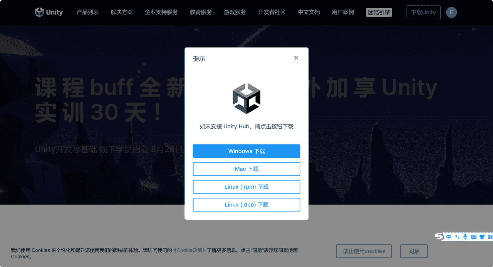

1.  下载完成后安装在任意硬盘位置即可，完成后启动界面如下：

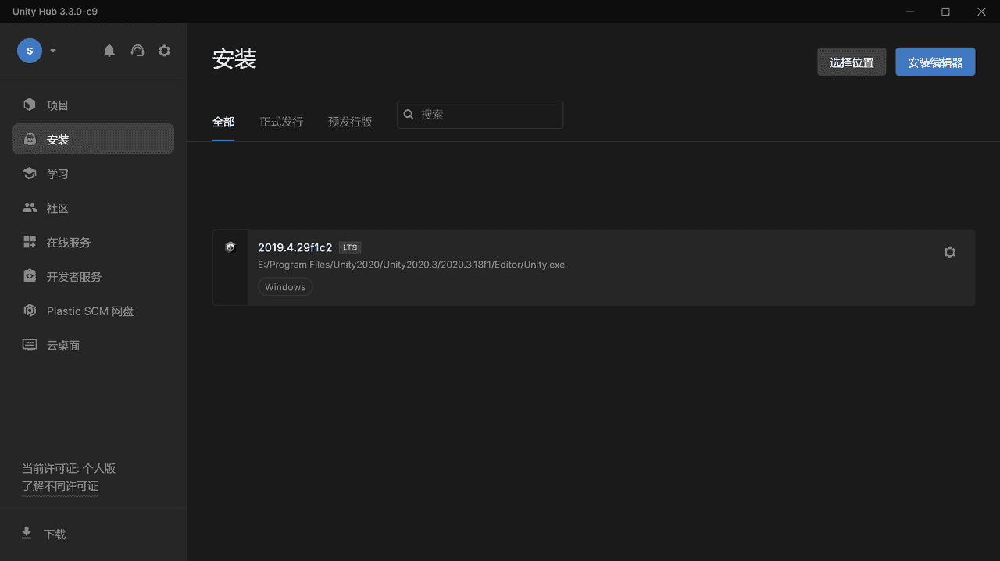

1.  安装后需要先进行登录，使用刚才注册的账号即可；

1.  登录完成后需要申请个人许可证；unity对于许可证控制较为严格（不想让企业占个人开发者的免费便宜），没有许可证无法使用unity，许可证时效很短，过期重新申请个人许可证即可。许可证注册点开头像，有一个管理许可证，可以申请注册。

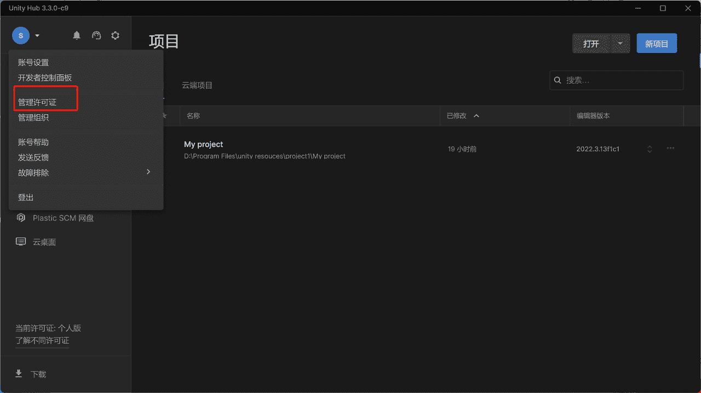

1.  选择添加后，点击免费的个人版许可证即可。

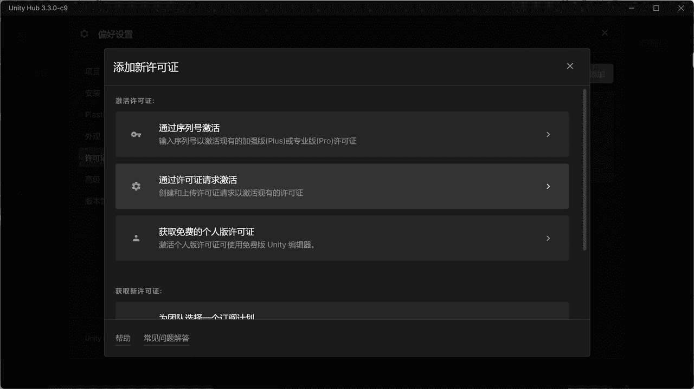

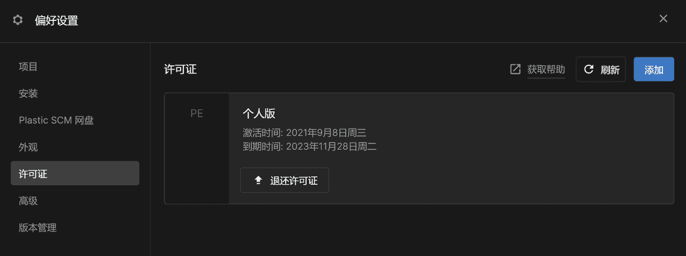

1.  有了许可证就可以开始下载编辑器了，点击安装，进入安装编辑器进行安装；编辑器版本不推荐选择最新的2023版本（稳定性和支持的资源可能受限），推荐2022版本。

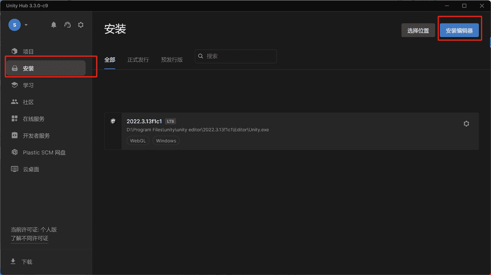

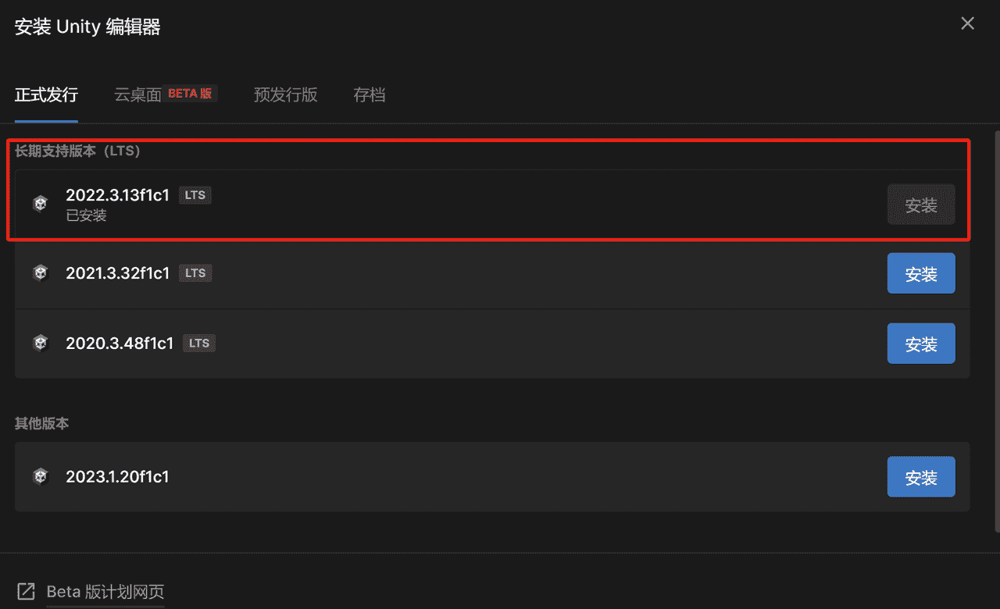

1.  安装时会提示是否安装VS、安卓、ios等等工具，VS如果没有建议装一下用于脚本代码编辑；其它安卓、ios这些工具可以先不选择安装，是构建项目用的，后期如果需要项目导出为安卓或ios可以随时在编辑器中安装。

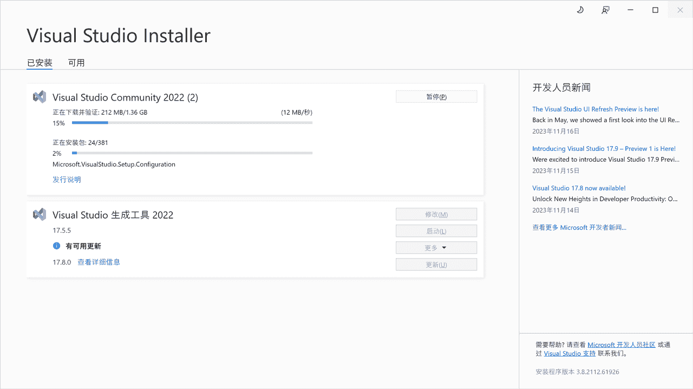

1.  等待所有安装完毕，恭喜你，Unity正式安装好了（不用配置环境）

## 注：其它版本的unity hub（为啥我的或者别人的是白色界面呢？）

如果你下载或使用的unity hub是白色的，说明你安装的是一个早期的版本，这个版本也能正常使用，但可能对2022年之后的编辑器支持不太好。早期版本的hub使用逻辑相似，这里不再复述。本文内容默认为最新版的unity hub。

下为早期版本视图：

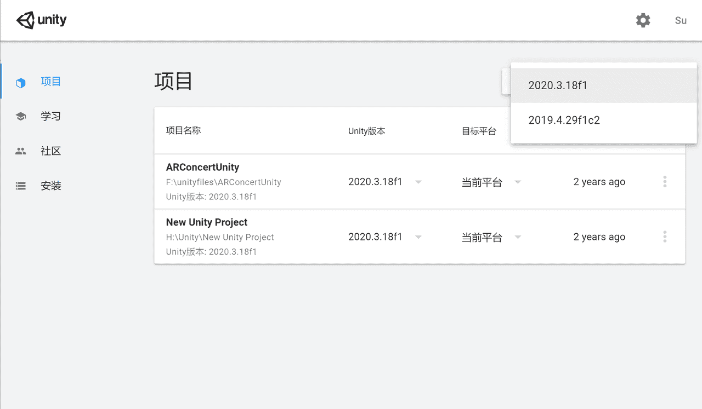

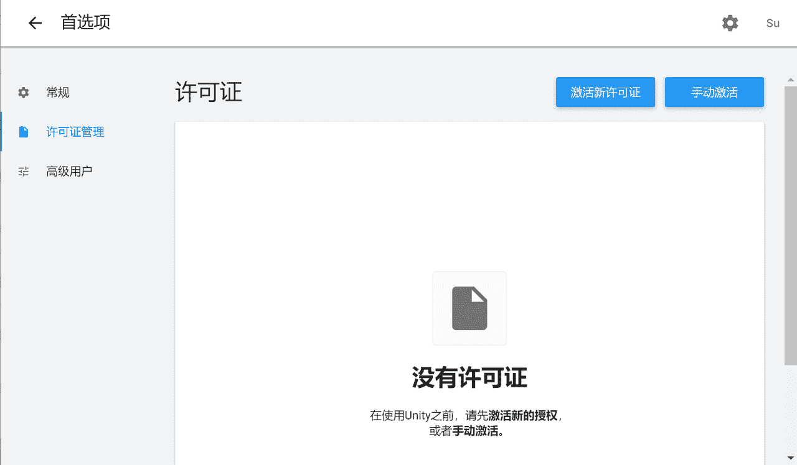

# 三、开始使用unity

## 3.1 入门unity编辑器（来建一个空白游戏项目）

> 先试试看能不能正常启动

1.  打开unity hub，点击项目栏，选择新项目，即可进行新项目的创建工作。

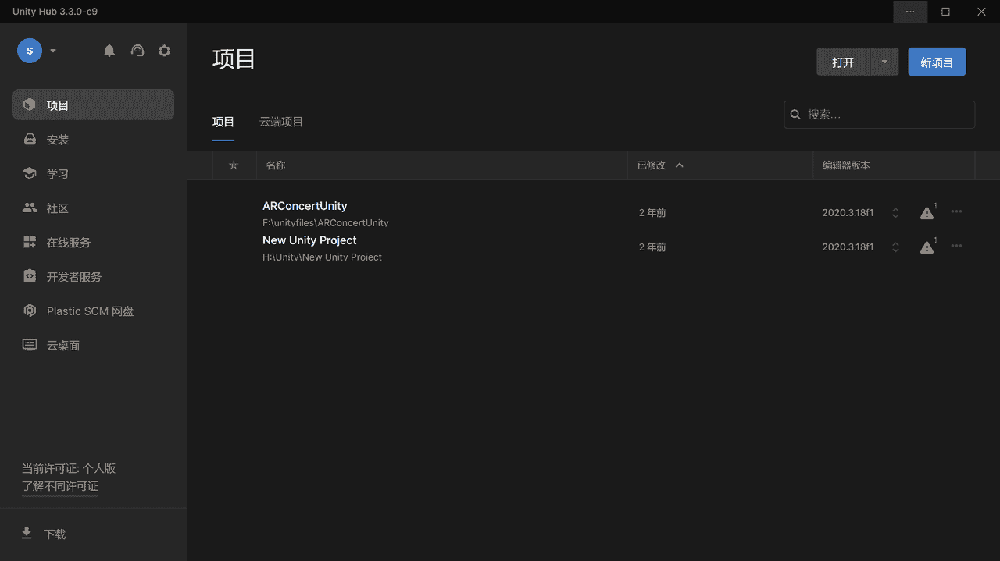

1.  新建项目后，会先跳出一个对话框，提示选择创建项目的类型，2D或3D，或选择带特定渲染管线的URP或HDRP的版本。

> 这里简要介绍下：

> 2D或3D的主要区别在于其游戏画面的展现形式，是二维平面展示还是三维立体展示。对于unity来说，其主要区别是是否固定摄像机角度、素材导入的资源类型、照明的设置等。各位小伙伴可以根据自己的想法选择合适的类型，如果没想好也没关系，可以先从3D进入先行体验，另外3D项目也可以切换为2D视角。

> URP或HDRP是unity官方提供的渲染管线，可以快速帮助开发者进行画面光照渲染，URP较为轻量简单，HDRP较为复杂但渲染效果更高质。它们可以随时根据项目需求添加到项目中，因此各位小伙伴刚开始也无需纠结怎么选，正式开始项目建议可以先从3DURP项目开始（小项目足够用了）。

1.  我们新[建](https://docs.unity.cn/cn/Packages-cn/com.unity.plasticscm@1.0/manual/)选择一个3D项目，先进去看看unity编辑器的界面，注意项目位置建议新建一个独立文件夹。（右下角的版本管理如果勾选，unity会安装一个PlasticSCM工具，这是一个unity官方版本控制工具，非必须使用，可以不安装直接跳过，想了解可以看链接PlasticSCM | China Unity PlasticSCM Solution | 1.0.0。）

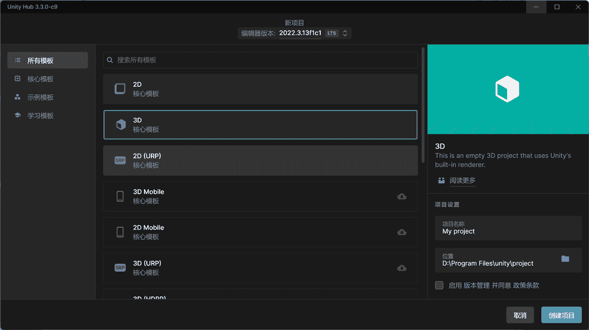

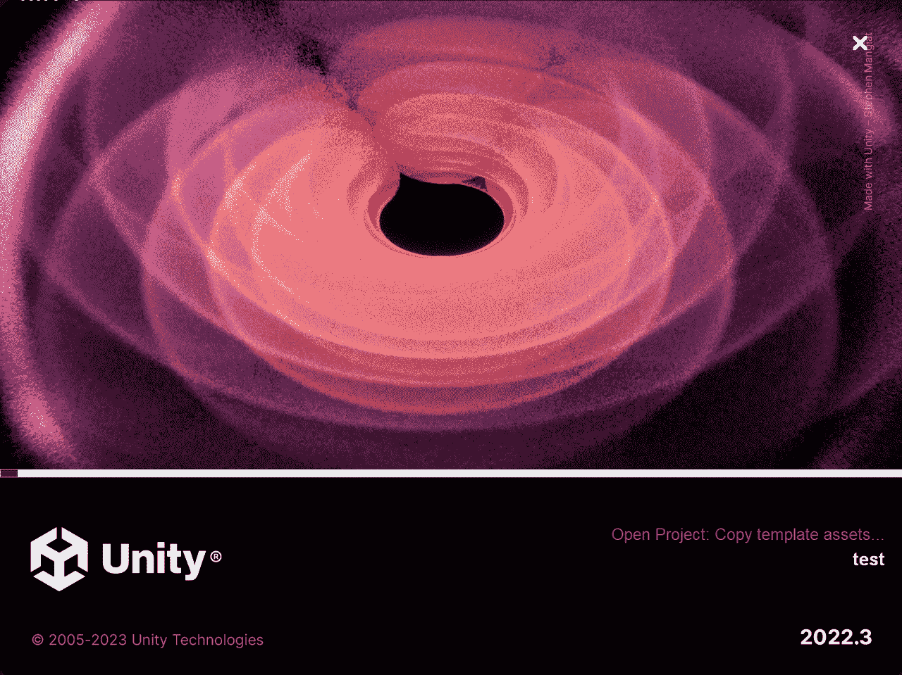

1.  等待一段时间后，新项目初始化完成，就进入到了unity编辑器的界面啦。

> 编辑器界面简介：

> unity编辑器顶部是常见的一排设置栏；

> 下面是默认的4个窗口布局，这4个窗口便是游戏开发中会常用到的窗口界面；

> 参照下图框内容，

> 1、左侧黄色区域Hierarchy窗口为游戏对象窗口，列出场景中的所有游戏对象（object），游戏对象即为游戏中常见的环境、建筑、人物、物品等元素。该窗口可以通过creat选项创建常见的正方体、长方体、球体、圆柱体等对象，这些对象可以通过组合形成更复杂的对象。

> 2、中间红色区域Scene窗口为场景窗口，可以编辑和管理一个游戏场景；场景中会根据游戏对象的外观和位置设置对其进行显示。

> 该窗口旁边还有一个game标签，用于预览游戏运行时的界面，如果点击上方的播放按钮运行游戏，在此窗口就可以看到游戏运行的样子，并进行游戏交互。

> 3、右侧蓝色区域的Inspector窗口显示游戏对象的所有设置内容，并可在此处进行响应调整。所有游戏对象都有位置的设置，并会根据对象的特性显示其它设置，也可以添加各类unity预设的组件，比如物理组件、声音组件、脚本组件等等，通过这些组件设置，可以快速设置对象的特性或功能。

> 4、下放绿色区域的Project窗口是项目资源窗口，用于显示项目文件目录下的所有资源，可以方便的查找或拖拽使用。

> 该窗口旁边还有一个Console标签，是一个调试窗口。

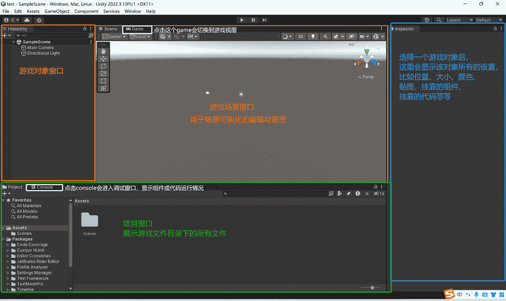

## 3.2 unity开发的基础逻辑（这玩意怎么就会动了？）

> Hello Game

一个游戏中，我们往往可以看到各种游戏对象，但这个对象是怎么放进unity中，又是怎么一个个变成一个能动、能交互的游戏元素呢？

这就是这部分我们想要给大家介绍的内容。

如果把一个游戏产品进行简化，褪去UI、褪去游戏中五颜六色皮肤（贴图和光线渲染的结果）、褪去故事线、褪去角色复杂的行为交互逻辑、褪去音乐，我们会得到什么？

一堆毫无生气的模型...

比如这个毫无生气的坦克和仙人掌：

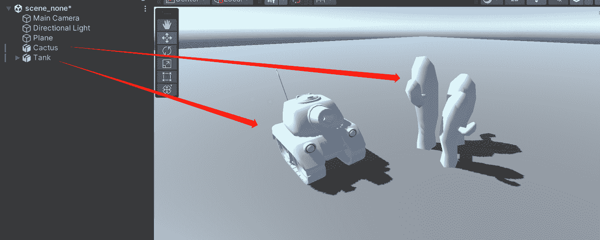

我们的游戏开发入门就可以先从这里开始。

### 1、游戏素材导入和使用

unity提供了基本的模型，比如上文提到的立方体、球体、圆柱体等等，用这些大家可以简单快速的搭建起来一个简易场景和对象。这些模型在Scene窗口右键空白处直接create即可创建：

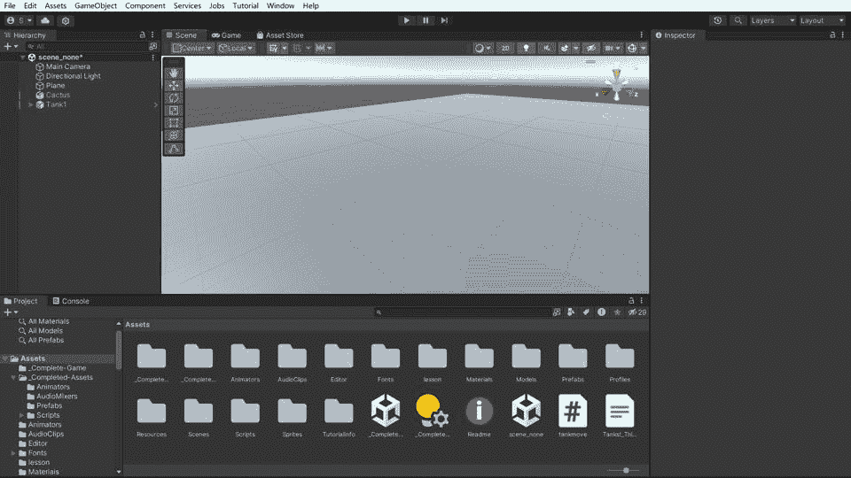

[My project - scene_none - Windows, Mac, Linux - Unity 2022.3.13f1c1_ _DX11_ 2023-11-20 21-14-57.mp4](https://internal-api-drive-stream.feishu.cn/space/api/box/stream/download/all/Kwa7bb8NzoozPhxGRjccABEWnQb)

**更复杂的模型怎么办呢？**

更复杂的模型一般是通过专业的建模工具制作，比如3dmax、maya等等，这些工具复杂且需要较高的专业知识，我们现学可能有一定难度（赶紧抓住懂设计和建模的大佬，别让他们跑了....）

怎么办，我们直接使用成熟的模型。

比如unity官方的资源商城就有很多成熟的模型，这些模型有收费的，有免费的（免费拉下来排列组合一下未尝不能用），这里我给大家示范下怎么从unity官方的资源商城下载安装使用模型。

[首先打开unity官方资源商城：Unity Asset Sto](https://assetstore.unity.com/zh)re - The Best Assets for Game Making，右侧登录一下你的unity账号（一定要与你使用unity的账号一致）

我们随便选择一个免费的环境模型如下，可以点进去看一下模型介绍和使用版本限制（也可以直接添加到我的资源）

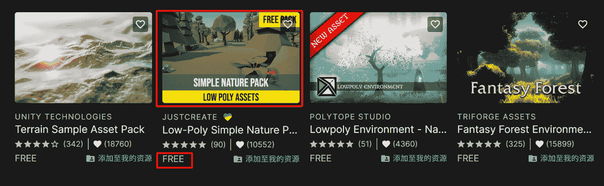

进去之后点击添加至我的资源，注意unity版本限制。

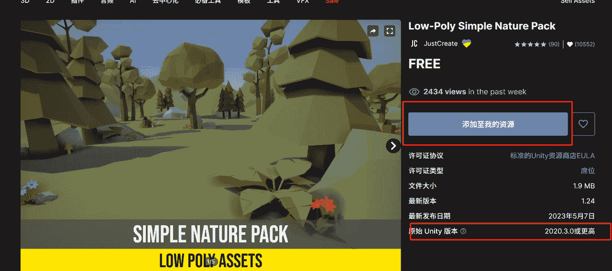

添加成功顶部会有提示

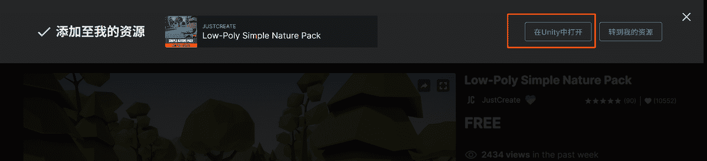

可以直接点击unity打开，就会跳转到当前unity工程中打开资源详情，如果你没有这里打开没关系，我们可以在unity界面中我的资源里面找到这个资源进行下载：

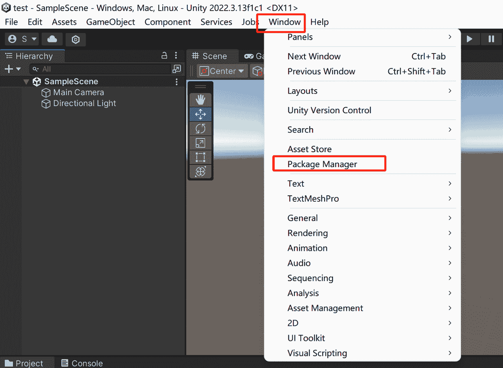

在package manager中可以找到这个资源包（在my assets中)

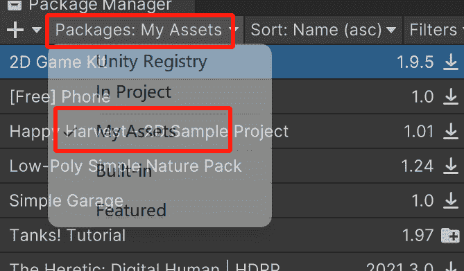

找到我们刚刚的资源，点击下载

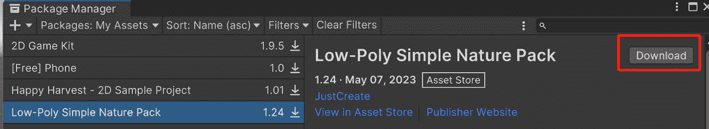

等待一会下载完成，在点击import导入资源到当前项目

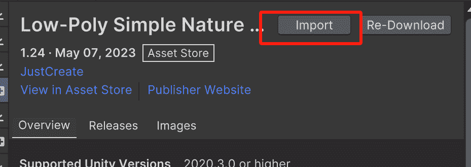

弹出一个资源选择框，你可以选择全部导入，也可以选择部分你想要的导入（实际工程中夹杂太多不必要的资源包体会很大），这里默认全部导入。

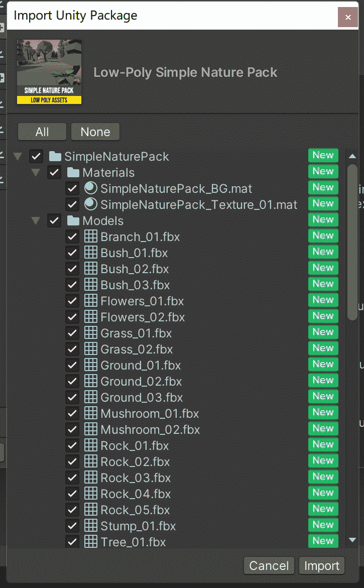

之后我们会看到下方的project窗口多了个文件夹，就是我们刚刚导入的资源。

打开文件夹，这几个文件夹都是相关资源

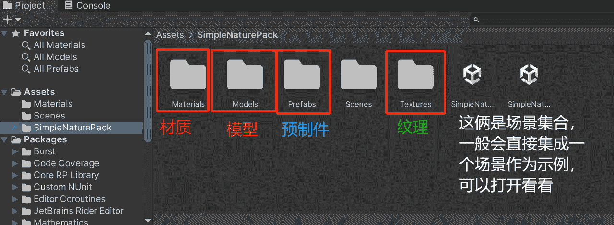

打开models模型，直接拖拽即可，可以拖拽到场景中，也可以拖拽到对象栏

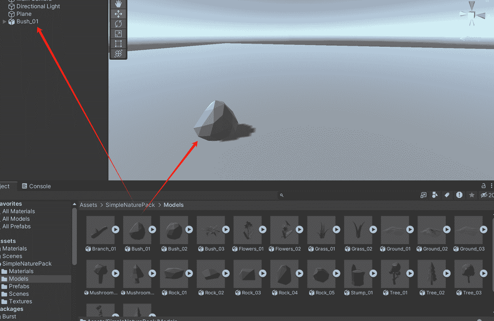

PS：如果这里的材质球是红色，一个原因是这个材质没有被成功加载，或者渲染管线设置不正确（需要URP或者HDRP管线）

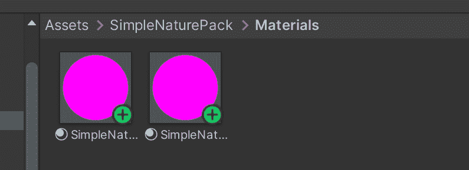

一般推荐直接使用prefabs预制件，这样你就不用处理材质贴图问题啦，可以直接使用，如果你想自己导入模型或者给它换皮肤也没问题，可以直接拖动材质球到模型上，就可以完成材质的替换操作。

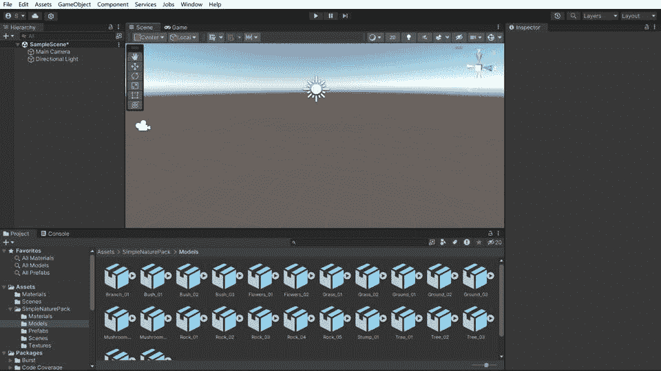

[test - SampleScene - Windows, Mac, Linux - Unity 2022.3.13f1c1_ _DX11_ 2023-11-20 22-11-42.mp4](https://internal-api-drive-stream.feishu.cn/space/api/box/stream/download/all/O57Hb25GMoozebxmM7nc4gfwnph)

#### 总结一下

模型决定了游戏对象的基本轮廓，材质决定了它的色彩质地，材质决定了它的图案（比如复杂的木材纹路）。

你可以通过变动模型改变对象轮廓，可以通过材质球改变其色彩质地，可以通过材质来让它图案更符合你想要的样式。

[想要更深入了解的同学，可以](https://docs.unity.cn/cn/current/Manual/Graphics.html)查阅官方文档图形 - Unity 手册，或者跟AI大模型唠唠（如果你是程序大牛你可能会更喜欢自己上手调整，可以了解下shader）。

### 2、场景布置入门

如果我想让这个仙人掌换位置怎么办？

在场景中拖动，或在右侧Inspector中找到位置transform标签改变其坐标。

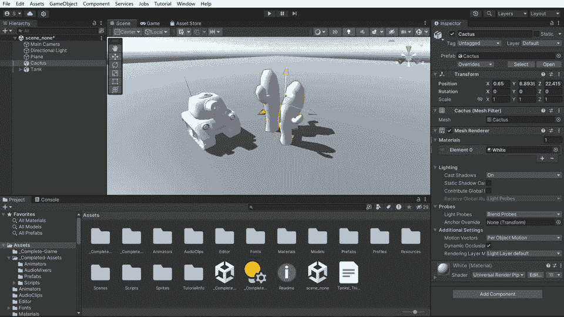

[My project - scene_none - Windows, Mac, Linux - Unity 2022.3.13f1c1_ _DX11_ 2023-11-19 21-45-03.mp4](https://internal-api-drive-stream.feishu.cn/space/api/box/stream/download/all/UEzkbnEqjoWvtIxujZGcZdwHnNc)

学会拖拽和使用transform，把素材拿来搭建出一个场景还不是so easy。

### 3、物体行为入门

如果我想让这个坦克动起来怎么办？

让游戏对象动起来，就需要让开发伙伴/AI大模型上场了，但是在具体讲解怎么操作之前，咱们先来看看unity是如何神奇的把游戏对象和脚本及其它属性关联起来的。

> 我们在使用unity时会发现，左右的Hierarchy和Inspector窗口分别将游戏对象和其属性分开了。Hierarchy窗口内的游戏对象本身没有任何行为逻辑、也没有任何“皮肤”属性，想要实现这些必须在右侧的Inspector窗口中进行处理，最终这个游戏对象才能呈现出一个有着行为和特性的游戏元素。

> 抽象一下就是，

> **一**个包含了行为和特性的游戏元素=游戏对象（Hierarchy中）+对象属性和脚本（Inspector中）

> 这样分开的好处是什么呢？类似于技术中的解耦作用，我们在开发游戏工程的时候，可以分别独立对游戏对象和其属性进行处理，也可以巧妙的复用游戏对象和属性；

> 比如上面的坦克，同一个模型我可以通过在右侧属性上更换不同的材质，变化出各种涂装出来（是的，游戏的皮肤大概就是这么换出来的）。

> 游戏对象的各种有逻辑的行为，也是在这个Inspector里面，通过挂载行为脚本及必要的属性实现的。

Inspector窗口一般默认只有一个位置坐标属性，如果想为其添加更多属性，可以在窗口最下方点击Add Component 就可以添加属性或者脚本（script）啦。

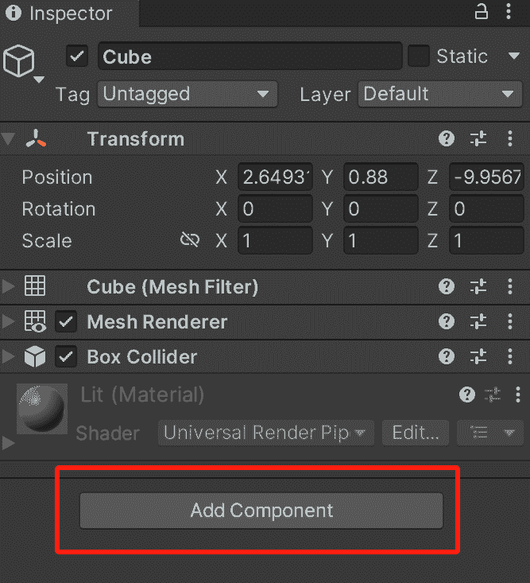

点开之后可以看到非常多的内容，比如常用的物理系统Rigidbody、碰撞组件Collider、光源组件Light、声音组件Audio、脚本组件Script等等

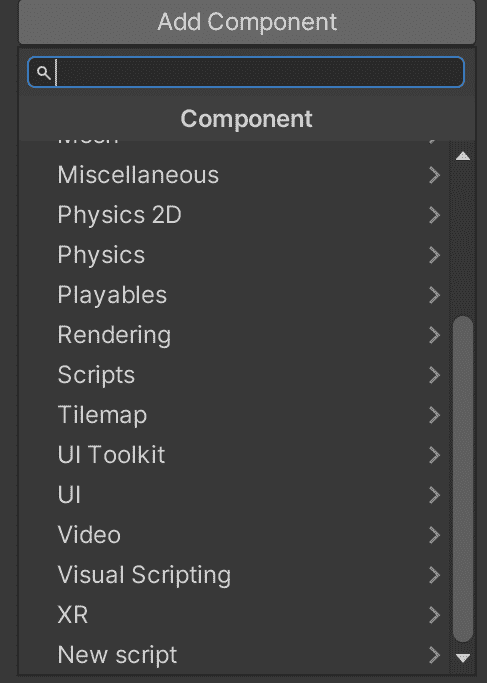

#### 开始上代码！

先为坦克对象添加一个script，选择Add Component中的new script（命名根据自己的习惯即可），将脚本组件挂载到坦克对象上去。

这里我创建了一个脚本组件叫tankmove挂载到了tank对象向，创建脚本组件会自动生成一个脚本名字，与脚本组件名称相同：

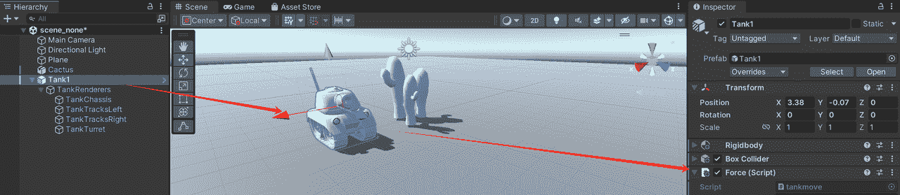

我们点击script后面的tankmove脚本，会自动定位到资源文件夹中的脚本位置，也可以双击直接进入该脚本进行编辑（如果你安装了VS，会自动打开编辑器）

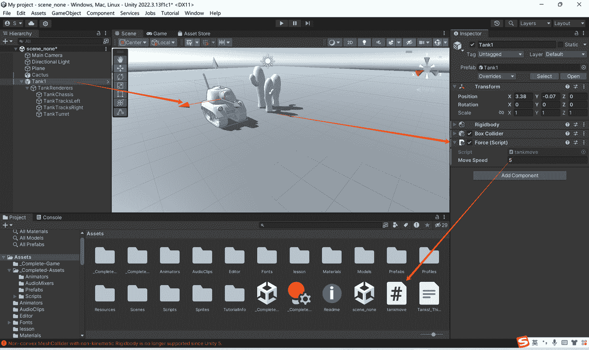

这里可能有同学问了，C#代码怎么写呢，不会呀；

如果你本身就是一名开发大佬，那么C#肯定难不倒你，但是可能需要了解一下unity的一些常见的API，或者找AI去问。

如果你本身不会编程，那么也难不到你，你只要会promt，让AI大模型替你写就可以。

这里我找AI问了一下，

怎么让unity中的一个cube对象（常见的3D模型）通过键盘wsad输入进行上下左右的移动？

AI回答如下：

> 我可以帮你解答你的问题。要让一个cube在unity中移动起来，你需要以下几个步骤：

1.  在unity中创建一个新的场景，然后在Hierarchy面板中点击右键，选择3D Object ->      Cube，这样就可以在场景中生成一个cube物体。

1.  选中cube物体，在Inspector面板中点击Add      Component按钮，然后搜索Rigidbody，选择Rigidbody组件，这样就可以给cube物体添加一个刚体组件，让它受到物理效果的影响。

1.  再次点击Add      Component按钮，然后搜索New Script，输入一个脚本的名字，比如MoveCube，然后点击Create and      Add按钮，这样就可以给cube物体添加一个新的脚本组件，用来控制它的移动逻辑。

1.  [点击](https://blog.csdn.net/qq_40229737/article/details/89518603)脚本组件的齿轮图标，选择Edit      Script，这样就可以打开脚本的编辑器，编写代码来实现cube物体的移动。你可以参考以下的代码示例，它可以让你通过WASD键来控制cube物体的前后左右移动(1)：

```
using UnityEngine;
public class MoveCube : MonoBehaviour { 
// 定义一个移动速度的变量 
public float moveSpeed = 5f;
// 在每一帧更新的时候执行
 void Update()
 {
    // 获取水平方向的输入，A为-1，D为1，无输入为0
    float horizontalInput = Input.GetAxis(&quot;Horizontal&quot;);
    // 获取垂直方向的输入，S为-1，W为1，无输入为0
    float verticalInput = Input.GetAxis(&quot;Vertical&quot;);
    // 根据输入的方向和移动速度，计算出一个移动的向量
    Vector3 moveVector = new Vector3(horizontalInput, 0, verticalInput) * moveSpeed;
    // 根据移动向量和每帧的时间，计算出一个位移的向量
    Vector3 displacementVector = moveVector * Time.deltaTime;
    // 将位移向量应用到cube物体的位置上，实现移动的效果
    transform.position += displacementVector;
 }
}
```

1.  保存脚本，回到unity中，点击运行按钮，就可以看到cube物体可以根据你的键盘输入来移动了。

> 以上就是让一个cube在unity中移动起来的方法，希望对你有帮助。如果你还有其他问题，欢迎继续提问。😊

这段代码基本可以使用，而且AI还贴心给出了注释。

我们在tankmove脚本的 public class MoveCube : MonoBehaviour （MonoBehaviour 就是开启unityAPI的魔法钥匙）后面加入AI给出的代码，并且更细一下input设定参数，填入的代码最终如下：

```
using System.Collections;
using System.Collections.Generic;
using UnityEngine;

public class force : MonoBehaviour
{
    // Start is called before the first frame update
    void Start()
    {

    }

    // Update is called once per frame
    
    // 定义一个移动速度的变量
    public float moveSpeed = 5f;
    // 在每一帧更新的时候执行
    void Update()
    {
        // 获取水平方向的输入，A为-1，D为1，无输入为0
        float horizontalInput = Input.GetAxis(&quot;Horizontal1&quot;);
        // 获取垂直方向的输入，S为-1，W为1，无输入为0
        float verticalInput = Input.GetAxis(&quot;Vertical1&quot;);
        // 根据输入的方向和移动速度，计算出一个移动的向量
        Vector3 moveVector = new Vector3(horizontalInput, 0, verticalInput) * moveSpeed;
        // 根据移动向量和每帧的时间，计算出一个位移的向量
        Vector3 displacementVector = moveVector * Time.deltaTime;
        // 将位移向量应用到cube物体的位置上，实现移动的效果
        transform.position += displacementVector;
    }
}

```

（注：这里我只改了 float horizontalInput = Input.GetAxis("Horizontal1");中的Horizontal1命名，这部分是unity中设定input输入的参数，具体设置位置在edit彩带的project setting中，可以自行设定输入的监听对象)

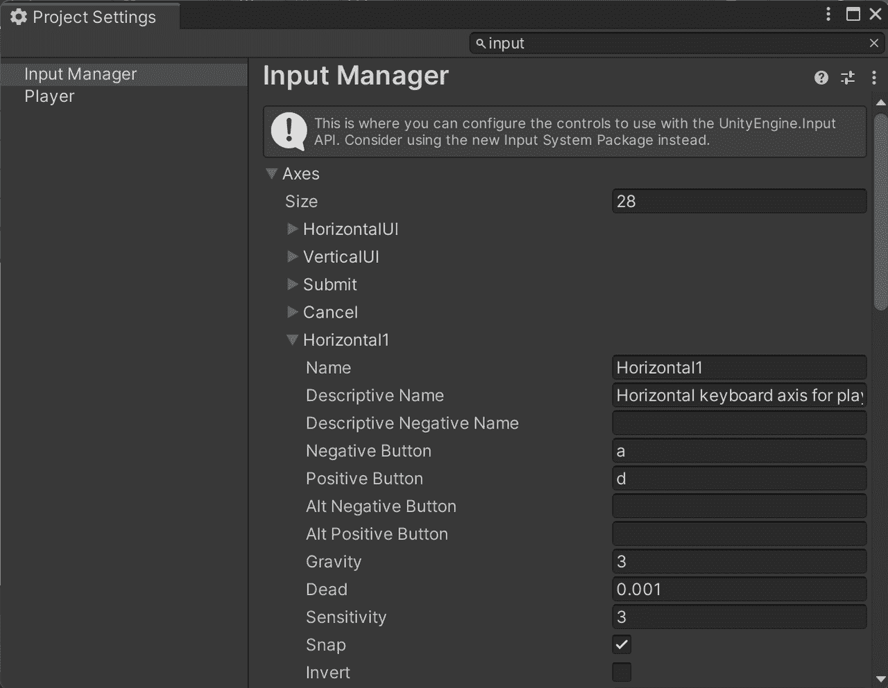

代码填写完成我们习惯性ctrl+s后，即可转到unity窗口查看其是否生效（unity会自动更新代码组件）

我们点击unity正上方的播放按键，试着运行一下游戏吧

看起来代码正常生效了，鼓掌！欢呼！

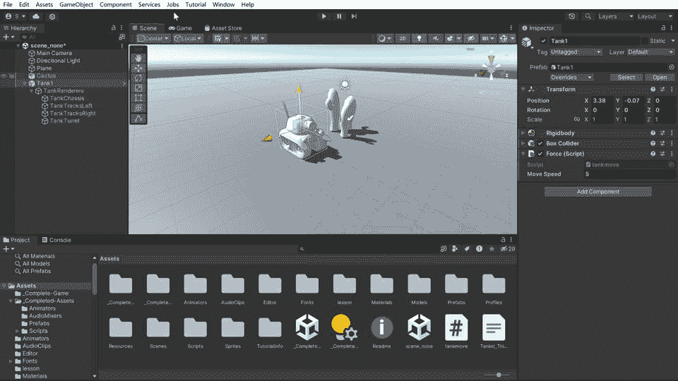

[My project - scene_none - Windows, Mac, Linux - Unity 2022.3.13f1c1_ _DX11_ 2023-11-20 20-52-46.mp4](https://internal-api-drive-stream.feishu.cn/space/api/box/stream/download/all/IYPRbdv0loBoNbxA1MxcUDalnUh)

### 4、场景布置+对象+属性+代码=？

看完上面，想必大家已经基本了解了unity是怎么入门开发游戏了吧，布置好场景道具，添加好游戏对象，为其设置属性和行为逻辑代码，一个简单的游戏雏形就出来啦。

至于最终游戏会变成什么样子，这就看各位奇思妙想天才们的想法啦。

## 3.3 文档与资源

> 能够巧妙合理的利用好资源，你就是大佬

> **首推最强资源：**

> **AI大模型！**

其它资源参考：

| **资源名称** | **地址** |
| --- | --- |
| unity官方手册 | [Unity User Manual 202](https://docs.unity.cn/cn/current/Manual/index.html)1.3 (LTS) - Unity 手册 |
| unity官方脚本API | [Unity 脚本 API](https://docs.unity.cn/cn/current/ScriptReference/index.html) |
| **unity商店**（游戏demo、模型、工具、材质，本文示例素材即来自官方游戏demoTanks!，强烈建议多在这里面挖挖宝，有很多免费好用的） | [Unity Asset Store - The Best As](https://assetstore.unity.com/zh)sets for Game Making |
| 动作资源（3D动作动画，免费的宝藏资源） | [Mixamo](https://www.mixamo.com/) |
| unity官方免费2D入门教程（带游戏dmo） | [Ruby&#x27;s Adventure](https://learn.u3d.cn/tutorial/unity-ruby-adventure?chapterId=63562b27edca72001f21d0af#61f0fe86eb46bf001f56401e)：2D 初学者 | Unity 中文课堂 |
| 3Dtank | https://learn.unity.com/project/tanks-tutorial?language=en |
|  |  |

最后祝大家都能开发出自己心目中的游戏！