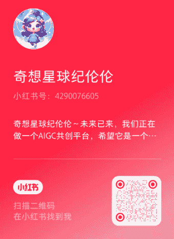

# 纪伦的个人说明书

> 来源：[https://datawhaler.feishu.cn/docx/NmrNdaIm0oMLsUxymZ7cyKn0nKb](https://datawhaler.feishu.cn/docx/NmrNdaIm0oMLsUxymZ7cyKn0nKb)

## 内容专栏

AI + 视频：[AI视频通用学习文档](https://datawhaler.feishu.cn/wiki/K764wjVGiivZswkSV7acw0ylnFh?from=from_copylink)

AI + 财务：[AI 数据处理](https://datawhaler.feishu.cn/wiki/SBvmwBG9liaqshkmeiZcWcgnn6f?from=from_copylink)

AI + 电商：[AI 人类模特换装](https://datawhaler.feishu.cn/wiki/R78awLh4gijYqnkbcmqczzHQnfj?from=from_copylink)，[AI 小动物换装](https://datawhaler.feishu.cn/wiki/OQuNwmVwjipxLXkbWqucrk07nng?from=from_copylink)

## 社交媒体

小红书：奇想星球纪伦伦

## 联系我

如果你也认可我，来点个赞吧~