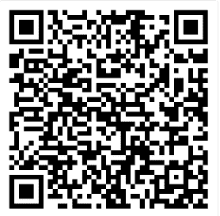

# 余弦淬火的个人说明书

> 来源：[https://datawhaler.feishu.cn/docx/DMCpdVFeroPZpRxVK1lcwX1fnbh](https://datawhaler.feishu.cn/docx/DMCpdVFeroPZpRxVK1lcwX1fnbh)

> 这是一个个人说明书模板，大家即可添加自己想要介绍的内容~（内容积极，没有违法或有风险的内容均可~）

## 内容专栏

> [SunoAI音乐创作分享](https://datawhaler.feishu.cn/wiki/CXCkweHFFinmhnkhyCmc60pkn6d?from=from_copylink)

> [AI文旅制作手册](https://datawhaler.feishu.cn/wiki/HN9GwLZ6wiBCsNksvdiclAXon9g?from=from_copylink)

> [AI小电影-广西宣传短片](https://ut34bvcsij.feishu.cn/docx/HFE3d798FooFT8xI4JgcoWLbnYc?from=from_copylink)

## 社交媒体

> [快手](https://v.kuaishou.com/uinzqT)

> [抖音](https://v.douyin.com/iY8rSdDK/)

> [小红书](https://www.xiaohongshu.com/user/profile/62af1cf0000000001b024d1a?xhsshare=CopyLink&appuid=62af1cf0000000001b024d1a&apptime=1712028167)

## 视频号

## 联系我

> WeChat上图头像

如果你也认可我，来点个赞吧~