# OPEN 1+X 共建研讨会

> 来源：[https://datawhaler.feishu.cn/docx/RtSkdcRqEo17HZx2xcpcIRxZnbd](https://datawhaler.feishu.cn/docx/RtSkdcRqEo17HZx2xcpcIRxZnbd)

> 此文档记录 **OPEN 1+X **的共建研讨会会议记录

> 关于 **OPEN 1+X AI通识课** 是什么，可见：[OPEN 1+X AI通识课](https://datawhaler.feishu.cn/wiki/X9AVwtmvyi87bIkYpi2cNGlIn3v)

> 关于如何参与共建，可见：[Dw内容趋势机会池](https://datawhaler.feishu.cn/wiki/XiavwQSJ6iMyf6kdBPicdNWGnBJ)

# 每周一共建研讨会

## 2025.4.21：OPEN 1+X 共建研讨会 NO.18

>

## 2025.3.31：OPEN 1+X 共建研讨会 NO.17

>

> **议题列表**

1.  OPEN 1+X 共建简报 & 新机会 @Amy

1.  怎么教普通人用会AI  @王铮 @李福

# **···**

## 2025.3.24：OPEN 1+X 共建研讨会 NO.16

> [**点击查看录制**](https://meeting.tencent.com/crm/l6BMJ0J9b4)

> **议题列表：**

1.  OPEN 1+X 共建简报 & 新机会 @Amy

1.  企业数智化内容标准

1.  共创经验分享

# **···**

1.  调研：写的内容就是自己使用AI的日常吗？

1.  做自己相信能提效的场景、不要停留在想象里、去找真实的场景和业务、面向真实的人来写内容

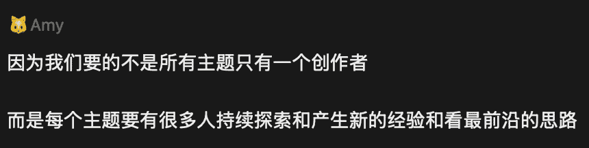

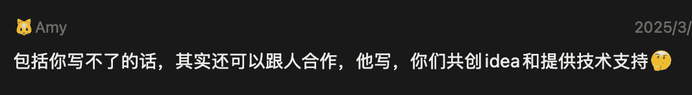

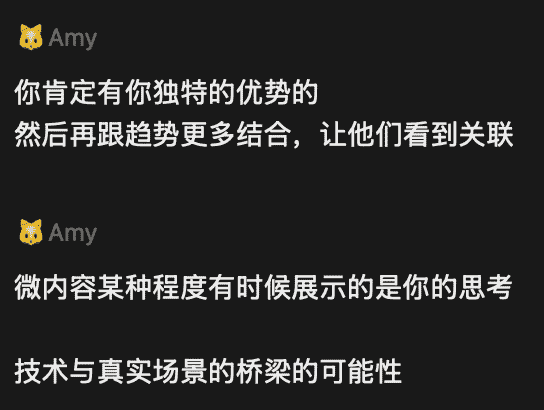

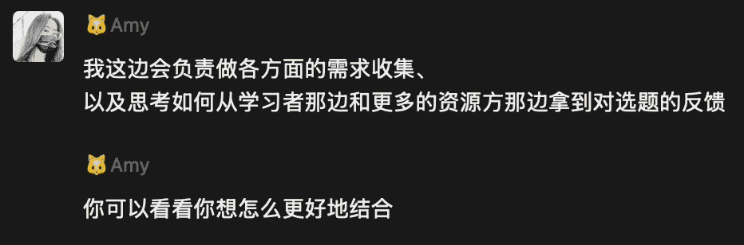

## 2025.3.17：OPEN 1+X 共建研讨会 NO.15

> [**点击查看录制**](https://meeting.tencent.com/crm/NxPvn8aM4d)

> **议题列表：**

1.  OPEN 1+X 共建简报 & 新机会 @Amy

1.  Un-AI活动经验与招募要求 @苏鹏（Un-AI项目发起人）

1.  创作经验分享** **[**@星星**](https://datawhaler.feishu.cn/record/VYnerg8f0etb1GcnzsocLb2TnJg)[（点击可打开共建卡详情）](https://datawhaler.feishu.cn/record/VYnerg8f0etb1GcnzsocLb2TnJg)

# **···**

1.  **Un-AI**：让每个人都能听得懂AI = AI使用案例 + 文科学AI的经历 + 通俗讲解AI原理

1.  【现状】报名310，到场180+：大家的需求很强烈、但供给不足（验证了假设、海报自传播）

1.  为什么要做？——假设有一群人不知道AI是什么、怎么用

1.  大家对AI的认知相差很大、

1.  很多人在用AI、AI真的在改变世界了

1.  但还有很多人不知道怎么用AI

1.  【未来】那后续怎么办？——中心化生产内容、在全国继续持续开展

1.  核心要素：场地 + 分享嘉宾（有内容可讲、对参与的人有价值）

1.  能不能中心化生产内容： 技术通俗拆解（最小白话、讲给父母） + 案例

1.  其他地方可以基于这些内容、学习一周，然后交付分享

1.  = 高质量活动可复制

1.  成就贡献者：讲解更多经验

1.  其他：高校 + 城市 —— 学习场景、工作坊、夜校，都需要中心化生产内容、然后批量复制

1.  **疑问点**

1.  内容如何标准化？准备20个案例+通俗原理PPT，再去批量化验证，获得批量化需求

1.  受众是谁？到底需要什么？

1.  非技术已经工作的职场人，对AI的诉求最大；

1.  到底需要什么：看不懂原理、但可能需要了解、主要是支持选型的why，不需要很深、还需要验证

1.  不是技术的细节、AI使用原则？使用基础？、让大家知道特点和边界

1.  最需要什么样的内容？

1.  **更多案例**：支持不同行业/岗位的专场、能用AI帮助解决什么问题？需要验证

1.  **通俗经验分享**：大模型的能力是什么、为什么能做到、怎么用比较好，扩大受众

1.  **···**

1.  案例需要深入到很细分行业么？

1.  不要设想 学习者/用户 知道很多

1.  考虑和一些领域的up主共创么？

1.  慢慢看能不能邀请进来共创、但更需要我们自主的内容

1.  更多议题（也需要更多寻找和共创）

1.  生成内容很多、怎么验证真伪？社区集中智慧、如何产生成可交付的对外阶段性结论

1.  **青少年AI**的核心话题：怎么更好地使用AI（新事物）

1.  用AI对答案：自校正马虎的东西、AI理清模糊的东西、AI私教讲学不会的东西

1.  需要培养家长的能力、培养新的学习方法的能力

1.  @那其：产出的东西get不到他人的需求？

1.  回想自己的需求、想象过去的自己需要什么样的内容？会不会是流水账？

1.  不能明确 或是想象出来 读者会在哪里有卡点

1.  想象不到**场景？**

1.  尝试做视频？讲、剪、做字幕、反复看自己的东西

1.  @余洋：如果现在像开启自己的课程，这个微课程要求是多少的内容，

1.  没有要求、单篇单篇用于学习者学习

## 2025.3.10：OPEN 1+X 共建研讨会 NO.14

> [**点击查看录制**](https://meeting.tencent.com/crm/NQj15EAp5a)

> **议题列表：**

1.  **DeepSeek通识课**** @范晶晶**

1.  OPEN 1+X AI微学习 @Amy

1.  Datawhale官方媒体投稿 @晓皖

1.  **固定话题**：创作经验交流

# **···**

1.  **DeepSeek通识课****的背景**

+   Datawhale的内容github排行进入前100

+   内容怎么被行业认可？

+   出版社：出版了一些开源教程书籍

+   高校学分课：最有用的方向是DeepSeek通识课

+   内容体系：DeepSeek怎么用（聚焦实践）

+   **DeepSeek本身怎么用**：初级、中级 、高级

+   **DeepSeek组合怎么用**

+   **DeepSeek在行业怎么用**

+   3.16浙大发布、然后持续直播讲课，3月底百校联动

+   第一批内容已经定邀制作

+   后面是更大的开源课程生态：千行百业

+   目标：社区贡献者被行业更多地认可

疑问：

1.  **做的形式**：先写材料、然后上直播

1.  用得不错  -》 写得不错 -》  讲得不错

1.  要先实践、拥抱趋势、有自己独特的心得、更好地帮到别人

1.  **受众是谁?**

1.  高校师生  + 行业从业者、能写给谁就写给谁

1.  **学校课程的时长要求 ？**

1.  不给学校做定制化

1.  先把内容生态搭建起来

1.  再和学校合作、逐渐进入高校体系，有很多学校联系，

1.  DeepSeek火了之后各个学校的需求也聚焦了

1.  [OPEN 1+X AI通识微学习 NO.2](https://datawhaler.feishu.cn/wiki/JMkDw6z6EiZUS9kDtGgcioCknSz)

学习内容不是很多、很快、更快的共建正反馈

希望听到学习者的反馈，目前没有收到

更好的得到反馈的方式：内容里穿插作业、引导思考的提问

小步快跑、快速迭代、偏应用的微学习快速复现、更有获得感和成就感

1.  **Datawhale官方媒体投稿**

要有自己的思考，图文比例合适，适合手机阅读

内容串联有过渡、内容之间不要过分跳跃

逻辑和步骤清晰很重要，把一件事讲清楚

结果先行、不要套太多层、不要太绕

场景受众广很重要，知识也最好结合热点

不用大而全，1000~3000最佳

1w字干货也行，但不要嵌套多个场景

**感兴趣：**

1：3

2：5

3：2

**通识课**：跟组队学习的差别？线上氛围没那么热烈？

**微学习**：帮助聚焦方向、有反馈、持续往目标前进

+   面向小白，比喻+例子，

+   **龙斐**：尝试把微学习放到线下，大模型通识讲解+几个场景的微学习实操

+   **佳辉**：第一期反响一般、第二期还可以

+   **熔阳**：第一期感兴趣的很多、但提交作业的不多；

+   第二期改成了一个案例，做了上期案例的链接，以及引导，基础案例+进阶案例，但是链接和启发

+   第二期感兴趣的学习者没有那么多、但是真正完成学习的更多

+   **锦泓**：一开始不是很自信、但大家打分还不错，先做再完美

## 2025.3.3：OPEN 1+X 共建研讨会 NO.13

> [**点击查看录制**](https://meeting.tencent.com/crm/ldR0ZpL6f5)

> **议题列表：**

1.  **固定话题**：内容趋势交流，

1.  [OPEN 1+X 共建组 机会池](https://datawhaler.feishu.cn/wiki/XiavwQSJ6iMyf6kdBPicdNWGnBJ)

1.  [OPEN 1+X AI通识课 微学习（为期3天）](https://datawhaler.feishu.cn/wiki/KqrBwmiZdi89sRkNWaPc6xKInQd)**：核心组经验分享**

1.  **固定话题**：创作经验交流

1.  **固定话题**：聊聊你的 Flags 和 看过的案例

# **···**

图文教程 VS 视频教程

学习内容的核心：学习者可能遇到的卡点、讲清楚、说明白为什么要做、怎么做

1.  录课录得不好、跟直播和直接讲课不一样，没有正反馈、很紧张

1.  学着自己进入状态、让自己讲嗨、不要要求太高

1.  做得不好不要管、让学习者给你反馈、帮你找问题

+   **录制流程说明**

1.  尽量有逐字稿：查看PPT，初稿AI先写一遍，然后看着PPT调整逐字稿，可以语音进行文案调整，很快

1.  **一页一页PPT进行录制**，尽量不要出现不太通顺的描述和过多的卡壳，

> omini录屏专家，可以暂停录制

> 看着一页PPT，然后对着逐字稿进行修改，然后抛下逐字稿，针对当前PPT页，一次过，进行录制

1.  如果对当前这页整体的效果不满意，可以暂停录制修整，然后再继续录制

1.  如果一页内容过多，可以拆成两部分进行录制，重点是在你可拿捏的范围内做这件事

1.  录的时候尽量不要紧张，可以反复录，一页一页录，把录制的节奏控制在完全掌控的范围里

1.  录制完成后，尽量多听几遍，最好不要让后期进行过多的声音处理(一般情况下，描述通顺、速度适中就不需要处理)

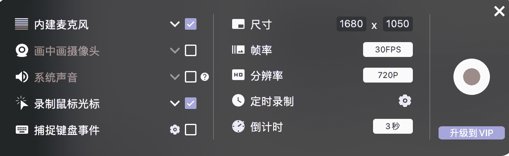

1.  剪辑需求需要写出来是哪些时间段，这样剪辑就会很快

+   **控制时长的建议**

1.  初步分析各PPT页你熟悉的程度和需要讲解的时长，

1.  如果预估时长不够，用更拿手的PPT页做更多扩展

1.  如果录制时长过长，把不是重点的内容做快速略过，“我在这里列举了xxxx，大家感兴趣的话可以自己去详细了解一下”

1.  录制时尽量按照规划走

找一个核心的你最拿手的PPT页，时长不够就做拓展

1.  教程怎么写的更清晰明白呀，以及用哪些工具比较方便的截图，或者记录操作过程

1.  gif：pixpin

1.  截图标注：Snipate

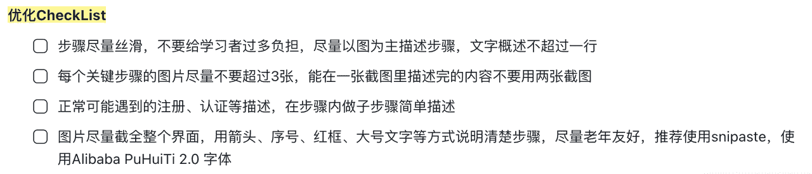

1.

## 2025.2.24：OPEN 1+X 共建研讨会 NO.12

> [**点击查看会议录制**](https://meeting.tencent.com/crm/2y5aJogR78)

>

> **议题列表：**

1.  **固定话题**：内容趋势交流，[OPEN 1+X 共建组 机会池](https://datawhaler.feishu.cn/wiki/XiavwQSJ6iMyf6kdBPicdNWGnBJ)

1.  **固定话题**：创作经验交流

1.  **固定话题**：聊聊你的 Flags 和 看过的案例

# **···**

## 2025.2.17：OPEN 1+X 共建研讨会NO.11

> [**点击查看会议录制**](https://meeting.tencent.com/crm/2qWeGYMR83)

>

> **议题列表：**

1.  **固定话题**：OPEN 1+X 共建进展

1.  **本周限定**：**OPEN 1+X 共建群**的定位

1.  **本周限定**：[Dw内容趋势机会池](https://datawhaler.feishu.cn/wiki/XiavwQSJ6iMyf6kdBPicdNWGnBJ)

1.  **本周限定**：**AI通识课 **金牌讲师计划

1.  **固定话题**：聊聊你的想写的教程~

1.  **固定话题**：讨论你遇到的 内容/学习 案例

# **···**

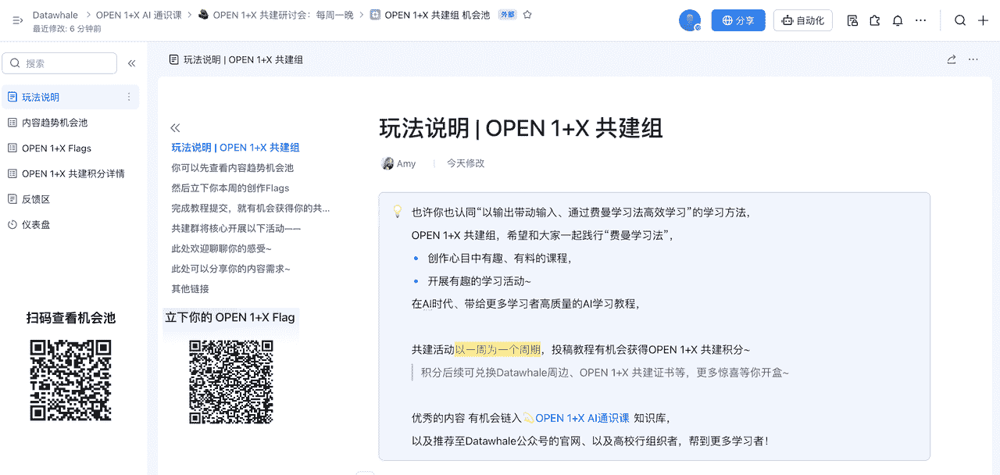

## 2025.2.10：OPEN 1+X 共建研讨会NO.10

> [**点击查看会议录制**](https://meeting.tencent.com/crm/lReWpAy31a)

>

> **议题列表：**

1.  **固定话题**：**OPEN 1+X AI通识课 **进展同步——项目动态

1.  **固定话题**：大家的项目卡点和集中建议

1.  **固定话题**：发散聊聊心目中的AI通识课和建设方法

1.  **本周限定**：【探讨/交流】2025年开年之后，你心中的AI通识课有没有什么变化？

1.  **本周限定**：【探讨/交流】你感兴趣的DeepSeek相关应用方向和案例

1.  ···其他内容在线等你聊~

+   **AI通识课建设的新的计划：**

+   通过 **O**PEN 1+X 共建研讨会（周一集中会议 + 日常拉起的会议） 更好地帮助大家创作

+   集中调研、公示一些需求和机会、更好地帮助大家完成有效、可持续的创作

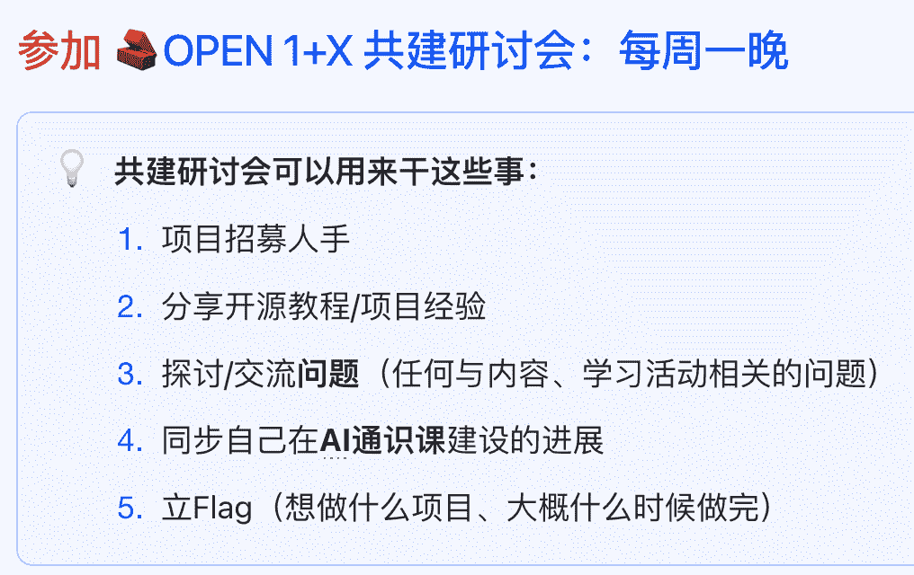

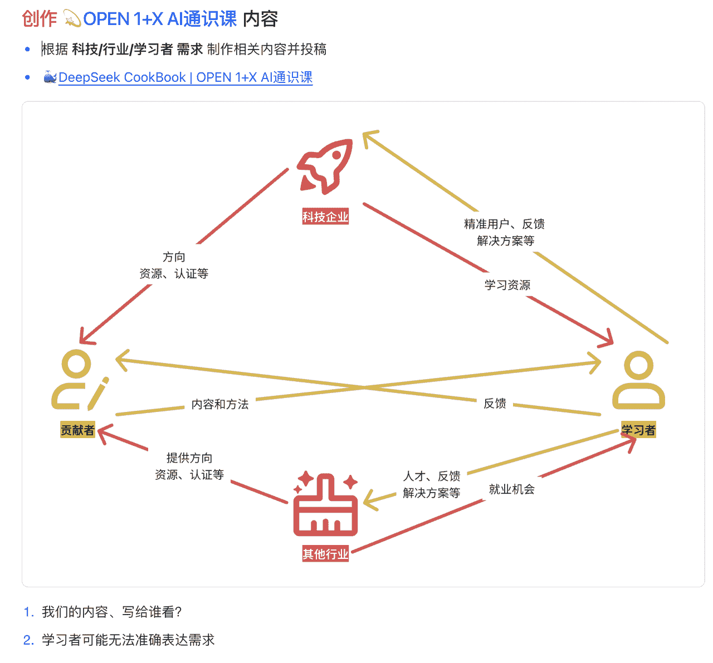

+   **遇到的卡点**

+   **@和乐**：确定的方向是 **Prompt工程**、不是很会**挖掘和扩展需求**？Anarchy

+   **@博毓**：没有写过开源教程，以往自己学习的时候是搜集了一堆资料、然后解决一定问题，

+   如何开始写作教程？

+   **从案例拆解开始**：解决了什么具体的问题、有什么思考、怎么总结出良构的要点、让学习者有动力去复现和学习、有收获

+   我们课程的优势在哪里？

+   节省其他人的时间

+   **把书拍**给大模型就能开始学习、那 我们 是不是要下岗了？

+   是谁不需要了？引导的环节、教师是不是不需要了？助教是否不需要了？

+   担心什么？其他学习者的学习能力达到了之后、是不是就不需要我们了？

+   有些问题不是问了大模型就能解决

+   大模型存在幻觉、能力有限、可能会有歧视或是错误的引导

+   OPEN 1+X AI通识课的核心作用：帮助指引方向

+   AI工具可以帮助提效、放大能力（1）

+   **@哲昱**：怎么将ai技术与实际的教学实践结合起来，

+   课程的定位：面向**义务教育阶段（初中）**学生的科普课程

+   不知道怎么处理 **课时与主题 **的关系

+   想先让青少年 了解ai是什么，怎么去更合理的去使用它

+   当前**课时设计**：学什么？注意事项，学习案例，学习工具以及学习深度

+   **一个个案例会比**较好？做真正有需求的内容、不要贪多！！！

+   需要考虑

+   学生的基础：起点

+   教学目标：终点

+   注意事项：不要导致别的课程作业出现抄袭现象（不应该是卡点？不要太过担心这个）

+   **DeepSeek**

+   很特别？什么时候需要用上**DeepSeek**的深度思考？什么时候深度思考有反作用？

+   [DeepSeek CookBook | OPEN 1+X AI通识课](https://datawhaler.feishu.cn/wiki/C4s0wNtfhiDnork0Eo3cVMPunoh)

+   让ds自己判断是否使用深度思考？技术上可行吗？

+   有时候 **目标 **不是那么明确的时候、**跟不上节奏、会聊偏**

+   什么时候不如kimi等指令模型好用？

+   是答案好坏的问题吗？不一定、复杂一些的问题他可能会脑补很多别的信息、没有帮助到思考问题

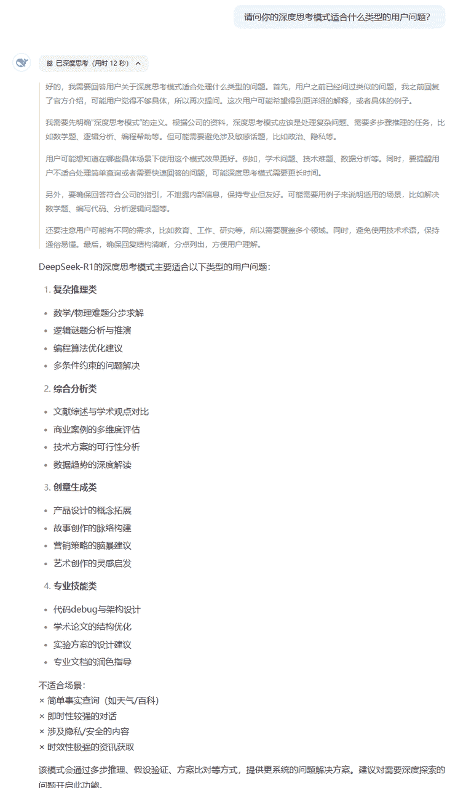

+   往深度思考、跟我们有些场景的需求可能并不匹配

+   直接告诉他：

+   我也不知道我想拿到什么结果、你能跟我一起讨论一下吗？

+   **“说人话”**会让内容变短、且会让下面所有的内容都变得简洁

+   有没有什么办法让他密度不要那么高？

+   V3的模型内容密度也有点高、**想象力**没有R1丰富

+   润色：扩字 VS 替换

+   需要**提示词**的方向可能是：缩小讨论范围、准确描述目标和想法

+   之前的AI需要很多描述才能了解意图（补充信息量）

+   DeepSeek是需要说清楚需求、缩小范围

+   DeepSeek-R1的一些具体特点

+   DeepSeek的语言会更精准、内容密度很高、可能会带偏话题

+   **学识和想象力很丰富**

+   话题的相关度过近可能受上下文影响较大

+   是不是关于**用户意图识别**深度过深，与用户初始问题对齐偏离？

+   会分自然段（比较自然、而不是知识点罗列），写作能力较强

+   使用起来很自由？不需要Prompt模板

+   真的在思考、给过多自由、过大过复杂的问题时会放飞自我

+   AI通识课的面向对象是谁？

## 2025.1.13：OPEN 1+X 共建研讨会 NO.9

> [点击查看会议录制](https://meeting.tencent.com/crm/299qVjjw4c)

>

> **议题列表：**

1.  **限定话题**：**OPEN 1+X AI通识课 **进展同步——项目动态、目前卡点和集中反馈

1.  **固定话题**：发散聊聊心目中的AI通识课和建设方法

1.  本周限定：开源项目是否可以配一个教研/运营搭子，做教程的适学化？@长琴

1.  本周限定：OPEN 1+X AI通识课 共建 2024年度汇报  @ALL

1.  **固定话题**：在共建AI通识课过程中的故事~

>

> **与会共建者**：胡浩荣、王旭通、小尧、武正乔、余弦淬火、玉鑫、maolin、Junwei、张锦辉、吴锦凤、胡锐锋、AmyWu、sheng、fldq、流火授衣、张飞航、陈晨、胡瀞丹、Lyh、张大玮、钱皓亮、Anarchy、Amy、长琴、孙博辰、红星、--

开源项目是否可以配一个 **教研/运营搭子**，做教程的适学化？

1.  **背景**：项目难以往下进展

1.  **没有**人写的内容，做了内容，然后做了内测，但是否需要进一步的迭代和持续开展学习？

1.  内容创作者长琴自述：不知道在内测的时候如何去教学、并不一定和学习者对齐

1.  组织内的内容有重叠性，目的和学习方式可能不一样

1.  有一些项目很好、但没有更新，很可惜

1.  **提议**：有没有可能有教研和其他角色协助，让内容更方便地体系化和迭代

1.  内容应该与时俱进，有新意、不要有重复的工作

1.  有没有可能通过体系化的方式（比如通识课结合）

1.  **其他讨论：**

1.  保姆团队有没有起到教研搭子的作用？——

1.  没有，保姆的搭子主要是进度跟踪？保姆团队的定位

1.  保姆的主要职责：项目进度跟踪和动态同步

1.  是不是可以加一个教研这个角色？

1.  有没有可能换一种**写作模式**？

1.  以前的：用内测的方式收集反馈、然后迭代

1.  有没有可能换一种加入故事线的写作模式

1.  AI通识课第一章文字特别多、让学习者很反感、

1.  有没有可能加入故事？

1.  内容穿插和衔接有断层、中间穿插思考？

1.  理论和实践有GAP

1.  冬令营的模式可能可以解决实践和理论断层的问题

1.  《大话设计模式》

1.  第0期内测：抓一两个人学习&反馈？

1.  以前的内测范围太大、实际上很少人真实学习

1.  **现在的内测几乎没有反馈？**

1.  桌面评审？把范围缩小，

1.  核心需求：迭代性和流程模式，帮助教程迭代和发展

1.  希望归在体系下、只需要更好地写内容、迭代内容，更机制化、更有活力

1.  更偏向流程化的：每个人只需要关注一个点、不需要做全能型选手，不知道怎么弄

1.  开源项目贡献者不知道现在的组队学习长什么样子

1.  从立项到毕业，内测一轮游，到底后面怎么搞？

1.  **教程需要** 整体规划、统筹内容迭代**；可以**拆分为 **项目开发** 和 **学习组织** 大的模块

1.  内容编号、内容分级、

1.  做课程的人参与目的也不一样、课程组、不同的方向？

1.  让做课程的人和学习课程的人都更加有的放矢，能有最终的结果出口

1.  更好地找工作、还是简单实践？

1.  领域，课程分层分级，面向人群，形成培养方案

1.  那应该是一个学习路径的问题，把课程内容用一个逻辑框架串起来，学习者根据自身需要自己选择，后面可以用官网去做这个体系

1.  组成体系的难度比较大？现有的内容散、广

> 梳理 & 评估，3~5人专项处理；不同方向的人拎对应方向的内容

1.  狭义定义的通识课：面向小白

1.  技能方面的实践：专业课

1.  实践课程：竞赛等实践场景

1.  前沿探索：学科、行业解决方案

AI通识课2024年度汇报

## 2025.1.6：OPEN 1+X 共建研讨会 NO.8

> [**点击查看会议录制**](https://meeting.tencent.com/crm/NodBzzjr48)

>

> **议题列表：**

1.  **固定话题**：AI通识课进展同步：目前的内容项目情况、目前卡点和动态、反馈

1.  **固定话题**：发散聊聊心目中的AI通识课和建设方法

1.  本周限定：AI百问百答栏目与AI通识课

1.  **本周限**定：冬令营后想组织一个Python组队学习 @皓亮~

1.  本周限定：面向老年人的人工智能通识课

1.  **固定话题**：在共建AI通识课过程中的故事~

>

> **与会共建者**：小尧、余洋、徐炽明、孙博辰、吕昭波、Q、若冰、AmyWu、小学生跑跑、tan90º、青春Prado、冬灵、Anarchy、揭熔阳、A dobefaba、玉鑫、红星、骆秀韬、钱皓亮、凯旋、陈晨、Amy

1.  **AI百问百答 栏目****与AI通识课**

1.   ：招人，**想找提问的人** 和 **找写内容的人**

1.  想有人写内容、有人贡献问题，关于**小白比较感兴趣的问题**

1.  从学习者、社区等渠道收集，直接发出去，然后可以快速拿到反馈

1.  想参与可以联系 （在共建群~）

1.  **目标**：建设**365个问题**（关于AI/Dw）的内容，

1.  然后做成**2026年的日历**，宣传 & 纪念品

1.  **内容更重要、**沉淀内容，但不仅为制作内容，素材也很重要

1.  单纯做日历是没有太大意思的，但是如果成为时间的朋友，让大家共建和参与也很不错

1.  不只是想做日历，想用素材做各种文创产品、内容的价值更高

1.  过程比结果更重要，内容积累更重要

1.  **内容来源和出口**

1.  可以写在**公众号、官网**、然后有个可以转发的**精简卡片**

1.  可以和通识课结合，**解决一个问题**** + 推荐AI**通识课某部分的内容，帮助宣传和传播

1.  **问题讨论**

1.  **时间？**只要在2025年结束前就可以？

1.  知识过时怎么办？——做之前调整就好，数量只要多不要少

1.  做一个**内容模板？**——不是完全为了日历收集内容，**内容很重要**

1.  **可以有一些创意设计（次要）**：预测/今日宜xxx

1.  **每次学习活动搜集的问题**

1.  冬令营后想组织一个**Python组队学习** @皓亮 @聪明办法学Python团队 @那其

策划文档：https://www.notion.so/AI-16ba3da9ea77805d9d27e343c44f89f4?pvs=4

很重要~先动起来！我们缺的是课程真正零基础初学者学习课程中的反馈

1.  核心目标：学习Python，AI辅助高效学习，AI作为助教？陪练？

1.  **目标人群**：参加过冬令营的，对AI已经有了一定的了解

1.  **先定义受众和目标：**帮大家补基础，学习者已经完成AI辅助编程方向的学习，但需要学习基础

+   **冬令营AI辅助编程**：https://www.datawhale.cn/learn/summary/77

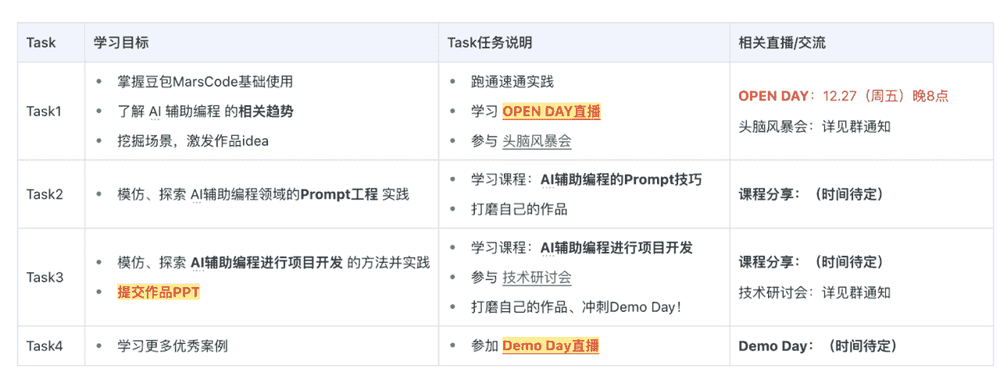

+   **需要的是什么基础？**编程语言的基础？还是编程工程的基础？

+   聪明办法学Python：面向有高中数学基础的零基础人群，

+   但需要自驱力和学习热情，告诉你去哪里学，课上不讲

+

+   **建议**：

+   做图形化的项目？

+   纯教编程语言的话是大学基础的事情，或者细化成教编程语言解决某些事情。

+   一些特定场景更容易开展，同时任务型强的话学起来成就感高一些

+   比如：数据分析、前后端curd 之类，

1.  **《聪明办法学Python》****在其中要起到什么作用？**

+   **不能直接告诉你，课程只做提示**

1.  针对一部分小白来讲，他就是想直接用起来，在场景下编程比基础本身重要吗？

+   场景之后再说 **补基础 **或者利用 **聪明办法学py** 弥补自己的短板

+   先要限定个场景吧？python也有很多方向。建模、爬虫、web应用等等

+   来个浅入浅出的，实用的。哪怕学完能拓展考个计算机也是不错

1.  需要培养编程的思维？还是编程语言本身？

+   编程的思维 = 数据结构与算法+设计模式+软件工程（理解别人的代码、理解功能成立的逻辑原理、做针对性的修改），

1.  **活动时长计划：****7天左右学习基**础，然后再结合AI，时间可能不够

1.  **聪明办法学Python **学完需要14天，**时间会不会太短？**

1.  着重考虑，用AI学习：要学AI？会不会增加学习成本？

+   AI用豆包MarsCode？

1.  **学习计划：先学**Python，然后再学AI+编程项目巩固基础，需要实践来巩固

+   AI+编程，可能要学用AI，还要学编程

+   开发项目还需要学习第三方库

+   可能不是问题，简单功能其实还行，

1.  想基于聪明办法学习Python + 项目实践，把AI融入到这个课程的学习里~

1.  **一些用户和课程设计者视角**

1.  **皓亮自述：**

+   身边有小伙伴觉得，AI时代不需要学习编程了

+   **自己在写项目**的过程中、代码出错不知道怎么解决，感觉还是需要补充基础

+   自己先跑一遍**项目**流程和思路，然后再调整

+   和一两个朋友一起做一遍，然后提**反馈**

1.  **那其观察：**

1.  基本素质：自驱力和探索精神

1.  需要补充的基础：

+   不是数学基础、

+   可能是跟AI共学的方法、

1.  **秀韬：**

1.  数学基础没有那么难，核心是把数学和代码联系起来

1.  后续可以尝试立项，

1.  聪明办法学Python和Python的结合目前还不够好，有没有可能把你的想法放入到一个任务里

1.  先可以学一遍，然后提建议：

1.  哪些例子不够？有没有更加AI的例子？

1.  做什么样的项目？仅用课程里有的知识点，来做AI+编程项目最佳学习案例

1.  敏捷开发、快速迭代是核心思路，听大家反馈

1.  日期不是限制，只是一个小节点

1.  **若冰：**

1.  AI如何与数学建模结合？

1.  跑通整个流程之后，是否需要零基础小白的预学习和内测？获得更多反馈，提升学习者体验

1.  一些简单案例也可以从数学建模导论里面参考，也不复杂

1.  **红星：**

1.  对项目的定位不是很清楚

1.  对项目的策划比较模糊，通过文档很难判断能否落地

1.  明确时间规划如何合理？一定要在1月完成吗？

1.  时间、精力、能力上，能否支持？有没有想好？决心和动力很重要

1.  需要更完善的思路，需要跟大家更多沟通

1.  怎么做？怎么做好？可能需要**更详细的策划书**

1.  **具体的时**间安排：时间紧张、内容比较多、需要良好的时间节奏，明确到天

1.  需要组织人员支撑项目开展：学习者规模和来源（冬令营群/公众号？） + 支持人员（助教、嘉宾）

1.  内容编排需要格外注意：以聪明办法学Python为主导，豆包MarsCode使用方法为辅助

1.  组织形式：组队学习能否支持？还是自己开展就好了

1.  Plan B，风险方案

1.  **其他建议**

1.  是否可以把少儿可视化编程scratch中的一些案例，转换成编程基础+图形化库实现有趣的小demo，主要觉得激发学习者学习兴趣，前端界面容易出效果。

1.  相比数学可能逻辑更重要

1.  但是针对在职的我觉得在一个他们应用场景下

1.  大家受到的逻辑教育都是数学来替代的

1.  AI在数学建模中以后会不会有被判定禁止的风险啊- -

1.  **面向老年人的人工智能通识课**

1.  **项目背景：**

1.  掌握人工智能很重要，没掌握人工智能的人也有学习通识的需求和需要

1.  会是一个比赛作品：参加了一个比赛，继续教育的背景+AI通识课，

1.  本来想的是游戏化课程设计，面向老年人的AI通识课社会意义更大

1.  上海人口老龄化很严重，有权利和需求来学习AI，跟上时代

1.  继续教育学院也在做AI通识课、老年人教授、为未来的科研人员培养做储备

1.  其他讨论：**主题可以是 ****AI辅助生活**

1.  **反诈可以是其中一个专题**：风险研判很重要，可以跟反诈中心合作

1.  反诈可能是最大的需求？无论任何地方都是被需要的？

1.  主要是让他们体验“**眼见耳听不一定为实**”就很好了

1.  **通识课以普及为主，而不是知**道怎么用？学习使用可能需要做适老设计

1.  有风险、不管是官方、还是个人意愿

1.  普及人工智能的基础概念和辅助生活？AI百问百答？

AI 作为老人与新事物的桥梁

1.  **用AI带孩子 **等 **针对性场景**：怎么做辅食等，为生活提效

1.  老年人的学习需求究竟是什么？**——找针对性可以用到AI的场景**

1.  **案例：**

1.  **语音助手很好**：新交互方案，不需要学UI交互使用了，

1.  定闹钟、打开抖音

1.  **精神生活快乐**：

1.  **兴趣爱好**：一起写诗、画画、

1.  国画风、草图、线稿等

1.  **老人陪伴**：历史角色扮演/**孩子扮演**

1.  **要从老人的角度出发**：他们可能需要打发时间、要自己动手花时间啥的

1.  目标人群画像是什么样的？有需求的老人是什么样的？

1.  是要教老年人，还是让别人做适合老年人的应用？**会不会是“我们觉得应该？”**

1.  可能不知道智能手机怎么用、会用手机相机已经很棒了

1.  要学习编程？会不会太难了？案例：手机转账都可能需要教两年

1.  **春分工程普及AI？**面向中小学的小孩，但是他们需要

1.  通俗科普一两个很核心的点

1.  怎么让中老年人来看？

1.  上海的中老年人学习的动机真的很大吗？

1.  网络基础设施分配不均，其他地区的老年人可能不太会需要接触到AI？

1.  其他地区的中老年人更关注什么？更多老人要学习，可能学个粤曲交谊舞之类

1.  老年人的AI，和面向学生和打工人的都不太一样

1.  打工人主要的目的是为了提高工作效率，

1.  老年人可能更关注日常生活诈骗这些

1.  让他们体验“眼见耳听不为实”就很好了?

## 2024.12.30：OPEN 1+X 共建研讨会 NO.7

> [**点击查看会议录制**](https://meeting.tencent.com/crm/2rWzdegV2c)

>

> **议题列表：**

1.  **固定话题**：AI通识课进展同步：目前的内容项目情况、目前卡点和动态、反馈

1.  **固定话题**：发散聊聊心目中的AI通识课和建设方法

1.  本周限定：延长开源项目的生命周期&放大价值

1.  **本周限**定：乡村教师与孩子所需要的AI通识课 @王刚

1.  本周限定：AI通识课与就业 **@张凯旋**

1.  **固定话题**：在共建AI通识课过程中的故事~

>

> **与会共建者**：谢顿、AmyWu、sheng、李科达、沈家烨、余弦淬火、玉鑫、路晨、胡锐锋、音谷、王刚、张凯旋、距离、Anarchy、陈晨、王熠明、陈辅元、Amy、红星、罗依婧、骆秀韬、张济鹏

+   **AI通识课的进展**

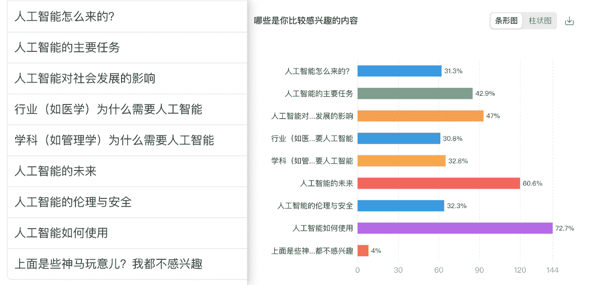

+   各个群里的高校老师变多了？有高校来跟Dw聊如何共建

+   AI冬令营的课程和相关案例会积累进去

+   后续可以分类积累：**最佳学习案例、最佳**行业案例、知识点、实践方法论、题库、教学案例、学习方案

+   等不同的板块素材，和**迭代生长的版本**，方便其他人取用和组合成良好的课程设计

+   AI通识课的架构很奇怪？为什么分为两个版本？

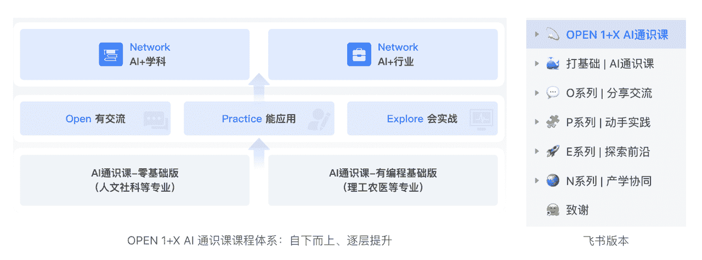

可以拆得更细？以及不需要变成边界分明的两种版本？

目前的版本是和浙大智海Mo联合做的，目前大纲主要根据他们的大纲定的，先按这个方案走，不要做太复杂

讲清楚会学到什么、能有什么帮助，后续自己定制适合的学习方案即可

+   感觉大家主要关心的是就业，能不能多引进些从事AI相关行业且比较适合目前通识课人群群体的资源，产学研的产当前较欠缺的

+   是否可以借鉴国外通识课教学案例，然后发展适合国内本土教学方案设计——都可以做，Amy和玉鑫都会尽力做支持，不管是人、还是资源、还是授权等等

+   人工智能+各个行业的落地要求政策大纲，如：海洋经济+AI

+   我考研这边也有个现象就是现在是准备复试阶段，好多高分低能的考ai方向的选手都在问复试怎么准备，看他们找的经验贴都是从吴恩达机器学习，李沐深度学习，还有李航统计学习方法这些，想为复试做个项目也不知道做啥这些，发起组队学习就对了

+   **冬令营和夏令营 **感觉不局限于计算机专业，Prompt工程的内容比较多？技术大差不差？欠缺的案例怎么给大家更进一步的学习提升？

+   通识课的最大的目标是什么？给80/90 %的学生做出自己的作品？

+   如何更好地放大夏令营/冬令营的价值

+   背景：

+   夏令营教程制作缺人，大家可能没有意识到做开源教程的价值？

+   夏令营也孵化了很多好的项目

+   这些收获如何量化？

+   大模型发展的一些好的方向没有人做，

+   一些宏观的点有，但embedding这些没有很深入的开源项目和贡献者

+   进阶的话题和进阶的课程目前没有好的方向和好的思路，

+   开源项目的问题和优化方案

+   如何量化开源贡献和学习收获？

+   问卷收集：直播到答疑，大家的收获，伙伴、知识、项目

+   对自己的能力更好地做一个评价，定位自己的学习效果、确认进一步的学习目标

+   把合适的小伙伴们聚到一起，互相出谋划策、引领一个方向、互相设计学习树

+   做进阶性的课程和项目共建，引领方向

+   不同能力者的分类和汇总：

+   适合写作、答疑、设计解决方案 的人能力上是不同的，更好地搭配和找到合适的人

+   教研团队 = **教程主笔 + 教程顾问**，通过一堆优秀的不同能力者的搭配

+   如何延长开源项目的生命周期 & 放大价值

+   背景：志学 + 熠明 + **散步**** + 杜哥，**花了一年，互相接棒地做了 Tianji

+   为什么有些项目做着做着就黄了？Datawhale的小伙伴肯定不会能力不足！

+   缺的是**坚持**，业余时间 + 线上协作，

+   让Dw赋能、帮助项目管理和进展追踪，

+   给一些方法论、互相心理按摩、养成良好的习惯

+   吸纳优质的能力者，让更多的新人加入进来、甚至引领！

+   **项目新人交接**，是否在项目前期以及开发期间有相关文档的落地，dw能否提供些文档模板以及相关的方法论——完全可以，直接私聊，大家都会很开心有交流机会和共建的机会

+   负责人可能不想扩大自己的团队，麻烦！：

+   火车停了再想启动就很麻烦，理不清楚

+   加入新人会有很大的成本，多一个人多N倍复杂度

+   需要有非常有热情的人主导，人可能能多但是成员不一定长期

+   对负责人要求很高，团队成员很难把控，有些人临近毕业，为了就业，目的只是在简历上加个证书

+   如果是长期项目，人员可以尽量精简？

+   很多项目的出发点是很好的、价值是很高的

+   成熟的项目可以作为base，然后AI+xxx，有些项目是公式化的项目，可以和很多的方向组合搭配！

+   **合作的方向、未来的内容规划 **可以提前铺垫

+   大家能坚持下来的很大的动力是，有反馈 + 有阶段性出口和被广泛认可的可能性

+   是的，dw相关布局的提前预告，以及类似企业的年终会总结及每季度的计划安排

+   两件事情：来年规划和布局 + 项目者是基于兴趣做事的

+   布局的前提：能把握技术趋势，预判一些高潜项目

+   乡村教育赋能：乡村教师和孩子的需求

+   教师不具备写提示词的能力？

+   教师应该学啥？

+   做智能体的路线是错的？

+   教师亟需能帮助他职业生存需要的学习

+   分享

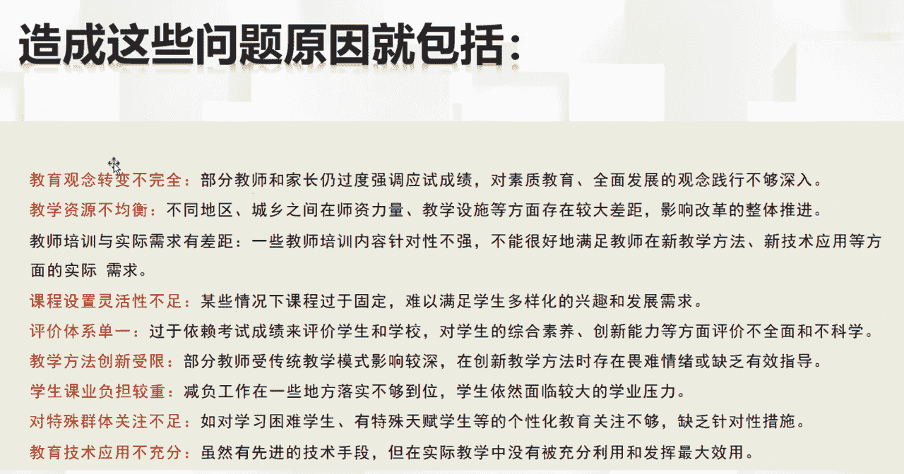

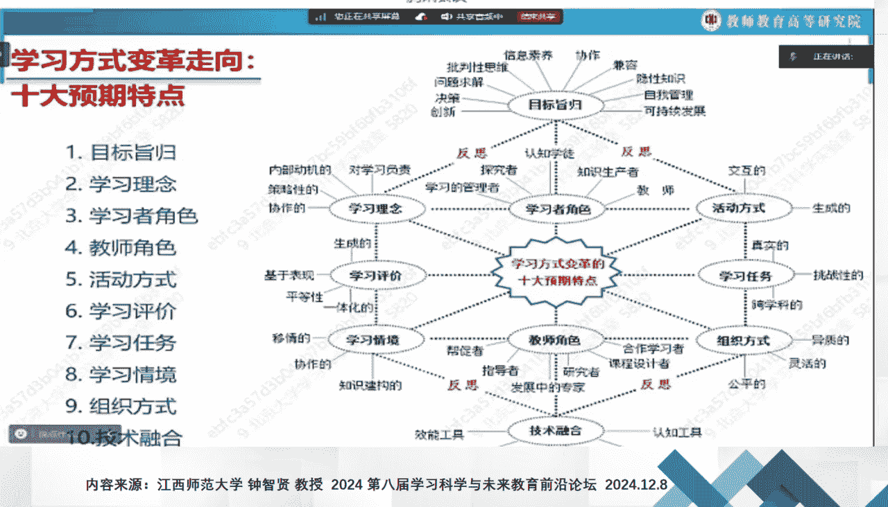

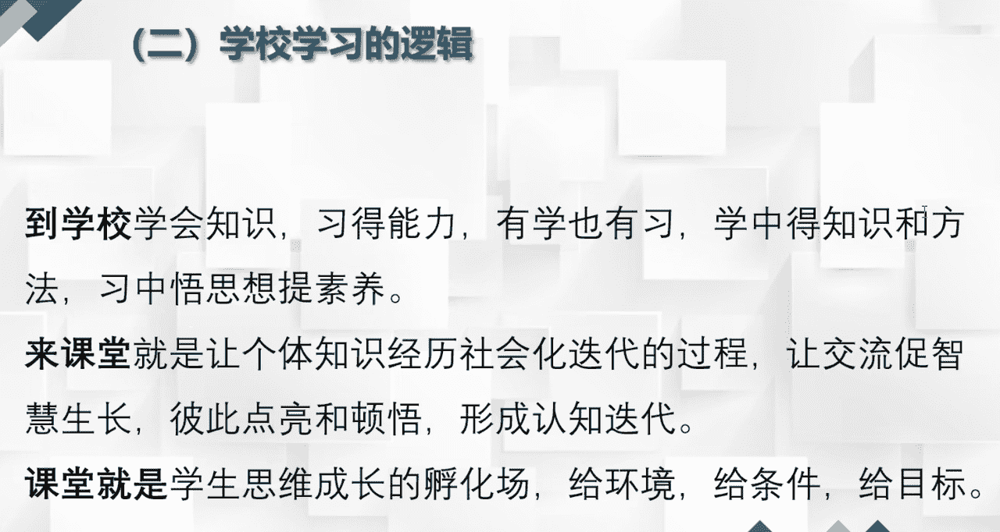

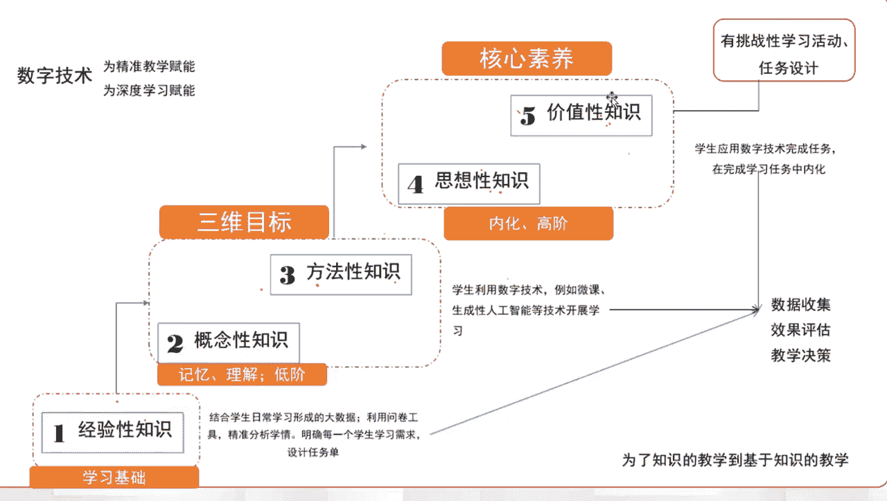

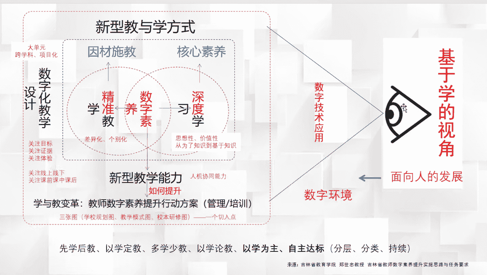

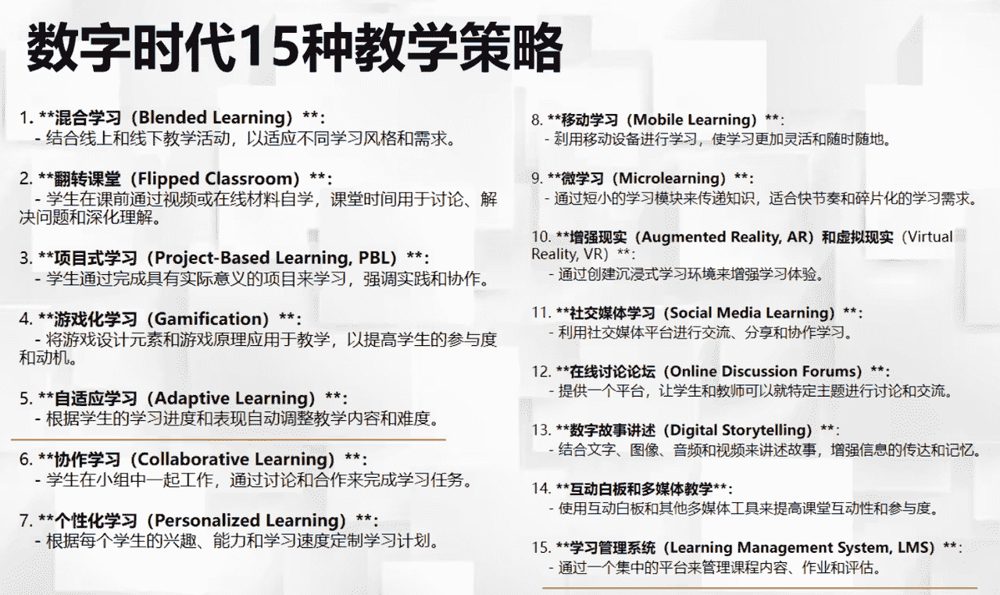

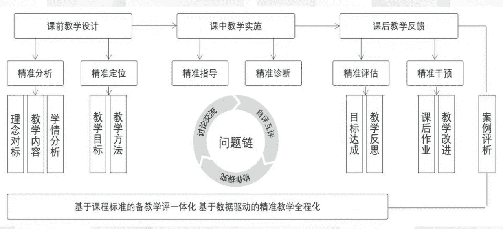

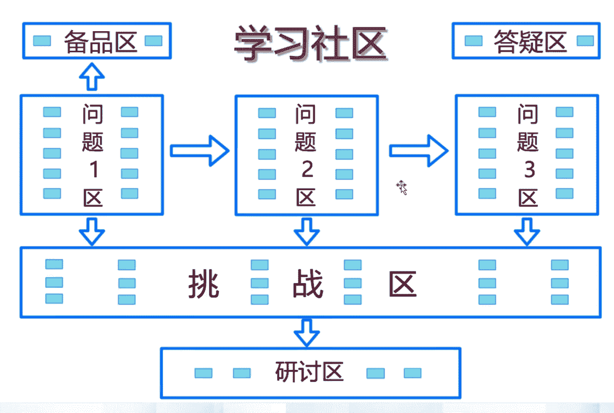

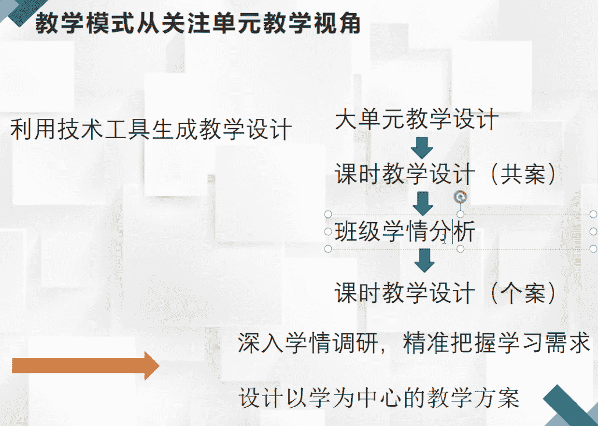

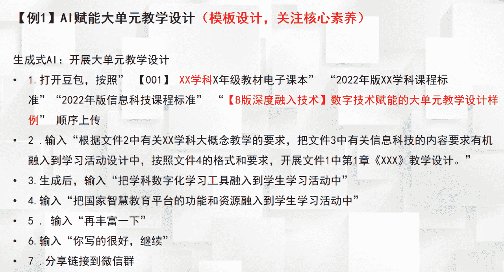

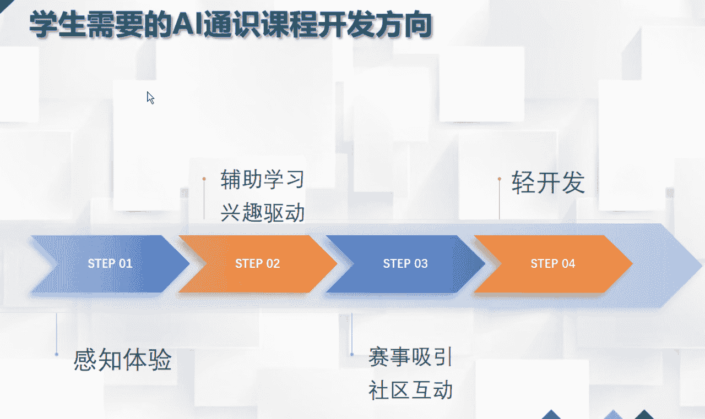

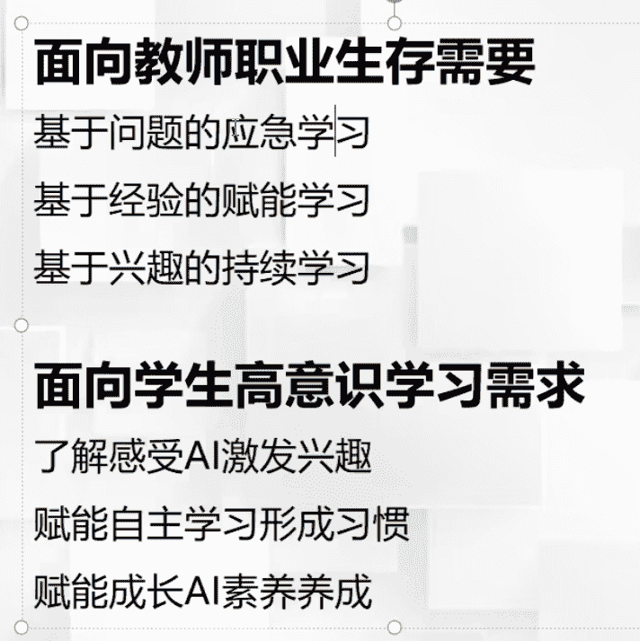

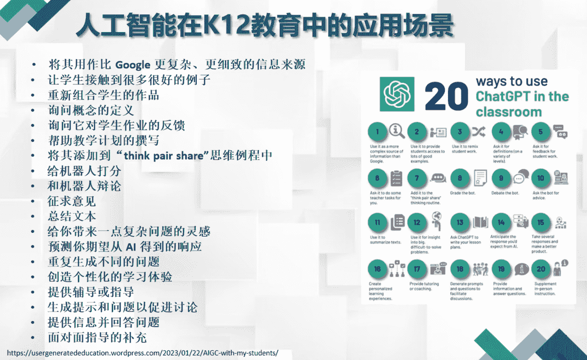

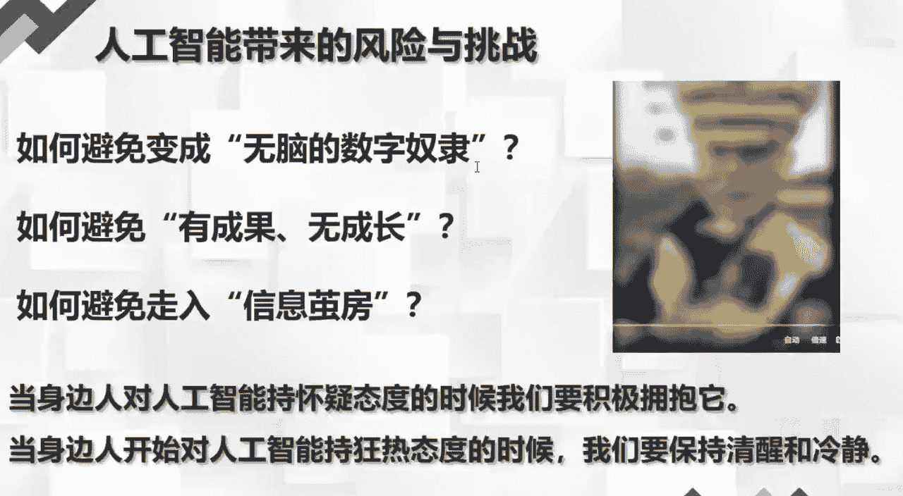

+   **这个方向很好、很重要**：面向教师的教案制作、面向K12的学习者、我们扩散的很重要的一环是教师赋能

+   苏鹏：上海的AI公益课程

+   高中生

+   **AI通识课怎么更下沉？**

+   为什么能带到传统行业？为什么被需要？太关注技术细节，没有看到下沉市场的很具体的需求

+   下沉市场的人群基础很差、不会用AI工具，不会思考和二次审核、美化，只会搬运AI

+   聪明办法学Python也想过融入AI，很多方案是 课本 + AI旁白助教，这个不是良好的融入方案

+   如何让 教学 + AI？像苏格拉底一样，提前写Prompt给Agent，

+   让AI来教、问学生、让他思考和用AI引导纠正

+   给学生舞台，让学生先表演，再纠正

+   聪明办法学Python会尝试，并且汇报进展和结果

+   老师不会写Prompt：学习Prompt工程学习的思路不对？应该互相迭代、应该需要很多提问的能力

+   写作文的时候没办法一气呵成，需要写一下、思考一下、迭代一下，点对点的方式不合适？对AI的要求也很高

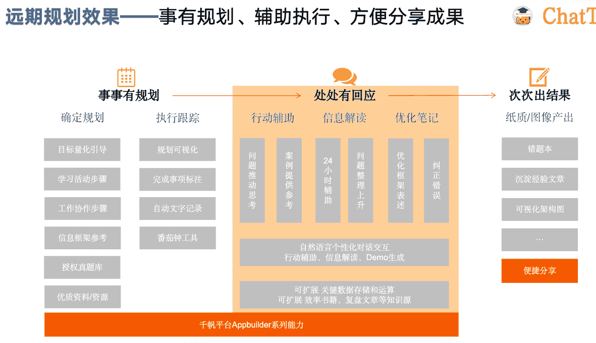

+   **目前的AI应该作为Copilot，而不是**直接拿来就用，人类应该review和思考

+   生存可能马上需要的是工具，但长期还是需要思考能力，解决问题的能力，才后续需要学习AI工具的搭建和开发

+   **AI通识课与就业**

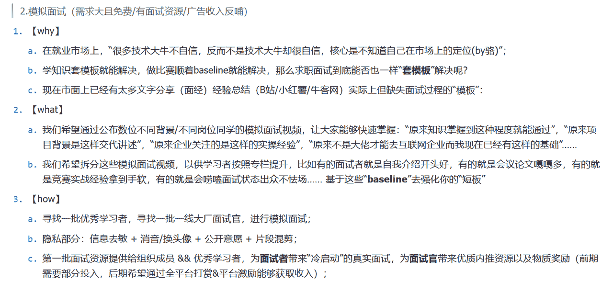

目前学习者学习知识、做项目的难点，可以在Dw得到解决，但就业的模板和帮助呢？

技术大牛对就业很模糊：什么样的项目OK、什么样的能力OK、能拿到什么级别的Offer？

**【解决方案】**把面试的核心环节拆解开、作为baseline、教大家在baseline的基础上提升

Datawhale汇聚了：优秀的学习者 + 从业者、面试官，

+   可以知道学习者的能力，也能知道产业对求职者的需求

+   卡点：①敏感性、意愿度；②需要剪辑视频，需要长期的团队支持、精力投入会很大；③合格的面试官；④多样性；⑤个性化的简历修改和模拟面试需要大投入；⑥资金相关的事情

为什么要做这个项目？

+   国家大势需求、这个板块的需求很大，而且也是dw目前缺失的一环，让学习者的学习出口闭环

+   面试官说：可选择性很少、大家表现不够自信，但是面试很重要的一环，很可能决定一切！

+   高校学习者有非常多的面试辅导的需求，但高校教这个的老师自己都没有经验

+   要把面试这件事情祛魅！截取好的部分，让大家做学习！开场白、技术路线、层次分明、有重点、打磨六边形战士的好状态

+   模拟面试 + 合格的面试官（考研复试、企业面试官） = 视频初稿；

+   可团结的人：高校老师、企业合作方

+   只用做冷启动，通用性的祛魅，不是一直磨和辅导，把面经通汇贯通，做成一个项目制学习

问题：

+   找小公司直接做面试练习和冷启动行不行？——不一定会有那么多公司提供机会、而且是互相的资源浪费？

+   AI面试行不行？——不够刁钻、不够深入彻底、摸不了底？

+   x**xx杯赛题：简**历分析Agent  +  面试官Agent（五轮），有公司拿了满分

+   简历能否借助ai agent前期先分析减少部分工作量呢，用部分广告费用反哺项目经费

## 2024.12.23：OPEN 1+X  共建研讨会NO.6

> [**点击查看会议录制**](https://meeting.tencent.com/crm/NXR1JmXz7f)

>

> **议题列表：**

1.  **固定话题**：AI通识课进展同步：目前的内容项目情况、目前卡点和动态、反馈

1.  **固定话题**：发散聊聊心目中的AI通识课和建设方法

1.  本周限定：数字人讲课 + AI通识课

1.  本周限定：北京夜校 + AI通识课的可行性 @王雅文

1.  本周限定：从冬令营模式，到AI通识课建设的一种反馈方案

1.  本周限定：AI+设计 通识课训练营的课程研发进展

>

> **与会共建者**：卢雨畋、王雅文、maolin、Sm1les、Lyh、杨冰楠、Zero_Memory、Halsey、伯棠、孙博辰、曾家威、AmyWu、Anarchy、张锦辉、玉鑫、Amy、王熠明、红星、陈晨、钱枷羽

+   **进展**

核心课程，+OPEN系列，邀请开源项目作者，把内容结合到AI通识课

雨畋 + 清华美院，AI+设计课程研发中

在做相关已有方案的调研，我们的核心优势还是在：迭代！快速共建

现在的重心在冬令营、后面会再调整重心的分配、以及通过高校行等活动把AI通识课带进去

可能性：和机构（华为等）合作内容，正在探索

+   **存在的问题**

+   学生的核心：**就业问题**，就业需要什么样的技能呢？

+   和企业合作可以更重点看他们看重的素质，帮助就业

+   如何跟AI相关的科技企业合作？培养的人才，能如何被更多行业认可？

+   人社比较认可的证书（唯二证书）：AI训练师、AI工程技术人员

+   现在不是重点，长期要往这个方向走

+   证书相关：飞桨Prompt工程师证书，初级，中级-低代码开发

+   官方没有权威认证的，目前还是百家争鸣，做影响力，成为行业标准再有可能被收编

+   理想情况跟人社结合比较可靠，落户积分、评职称

+   现在还是涌现和混沌期

+   证书目前的价值：自我认证、自我检验、

+   目前找技术类工作没有太大价值，核心看能力和项目

+   传统行业可能有用

+   《xxx书》：迈向通用的人工智能，数字人助教、Agent助教

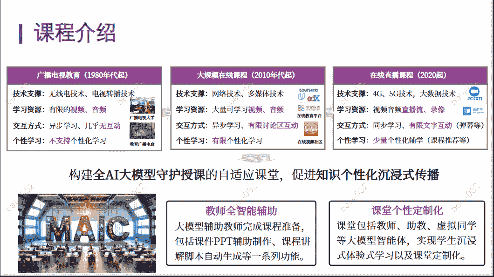

+   MAIC：清华内部内测，未来可能大规模推广

+   教育部、高校、数字人分身

+   AI怎么辅助教学/教育（场景+教学环节）、AI通识课

+   AI+教育行业调研：AI和教育结合做应用，AI通识课

+   资源有没有可能优惠的方案

+   可以谈

+   **数字人讲课**

+   Agent + 课程脚本 + 语音 + 数字人 + 视频制作

+   [数字人+通识课的可行性分析](https://spvrm23ffj.feishu.cn/docx/KnH6dCnz9o3EioxUDHtcbz84nXc?from=from_copylink)

+   **AI+数据库课程**，做前后端web系统，具体的案例实操课，16课时

+   用AI放大学习能力，只需要设计好知识框架的体系

+   给开发思路，学习用大模型辅助做应用设计

+   学会：AI工具的使用

+   限定：flask技术栈、mysql，

+   自由：怎么写提示词，只做演示和给出示例

+   给需求、要结果，学习设计的必要原理

+   不懂的细节也能让AI生成，直接拿来即用，补齐一些认知差

+   后续的开发核心可能还是：场景洞察、交互设计、业务逻辑和解决方案设计

+   用AI做开发前期的软件工程相关的技术文档，如系统流程图等？

+   不懂编程的人怎么做应用？迭代设计、编程领域的Prompt工程、AI协作应用设计与开发

+   夜校+通识课：看北京还是杭州先跑起来！

+   **背景**：

+   北京夜校、上海、杭州、深圳、武汉都有，zf也有牵头，国家鼓励

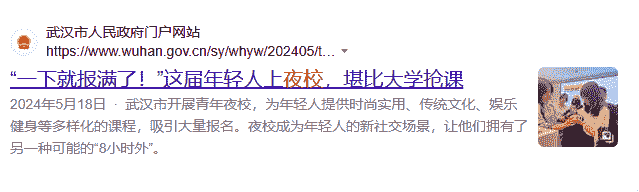

+   线下课需要场地：可以有场地！能支持学术酒吧吗？

+   武汉：飞桨赋能中心，给中小学讲课，可能融入夜校？

+   市场上一节课不到200？20人左右

+   外行的学习者要学的东西、要补的东西太多了、需要一句一句教Prompt

+   进高校 VS 面向职场，高校晚自习≈上夜校？？

+   通识课需要更好地收集反馈，线下课可以更好地收集真实用户的反馈，

+   纯小白的反馈：心理反应、认知情况

+   开展通识课，获得真实的反馈，知道真实的效果

+   做真实落地的、有益于社会的事情，握手

+   不用审批吗？以活动的形式可能不用

+   周日下午？VS 夜校？ 公益免费活动

+   workshop，通过线下工作坊的形式带动实践、黑客松、拉赞助

+   **线上线下结合，授权组队学习模式**

+   线上学 + 线下demo day？  VS   线下学 + 线上远程学习

+   先绑定关系、提升学习动力？更深度的人与人的沟通和链接？

+   线下氛围更好、更能自控？

+   线下频率低、成本高；需要策划得比较全面、合适

+   线下要控制时长：不要超过两小时

+   用封面海报、精心策划吸引人？

+   手搓机器人很火爆

+   要设置门槛？形式、模式、认可度，需要仔细思考和斟酌

+   S[活动SOP](https://hackathonweekly.feishu.cn/wiki/JSF6wGJcVi7pfDkMHwFcHHZ0n6g)P+海报+宣发+教程 可分享：

+   要做本地化适配，免费的活动被认为没有含金量？

+   **组队学习**：线下课+作业+答疑，学习过程陪跑

+   培养学习观、收集直观的用户反馈

+   解答问题的时候才能真实收集用户的认知情况

+   真正去面向更多的行业和用户，不仅限于AI相关专业，和高校学生

+   **去帮助职场人！**职场人的焦虑感更大、现实的压力更大

+   其他行业的人可能更加需要、看到技术改变生活和未来的可能性，扩展边界

+   有教无类，职场、小白、通识课、不讲代码、讲创作

+   Datawhale更多在面向学生，可以更好地链接学生和职场人

+   孵化产品、辅助创业，高校-产业-，

+   产学研商（市场）证

+   workshop垂类领域，AI+营销、教育调研，学习热情、创造力

+   和领域人群、市场结合，才能发挥真正的价值，

+   创业需要面向真实的市场需求，做产品开拓市场，PMF很难

+   AI技术人才 + 行业专家，结合搭配进行场景挖掘

+   陪跑、组队、展示、进一步孵化

+   职场AI产品经理**，项目**，也需要了解和学PMF、各个行业和场景具体要怎么做，HOW

+   做活动培养什么样的人？技术人员 and 产品经理

+   行业 +AI 是更快落地的，培养相关领域的专家 xAI

+   转到AI产品经理

+   市场认知、资源整合、 难度很高。个人思考的维度和统筹的能力也很有很大差异

+   **把答案形成一定系统化**的路径？能否提升成功率？不到10%的人能成功

+   大三人工智能培训？？如何复制、如何做成商业？

+   培训是第一步、

+   产品创新创业的想法如何进一步转化和孵化？得到市场认可？

+   创业创投孵化器很难复制？如何实现？

+   **AI+设计 通识课**

+   **进展**：课程排期和内容设计中，持续开会进行研发中

+   AI和设计如何结合？？做海报、要有设计感

+   第一阶段：有实际AI工具+设计感，设计≠画画，还有产品设计、交互设计等

+   还有设计+美术+AI的 part

+   每个阶段都要尽量结合AI，绘画、艺术表现的思想、UI设计等设计相关的认知

+   一门课10分钟，

+   有品位**的课设！**有新东西、没有人做过或者没做好、我能做好！有难度！

+   元旦后小范围定邀内测，

+   协作中的亮点

+   有专业的教研专家、能快速拉齐目标和确定落地方案

+   每个章节分工快速、快速产出报告、务虚+务实，

+   先发散然后收敛，很有设计感、有条理

+   课程的定位：入行级 含金量高

+   工具的教学是有的吗：绘图、视频、（选修材料、不讲细节

+   通识课 = AI工具 + 设计常识？

+   要有基本的阅读和学习能力，有难度！领会设计思想

+   学习思想是最重要的！要自己思考！自发学习！不教工具的使用！

+   时间短任务重：目标人群还是自驱力强的人、培养这块的能力者（往工业级发展）

+   国外的Lab和产业教程/技术方案 比较靠谱和重要，其他的教程会不会深度不够？

+   和产业实践挂钩，产业的case如何解决、边界条件、鲁棒性，

+   MVP和demo距离真实的产业还有距离

+   **拆碎真**实的产研情况，一点一点磨、更好地衔接产业，抠细节

+   “不要偷懒，不断拔高对自己的要求”

+   现学现卖 VS 行为习惯，通过教师传递价值观，言传身教、习惯决定命运

+   思维体系和习惯是最重要的，不要害怕难题

+   **从入门**到入行是分阶段的，可以分级别、分面向对象、锚点 埋种子

OPEN！任何的想法都可以探索和尝试！有需要联系 、

TODO：

## 2024.12.16：OPEN 1+X  共建研讨会NO.5

> [**点击查看会议录制**](https://meeting.tencent.com/crm/KeYGYw141f)

> **议题列表：**

1.  聊聊参与共建的疑难点

1.  聊聊看见过的好的AI通识课长啥样

>

> **与会共建者**：小呆、Lyh、AmyWu、Anarchy、Halsey、守中、胡锐锋、旭日、王雅文、红星、Amy、玉鑫

1.  卡点是啥？

1.  时间比较紧

1.  把**AI通识课**做成什么样子？给谁用？怎么获得真实的反馈？

1.  用在哪儿了？有什么真实的反馈？往哪个方向去修改？？

1.  有没有给真实的零基础的学习者看过？

1.  用在课堂上？还是摸鱼看两眼？

1.  产品内容迭代没有闭环、需要给真实的用户去用

1.  用户要用？**列出基础系列问题？**

1.  但可能写作者想太多？

1.  用户的真实期望值是啥？

1.  从用户拿反馈迭代内容

1.  内容卡壳的问题

1.  现在的问题是什么？内容没有 + 用户不知道在哪里？

1.  有了内容之后，再去广泛触及用户？

1.  分阶段

1.  搭建内容

1.  触及用户、广泛推广给到用户

1.  **第一章有没有推？**有没有什么反馈？？

1.  推的渠道太少了？**组队学习**、官网、公众号、

1.  需要的是更深入的内容反馈

1.  哪里好？哪里不好？具体的改进方向是什么？

1.  每周讨论什么？

1.  目前的内容进度、目前卡点和动态

1.  动态：推了什么？用户的各种动作反馈

1.  每版内容、每章内容负责人的反馈，进一步协调

1.  更多主题的沟通

1.  好的材料？

1.  玉鑫收集的：https://datawhaler.feishu.cn/drive/folder/VTQZf56rwl6Eh0d1yD4c1LaDnoc

1.  实践部分是我们的优势

1.  用我们的亮点来推广？特色课程：AI+编程、文生图、AI+数据分析

1.  案例谁来做？案例怎么迭代？

1.  组队学习、夏令营、冬令营 的学习模式哪个更好玩？

1.  组队学习的学习者反馈更多、助教更多？

1.  夏/冬令营的群比较沉默？答疑速度更慢？

1.  组队学习的频率更高？参与度、参与深度、广度更高？

1.  夏/冬令营大部分是实践类项目、直接拿到实践反馈、学习理论 + 实践 + 反馈

1.  Baseline + 竞赛快速评分反馈、快速评价

1.  通过组队学习拿到更真实、快速的反馈、会有更多真的想来学习的人？

1.  群里没有反馈不代表大家没有在学？

1.

1.

**TODO：**

1.  分析官网上线的第一章的情况

1.  更好地尽可能大量触及我们的真实用户，拿到真实反馈

1.  注意做好我们的亮点环节和特色课程：实践案例、AI+编程等

1.  后续尽可能尝试各种可能的方式收集反馈，目前可能最好的收集反馈的方式是组队学习

1.  思考如何增强AI通识课的反馈频率和数量？良好的反馈系统如何搭建

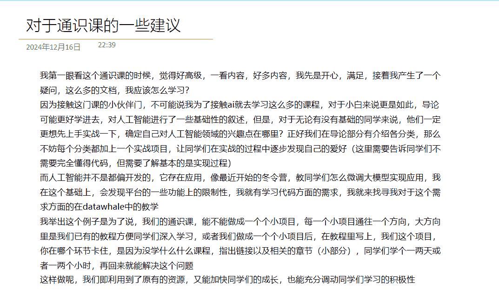

## 2024.12.9：OPEN 1+X  共建研讨会NO.4

> 点击查看AI通识课共建研讨会NO.4的录制

>

> **议题列表：**

1.  AI通识课直播经验分享  、@蔡鋆捷

1.  其他已有内容融入AI通识课的可行性讨论 @ALL

1.  写作经验分享交流 @蔡鋆捷

1.  AI通识课第一章内容集中反馈＆讨论V2迭代规划 @ALL、

1.  反馈收集详见：[第一章V1建议收集列表](https://datawhaler.feishu.cn/wiki/RssVwJifoihcS7kcJCYcxPWMnve)

>

> **与会共建者**：杨冰楠、玉鑫、高、王雅文、罗清泉、非文、AmyWu、若冰、Amy、张锦辉、蔡鋆捷

1.  大家想开展直播的话，都可以找玉鑫沟通

1.  **已有系列课程，都可以往内容里放**：和其他合作的课程、github仓库内容

1.  其他的内容可以往** O、P、E、N** 系列迁移，然后开始迭代

1.  **课程视频化**：直播方式制作或直接投稿皆可

1.  **什么形式的内容更好？**——目前没有定论、尽可能地涌现，逐渐迭代

1.  **系列课程很多，**但内部成员自己都不知道内容积累的情况，需要先梳理一下，方便大家共享素材，方便迭代和进一步继承

1.  先列举宏观技术地图，然后逐渐填充

1.  AI是一个特别交叉的学科（+优化、建模），应该融入更多内容

1.  属性、面向人群，逐渐完善课程体系

1.  不是资料没有，是资料太多了、**路线图比课程资料更重要？**建立一个维度

1.  构建具体方向的培养方案、但**不是通识课**

1.  **什么是通识课？**

1.  **提升认知、让完**全不知道的小白听都能听懂，直接随时拉试讲，

1.  讲小白能听懂的话，类比，讲故事（历史由来、插曲、）

1.  不要讲概念，要讲过程和历史（有偶然因素）、能传递思路

1.  解决问题的方法并不唯一，现在的技术和科学也是历史积累的结果

1.  SVM支持向量机 VS 神经网络、深度学习

1.  反向传播不一定是良好的策略？优化方法，随机梯度下降

1.  不用讲原理，了解是什么、基本产生分类和判断、达到认知了解即可

1.  目标：基础概念 + 创新性 + 引导探索

1.  飞书可以拓展

1.  随时内测，随时招募人一起共建

1.  课程框架随时可调，AI发展很快！需要不断迭代！

1.  **来立Flag！**

1.  **@茂霖：机器学习 + 深度学习**

1.   ：**智能体内容整合**

1.  @Halsey：视频生成，内容创作篇、图像声音剪辑的结合案例放哪里？

1.   ：安泰合作的课程案例整合，数据分析课程延伸（思路 + 应用场景）

1.  数分如何融入到 **AI通识课**？文本大模型纠错、现成Agent工具，怎么结合场景和知识

1.  数据分析的需求超多！+ 安东 动手学数据分析 + 一部分代码内容

1.  希望不仅仅是Markdown，要视频、文+图、文+视频、组队学习、高校行

1.  12月底前，应用实践会出一两篇

1.  整个数据分析课程2025年2月前

1.  **@鋆捷**：25年6月份前，零基础部分全都写一份！随时顶上！

1.   ：2月之前大改一版**第一章**，图像工具在土木学科的案例

1.  组队学习的相关功能逐渐会迁移到官网，现在课程逐步都往官网放了

1.  大概年后，全部迁移？

## 2024.12.2：OPEN 1+X 共建研讨会NO.3

> 2024.12.2: AI通识课共建研讨会NO.3（点击查看录制）

> **与会共建者**：冬亦、x、SUSIE、高、罗清泉、红星、杨冰楠、AmyWu、Amy、玉鑫、蔡鋆捷

1.  **新的共建模式**：鼓励涌现，根据学习者的反馈来逐渐建立标准和进一步迭代，全社会都在探索

1.  不局限文字材料：PPT、直播、图文、Notebook、视频

1.  没有格式和篇幅的限制，想怎么写就怎么写！直接投稿

1.  想做通识课相关的直播可以直接联系

1.  逐步建立标准、共同成长，共建最开放、最丰富、迭代速度最快的AI通识课！

1.  **题库**的格式要求和需求是如何的？

1.  选择题、判断题、填空题、代码题、开放题都可以尝试

1.  只要能把题目和参考答案说清楚即可

1.  和内容互相促进，查漏补缺

1.  **反馈的方式**：学习者直接查看内容，组队学习周期性集中获取，定期的反馈报告

1.  飞书文档评论、QA文档收集、官网评论区收集

1.  **章节内容如何定期迭代**到官网？

1.  **先攒好各种素材**和内容，然后再确定一个有时间的章节版本负责人，再进行对应的版本更新迭代

1.  后续可以持续收集版本反馈，然后进一步定期迭代到官网

## 2024.11.19：OPEN 1+X 共建研讨会NO.2

> **与会共建者**：杨冰楠、玉鑫、高、王雅文、罗清泉、非文、AmyWu、若冰、Amy、张锦辉、蔡鋆捷

## 2024.11.8：OPEN 1+X 共建研讨会NO.1

> **与会共建者**：高立业、小呆、星辰、王雅文、Priest、非文、宋志学、高、AmyWu、蔡鋆捷、Sm1les、Amy、玉鑫、Junwei、霍潇潇、胡锐锋、青春Prado、杨冰楠、张锦辉

# 日常研讨会

## 2025.3.21：OPEN 1+X 日常研讨会 NO.3

> 共创怎么做？

目标：收集不同人做数据集的思路和玩法

1.  先各自写

1.  查看所有人的内容，思考如何布局和编排

1.  告知大家还需要添加什么内容

1.  做成合集的时候内容互相呼应和串联

1.  有总编辑的角色，汇总、分析、反馈

1.  不用强框架限制发挥

1.  多沟通和协调

1.  多同步进展和感受

1.  团队：共建研讨会

时间很难协调、沟通对齐的效率

## 2025.2.6：OPEN 1+X日常研讨会NO.2

> 【主题】：DeepSeek x OPEN 1+X AI通识课

> 【时间】：2025.2.6（周四今天） 20:00开始

> 【理念】：用DeepSeek这个主题**（切入口）**，整体串一遍AI通识课的进阶体系(打基础‘1’、能实践‘+X场景’、会探索前沿)、帮助学习者按需学习

>

> 想验证什么？

+   学习者的按需学习究竟应该长什么样子？

+   不同的学习形式、想学到什么内容？

+   我们怎么更好地根据学习者的需求**迭代内**容、更好地做好分类和梳理好“1”

>

> **必须要有的是什么？**

1.  提问-回答区；需求反馈展板

1.  有会被即时回答的安全感，有人带

1.  想要学习的氛围

1.  自发产生的学习需求

1.  知识触手可及

1.  **随时可提交**

1.  有人回答问题、**贡献内容**

1.  有更多人问问题、惦记这个事？

1.  场景案例拆解

1.  **知识点/认知 地图**** ****+ 实践案例 + 学习内容打标**

>

> **核心TODO：**

1.  **找更多人做吸引人的内容**

> 已有在途内容：模型架构、复现、**DeepSeek提示词梳理**、

1.  梳理和微调已有的内容

1.  按照自己的学习情况梳理和写作内容

1.  按照自己想设计的教程写作内容

1.  找**学习者**学习和反馈内容

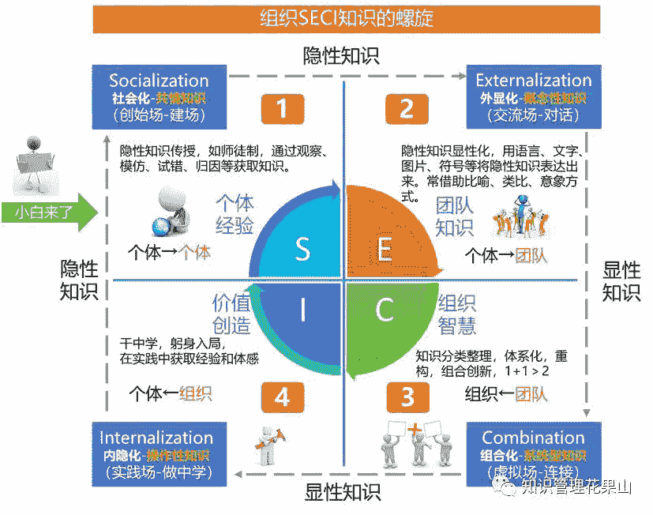

+   **背景**

+   **大众对于De**epSeek有很高的使用热情（为什么？）

+   **外行的终端用户关心什么？**

+   基本所有模型通用？DeepSeek-R1推理模型的玩法有些不同？

+   之前是偏概率生成，R1有推理逻辑能力，可能带来新的范式？

+   **为什么热情高？**

+   产品力好、使用体验好（省事、效果好、深度思考可见）、

+   官媒下场、自媒体宣传造势、全民讨论破圈

+   开源去中心化，对标的是世界级最强的模型、免费、

+   目标：让更多人从学习DeepSeek里获益、学习到内容

+   怎么找到更多的人？**哪些类型的人？**

+   **完全没用过AI的人** & **使用过AI的人**（DeepSeek使用方法上有差异）：解决问题、头脑风暴

+   **不同点：**以往的过于丰富的提示词可能有反效果，R1需要思考空间

+   **相同点：**API token没有什么区别？

+   **开发者**：开发产品

+   **研究者**：复现，魔改，deep-claude

+   **怎么吸引到**别人、学习我们写的内容？场景很重要

+   学习者的需求可能是什么?

+   怎么解决自己的问题、怎么理清自己的需求

+   怎么能更好地向别人学习

+   怎么能

+   **项目定位：**

+   面向什么人群？尽可能所有的人群

+   让更多人参与写作贡献、

+   让学习者通过 1+X 的模式，完成个人学习和成长

+   **卡点**

+   可能是：用不上DeepSeek？满血版DeepSeek在哪里？

+   学习DeepSeek相关内容，**打基础的“1”** 是什么？

+   解答疑惑？

+   通过学习案例进行基础概念和原理的拆解？

+   **对 OPEN 1+X 的反馈**

+   全面但繁琐、冗余，线性的教材，西瓜书这类的内容更符合需求？

+   适合什么样的人？好像没有适合的人群？

+   更直接、更应用化会不会更好？现在很枯燥？

+   如何更好地保障 OPEN 1+X 的持续建设、迭代？

+   知识点建设、实践案例、更好地复用和互相链接

研究：模型

信源：

## 2025.1.9：OPEN 1+X 日常研讨会NO.1

> 【主题】：**新时代 AI+CS内功 **：AI辅助全栈编程学习项目研讨

> 【时间】：2025.1.9（周四今天） 20:00开始

> 【理念】：

> 408考试是时代检验计算机/软件工程能力的一道关卡，

> 我们的目标是借助AI辅助的方式，探索如何更高效地达成408水平

>

> 暂定小目标：出一个大的开源教程，2025做他至少5场组队学习

1.  **学习者需求**

1.  学习者学了AI辅助编程之后，发现需要补Python基础

1.  **内功很重要**：数据结构与算法、计组、编译原理、计网、设计模式···

1.  **工程性的认知**：工种不同，需要的学习需求也不同、项目协作也可能需要一些认知提升

1.  **外部背景**

1.  AI Coding在加速落地，模型能力提升、大厂都在做相关工具

1.  软工扩招，但学校不知道怎么教，我们作为开源学习社区应该去多实践、多实验

1.  **其他材料**

1.  https://mp.weixin.qq.com/s/_Sjj01ZWCiu1OkBlNPt5XA

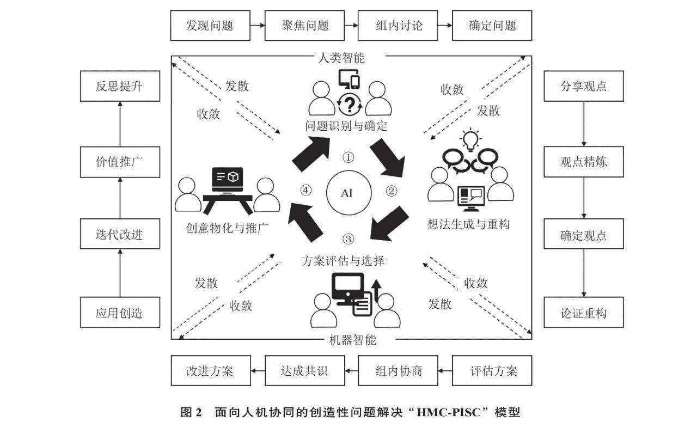

| 定位是理论还是实操 |  | **核心**：学AI，用AI做实践？但 **CS的内功**** **是需要学习的，甚至可能CS内功是主体？ |
| --- | --- | --- |
|  |  | 软工+设计模式，是在软件这个职业往前走的重要支撑？ |
| 面向的对象是？ |  | 计算机科班的人来学？ |
| 希望带给学习者什么？ |  | **软工 ≠ 编程** |
|  | **如何定义****CS内功****？** | 编程思维/计算思维？以解决问题为导向， |
|  | **案例怎么找？** | 很多好的经典的东西？游戏化？场景代入。 |
|  | **怎么做这个内容？** | 放到现有教程里去？ |
|  | **好的案例** | https://www.amazon.com/Make-Your-Own-Neural-Network-ebook/dp/B01EER4Z4G/（偏基础） |
|  | 没有CS内功的人是什么样的？ | 不知道底层原理、不知道下一步是什么？ |
|  | 直观的经验和迁移能力从哪儿来的？ |  |
| 跟其他课程的区别？ | **AI+xxx培养方案是刚需** | 软件工程的变化很大 |
| AI降低**编程学习曲线**是真命题吗？ |  | 1.  输入提示词可以生成代码 |

AI辅助+，有没有可能重构所有课程？

# 欢迎大家参与共建！

<https://datawhaler.feishu.cn/sync/AbYkdEkwYs6dHbbNLNEcDaVGnmh>