# 玩法说明 | 参与OPEN 1+X 共建

> 来源：[https://datawhaler.feishu.cn/docx/Ao61dcjpToGVktx6C3ycYM1Nn7b](https://datawhaler.feishu.cn/docx/Ao61dcjpToGVktx6C3ycYM1Nn7b)

# 路径一：直接投稿

<https://datawhaler.feishu.cn/share/base/form/shrcn13VsORqTwbGqOXKJLuhYqc?iframeFrom=docx&ccm_open=iframe>

# 路径二：逐步创作

> OPEN 1+X 共建组是Datawhale社区下的内容创作兴趣组

> 进群可添加 @Amy 微信👉

> 来创作心目中 **有趣、有料** 的学习教程！

> 优质内容有机会被通识课知识库收录

> 还有可能被推荐至 Datawhale公众号、

> Datawhale官网及更多媒体平台、

> 以及Datawhale线下活动等

> OPEN 1+X 共建推荐玩法：

> **→ **[**① 查看内容趋势机会池**](https://datawhaler.feishu.cn/share/base/view/shrcnSOLZvZwla4of3DB1GpRomd)：**每周一晚 **[**共建研讨会**](https://datawhaler.feishu.cn/wiki/JMzgwtOBhiF8woksLIdcPbBvnzf)交流 内容趋势 和 创作经验

> **→ **② 填写【共建投稿表单】立创作Flag

> **→ ③ 内容创作**：把你的思考和解决问题的思路写出来、写明白

> **→ ④ 提交内容/投稿**：修改/填写[**【共建投稿表单】**](https://datawhaler.feishu.cn/share/base/form/shrcn13VsORqTwbGqOXKJLuhYqc)、私聊 @Amy

## ① 先查看[内容趋势机会池](https://datawhaler.feishu.cn/share/base/view/shrcnSOLZvZwla4of3DB1GpRomd)

> **内容趋势机会池**，

> 会收录来自 Datawhale专家团、Datawhale活动、网络热点、社区学习者 等场景的内容创作需求，

> 帮助大家寻找创作灵感、梳理自己想创作的内容方向。

>

> 注意：内容趋势机会池，更多的是帮大家梳理自己的方向和思路、做自己的积累

+   注意尽量拆解目标，阶段性产出

+   尽快行动起来，实现 **产出-反馈-迭代-发布** 的闭环

<https://datawhaler.feishu.cn/share/base/view/shrcnSOLZvZwla4of3DB1GpRomd?iframeFrom=docx&ccm_open=iframe>

## [② 然后立下你 ](https://datawhaler.feishu.cn/share/base/form/shrcn13VsORqTwbGqOXKJLuhYqc)[近两周内](https://datawhaler.feishu.cn/share/base/form/shrcn13VsORqTwbGqOXKJLuhYqc)[ 的创作Flags](https://datawhaler.feishu.cn/share/base/form/shrcn13VsORqTwbGqOXKJLuhYqc)

> 立下Flag，有时可以事半功倍哟~

> 听说在Datawhale许愿想做成的事情，会很灵验哒~

> PS：如果你不想填，也可以悄悄告诉Amy~

<https://datawhaler.feishu.cn/share/base/form/shrcn13VsORqTwbGqOXKJLuhYqc?iframeFrom=docx&ccm_open=iframe>

## [③ 创作内容并投稿](https://datawhaler.feishu.cn/share/base/form/shrcn13VsORqTwbGqOXKJLuhYqc)

> 已有内容可直接投稿

> 立过Flag可修改之前填写的记录

<https://datawhaler.feishu.cn/share/base/form/shrcn13VsORqTwbGqOXKJLuhYqc?iframeFrom=docx&ccm_open=iframe>

# 参与微学习、近距离接触学习者

### 什么是微学习？

> **To学习者：**——没有门槛、兴趣导向、快速上手的 小型AI学习活动

>

> =====================================

>

> To创作者：没有门槛、只要有一节内容即可开课、接受学习者检阅

> 投稿**笔记、教程、技术趋势分析**等即有机会在微学习开课，

> 按照自己的想法开课、收集学习者反馈即可

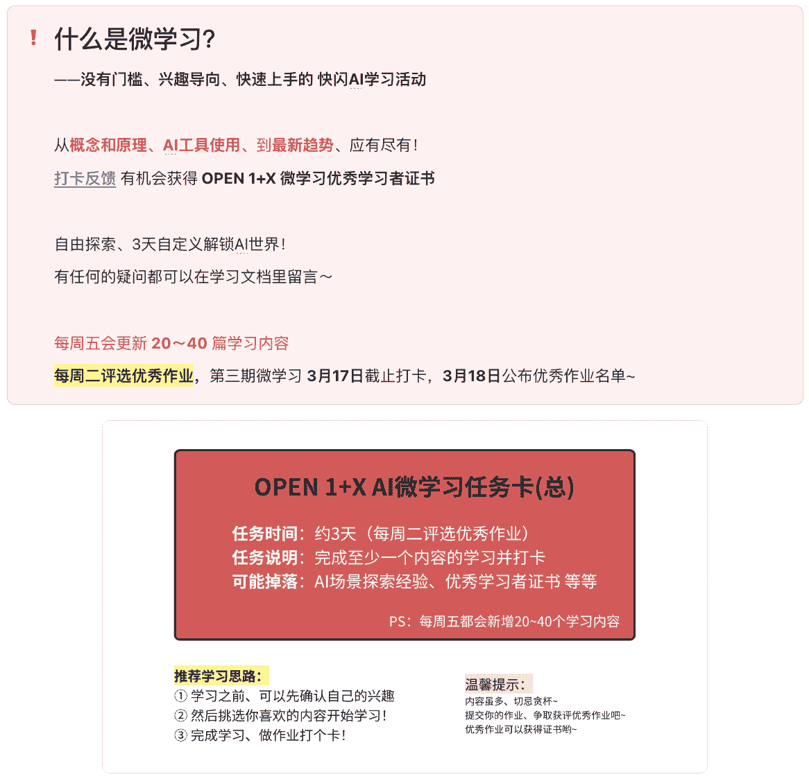

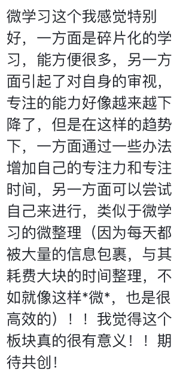

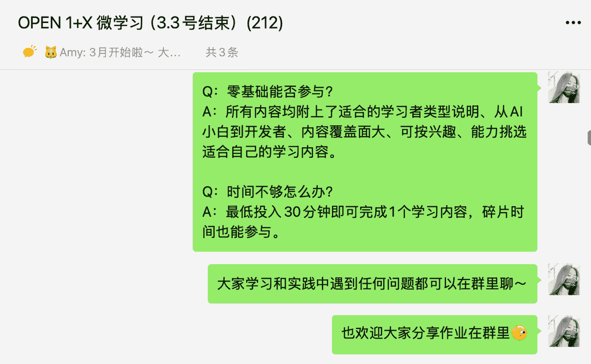

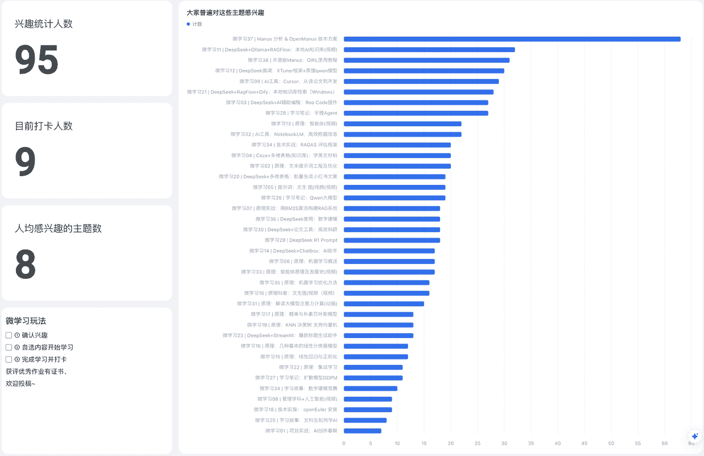

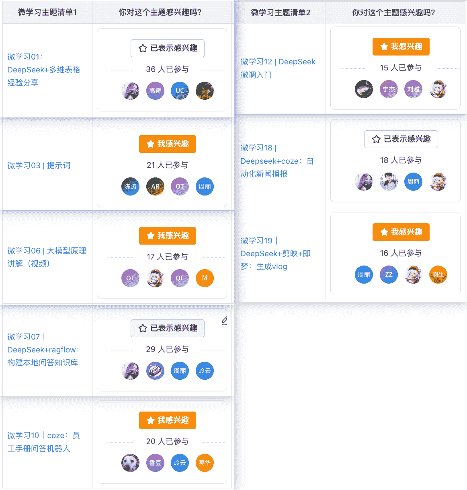

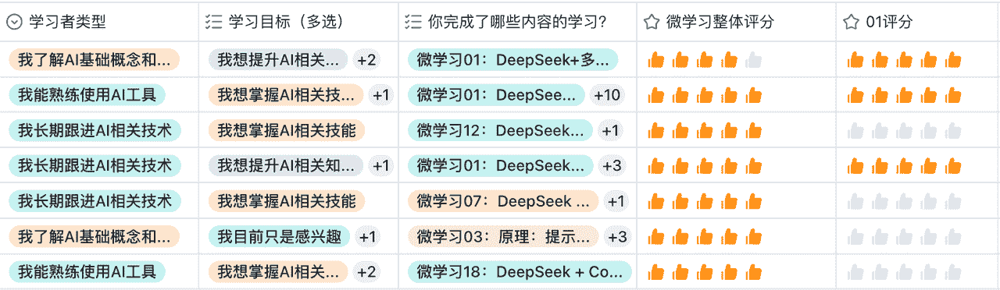

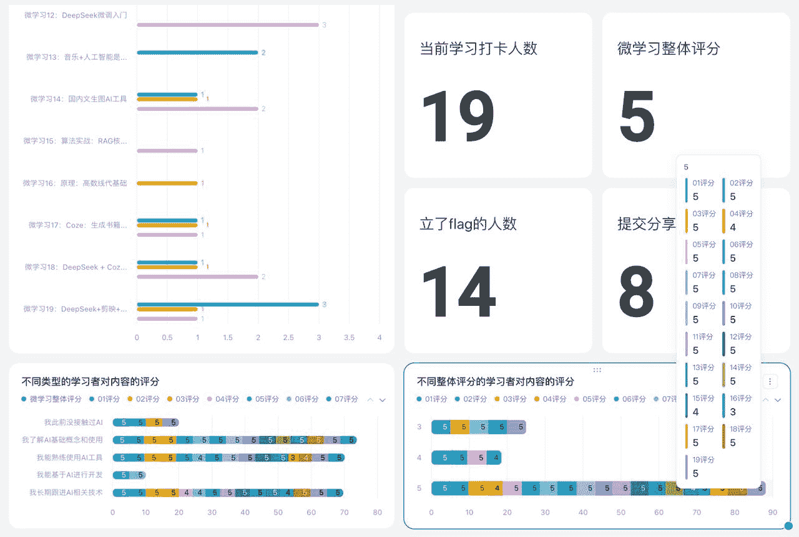

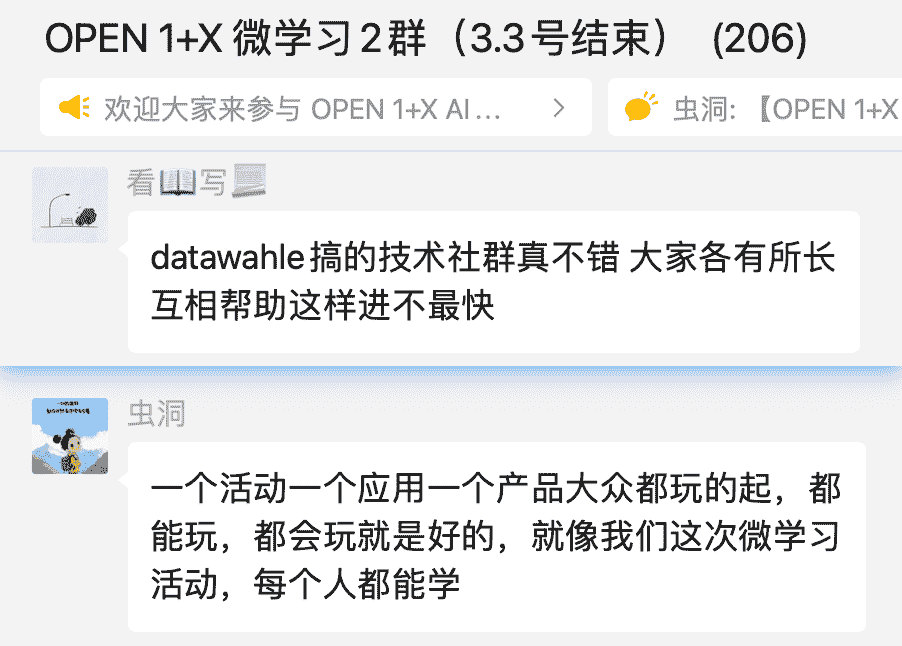

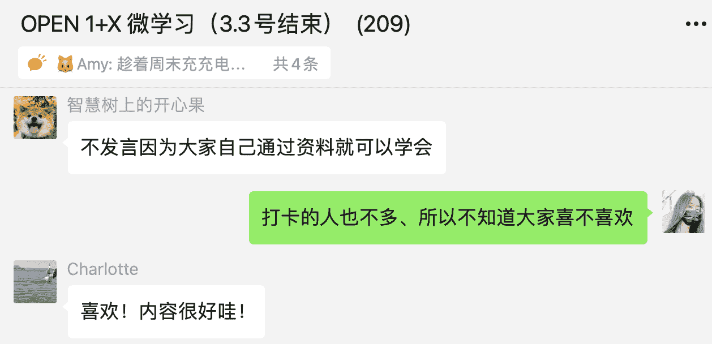

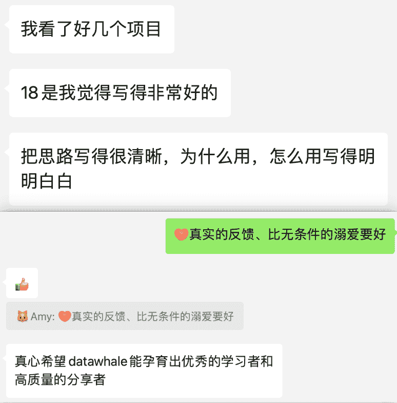

# 优秀内容可获得共建积分~

> 提交内容可扫码填写右侧表单、并私聊 （wx：aomferni）即可~

> 优秀的内容有机会被收录至AI通识课知识库、并推荐给更多学习者~

>

> 每周整体更新一次积分结算，每月3日公示整体积分并颁奖~

+   积分累积 20 可获得 **OPEN 1+X 共建者证书**

+   **积分累积 50 可开启鲸鱼**周边兑换权限，进入 OPEN 1+X核心共建群

+   积分累积 100 可获得 OPEN 1+X 核心共建者证书

| 共建类型 | 积分结算 |
| --- | --- |
| 投稿内容 | +   投稿短篇内容可获得 1 积分 |
| **教程优化迭代** | 鼓励大家在教程已有的基础上进行迭代、扩展 |
| **月积分新增 TOP3****，额外奖励 3 积分，并颁发 ****x月OPEN 1+X 共建之星**** 等证书** |  |

# 共建群将核心开展以下活动——

| 创作支持 | 预计活动形式 |  |
| --- | --- | --- |
| 寻找 &amp; 梳理创作方向 | +   **群内分享**从各处搜集到的内容需求 |  |
| 内容迭代反馈 | +   **内容试讲快速会议** | 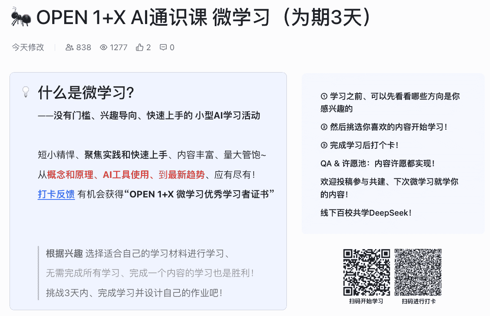 |
| 技术交流 | +   **相关主题的兴趣小组** |  |

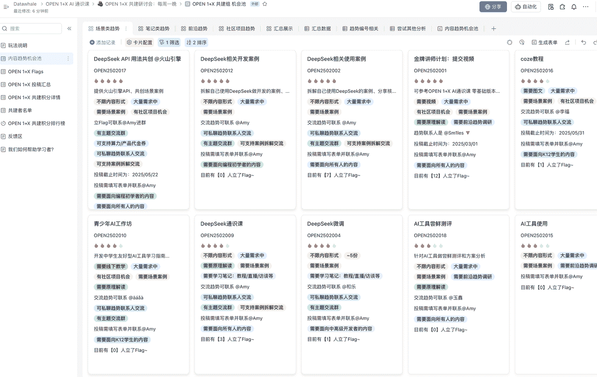

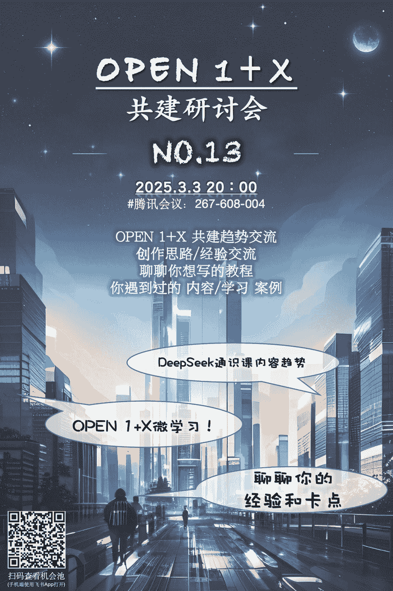

# 其他链接

1.  [OPEN 1+X AI通识课](https://datawhaler.feishu.cn/wiki/X9AVwtmvyi87bIkYpi2cNGlIn3v)

1.  [OPEN 1+X AI通识课共建指南](https://datawhaler.feishu.cn/wiki/LuIVwkmFYiD0RlknbRUcw7KYnBe)

1.  [OPEN 1+X 共建研讨会：每周一晚](https://datawhaler.feishu.cn/wiki/JMzgwtOBhiF8woksLIdcPbBvnzf)

1.  [OPEN 1+X AI通识微学习](https://datawhaler.feishu.cn/wiki/OICKwOCMGin7pgkPrWKcItzvnld)

1.  [OPEN 1+X AI通识课 微学习（为期3天）](https://datawhaler.feishu.cn/wiki/KqrBwmiZdi89sRkNWaPc6xKInQd)

1.  [OPEN 1+X AI通识微学习 NO.2](https://datawhaler.feishu.cn/wiki/JMkDw6z6EiZUS9kDtGgcioCknSz)

1.  [OPEN 1+X 共建者名单](https://datawhaler.feishu.cn/share/base/view/shrcn7S6Ij91MSCK15gLFGMrDAb)

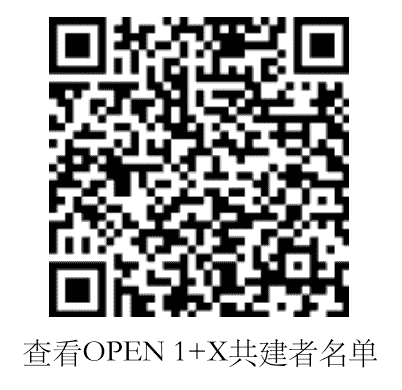