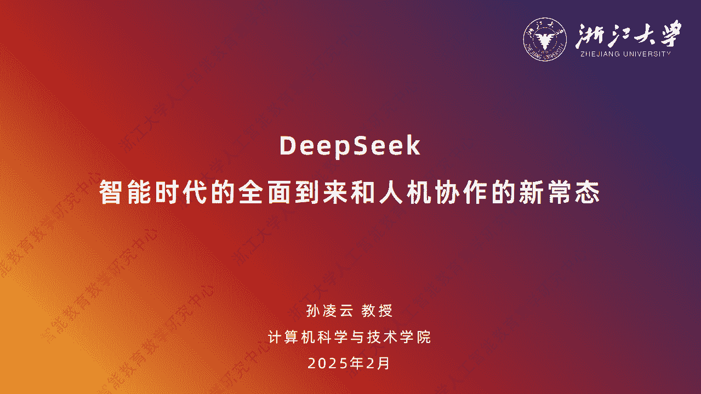

# DeepSeek：AI智能演变 & 人机协作实例和前景

> 来源：[https://datawhaler.feishu.cn/docx/C02Zd99Ydon3dpxobqDcMeCcnog](https://datawhaler.feishu.cn/docx/C02Zd99Ydon3dpxobqDcMeCcnog)

> Datawhale联合浙大发起了《能应用的DeepSeek通识课》

> 本内容是浙江大学DeepSeek系列公开课其中的一篇，邀请了孙凌云教授进行主题演讲

> 原演讲主题——《智能时代的全面到来和人机协作的新常态》

>

> 欢迎大家 [**学习打卡、投稿笔记**](https://datawhaler.feishu.cn/share/base/form/shrcnhopDrI77ZzTkzxBoE0pCmd)~

<https://player.bilibili.com/player.html?bvid=1KmPeeCEHp>

[第二期：孙凌云（浙江大学）DeepSeek：智能时代的全面到来和人机协作的新常态.pdf](https://internal-api-drive-stream.feishu.cn/space/api/box/stream/download/all/Jc27b6h5Cot2v6x0TqWcZNZqnYe)