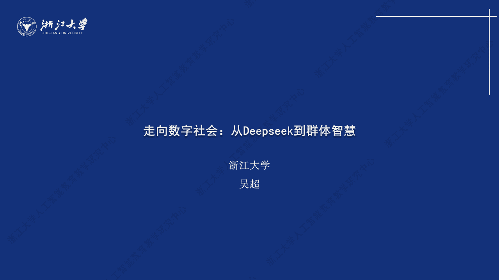

# DeepSeek：数字社会发展史

> 来源：[https://datawhaler.feishu.cn/docx/EaLLdisd3ofaUKxKEHVc94bfn2d](https://datawhaler.feishu.cn/docx/EaLLdisd3ofaUKxKEHVc94bfn2d)

> Datawhale联合浙大发起了《能应用的DeepSeek通识课》

> 本内容是浙江大学DeepSeek系列公开课其中的一篇，邀请了吴超副教授进行主题演讲

> 原演讲主题——《走向数字社会：从Deepseek到群体智慧》

>

> 欢迎大家 [**学习打卡、投稿笔记**](https://datawhaler.feishu.cn/share/base/form/shrcnhopDrI77ZzTkzxBoE0pCmd)~

<https://player.bilibili.com/player.html?bvid=1pKRKYvEfo>

[第三期：吴超（浙江大学）走向数字社会：从Deepseek到群体智慧.pdf](https://internal-api-drive-stream.feishu.cn/space/api/box/stream/download/all/F3pcbH33goEMe7xG6occkVRVn4d)