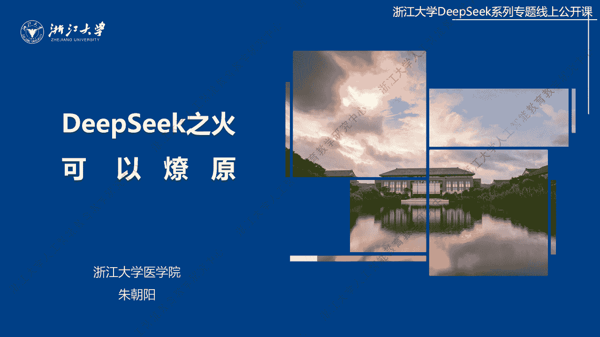

# DeepSeek：训练思路与争议分析 & 私有部署与微调

> 来源：[https://datawhaler.feishu.cn/docx/K3hUd19DBowozBxkdURcGSWjnjg](https://datawhaler.feishu.cn/docx/K3hUd19DBowozBxkdURcGSWjnjg)

> Datawhale联合浙大发起了《能应用的DeepSeek通识课》

> 本内容是浙江大学DeepSeek系列公开课其中的一篇，邀请了朱朝阳老师进行主题演讲

> 原演讲主题——《DeepSeek之火，可以燎原》

> 欢迎大家 [**学习打卡、投稿笔记**](https://datawhaler.feishu.cn/share/base/form/shrcnhopDrI77ZzTkzxBoE0pCmd)~

<https://player.bilibili.com/player.html?bvid=1fPQVYuEGF>

[第四期：朱朝阳（浙江大学）DeepSeek之火，可以燎原.pdf](https://internal-api-drive-stream.feishu.cn/space/api/box/stream/download/all/CmotbTmuYoOM35xjAsJcz9gIn4b)