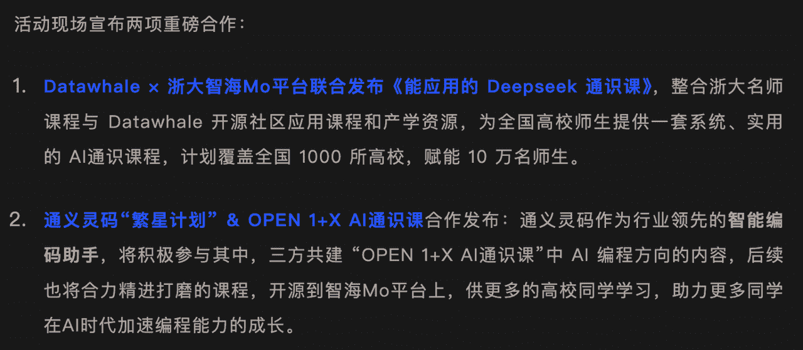
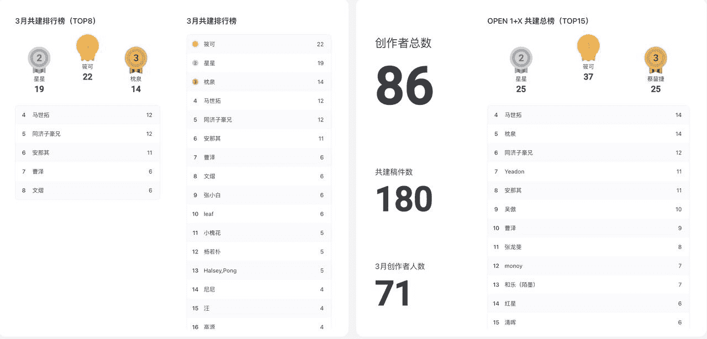

# OPEN 1+X AI通识课更新简报

> 来源：[https://datawhaler.feishu.cn/docx/BrrjdZfyMosrvmxq2B7cv4GXnB4](https://datawhaler.feishu.cn/docx/BrrjdZfyMosrvmxq2B7cv4GXnB4)

> 一起共建全国**最大的、最开放的、内容最丰富**的AI通识课知识库！

> 把优质的内容带给更多需要学习AI的人！走进 3000 所高校！

>

> [**OPEN 1+X AI通识课**](https://www.datawhale.cn/open-ai)** 是国内首个面向高**校各个**学科的人****工**智能通识培养方案，由 Datawhale 和 浙大智海 联合发起。

> 以 Open（开源共创）、Practice（动手实践）、Explore（前沿探索）和 Network（产学协同）为理念，

> 共同构建AI基础知识和实践体系，旨在促进深入交流和知识应用。

> 我们将链接全国 3000 余所高校、企业及组织机构，共同推动 AI 教育和产业的繁荣发展。

>

> 更多介绍详见：

+   飞书知识库版本：[OPEN 1+X AI通识课是什么？](https://datawhaler.feishu.cn/wiki/X9AVwtmvyi87bIkYpi2cNGlIn3v)

+   OPEN 1+X AI通识课官网：https://www.datawhale.cn/open-ai

## OPEN 1+X AI通识课 更新简报

> 更多详见：[更新历史 | OPEN 1+X AI通识课](https://datawhaler.feishu.cn/wiki/NGbKw0ELViTE0KkVG1rcAG9Cnxb)

> **2025.3.18**：微学习第三期作业评选结束——

+   [**打卡16人、优秀学习者4名**](https://datawhaler.feishu.cn/share/base/dashboard/shrcnJ1u9f1vXRkUSLkBYWifKqf)：与兼、张辉、Chengdz、charlotte

+   [**OPEN 1+X 微学习指南**](https://datawhaler.feishu.cn/share/base/dashboard/shrcnJ1u9f1vXRkUSLkBYWifKqf)** **更新：https://datawhaler.feishu.cn/share/base/dashboard/shrcnJ1u9f1vXRkUSLkBYWifKqf

+   [**OPEN 1+X 共建指南**](https://datawhaler.feishu.cn/share/base/dashboard/shrcnFlngxxIYjJHLVHvzO9hg8e) 更新：https://datawhaler.feishu.cn/share/base/dashboard/shrcnFlngxxIYjJHLVHvzO9hg8e

> **2025.3.17**：OPEN 1+X 共建研讨会 NO.15 开展

+   **聚焦主题**：Un-AI活动经验分享 、创作经验分享（PPT制作 + 教程制作）

> **2025.3.16**：**《能应用的DeepSeek通识课》发布、**OPEN 1+X AI通识课合作伙伴+1

+   《能应用的DeepSeek通识课》发布：Datawhale x 浙大智海Mo，约3.23日后正式开课！

+   恭喜OPEN 1+X AI通识课合作伙伴+1：通义灵码

+   AI+X高校行又去浙大啦！

+   更多详见公众号发布：https://mp.weixin.qq.com/s/3FqJ56rwlpWQJNqaMEDGkA

> **2025.3.14**：微学习第三期新增31篇学习内容

+   **涉及主题**：DeepSeek、Agent、AI底层原理、编程/应用开发、AI工具、RAG、AI+编程、AI for Science等

+   **创作团队（25人）**：晋宁波、孙博辰、Dennis、小槐花、浩婷、培风、安那其、刘振亚、钱皓亮、LTA、筱可、黄晨宇、文熠、馨怡、何瑞杰、马世拓、同济子豪兄、陈睿、吴傲、曹泽、黄渃昀、蔡鋆捷、枕泉、郭才高、Ethanwhh

+   **欢迎大家踊跃**投稿或加入创作交流群，下一期微学习创作者也许就有你！：https://datawhaler.feishu.cn/share/base/form/shrcn13VsORqTwbGqOXKJLuhYqc

更多详情可联系 @Amy（wx：aomferni）

## [OPEN 1+X AI通识微学习](https://datawhaler.feishu.cn/wiki/OICKwOCMGin7pgkPrWKcItzvnld)

<https://datawhaler.feishu.cn/sync/D0kGd9TLhsIUm1bwJLbcEoBrn0c>

<https://datawhaler.feishu.cn/share/base/dashboard/shrcnJ1u9f1vXRkUSLkBYWifKqf?iframeFrom=docx&ccm_open=iframe>

## 2月OPEN 1+X 共建之星

> 2025年3月的OPEN 1+X 共建之星是——

> ** ****(筱可)**： AI实战派开发者 | 技术成长陪伴者 | RAG前沿探索者

+   [你的RAG检索太“笨”？用K-Means聚类来“调教”](https://datawhaler.feishu.cn/wiki/JTNlwxEb7iYwyXkvMxMcI0AAnsd)等11篇学习内容

>

> ** **：小白AI开发者 | 数据分析 | HIT硕士

+   [Deepseek+AIGC工具：创作《赛博哪吒：天机觉醒》视频短片](https://datawhaler.feishu.cn/wiki/E2lhwkz9OiZxu7kox3hcA98nnqb)等9篇学习内容

>

> ：模型长上下文探索者，写作小白化教程

+   [Chapter 6 贝叶斯](https://datawhaler.feishu.cn/wiki/QZb7wsyoxioOAXkfbHGcxERnneb)等7篇学习内容

<https://datawhaler.feishu.cn/share/base/dashboard/shrcnjxXLJpvDuohotYHmNnucMd?iframeFrom=docx&ccm_open=iframe>

## 欢迎大家参与共建！

<https://datawhaler.feishu.cn/sync/AbYkdEkwYs6dHbbNLNEcDaVGnmh>