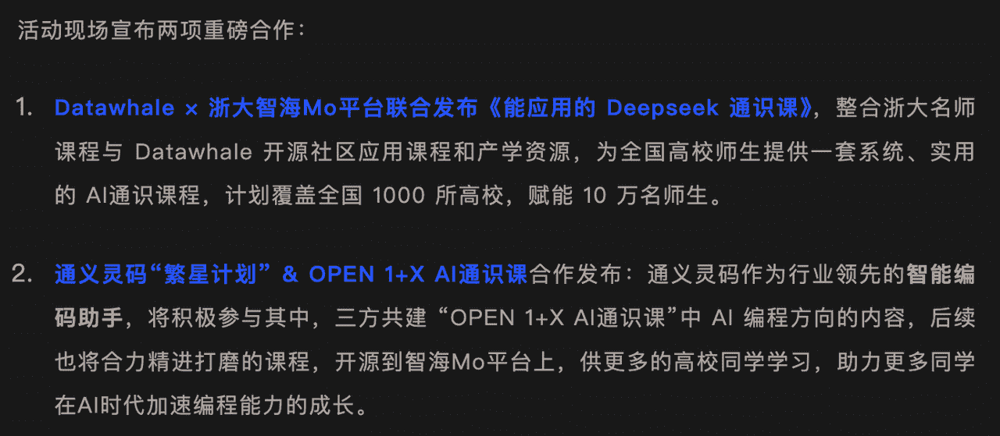
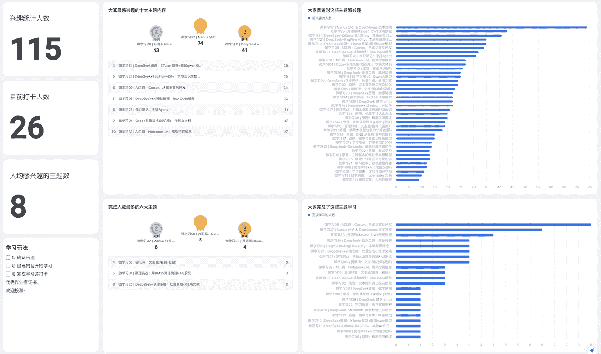

# 更新历史 | OPEN 1+X AI通识课

> 来源：[https://datawhaler.feishu.cn/docx/Hxl3daOfaoK6AzxX04JcDQKxnDc](https://datawhaler.feishu.cn/docx/Hxl3daOfaoK6AzxX04JcDQKxnDc)

## 近期更新

<https://datawhaler.feishu.cn/sync/L7NkdvyX3sLqPAbFcW7cCstRneg>

## 更新列表

| 日期 | 更新板块 | 更新内容 |
| --- | --- | --- |
| 2025.3.18 | **OPEN 1+X** 【[**AI微学习**](https://datawhaler.feishu.cn/share/base/dashboard/shrcnJ1u9f1vXRkUSLkBYWifKqf)】 | [**OPEN 1+X 微学习指南**](https://datawhaler.feishu.cn/share/base/dashboard/shrcnJ1u9f1vXRkUSLkBYWifKqf)** **更新 |
| 2025.3.18 | **OPEN 1+X** **【**[**共建指南**](https://datawhaler.feishu.cn/share/base/dashboard/shrcnFlngxxIYjJHLVHvzO9hg8e)**】** | [**OPEN 1+X 共建指南**](https://datawhaler.feishu.cn/share/base/dashboard/shrcnFlngxxIYjJHLVHvzO9hg8e) 更新 |
| 2025.3.17 | **OPEN 1+X** **【**[**共建指南**](https://datawhaler.feishu.cn/share/base/dashboard/shrcnFlngxxIYjJHLVHvzO9hg8e)**】** | [OPEN 1+X 共建研讨会：每周一晚](https://datawhaler.feishu.cn/wiki/JMzgwtOBhiF8woksLIdcPbBvnzf?table=tblUf7zCmZlEFF7N&amp;view=vewMMZ564l#share-P1rvddyk6oKOQ2xWFcecspWZneg) NO.15 会议纪要 |
| 2025.3.14 | **OPEN 1+X** 【[**AI微学习**](https://datawhaler.feishu.cn/share/base/dashboard/shrcnJ1u9f1vXRkUSLkBYWifKqf)】 | 🐜 O**P**EN 1+X 微学习 NO.3 新增38篇内容 |
| 2025.3.10 | **OPEN 1+X** **【**[**共建指南**](https://datawhaler.feishu.cn/share/base/dashboard/shrcnFlngxxIYjJHLVHvzO9hg8e)**】** | [OPEN 1+X 共建研讨会：每周一晚](https://datawhaler.feishu.cn/wiki/JMzgwtOBhiF8woksLIdcPbBvnzf?table=tblUf7zCmZlEFF7N&amp;view=vewMMZ564l#share-P1rvddyk6oKOQ2xWFcecspWZneg) NO.14 会议纪要 |
| 2025.3.10 | **OPEN 1+X** 【[**AI微学习**](https://datawhaler.feishu.cn/share/base/dashboard/shrcnJ1u9f1vXRkUSLkBYWifKqf)】 | [OPEN 1+X AI通识微学习 NO.2](https://datawhaler.feishu.cn/wiki/JMkDw6z6EiZUS9kDtGgcioCknSz)发布，38篇内容 |
| 2025.3.3 | **OPEN 1+X** **【**[**共建指南**](https://datawhaler.feishu.cn/share/base/dashboard/shrcnFlngxxIYjJHLVHvzO9hg8e)**】** | [OPEN 1+X 共建研讨会：每周一晚](https://datawhaler.feishu.cn/wiki/JMzgwtOBhiF8woksLIdcPbBvnzf?table=tblUf7zCmZlEFF7N&amp;view=vewMMZ564l#share-P1rvddyk6oKOQ2xWFcecspWZneg) NO.13 会议纪要 |
| 2025.3.1 | **OPEN 1+X** 【[**AI微学习**](https://datawhaler.feishu.cn/share/base/dashboard/shrcnJ1u9f1vXRkUSLkBYWifKqf)】 | [OPEN 1+X AI通识微学习 NO.1](https://datawhaler.feishu.cn/wiki/KqrBwmiZdi89sRkNWaPc6xKInQd)发布，19篇内容 |
| 2025.2.24 | **OPEN 1+X** **【**[**共建指南**](https://datawhaler.feishu.cn/share/base/dashboard/shrcnFlngxxIYjJHLVHvzO9hg8e)**】** | [OPEN 1+X 共建机会池](https://datawhaler.feishu.cn/wiki/XiavwQSJ6iMyf6kdBPicdNWGnBJ) |
| 2025.2.17 | **OPEN 1+X** **【**[**共建指南**](https://datawhaler.feishu.cn/share/base/dashboard/shrcnFlngxxIYjJHLVHvzO9hg8e)**】** | [OPEN 1+X 共建研讨会：每周一晚](https://datawhaler.feishu.cn/wiki/JMzgwtOBhiF8woksLIdcPbBvnzf?table=tblUf7zCmZlEFF7N&amp;view=vewMMZ564l#share-P1rvddyk6oKOQ2xWFcecspWZneg)NO.11 会议纪要 |
| 2025.2.10 | **OPEN 1+X** **【**[**共建指南**](https://datawhaler.feishu.cn/share/base/dashboard/shrcnFlngxxIYjJHLVHvzO9hg8e)**】** | [OPEN 1+X 共建研讨会：每周一晚](https://datawhaler.feishu.cn/wiki/JMzgwtOBhiF8woksLIdcPbBvnzf?table=tblUf7zCmZlEFF7N&amp;view=vewMMZ564l#share-P1rvddyk6oKOQ2xWFcecspWZneg)NO.10 会议纪要 |
| 2025.1.20 | **OPEN 1+X** 【[**AI微学习**](https://datawhaler.feishu.cn/share/base/dashboard/shrcnJ1u9f1vXRkUSLkBYWifKqf)】 | [5.2 国内智能体工具介绍与使用_浩远](https://datawhaler.feishu.cn/wiki/LR8lw4v6tiYedEkDoVgcLaaGnCh) |
|  | OPEN 1+X **【****学习内容****】**| 零基础版 第** 六 **章 | [AIGC办公应用实践之时序分析和相关性分析](https://datawhaler.feishu.cn/wiki/A8aZwDVwDiGvPIknRz5ceKCknbe) |
| 2025.1.13 | **OPEN 1+X** **【**[**共建指南**](https://datawhaler.feishu.cn/share/base/dashboard/shrcnFlngxxIYjJHLVHvzO9hg8e)**】** | [OPEN 1+X 共建研讨会：每周一晚](https://datawhaler.feishu.cn/wiki/JMzgwtOBhiF8woksLIdcPbBvnzf?table=tblUf7zCmZlEFF7N&amp;view=vewMMZ564l#share-P1rvddyk6oKOQ2xWFcecspWZneg)NO.9会议纪要 |
| 2025.1.6 | OPEN 1+X **【****学习内容****】**| 零基础版 第** 六 **章 | [AIGC应用实践之内容运营](https://datawhaler.feishu.cn/wiki/LLK9wGXfGixQr6kbJSoc1Bxun8b) |
|  | **OPEN 1+X** **【**[**共建指南**](https://datawhaler.feishu.cn/share/base/dashboard/shrcnFlngxxIYjJHLVHvzO9hg8e)**】** | [OPEN 1+X AI通识课共建研讨会：每周一晚](https://datawhaler.feishu.cn/wiki/JMzgwtOBhiF8woksLIdcPbBvnzf?table=tblUf7zCmZlEFF7N&amp;view=vewMMZ564l#share-P1rvddyk6oKOQ2xWFcecspWZneg)NO.8会议纪要 |
| 2024.12.30 | **OPEN 1+X** **【**[**共建指南**](https://datawhaler.feishu.cn/share/base/dashboard/shrcnFlngxxIYjJHLVHvzO9hg8e)**】** | [OPEN 1+X AI通识课共建研讨会：每周一晚](https://datawhaler.feishu.cn/wiki/JMzgwtOBhiF8woksLIdcPbBvnzf?table=tblUf7zCmZlEFF7N&amp;view=vewMMZ564l#share-P1rvddyk6oKOQ2xWFcecspWZneg)NO.7会议纪要 |
| 2024.12.23 | **OPEN 1+X** **【**[**共建指南**](https://datawhaler.feishu.cn/share/base/dashboard/shrcnFlngxxIYjJHLVHvzO9hg8e)**】** | [OPEN 1+X AI通识课共建研讨会：每周一晚](https://datawhaler.feishu.cn/wiki/JMzgwtOBhiF8woksLIdcPbBvnzf?table=tblUf7zCmZlEFF7N&amp;view=vewMMZ564l#share-P1rvddyk6oKOQ2xWFcecspWZneg)NO.6会议纪要 |
| 2024.12.14 | OPEN 1+X **【****学习内容****】**| 零基础版 第** 二 **章 | [prompt教程](https://datawhaler.feishu.cn/wiki/Ursvwy2rTiQfKVkStBicigvGn3f) |
|  | OPEN 1+X **【****学习内容****】**| 零基础版 第** 二 **章 | [AI文本工具介绍与使用方法](https://datawhaler.feishu.cn/wiki/OnvkwnUqhinm04k44YRcx4cxncg) |
|  | **OPEN 1+X** **【**[**共建指南**](https://datawhaler.feishu.cn/share/base/dashboard/shrcnFlngxxIYjJHLVHvzO9hg8e)**】** | [写作经验：AI工作流](https://datawhaler.feishu.cn/wiki/HP4nwtkUQiH96nkmuyKcoJ5tnQd) |
| 2024.12.10 | AI通识课**【****学习内容****】**| 零基础版 第** 三 **章 | [国内文生图/视频AI工具介绍与使用](https://datawhaler.feishu.cn/wiki/HIdUwUzNBiiptlkf32qc2F96n2z) |
| 2024.12.9 | **OPEN 1+X** **【**[**共建指南**](https://datawhaler.feishu.cn/share/base/dashboard/shrcnFlngxxIYjJHLVHvzO9hg8e)**】** | [OPEN 1+X AI通识课共建研讨会：每周一晚](https://datawhaler.feishu.cn/wiki/JMzgwtOBhiF8woksLIdcPbBvnzf)NO.4 会议纪要 |
| 2024.12.7 | AI通识课**【****学习内容****】**| 零基础版 第** 五 **章 | [智能体工具介绍与使用](https://datawhaler.feishu.cn/wiki/Aud7wFRcEiisfdkk5fJcFX9JnZY) |
| 2024.12.6 | **OPEN 1+X** **【**[**共建指南**](https://datawhaler.feishu.cn/share/base/dashboard/shrcnFlngxxIYjJHLVHvzO9hg8e)**】** | [通识课写作经验汇总](https://datawhaler.feishu.cn/wiki/AoD6wmIusi3BJ7ky8rzc6Gu5neb) |
| 2024.12.5 | AI通识课**【****学习内容****】**| 零基础版 第** 二 **章 | [智能体工具介绍与使用](https://datawhaler.feishu.cn/wiki/Aud7wFRcEiisfdkk5fJcFX9JnZY) |
|  | AI通识课**【****学习内容****】**| 零基础版 第** 五 **章 | [AI文本工具介绍与使用方法](https://datawhaler.feishu.cn/wiki/OnvkwnUqhinm04k44YRcx4cxncg) |
| 2024.12.4 | AI通识课**【****学习内容****】**| 零基础版 第** 二 **章 | [文本提示词工程&amp;优化方法](https://datawhaler.feishu.cn/wiki/Ieg8w9iYZiNVFMkab6Bch3nKnAh) |
|  | AI通识课**【****学习内容****】**| 零基础版 第** 五 **章 | [智能体设计思路与技巧](https://datawhaler.feishu.cn/wiki/DZPSwyKv0ibAbfk5knqcQYupnXe) |
|  | AI通识课**【****学习内容****】**| 零基础版 第** 二 **章 | [大模型原理](https://datawhaler.feishu.cn/wiki/L7ZMw2fcNiJuFZkNNBMc0Fk4nyb) |
|  | AI通识课**【****学习内容****】**| 零基础版 第** 五 **章 | [智能体原理介绍](https://datawhaler.feishu.cn/wiki/XsuGwc9Y4iyUJUkyiNpcnXAcnPf) |
|  | AI通识课**【****学习内容****】**| 有编程基础版 第** 五 **章 | [深度学习介绍_王茂霖](https://datawhaler.feishu.cn/wiki/DTkTwg8NZi0WAmklAV9cteD0nRe) |
| 2024.12.3 | AI通识课**【****学习内容****】**| 零基础版 第** 三 **章 | [ 文生图/视频模型原理简介](https://datawhaler.feishu.cn/wiki/CnoGwxotwimoGPk15tEc0DzWngd) |
|  | AI通识课**【****学习内容****】**| 零基础版 第** 四 **章 | [语音识别/合成模型原理简介](https://datawhaler.feishu.cn/wiki/Ga0Pwa5nPicJ3jkIo6iclMvpn7d) |
| 2024.12.2 | **OPEN 1+X** **【**[**共建指南**](https://datawhaler.feishu.cn/share/base/dashboard/shrcnFlngxxIYjJHLVHvzO9hg8e)**】** | [教程撰写总结](https://datawhaler.feishu.cn/wiki/YbvKwY2HCiYS8TkMJqOci9P8ntf) |
|  | **OPEN 1+X** **【**[**共建指南**](https://datawhaler.feishu.cn/share/base/dashboard/shrcnFlngxxIYjJHLVHvzO9hg8e)**】** | [OPEN 1+X AI通识课共建研讨会](https://datawhaler.feishu.cn/wiki/JMzgwtOBhiF8woksLIdcPbBvnzf)NO.3 会议纪要 |
| 2024.12.2 | AI通识课**【****学习内容****】**| 零基础版 第** 三 **章 | [图像提示词工程与优化方法](https://datawhaler.feishu.cn/wiki/Gt7WwP4zliCgDukmBZFcAkrBnBf) |
|  | AI通识课**【****学习内容****】**| 零基础版 第** 一 **章 | [人工智能安全介绍](https://datawhaler.feishu.cn/wiki/OaOPwUOmPiCUUmky4apcxMswnFf) |
|  | AI通识课**【****学习内容****】**| 零基础版 第** 一 **章 | [人工智能伦理介绍](https://datawhaler.feishu.cn/wiki/ECtKwrTpXiQSjwkuvi1cSy9NnHc) |
|  | AI通识课**【****学习内容****】**| 零基础版 第** 四 **章 | [ 国内语音识别/合成AI工具介绍与使用](https://datawhaler.feishu.cn/wiki/OSS5wycj7iUeZDk2hKjcU1sDn6f) |
| 2024.12.1 | AI通识课**【****分享笔记****】**| 有编程基础版 第** 二 **章 | [信息技术基础：信息论、数字信号&amp;图像处理](https://datawhaler.feishu.cn/wiki/Wav2w8a7DiWzXkkDSw8cbs3Hnwf) |
|  | AI通识课**【****分享笔记****】**|  零基础版 第** 三 **章 | [国内文生图/视频AI工具介绍与使用](https://ycnosmsebbdf.feishu.cn/docx/T8N0dtgAXolYlqx4VC4cJ8RwnAb) |
| 2024.11.29 | AI通识课**【****分享笔记****】**| 零基础版 第** 一 **章 | [学习内容 | 第一章：人工智能导论](https://datawhaler.feishu.cn/wiki/ZuKZwaSNOimAaikBKlnc3HwunRf)_V 1.0 上线 |

## 更多历史更新

> **2025.3.18**：微学习第三期作业评选结束——

+   [**打卡16人、优秀学习者4名**](https://datawhaler.feishu.cn/share/base/dashboard/shrcnJ1u9f1vXRkUSLkBYWifKqf)：与兼、张辉、Chengdz、charlotte

+   **OPEN 1+X 微学习指南**** **更新：https://datawhaler.feishu.cn/share/base/dashboard/shrcnJ1u9f1vXRkUSLkBYWifKqf

+   **OPEN 1+X 共建指南** 更新：https://datawhaler.feishu.cn/share/base/dashboard/shrcnFlngxxIYjJHLVHvzO9hg8e

> **2025.3.17**：OPEN 1+X 共建研讨会 NO.15 开展

+   **聚焦主题**：Un-AI活动经验分享 、创作经验分享（PPT制作 + 教程制作）

> **2025.3.16**：**《能应用的DeepSeek通识课》发布、**OPEN 1+X AI通识课合作伙伴+1

+   《能应用的DeepSeek通识课》发布：Datawhale x 浙大智海Mo，约3.23日后正式开课！

+   恭喜OPEN 1+X AI通识课合作伙伴+1：通义灵码

+   AI+X高校行又去浙大啦！

+   更多详见公众号发布：https://mp.weixin.qq.com/s/3FqJ56rwlpWQJNqaMEDGkA

> **2025.3.14**：微学习第三期新增31篇学习内容

+   **涉及主题**：DeepSeek、Agent、AI底层原理、编程/应用开发、AI工具、RAG、AI+编程、AI for Science等

+   **创作团队（25人）**：晋宁波、孙博辰、Dennis、小槐花、浩婷、培风、安那其、刘振亚、钱皓亮、LTA、筱可、黄晨宇、文熠、馨怡、何瑞杰、马世拓、同济子豪兄、陈睿、吴傲、曹泽、黄渃昀、蔡鋆捷、枕泉、郭才高、Ethanwhh

+   **欢迎大家踊跃**投稿或加入创作交流群，下一期微学习创作者也许就有你！：https://datawhaler.feishu.cn/share/base/form/shrcn13VsORqTwbGqOXKJLuhYqc

+   更多详情可联系

> **2025.3.12**：[OPEN 1+X AI通识微学习 NO.2](https://datawhaler.feishu.cn/wiki/JMkDw6z6EiZUS9kDtGgcioCknSz)结束、优秀作业评选出炉

+   优秀学习者名单（10人，点击可查看优秀作业）：丁梦媛、devinyin、nible、韩大瑞、与兼、肥肥、倪飞、赵女士、王影、Gadfly

+   **打卡名单（26人）**：CK、枫、啊飞、丁梦媛、路路、devinyin、兰兰、nible、韩大瑞、与兼、chengdz、charlotte、马晓菲、黑暗伏击龙王、沈明辉、肥肥、倪飞、枕泉、Sylvia、何成、TT、汉堡、赵女士、陌间君、王影、Gadfly

+   **最受瞩目的学习内容是**：微学习37 | Manus 分析 & OpenManus 技术方案，共74人感兴趣

+   **学习者完成人数最高的内容是**：微学习09 | AI工具：Cursor，从读论文到开发，共8人完成学习

> **2025.3.10**：OPEN 1+X 共建研讨会 NO.14 开展

+   **聚焦主题**：DeepSeek通识课建设、Datawhale媒体平台投稿、OPEN 1+X AI微学习

+   欢迎大家踊跃投稿或加入创作交流群，下一期微学习创作者也许就有你！：https://datawhaler.feishu.cn/share/base/form/shrcn13VsORqTwbGqOXKJLuhYqc

+   更多详情可联系

> **2025.3.9**：[OPEN 1+X AI通识微学习 NO.2](https://datawhaler.feishu.cn/wiki/JMkDw6z6EiZUS9kDtGgcioCknSz)开展

+   本期共计**38个**学习内容，其中**manus**相关**2个**，**DeepSeek**相关**10个**

+   **创作者（21人）**：余衫马、安那其、陈晨、尼尼、马世拓、筱可、杨冰楠、星星、汪、高源、鲁力、陈辅元、Zgh_332、小揭、张龙斐、刘振亚、周景林、陈嘉诺、珞索、曹泽、章佳辉(沫兮)/monoy

+   **合作组织**：OpenManus，CAMEL AI

> **2025.3.4**：[OPEN 1+X AI通识微学习 NO.1](https://datawhaler.feishu.cn/wiki/KqrBwmiZdi89sRkNWaPc6xKInQd)快闪优秀学习者出炉~

+   优秀学习者：**张辉、Molly、洋洋洋****、**与兼、王影、Gadfly、Yike

+   优秀作业查看：https://datawhaler.feishu.cn/share/base/view/shrcnETuHfRfpCYC7PPCd2XtG0b

> **2025.3.3**：OPEN[OPEN 1+X AI通识微学习 NO.1](https://datawhaler.feishu.cn/wiki/KqrBwmiZdi89sRkNWaPc6xKInQd)1+X 共建研讨会 NO.13 开展、  快闪结束~

+   OPEN 1+X 共建研讨会 NO.13 开展~

+   会上交流了最新趋势：**DeepSeek通识课**

+   共建组进行了第一波流出、目前共建组成功投稿的创作者共计 45人、54份新学习内容在开发中~

+   [OPEN 1+X AI通识微学习 NO.1](https://datawhaler.feishu.cn/wiki/KqrBwmiZdi89sRkNWaPc6xKInQd) 第一期快闪共计37人打卡~

> **2025.3.1**：OPEN 1+X 微学习第一期成功展开

+   [OPEN 1+X AI通识微学习 NO.1](https://datawhaler.feishu.cn/wiki/KqrBwmiZdi89sRkNWaPc6xKInQd)

+   第一期总计19个学习内容，3月3日打卡截止（统计优秀作业）

> **2025.1.20**：内容新增！

+   **【学习内容】**新增：[AIGC办公应用实践之时序分析和相关性分析](https://datawhaler.feishu.cn/wiki/A8aZwDVwDiGvPIknRz5ceKCknbe)，贡献者

+   **【学习内容】**新增：[5.2 国内智能体工具介绍与使用_浩远](https://datawhaler.feishu.cn/wiki/LR8lw4v6tiYedEkDoVgcLaaGnCh)，贡献者 @张浩远

> **2025.1.13**：共建研讨会NO.9 顺利开展~

+   **重要观点**：

+   **教程需要** 整体规划、统筹内容迭代**；可以**拆分为 **项目开发** 和 **学习组织** 大的模块

+   有没有可能有教研和其他角色协助，让内容更方便地体系化和迭代

+   OPEN 1+X AI通识课共建历程回顾

+   **更多详情**：

+   **会议记录**详见：[OPEN 1+X 共建研讨会：每周一晚](https://datawhaler.feishu.cn/wiki/JMzgwtOBhiF8woksLIdcPbBvnzf?table=tblUf7zCmZlEFF7N&view=vewMMZ564l#share-PprNdgn3XoHdtqxNcklcgKhMn7b)

+   [**点击查看会议录制**](https://meeting.tencent.com/crm/NodBzzjr48)

> **2025.1.6**：内容新增 & 共建研讨会NO.8

+   【**学习内容**】新增：[AIGC应用实践之内容运营](https://datawhaler.feishu.cn/wiki/LLK9wGXfGixQr6kbJSoc1Bxun8b)，贡献者

+   **重要观点**：

+   **AI百问百答 **项目负责人 **想招募会提问的人** 和 **写内容的人** 参与项目建设

+   **@皓亮** 在参加冬令营后，想基于《聪明办法学Python》补充相关编程基础

+   符合**P2S项目核心团队**的目标人群，希望能组织组队学习，探索 AI+P2S 的可能性，

+   以及收集更多目标人群对教程的反馈，推动教程迭代更新

+   面向老年人的人工智能通识课，**主题可以是 ****AI辅助生活**

+   **更多详情**：

+   **会议记录**详见：[OPEN 1+X AI通识课共建研讨会：每周一晚](https://datawhaler.feishu.cn/wiki/JMzgwtOBhiF8woksLIdcPbBvnzf)

+   [**点击查看会议录制**](https://meeting.tencent.com/crm/NodBzzjr48)

> **2024.12.30：**共建研讨会NO.7 顺利开展~

+   **重要观点**：

+   目前竞赛类教研团队** = 教程主笔+教程顾**问，可以进一步让优秀的、多元的能力者们合理搭配和分工

+   适合 写作、答疑、设计解决方案、时间不足的能力者都可以参与贡献，协作成长

+   开源项目的生命周期要想延长，缺的是能坚持的人，如何让坚持在Dw变得更简单？

+   Dw应该思考如何更好地赋能、帮助项目管理和进展追踪，实现 反馈 + 阶段性激励 的闭环

+   Dw应该思考如何把握技术趋势、预判高潜项目、提前布局

+   **AI通识课可以如何下沉到**乡村教师和孩子？乡村教师面临职业生存压力。

+   目前的AI还只能是一个Copilot，而不能拿来即用，人类需要review和自主思考

+   生存可能需要的是工具，但长期还是需要思考能力和解决问题的能力，

+   学习工具搭建和开发是后面的需求

+   **除了组织学**习，还可以探索“就业学习”，完成学习的闭环，做面试baseline切片、学习面试方法论

+   **更多详情**：

+   **会议记录**详见：[OPEN 1+X AI通识课共建研讨会：每周一晚](https://datawhaler.feishu.cn/wiki/JMzgwtOBhiF8woksLIdcPbBvnzf?table=tblUf7zCmZlEFF7N&view=vewMMZ564l#share-P1rvddyk6oKOQ2xWFcecspWZneg)

+   [**点击查看会议录制**](https://meeting.tencent.com/crm/2rWzdegV2c)

> **2024.12.23：**共建研讨会NO.6 顺利开展~

+   **重要观点**：

+   **数字人讲课、用AI辅助教学**，会是很大空间的方向~

+   北京/杭州/武汉**夜校 + AI通识**课，谁能先建起来？这个需求很值得验证

+   **组队学习 **和 **夏/冬令营 **是很好的收集课程反馈的方式

+   **AI+设计 通识课训练营**，会是比较有“品位”的、有难度的、探索行业能力上限的学习设计

+   **更多详情**：

+   **会议记录**详见：[OPEN 1+X AI通识课共建研讨会：每周一晚](https://datawhaler.feishu.cn/wiki/JMzgwtOBhiF8woksLIdcPbBvnzf?table=tblUf7zCmZlEFF7N&view=vewMMZ564l#share-JYG3df7yLoUlQBxmUikcqyaMnnd)

+   [**点击查看会议录制**](https://meeting.tencent.com/crm/NXR1JmXz7f)

> **2024.12.14**：内容新增 & 更新

+   【**学习内容**】新增：[prompt教程](https://datawhaler.feishu.cn/wiki/Ursvwy2rTiQfKVkStBicigvGn3f)，贡献者 @VV

+   **【学习内容】**更新：[AI文本工具介绍与使用方法](https://datawhaler.feishu.cn/wiki/OnvkwnUqhinm04k44YRcx4cxncg)，贡献者 [@蔡鋆捷](https://ycnosmsebbdf.feishu.cn/wiki/Yh4lwZ6wJiaJcLk4II5cixvxnTe)

+   **【共建指南】**更新：[写作经验：AI工作流](https://datawhaler.feishu.cn/wiki/HP4nwtkUQiH96nkmuyKcoJ5tnQd)，贡献者[@蔡鋆捷](https://ycnosmsebbdf.feishu.cn/wiki/Yh4lwZ6wJiaJcLk4II5cixvxnTe)

> **2024.12.10**：内容更新

+   **【学习内容】**更新：[国内文生图/视频AI工具介绍与使用](https://datawhaler.feishu.cn/wiki/HIdUwUzNBiiptlkf32qc2F96n2z)更新即梦AI海报设计方法，贡献者[@蔡鋆捷](https://ycnosmsebbdf.feishu.cn/wiki/Yh4lwZ6wJiaJcLk4II5cixvxnTe)

> **2024.12.9**：**共建研讨会NO.4** 完美开展！

+   **重要观点**：

+   可以把之前积累的内容梳理成知识地图，对应融入通识课，并查漏补缺

+   OPEN 1+X AI通识课 = 底层通**识课（完全打基础**的必备AI相关通识）+  O、P、E、N 系列课程，

扩展 **场景、学科、职业 （X）**等路线，完成整体能力培养

之前的[**人工智能培养方案**](https://datawhaler.feishu.cn/wiki/FFNHwwyw7ilUs7ktS97cTYKSnUg)，更多是N系列的+学科、+职业的培养路径

+   来立Flag！你要写什么内容？！

+   **更多详情**：

+   **会议记录**详见：[OPEN 1+X AI通识课共建研讨会：每周一晚](https://datawhaler.feishu.cn/wiki/JMzgwtOBhiF8woksLIdcPbBvnzf)

+   点击查看AI通识课共建研讨会NO.4的录制

>

> 下一场共建研讨会，你想聊什么呢？

> **2024.12.7**：内容更新

+   **【学习内容】**更新：[智能体工具介绍与使用](https://datawhaler.feishu.cn/wiki/Aud7wFRcEiisfdkk5fJcFX9JnZY)更新使用案例，贡献者[@蔡鋆捷](https://ycnosmsebbdf.feishu.cn/wiki/Yh4lwZ6wJiaJcLk4II5cixvxnTe)

> **2024.12.6**：下周研讨会议题开始征集啦~ 第一章V1内容等你反馈和建议！

+   【**共建研讨会**】详见：[OPEN 1+X AI通识课共建研讨会：每周一晚](https://datawhaler.feishu.cn/wiki/JMzgwtOBhiF8woksLIdcPbBvnzf)

+   【**QA与反馈**】收集详见：[第一章V1建议收集列表](https://datawhaler.feishu.cn/wiki/RssVwJifoihcS7kcJCYcxPWMnve)

+   【**共建指南**】新增：[通识课写作经验汇总](https://datawhaler.feishu.cn/wiki/AoD6wmIusi3BJ7ky8rzc6Gu5neb)，贡献者[@蔡鋆捷](https://ycnosmsebbdf.feishu.cn/wiki/Yh4lwZ6wJiaJcLk4II5cixvxnTe)

> **2024.12.5**：内容新增！绝不断更！

+   **【学习内容】**新增：[AI文本工具介绍与使用方法](https://datawhaler.feishu.cn/wiki/OnvkwnUqhinm04k44YRcx4cxncg)，贡献者 [@蔡鋆捷](https://ycnosmsebbdf.feishu.cn/wiki/Yh4lwZ6wJiaJcLk4II5cixvxnTe)

+   **【学习内容】**新增：[智能体工具介绍与使用](https://datawhaler.feishu.cn/wiki/Aud7wFRcEiisfdkk5fJcFX9JnZY)，贡献者 [@蔡鋆捷](https://ycnosmsebbdf.feishu.cn/wiki/Yh4lwZ6wJiaJcLk4II5cixvxnTe)

> **2024.12.4**：今晚有直播！内容新增

+   **AI通识课第一讲开播啦！！！**

+   **今晚(周三) 20:00：**AI通识课第一讲开播啦！！！（日后每周三晚不见不散！）

+   **主题**：《你不了解的人工智能前世今生》

+   **分享嘉宾**：AI通识课第一章优秀贡献者  、[@蔡鋆捷](https://ycnosmsebbdf.feishu.cn/wiki/Yh4lwZ6wJiaJcLk4II5cixvxnTe)、@罗清泉

+   【**学习内容】**新增：[深度学习介绍_王茂霖](https://datawhaler.feishu.cn/wiki/DTkTwg8NZi0WAmklAV9cteD0nRe)，贡献者 @王茂霖

+   **【学习内容】**新增：[大模型原理](https://datawhaler.feishu.cn/wiki/L7ZMw2fcNiJuFZkNNBMc0Fk4nyb)，贡献者 [@蔡鋆捷](https://ycnosmsebbdf.feishu.cn/wiki/Yh4lwZ6wJiaJcLk4II5cixvxnTe)

+   **【学习内容】**新增：[智能体原理介绍](https://datawhaler.feishu.cn/wiki/XsuGwc9Y4iyUJUkyiNpcnXAcnPf)，贡献者 [@蔡鋆捷](https://ycnosmsebbdf.feishu.cn/wiki/Yh4lwZ6wJiaJcLk4II5cixvxnTe)

+   **【学习内容】**新增：[文本提示词工程&优化方法](https://datawhaler.feishu.cn/wiki/Ieg8w9iYZiNVFMkab6Bch3nKnAh)，贡献者 [@蔡鋆捷](https://ycnosmsebbdf.feishu.cn/wiki/Yh4lwZ6wJiaJcLk4II5cixvxnTe)

+   【**学习内容**】新增：[智能体设计思路与技巧](https://datawhaler.feishu.cn/wiki/DZPSwyKv0ibAbfk5knqcQYupnXe)，贡献者 [@蔡鋆捷](https://ycnosmsebbdf.feishu.cn/wiki/Yh4lwZ6wJiaJcLk4II5cixvxnTe)

> 2024.12.3：内容新增

+   **【学习内容】**新增：[ 文生图/视频模型原理简介](https://datawhaler.feishu.cn/wiki/CnoGwxotwimoGPk15tEc0DzWngd)，贡献者 [@蔡鋆捷](https://ycnosmsebbdf.feishu.cn/wiki/Yh4lwZ6wJiaJcLk4II5cixvxnTe)

+   **【学习内容】**新增：[语音识别/合成模型原理简介](https://datawhaler.feishu.cn/wiki/Ga0Pwa5nPicJ3jkIo6iclMvpn7d)，贡献者 [@蔡鋆捷](https://ycnosmsebbdf.feishu.cn/wiki/Yh4lwZ6wJiaJcLk4II5cixvxnTe)

> **2024.12.2**：内容新增，**AI通识课共建研讨会** 定期开业啦~

+   **【共建指南】**新增：[教程撰写总结](https://datawhaler.feishu.cn/wiki/YbvKwY2HCiYS8TkMJqOci9P8ntf)，优秀贡献者 为大家分享学习内容写作经验！

+   **【共建指南】**新增：[OPEN 1+X AI通识课共建研讨会](https://datawhaler.feishu.cn/wiki/JMzgwtOBhiF8woksLIdcPbBvnzf)**NO.3 会议纪要**，每周一晚，不见不散！

> **2024.12.2**：内容新增

+   **【学习内容】**新增：[图像提示词工程与优化方法](https://datawhaler.feishu.cn/wiki/Gt7WwP4zliCgDukmBZFcAkrBnBf)，贡献者 [@蔡鋆捷](https://ycnosmsebbdf.feishu.cn/wiki/Yh4lwZ6wJiaJcLk4II5cixvxnTe)

+   **【学习内容】**新增：[人工智能安全介绍](https://datawhaler.feishu.cn/wiki/OaOPwUOmPiCUUmky4apcxMswnFf)，贡献者 [@蔡鋆捷](https://ycnosmsebbdf.feishu.cn/wiki/Yh4lwZ6wJiaJcLk4II5cixvxnTe)

+   **【学习内容】**新增：[人工智能伦理介绍](https://datawhaler.feishu.cn/wiki/ECtKwrTpXiQSjwkuvi1cSy9NnHc)，贡献者 [@蔡鋆捷](https://ycnosmsebbdf.feishu.cn/wiki/Yh4lwZ6wJiaJcLk4II5cixvxnTe)

+   **【学习内容】**新增：[ 国内语音识别/合成AI工具介绍与使用](https://datawhaler.feishu.cn/wiki/OSS5wycj7iUeZDk2hKjcU1sDn6f)，贡献者 [@蔡鋆捷](https://ycnosmsebbdf.feishu.cn/wiki/Yh4lwZ6wJiaJcLk4II5cixvxnTe)

> **2024.12.1**：内容新增，知识库改版后迎来第一位内容贡献者！

+   **【分享笔记】**新增**：**** **[国内文生图/视频AI工具介绍与使用](https://ycnosmsebbdf.feishu.cn/docx/T8N0dtgAXolYlqx4VC4cJ8RwnAb)，贡献者 [@蔡鋆捷](https://ycnosmsebbdf.feishu.cn/wiki/Yh4lwZ6wJiaJcLk4II5cixvxnTe)

+   **【分享笔记】**新增：[信息技术基础：信息论、数字信号&图像处理](https://datawhaler.feishu.cn/wiki/Wav2w8a7DiWzXkkDSw8cbs3Hnwf)，贡献者 [@蔡鋆捷](https://ycnosmsebbdf.feishu.cn/wiki/Yh4lwZ6wJiaJcLk4II5cixvxnTe)

+   **【贡献者福利】**[：新增内容贡](https://datawhaler.feishu.cn/wiki/LuIVwkmFYiD0RlknbRUcw7KYnBe#QaFcdv6dmoEOcTxfSmFcBnNDnOg)献者贡献汇总展示，详见【共建榜单】

> **2024.11.29**：AI+X 学习指南 升级为 [OPEN 1+X AI通识课](https://datawhaler.feishu.cn/wiki/X9AVwtmvyi87bIkYpi2cNGlIn3v)

+   ** **[OPEN 1+X AI通识课共建指南](https://datawhaler.feishu.cn/wiki/LuIVwkmFYiD0RlknbRUcw7KYnBe)：AI通识课飞书快速迭代版 初上线，期待你来共建~

+   **零**基础版第一章：人工智能导论【学习内容】V1.0 已ready，期待你的学习和反馈！

+   第一章V1.0内容由 统筹，感谢19位内容贡献者（蔡鋆捷、罗清泉、杨晨旭等）

+   感谢16位内测反馈读者（刘越、胡锐锋、张岭云等）给出中肯的阅读反馈和建议！

+   贡献者名单详见：[致谢AI通识课贡献者们](https://datawhaler.feishu.cn/wiki/HnMiwEzpdiLvWRkfbvFcaJFLnSg?table=tblUf7zCmZlEFF7N&view=vewMMZ564l)

+   第一章V1.0内容已更新至官网：https://www.datawhale.cn/learn/summary/30