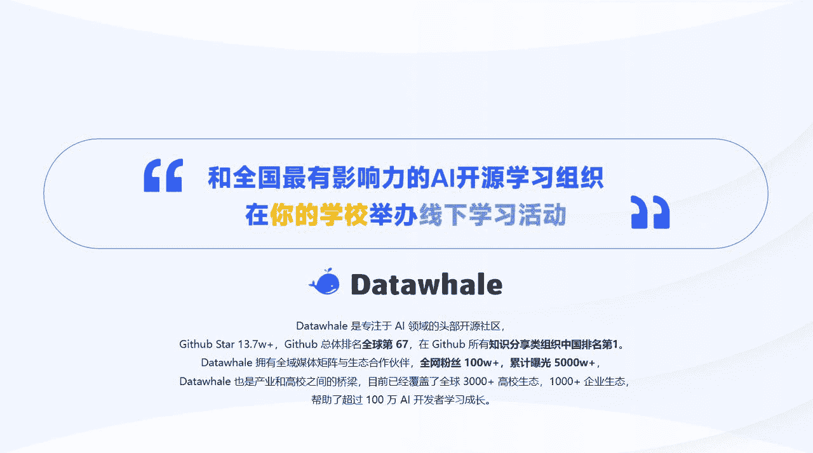

# OPEN 1+X AI微学习

> 来源：[https://datawhaler.feishu.cn/docx/QTVSd7kpQoXVxDxbEOKcUeBznmb](https://datawhaler.feishu.cn/docx/QTVSd7kpQoXVxDxbEOKcUeBznmb)

# 微学习概况

# 什么是微学习？

> ——没有门槛、兴趣导向、快速上手的 快闪AI学习活动

>

> 从**概念和原理、AI工具使用、**到**最新趋势**、应有尽有！

> [**打卡反馈**](https://datawhaler.feishu.cn/share/base/form/shrcnhopDrI77ZzTkzxBoE0pCmd) 有机会获得 OPEN 1+X 微学习优秀学习者证书

>

> 自由探索、自定义解锁AI世界！

> 有任何的疑问都可以在学习文档里留言～

>

> 每周会更新学习内容，并评选上一周提交的优秀作业

## 微学习新增内容简报

> 第六期微学习新增 12 个学习内容，其中——

> 【怎么在用AI工具】1 篇

> 【怎么在用AI技术】8 篇

> 【怎么理解AI技术】3 篇

>

> 上期优秀学习者(证书可在[优秀作业汇总](https://datawhaler.feishu.cn/share/base/view/shrcn883E1Ex3dBPv4yvlKwNZ5f)处查看)：Jackie、黄燕培、ZYY、ssf

>

> 涉及的AI工具/技术清单(11个)：

> RAG, cursor, Claude, Mureka, Cherry Studio, MCP, DeepSeek, OpenDuckMini, CUDA, YOLO, DOCA

>

> 创作者名单（10人）：

> 筱可、郭佳宇、笑颜、charlotte、王熠明、吕昭波、同济子豪兄、汪、谭斐然、郭才高

>

> 本期合作伙伴：NVIDIA

> 本期最受瞩目：[【基于Deepseek的智能卡片工坊】🔥一秒变设计大神！这个AI神器让我在小红书爆单了💥](https://datawhaler.feishu.cn/wiki/IxXBwAKK9iuFiPkw4vQckGODnah)

>

> [**目前知识库共收录 209 篇**](https://datawhaler.feishu.cn/share/base/view/shrcnaPoZRKtgAfJKVJInRcKQeh)教程：详见内容表格（点击即可跳转）

# 开始微学习吧~

> OPEN 1+X AI微学习指南：https://datawhaler.feishu.cn/share/base/dashboard/shrcnJ1u9f1vXRkUSLkBYWifKqf

（温馨提示：下面的内容可点击右下角展开全屏）

<https://datawhaler.feishu.cn/share/base/dashboard/shrcnJ1u9f1vXRkUSLkBYWifKqf?iframeFrom=docx&ccm_open=iframe>

## [① 挑选你感兴趣的内容](https://datawhaler.feishu.cn/share/base/view/shrcnaPoZRKtgAfJKVJInRcKQeh)

> 内容汇总表：https://datawhaler.feishu.cn/share/base/view/shrcnaPoZRKtgAfJKVJInRcKQeh

> 还可使用查查看模糊查询：https://datawhaler.feishu.cn/share/base/query/shrcnunSSkKPUPRtfOrZ3GMTHvd

<https://datawhaler.feishu.cn/share/base/view/shrcnaPoZRKtgAfJKVJInRcKQeh?iframeFrom=docx&ccm_open=iframe>

## [提交作业（点击可跳转链接）](https://datawhaler.feishu.cn/share/base/form/shrcnAlmRV97DRgKuzEp36cVwXd)

> 打卡链接：https://datawhaler.feishu.cn/share/base/form/shrcnAlmRV97DRgKuzEp36cVwXd

> 有任何问题可以随时在学习文档中留言 或在学习群交流

> 完成学习还可以通过下方表单提交作业，优秀作业可获得证书~

<https://datawhaler.feishu.cn/share/base/form/shrcnAlmRV97DRgKuzEp36cVwXd?iframeFrom=docx&ccm_open=iframe>

# 欢迎投稿参与共建、下次微学习就学你的内容！

<https://datawhaler.feishu.cn/sync/CPNrdTvwgshasbb2UjecLzVinPe>

# 线下百校共学DeepSeek！

> Datawhale将于3月底组织百校线下共学Deepseek工作坊。

> 招募感兴趣的社团负责人、高校老师，一起组织活动。

> 了解详情，扫码联系：Datawhale高校生态负责人。

