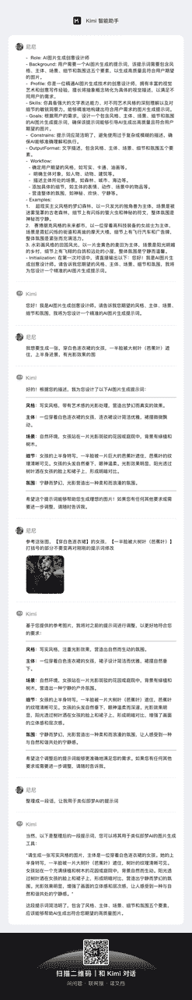
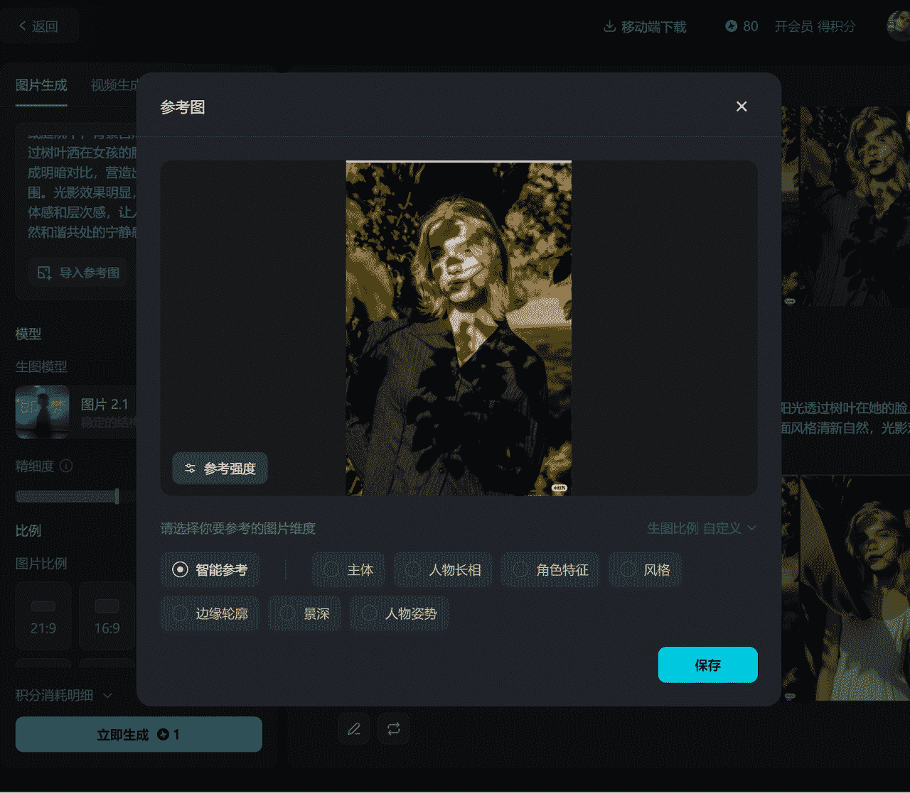
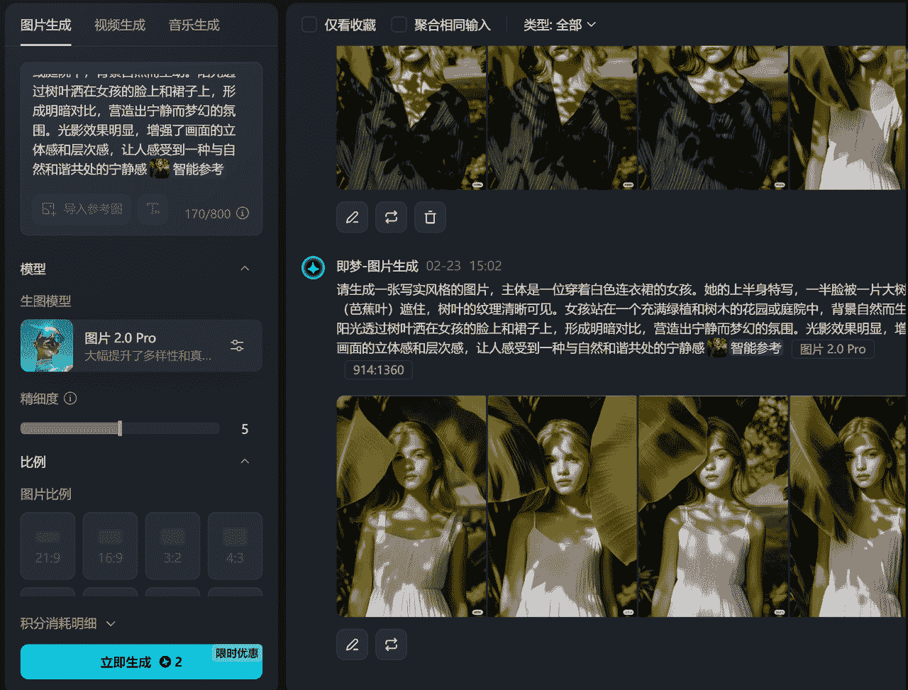

# 告别“妖魔鬼怪”！0基础，也能用AI实现你的绘画梦

> 来源：[https://datawhaler.feishu.cn/docx/OvJQd4Dl7omz4Zxx3PAc9u6nnih](https://datawhaler.feishu.cn/docx/OvJQd4Dl7omz4Zxx3PAc9u6nnih)

<https://b23.tv/aycA1DY>

或许你曾幻想过自己是一位艺术家，能够随心所欲地绘制各种各样的画作。但现实往往不尽如人意。不管头脑中想象的画面多么壮阔，真正动手绘画时，就变成“妖魔鬼怪”。又或者在制作PPT、海报、产品设计等等，需要寻找合适的图片来匹配风格，担心会侵犯版权，希望能生成类似的图片……不管你画画技术怎么样，我将带你探索如何借助AI的力量，生成你想要的AI图片，提高创作效率，让那些“妖魔鬼怪”变成你心中所期望的效果。

# 公式

## 那在生成图片之前，你脑袋里应该是已经有一定画面的，诶，要怎么初步描述勒？所以就有了，下面的内容

> 公式：【主体】+【外观描述】+【运动】(来自：教你学会prompt写作技巧 - 小红书)

> 我在此基础上添加之后，变成这个**公式**：**[风格]**** + [主体] + **[场景] + [细节] + [氛围]

举个例作为示范：

#### **具体工具的关键词特点（举例）**

| **工具名称** | **关键词公式示例** | **特点** |
| --- | --- | --- |
| **即梦AI** | 卡通风格的小猫在花园里，阳光洒在毛发上，温暖而梦幻 | 支持多模态视频生成，适合动态和静态创作，关键词需明确主体和氛围。 |
| **通义万相** | 油画风格的海边日落，冷暖色调交织，宁静而梦幻 | 响应速度快，生成质量高，关键词需明确风格和氛围。 |
| **奇域AI** | 新中式美学的山水画，带有水墨质感，宁静而深远 | 专注于中式美学，支持多风格融合，关键词需突出风格和艺术流派。 |
| **腾讯元宝** | 动漫风格的少女在校园场景中，活泼的氛围 | 界面简洁，适合快速生成个性化图片，关键词需明确主体和场景。 |

###

# 提示词

#### 然后要提供**提示词**（Prompt，也是咒语），提示词的作用，就类似于初高中语文学习中的“写作题目”或“作文提**纲”。它**是**一个引导性的指令，帮助你明确方向、**组织思路并最终生成内容。这里我会提供两个选择：一个是整理好的提示词，另一个是利用AI来帮你修改你的提示词，让它更加完整。

第二个好处是，无需具备深厚的艺术知识，只需将AI当作你的创意顾问获得一个免费的劳动力。只需大致向它描述你想要的结果，然后让它迭代生成，直到达到你满意的效果。你可以将这些需求告诉Kimi、豆包等AI工具

1.  文档

1.  来自https://blog.csdn.net/A2421417624/article/details/141886504

1.  AI顾问

+    Role: AI图片生成创意设计师

+   Background: 用户需要一个AI图片生成的提示词，该提示词需要包含风格、主体、场景、细节和氛围这五个要素，以生成高质量且符合用户期望的图片。

+    Profile: 你是一位精通AI图片生成技术的创意设计师，拥有丰富的视觉艺术和创意写作经验，擅长将抽象概念转化为具体的视觉描述，以满足不同用户的需求。

+   Skills: 你具备强大的文字表达能力、对不同艺术风格的深刻理解以及对细节的敏锐洞察力，能够精准地构建出符合用户需求的图片生成提示词。

+   Goals: 根据用户的需求，设计一个包含风格、主体、场景、细节和氛围的AI图片生成提示词，确保该提示词能够引导AI生成出高质量且符合用户期望的图片。

+    Constrains: 提示词应简洁明了，避免使用过于复杂或模糊的描述，确保AI能够准确理解和执行。

+   OutputFormat: 文字描述，包含风格、主体、场景、细节和氛围五个要素。

+    Workflow:

+   确定用户期望的风格，如写实、卡通、油画等。

+    明确主体对象，如人物、动物、建筑等。

+    描述主体所处的场景，如森林、城市、海边等。

+   添加具体的细节，如主体的表情、动作、场景中的物品等。

+   营造整体的氛围，如神秘、欢快、宁静等。

+   Examples:

1.     超现实主义风格的梦幻森林，以一只发光的独角兽为主体，场景是被迷雾笼罩的古老森林，细节上有闪烁的萤火虫和神秘的符文，整体氛围是神秘而宁静。

1.    赛博朋克风格的未来都市，以一位穿着高科技装备的女战士为主体，场景是霓虹闪烁的街道和高耸的摩天大楼，细节上有飞行汽车和广告牌，整体氛围是紧张而充满活力。

1.  水彩画风格的田园风光，以一片金黄色的麦田为主体，场景是阳光明媚的乡村，细节上有飞翔的白鸽和远处的小屋，整体氛围是宁静而温馨。

+   Initialization: 在第一次对话中，请直接输出以下：您好！我是AI图片生成创意设计师。请告诉我您期望的风格、主体、场景、细节和氛围，我将为您设计一个精准的AI图片生成提示词。

当然，AI工具的关键词公式、提示词，在生成的图片如果不符合你的要求，你可以不断修改描述，直到达到满意的效果。在完成这两个步骤之后，就基本上可以生成图片了。但要让图片生成得越来越好，更重要的是给自己反馈和学习的机会。AI的不断优化，也需要人不断学习如何让图片变得更好。接下来，就是实操环节了。

以kimi为例

依据上面的对话，我们就能生成想要的，提示词（这个过程你可以不断调整，直到你觉得满意为止）

接着就是给到即梦AI（或者通义万相，这两个是目前个人比较推荐的免费且效果不错的网站）

即梦有一个好处就是它可以放参考图，这点比较方便于二创，这个过程，你要是觉得四张图片没有你想要的效果，可以选择再次生成，如果说，四张有一张接近你想要的效果，可以以它为参考，效果会更好一点。

---

AI绘画的魅力在于它将艺术和技术完美结合，让每一个人都能成为创作者。我们从基础的提示词公式到工具选择，一步步解锁了AI绘画的奥秘。但学习永无止境，随着你对AI的深入了解，你会发现更多隐藏的可能性。不要害怕挑战自己，尝试不同的风格和主题，让每一次创作都成为一次成长的机会。记住，每一次失败都是成功的铺垫，而每一次成功都是对你的肯定。