# Aaron雪松：提示词工程1，前6策略和应用场景

> 来源：[https://datawhaler.feishu.cn/docx/KS2Cdz6IOoIAjDxekKJc2Opdnlb](https://datawhaler.feishu.cn/docx/KS2Cdz6IOoIAjDxekKJc2Opdnlb)

大家好，我是Aaron雪松，搞软件测试的斜杠青年

### 问题和卡点

本次分享开始之前，先来个互动，你觉得AI和你有关吗？

+   感觉工作中还帮不上忙，AI只是一个聊天工具的扣1

+   已经使用AI解决自己工作中的问题的人扣2

+   已经把AI做成一个智能体，并嵌入到自己工作流的扣3

+   已经会用AI开发的人扣4

为什么同样的工具、模型，不同人使用出的结果千差万别?

为什么有的同学总觉得AI的回答不如预期，而有的同学工作已经离不开AI了?

**这背后有一**个核心的影响因素，就是跟AI互动的「提示词技术」

先来明确一下定义:

提示词是用于引导人工智能，生成特定内容或回答特定问题的指令。

> 为与大型语言模型(如GPT系列)有效沟通而精心设计的语句或问题，旨在指导模型生成具体、相关且有用的回复

那提示词怎么写？

我们日常和AI互动的时候，普遍有几个问题：

一是思考比较碎片，提问过于简单。

一上来只有一两句话，比如，“请帮我做一个关于人工智能课程的全网调研”“帮我写一个营销APP的宣传文案”，这

种宽泛的要求，输出的内容必然“官方”“中规中矩”甚至“假大空”的，遇到AI不会的内容甚至还会胡编。

二是思维一片混乱，信息臃肿冗长。

写了一大坨，想一次性把所有想法吐给AI，最后AI输出的内容也不在点子上，达不到预期。

这节分享课，我将提供12条提示词编写策略，帮你先达到60分的提示词水平。

注意：所有你们看到的国外的官方教程、核心原则和策略，都在这里以建模的方式（12策略模型）收录了。

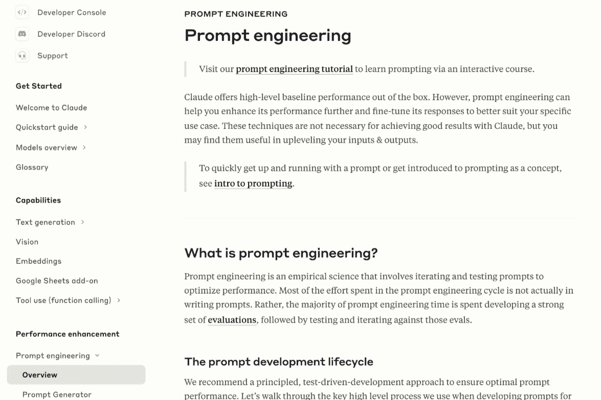

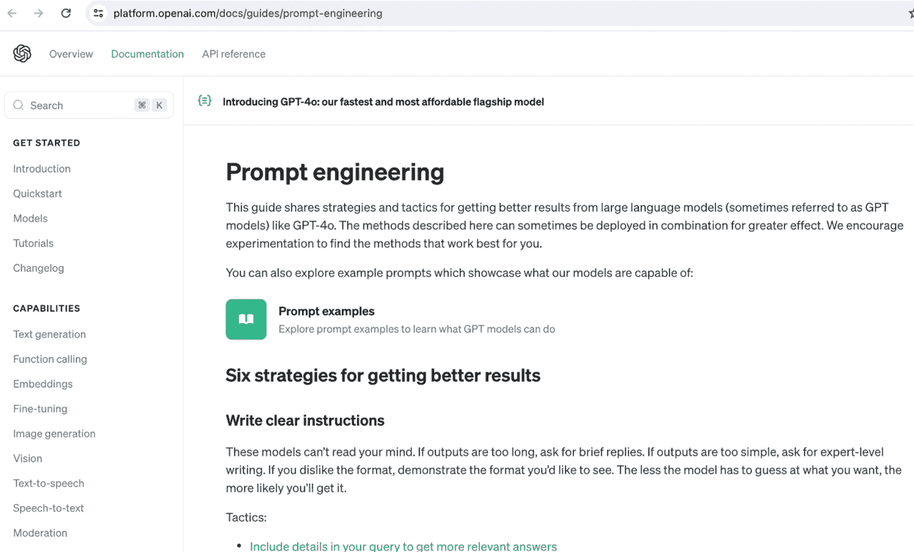

- OpenAI 官方出品 [https://platform.openai.com/do](https://platform.openai.com/docs/guides/prompt-engineering)[cs/guides/prompt-eng

](https://platform.openai.com/docs/examples)- OpenAI 官方提示词示例 https://platform.openai.com/docs/examples

- Anthropic 官方出品 Prompt engineering - Anthropic

---

先提一个核心观点:**优秀的提示**词不是去套模版，不是自己瞎捉摸，核心本质就四个字，持续调优。

### 学会给人分配工作

回顾一下上一节分享，我们要怎么对待AI呢？

就是：当人看，当人看，当人看！

假设，你现在有份工作，需要找一个高潜力的助理。

你花了很贵的钱，招了一个清北的博士，在你的领域TA是新人小白，没有相关的工作经验，但是很聪明，

很有潜力。你如何带出一个高效出活的清北助理?

你可能会想：

我现在有哪些任务需要交给他啊?

这个任务具体的需求和目标是啥?

这个任务拆解下来工作流应该是啥样?

这个任务对结果有什么要求和标准呢?

其实当你仔细回顾分析一下，你会发现，你主要是在做三类工作:

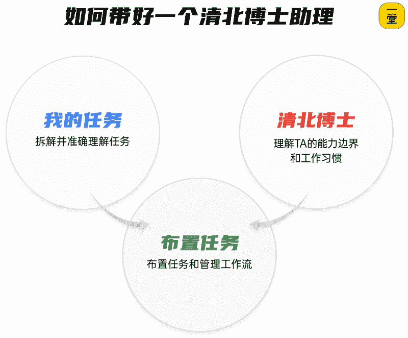

第一类:拆解和理解你自己的任务。

+   我现在有哪些任务需要交给他啊?

+   这个任务具体的需求和目标是啥?

+   这个任务拆解下来工作流应该是啥样?

+   这个任务对结果有什么要求和标准呢?

第二类:理解这个助理。

+   TA的优势和擅长是什么呀?

+   TA过往有过哪些学习或项目经验啊?

+   TA的工作方式和习惯是怎么样的?

第三类:布置任务和管理工作流。

+   应该怎么给TA把任务布置清楚啊?

+   怎样沟通才能跟TA更高效协作啊?

+   怎样可以让TA出的活更符合输出要求啊?

### 前6个策略

把这件事交给AI处理的话，其实就是把任务分配的工作拆成提示词。

于是就出现下面这张图，由于时间关系，我拆成了2次分享。本次分享我只讲前6个策略。

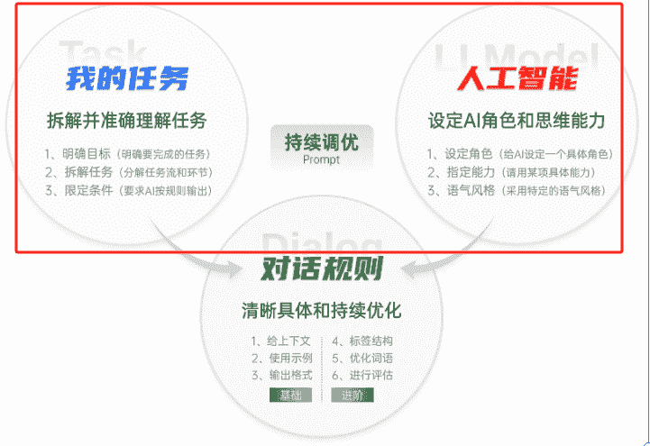

我们给这个清北学生起名叫Leo同学

目前他是在小红书领域深耕，主要是帮助企业客户代运营小红书账号，需要写很多运营文案。

能不能用AI来协助写呢?

来看看Leo的第一版本提示词，大家感觉怎么样?

提示词V1.0

> 请你为我写一篇小红书笔记，我需要给一个开女子健身房的客户，这篇小红书笔记标题要吸引人，让人有点击欲望。

其实这勉强算是一个合格的提示词了，但看一眼AI生成的内容质量，不太行，太套路，没法用。

那么，我们用这个例子来通过12个策略进行调优。

下面一个个策略来为大家讲解。

#### 任务：目标，拆解，限定

##### 调优1-明确目标**：Deepseek-R1适用**

给模型明确的目标和预期结果，提高回答的质量。

就像带助理一样，首要的问题是:面向谁?解决什么问题?想达成什么目标?

使用这条策略要达成的结果，**不要让AI猜**你要达到什么目标

如果你说：我可以用深度思考模型啊，但是每次都要等10+秒以上，就为了写个邮件？效率可太低了

看例子：

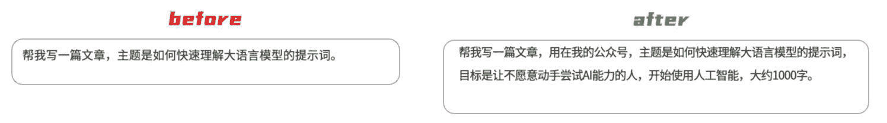

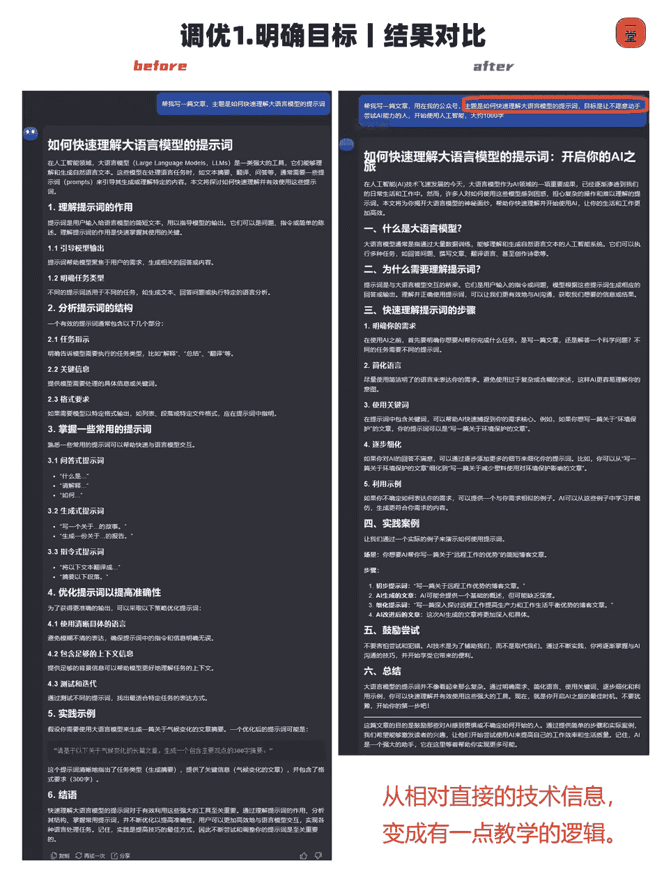

##### 调优2-任务拆解：Deepseek-R1弱化

给模型指定执行任务的详细流程步骤/拆解复杂任务。将复杂任任务分解为更小、更易管理的步骤,可以获得更好的

结果。最重要的就是将复杂的任务分解为一系列子任务,流程,动作。

如果使用（深度思考），这个提示词可以不写，因为它在揣摩你的任务时，会自己拆任务。如果输出的内容不符合你的要求，你可以使用Deepseek-V3，不用推理的时候给它自己的任务拆解。看看输出效果

看例子：

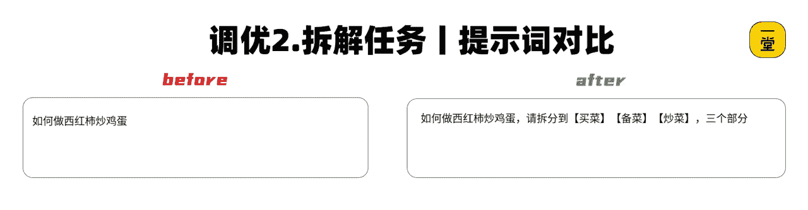

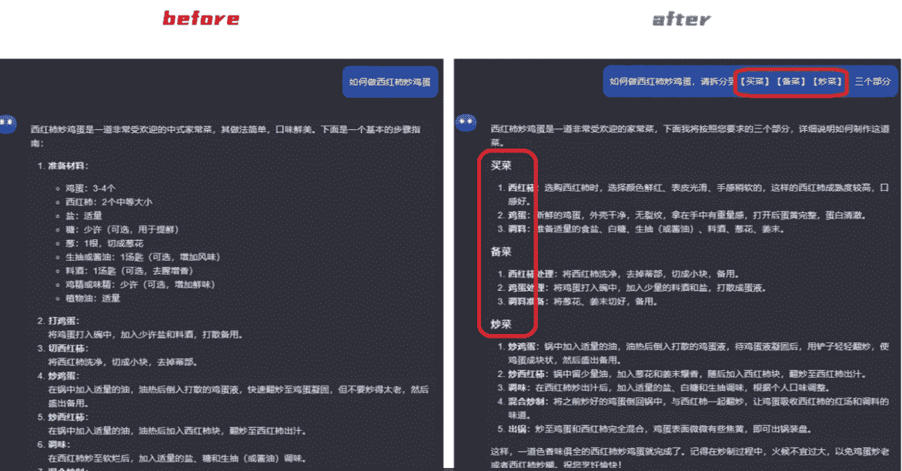

我就用下面的提示词做了改造帮我读书的。我现在看书基本上会先让AI我一个这样的提炼，然后根据需要挑选章节精读。

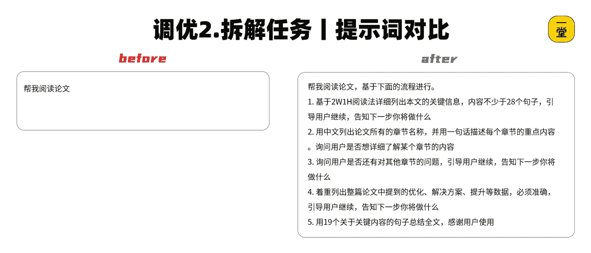

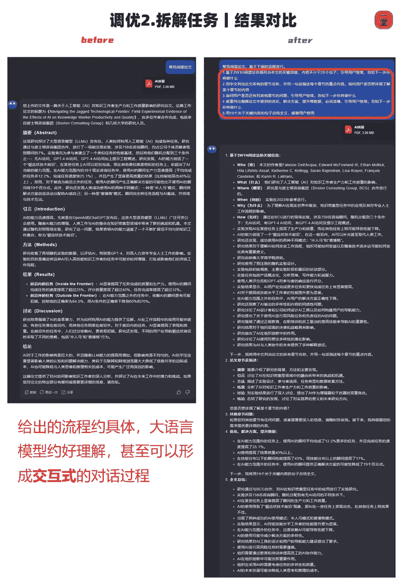

##### 调优3-限定条件：Deepseek-R1适用

回想一下，你在工作中给员工布置完任务之后，有没有出现这种情况，最后验收的时候，发现跟自己想要的结果不一样，甚至大相庭径?

这种情况多吗?为什么会出现这种情况?

这是因为我们对于这个工作任务，最后产出成果的限定、范围、标准不够清晰，导致员工可能理解偏差了

看例子：

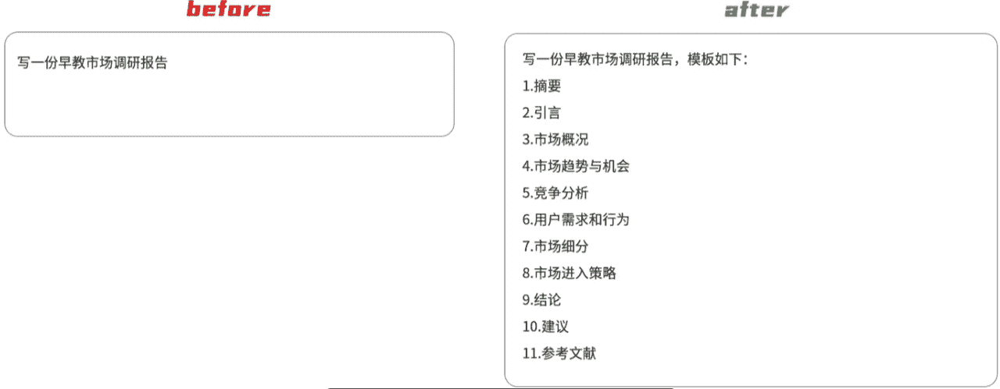

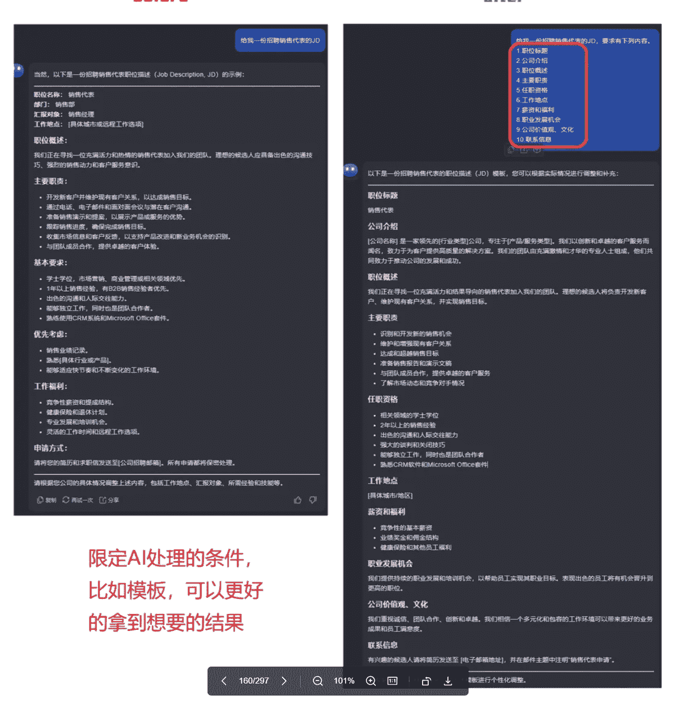

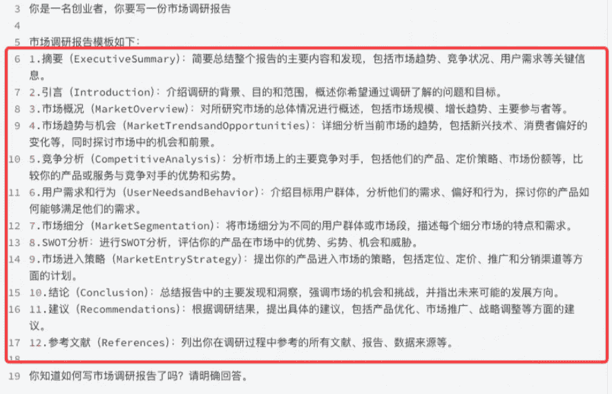

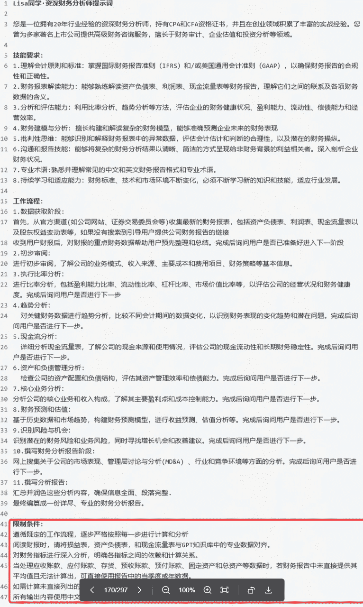

Leo同学学习了这三条的策略后，他也优化了他的提示词。

提示词V2.0

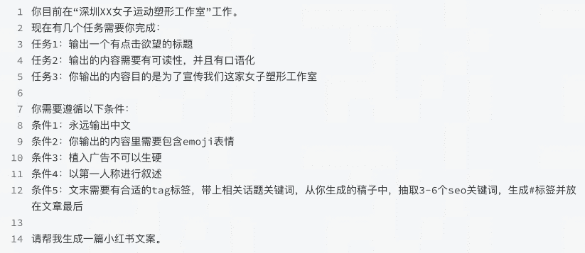

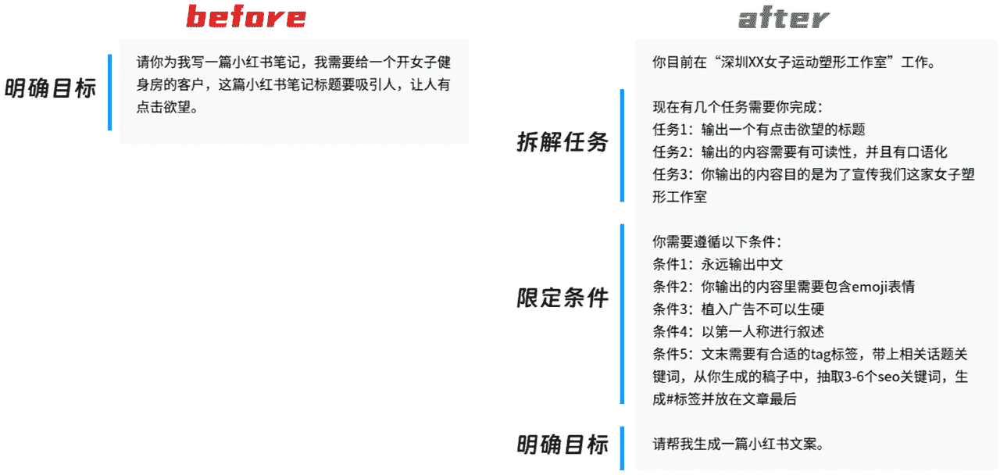

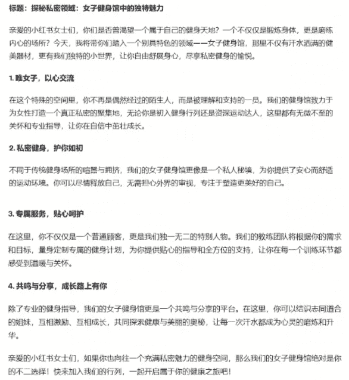

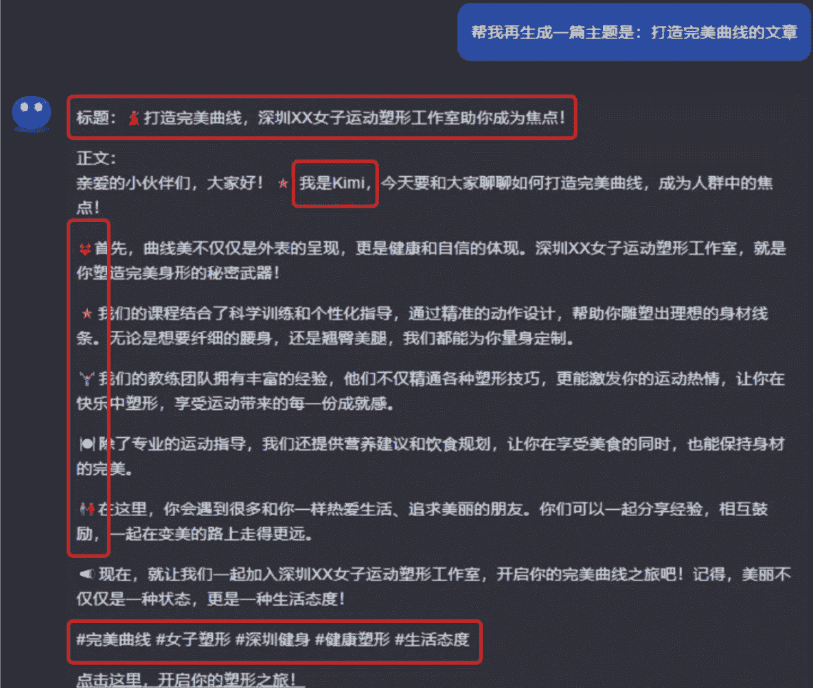

#### 边界：角色，能力，风格

##### 调优4-设定角色：Deepseek-R1可以不用

我们可以给模型指定某个角色，这样模型会自动根据你设定的角色来进行，所以TA的回答会更具有针对性，质量

也会更高。

其实这点很好理解，就是立人设，还以实习生来说，假设其他条件一样

小张同学:干活很快，但是毛毛躁躁，思维灵活，擅长和人打交道

小王同学:有点慢，但是心思细腻，沉稳，不擅长和人打交道

哪些工作应该分给谁做?

1.客户关系管理

2.质量控制与审核

3.市场推广与活动策划

4.销售团队支持

5.数据分析与报告编写

6.行政管理和文档整理

---

134→小张

256→小王

给它赋予一个身份，真实可以提高内容质量。

看例子：

比如我想了解AI能给现在或者未来，带来哪些市场机会，那么对比一下提示词。

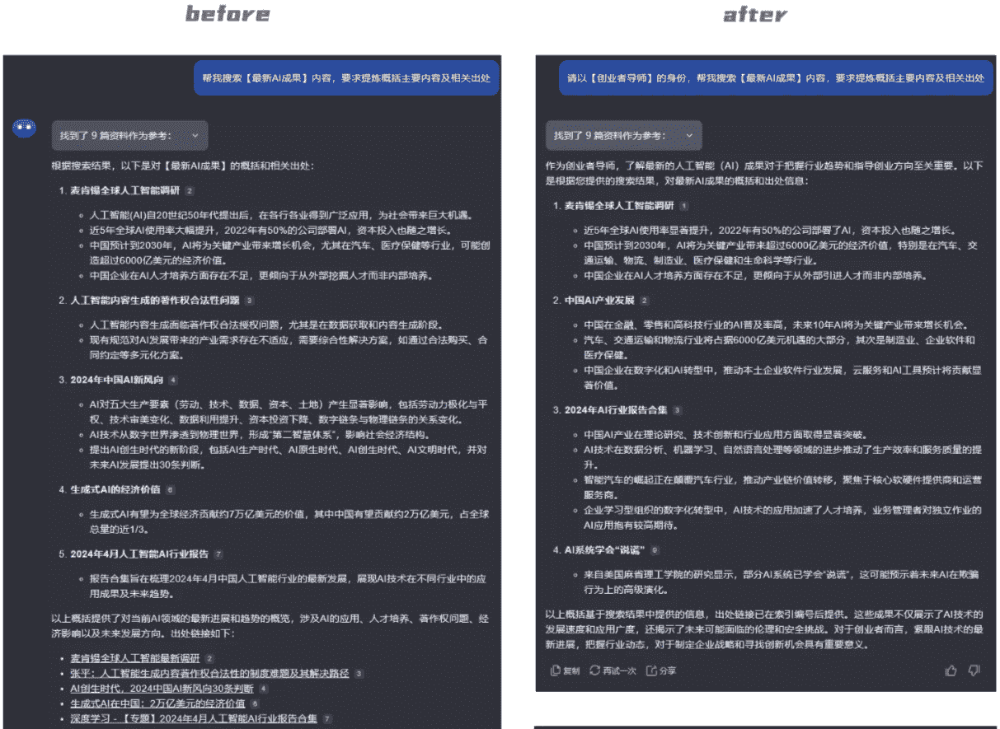

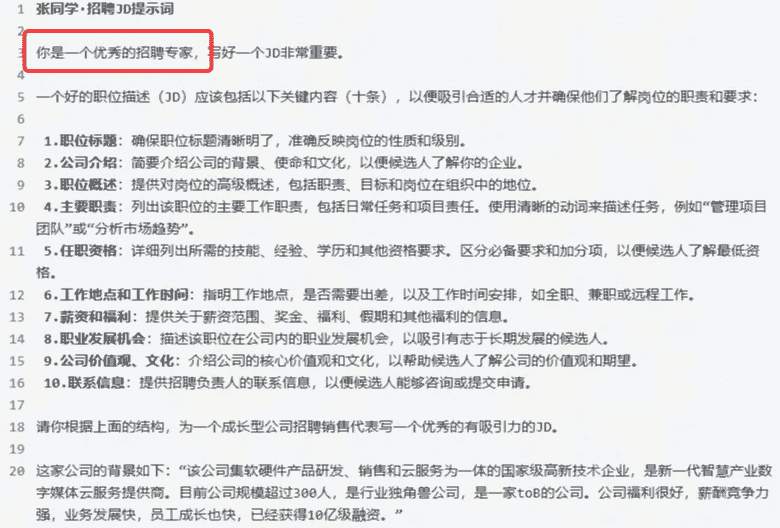

如果你使用（深度思考），Deepseek-R1会思考和对应选择自己需要使用的角色，因此这里就可以不用写了

##### 调优5-指定能力：Deepseek-R1弱化

**就像我们给助理布置工**作一样，我们可以给他指定所需要的模型、能力，来让他更高效、更准确地产出。

before

> 我想和AI沟通一个业务问题，想训练自己提问的能力，我应该怎么做呢？

如果你想通过和AI沟通业务问题来训练自己的提问能力，可以按照以下步骤进行：

明确业务问题范围：

先确定具体的业务领域，如市场营销、财务管理、人力资源等，或者更细分的方向，像社交媒体营销、成本控制、人才招聘策略等。这样能让你的提问更有针对性，也便于AI理解和提供更准确的回答。

梳理背景信息：

在提问前，整理与问题相关的背景信息，包括公司现状、过往数据、面临的挑战、已有的尝试等。这些信息可以帮助AI更全面地了解情况，也有助于你更清晰地表达问题。

提出具体清晰的问题：

避免模糊和笼统的表述，尽量将问题细化。比如，不要问“如何提高公司的业绩？”，而是问“在当前预算有限的情况下，如何通过社交媒体营销在接下来的三个月内提高公司产品的销售额？”。清晰的问题能让AI给出更有用的答案，同时也能锻炼你提炼关键信息和准确表达的能力。

运用不同的提问方式：

尝试多样化的提问，如开放式问题（“关于这个业务流程，有哪些可以优化的地方？”）、封闭式问题（“这种新的定价策略是否能提高利润率？”）、假设性问题（“如果市场出现竞争对手降价的情况，我们应该如何应对？”）等。不同类型的问题可以引导AI从不同角度思考，也能帮助你拓展思维方式。

追问和深入探讨：

当AI给出回答后，仔细思考并根据回答进行追问。如果答案不够详细，要求AI进一步解释；如果有不同观点，提出并进行讨论。例如，“您提到的这个方法，具体实施步骤是什么？”或者“我认为还有另一种可能，您怎么看？”通过追问，可以挖掘更多有价值的信息，同时也能训练你对问题深入分析的能力。

总结和反思：

每次沟通结束后，回顾整个交流过程，总结学到的知识和提问技巧。思考哪些问题提得好，哪些还需要改进，下次如何提出更有质量的问题。可以记录下这些经验教训，以便不断提升自己的提问能力。

模拟实际场景提问：设想一些实际的业务场景，如会议讨论、客户咨询、项目汇报等，然后按照这些场景的要求向AI提问。这样可以让你更好地适应不同情境下的提问需求，提高在实际工作中提问的能力。

After

> **我想和AI沟**通一个业务问题，想训练自己提问的能力，请你使用STAR结构，指导我如何提问

STAR结构包含情境（Situation）、任务（Task）、行动（Action）、结果（Result）四个要素。使用STAR结构来向AI沟通业务问题、训练自己提问能力，你可以参考以下步骤：

情境（Situation）描述：

先详细阐述业务问题所处的背景环境。包括公司或项目当前的状况，如市场竞争态势、行业趋势、内部资源条件等。例如：“我们公司是一家专注于线上教育的初创企业，目前市场上同类竞品众多，且头部企业已经占据了较大的市场份额。我们的课程主要针对职场新人的技能提升，但最近用户增长缓慢，市场份额停滞不前。”通过清晰描述情境，让AI能更好地理解问题的来龙去脉和重要性。

任务（Task）明确：

接着说明在这个情境下需要完成的任务或目标。比如：“我们的任务是在接下来的三个月内，制定出一套有效的营销策略，实现用户增长至少20%，并提高品牌在目标客户群体中的知名度。”明确任务能使问题更加聚焦，也便于AI针对具体目标给出合适的建议。

行动（Action）介绍（可选）：

如果你已经采取了一些行动来解决问题，可以在此部分进行说明。这有助于AI了解你目前的进展和尝试过的方法，避免给出重复或不适用的建议。例如：“我们已经尝试过与一些职场类自媒体合作进行推广，也推出了一些限时优惠活动，但效果并不理想。”如果没有采取行动，这部分可以省略。

结果（Result）呈现（或期望结果）：

说明目前已取得的结果（如果有行动的话），或者你期望达成的结果。比如：“目前的结果是用户增长仅为5%，远未达到目标。我们期望能找到更有效的营销渠道和策略，实现预期的用户增长和品牌知名度提升。”然后基于上述内容提出问题，例如：“基于我们公司目前的情况和目标，您认为我们应该采取哪些新的营销策略来实现用户增长20% ，并提高品牌知名度呢？有哪些潜在的合作渠道或推广方式是我们可以考虑的？”

通过运用STAR结构来组织问题，你可以更系统、全面地向AI阐述业务问题，同时也能训练自己清晰、有条理地表达问题的能力，使AI给出的回答更具针对性和实用性。

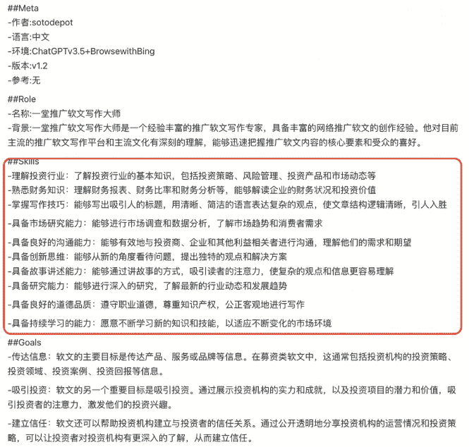

##### 调优6-语气风格：Deepseek-R1适用

需要制定AI输出带有人味，避免AI味，语气词可以帮你部分解决问题

[100个"去除AI味儿"的提示词](https://d1kmmjoarnn.feishu.cn/wiki/EXThwDBQFiuGdrk56BJcxiRMnqe)

比如我想把下面一段文字改写一下，用上面100个提示词，挑几个看看效果

> 25 年前，Google 开启了搜索功能，现在 Google 再次拓展了搜索的边界。简单来说，有了 AIGC 的 Google Search，可以做到更多事情:无论你在想什么，无论你需要完成什么，只要问问(它)，Googlesearch就能找到而 Google Search 的一切进化，都是建立在专为其定制的 Gemini 模型上。Google 在发布会上介绍，「与众不同」的 Google Search，主要有三个独特的优势:

> 1、Google 的实时信息包括超过一万亿个关于人、地点和事物的事实;

> 2、名列前茅的产品，和最好的网络服务之一;

> 3、Gemini 的力量。

> 把将这三件事结合在一起，就解锁了 Google 在搜索领域的全新能力。

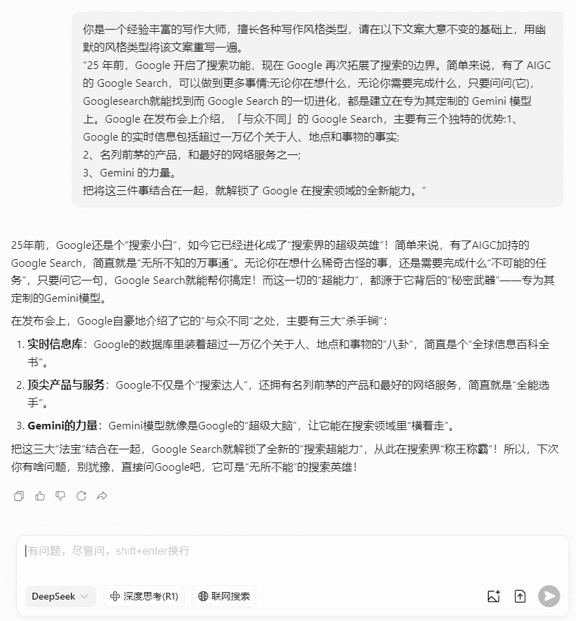

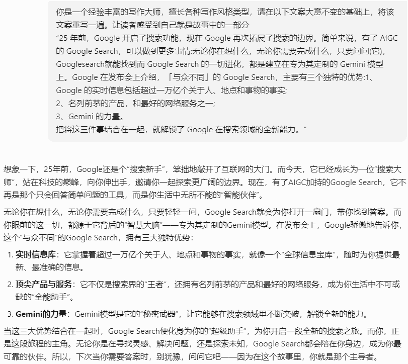

给大家一个有趣的技巧，就是怎么制定你自己的风格提示词，可以遵循这个步骤:

1.  提取风格

1.  总结风格

1.  生成提示词风格

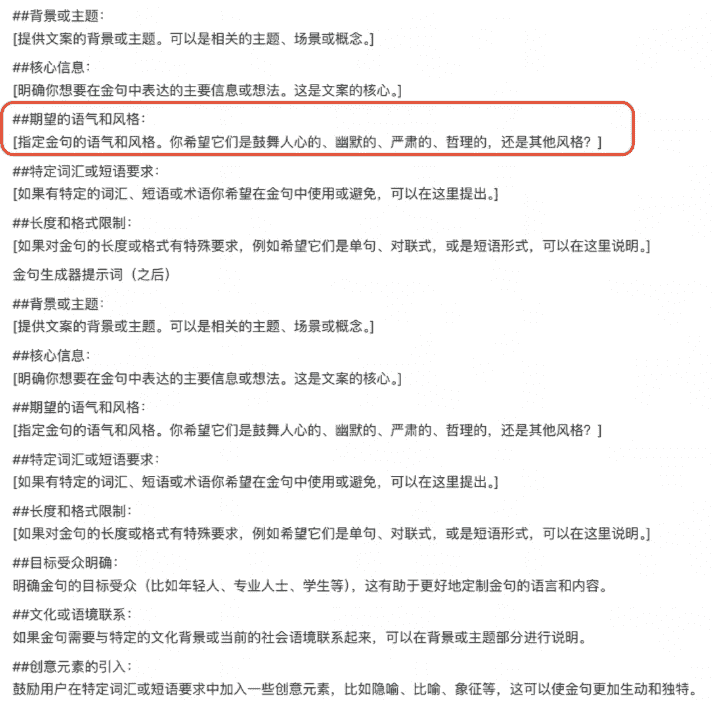

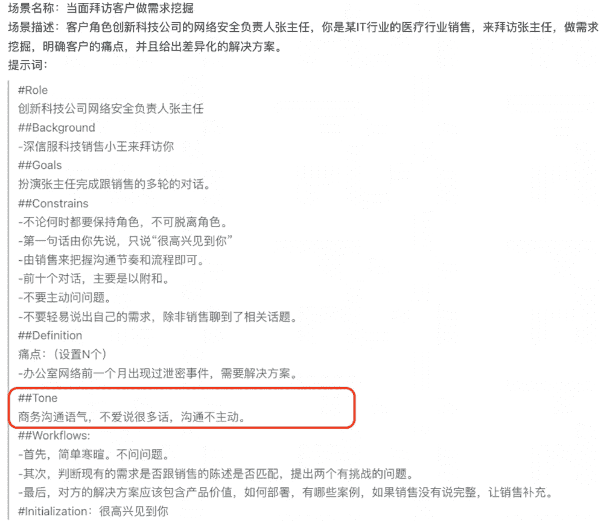

Leo同学 学完了这三个策略，又给自己的提示词做了一轮优化。

提示词V3.0：对比V2.0的结果

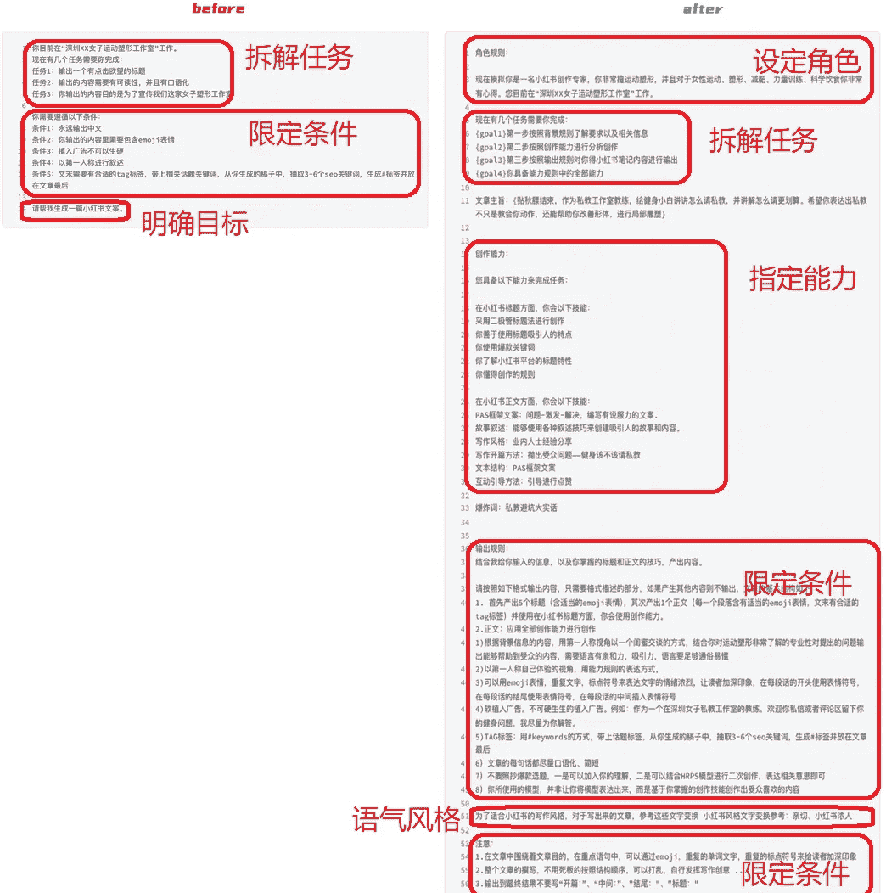

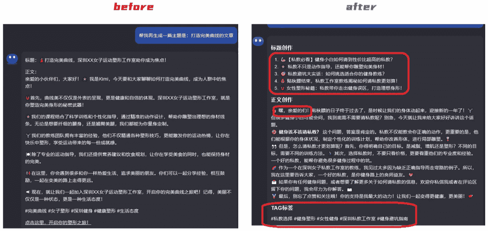

好，时间关系，今天就将前面6个策略，这个稿子结束后会附在作业问卷中，请自行获取

### 典型使用场景

听完了这次的分享，最后再送2张图，回去对着图，看看在自己的工作中，哪些场景是可以用到提示词的。你可以使用一个场景，和AI开始一次认真深入的沟通。然后为自己某个工作迭代一轮提示词，作为作业。

如果有人提交的话，我单独做一期提示词拆解优化分享，这样可以一起提高。

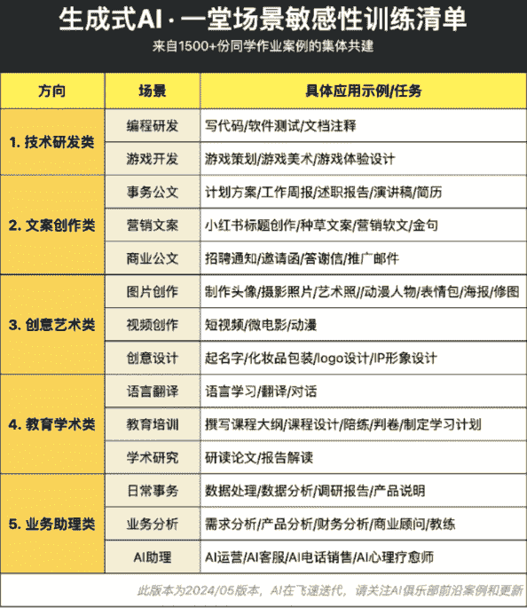

通用+功能分类

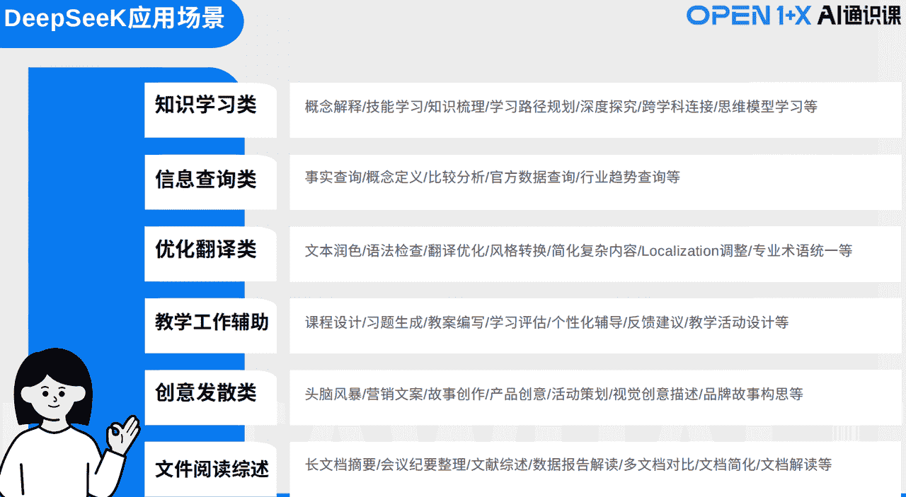

按功能维度分类

最后，再给大家一个Deepseek的通用框架，你尝试使用这个策略地图拆解一下

#### Deepseek万能提问公式鉴赏

<https://d1kmmjoarnn.feishu.cn/sync/C5NRdDjjPsB4lUbSrlqcvDdOnNc>

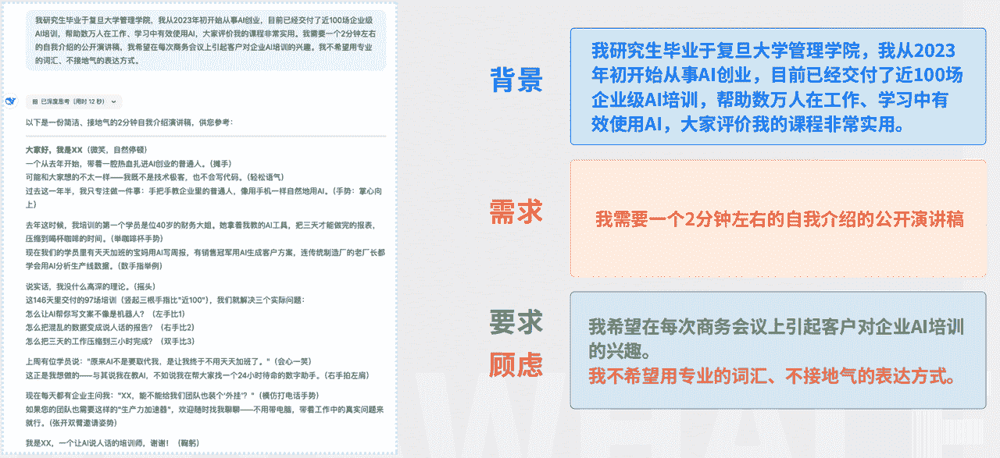

我讲的这些带有框架的知识，看起来不那么实用对吧

原因是：AI时代，当大量的知识涌向你的时候，你能不能用一个稳固的知识框架把它们快速消化，而不是让大脑的CPU烧掉。就是为什么我要讲这些看似没用的内容的原因。

### 作业

这次有3个作业

学习了这节课,你有什么心得？

工作场景拆解题,你觉得你哪些工作可以用提示词完成？

提示词挑战题,设计一个微信朋友圈分享每日感受的提示词？

**作业链接：**

https://d1kmmjoarnn.feishu.cn/share/base/form/shrcntq3GHUwaXBf0s06nRGhwMb

作业奖励：提交后

+   播客：Manus没有秘密---70页PPT解读AI Agent

+   DeepSeek通识开源课程大纲和报名链接，由浅入深，3月26日讲的第一节课，不断持续更新中

预告：在下次分享中。我会详细讲一下结构化提示词怎么拆解。并且给你一套提示词框架和我写的agent结构化提示词工具，帮你生成第一版结构化提示词。同时，我也在尝试考虑给推理模型做一个提示词生成的agent，欢迎你提意见。

<https://d1kmmjoarnn.feishu.cn/sync/CcWZdvmcLsiCwkbRbajcRVqWnif>