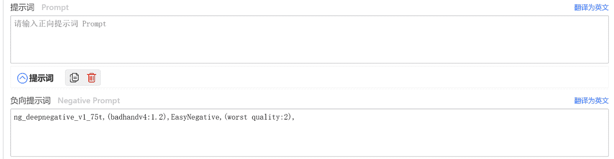
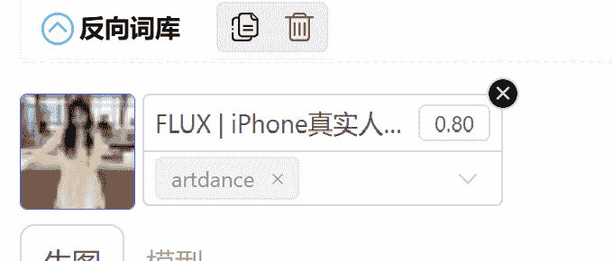
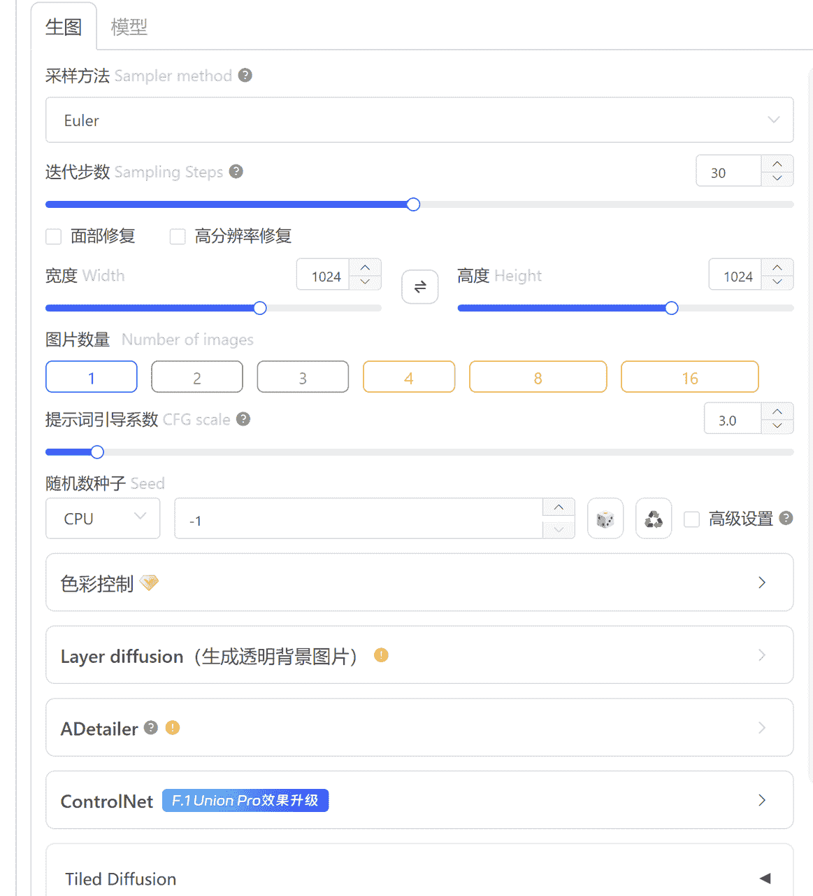

# 基于liblib的文生图（有小任务和详细教程版）

> 来源：[https://datawhaler.feishu.cn/docx/QO0mdKJSroEYr1xMh1fcCb0vnuc](https://datawhaler.feishu.cn/docx/QO0mdKJSroEYr1xMh1fcCb0vnuc)

> **时间**：3月22日 - 3月25日

正常登入后你将会获得

## 【简单版】

### 内容链接

> https://www.liblib.art/userpage/55327fdc0ed846d08af67290f054343d/publish

> https://www.liblib.art/

### 版面介绍

提示词：你想要图片生成什么样子的，你可以发挥你的想像，也可以去尝试发挥AI的想象。

> 可以通过加括号的方式增加你的权重,比如我想要一个男孩，这个点对你来说很重要，那就（1 boy:2），这样AI理解的是这个任务得好好的干，那如果现在你还特想加一个糖果，但没画面中有男孩重要，那就（1 candy:1.2）,但是不要全加一遍这就像你画课本一样等于没画。

负面提示词：你不想图片出现什么就写什么

> 一般情况下，保留它原始的就够用，但是比如你特别不想要糖果你可以告诉他(no candy：1),

> 关于提示词我想说：

> 1.当你发现你怎么写都没有去掉你不想要的，那多半是模型的问题，但如果他没有生成你想要的你可以去看看是不是你要求的太多了。

> 2.你可以试试适当扩大系数比如（1 boy:1.2）到（1 boy:2），如果你加过多其实基本没什么效果还影响其他的内容实现。

> 3.简单通俗的提示词可能AI更易理解。

这个0.80数值的地方可以进行修改，越高数值真实度会相对高。

迭代步数可以在他给出的上下尝试，建议20-30步之间最优。迭代步数越少速度越快，质量越低。

提示词引导系数是你说的话有多重要，比如你调高了，他会认为这个事情很重要，但太高的话他会像个叛逆的小孩一样，用鬼畜的方式实现。

随机数种子不用去改，如果你特喜欢一个风格时，可以考虑固定他。

样例介绍：

提示词：A cyber-girl stands in a neon-soaked alley,quantum-chrome liquid trench coat shimmering under acid rain. Cyan-circuit biomechanical arm contrasts with holographic facial implants,while magnetic levitation boots shatter puddles reflecting Japanese holograms. Nano-drone barrier floats above gradient undercut,palm projecting 3D city blueprints as iridescent eyelashes flicker with data streams. Seal-script collar projection casts cyber-moon shadows through blockchain interfaces,fusing glitchcore aesthetics with synthwave futurism.,

负向提示词：ng_deepnegative_v1_75t,(badhandv4:1.2),EasyNegative,(worst quality:2),

迭代步数：30

提示词引导系数：3

### 小作业

> 【小作业 1】基于你的理解，在学习后，描绘你回忆里的，或者想象中的春天

> 【小作业2】用图画描绘你是如何理解新时代的赛博人的

> 你可以根据你的思考做出你的作品呀，可以不限于小作业。