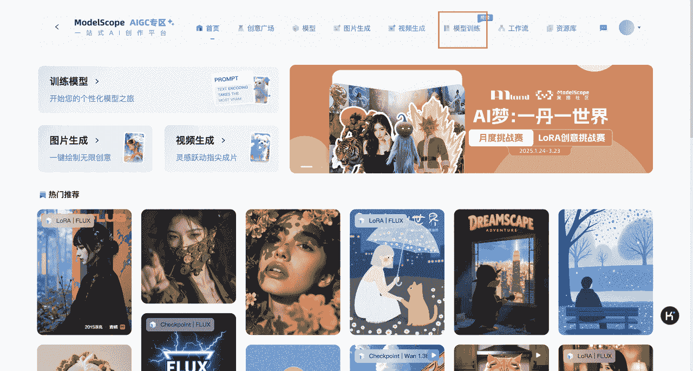
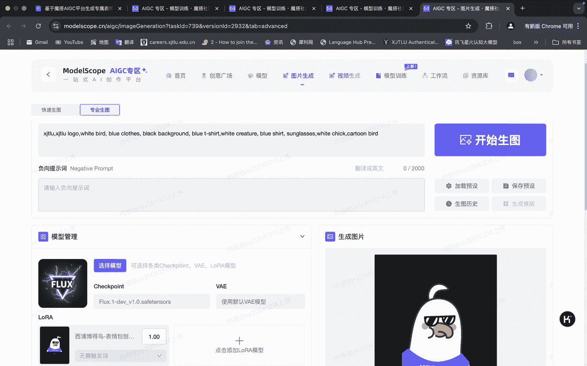
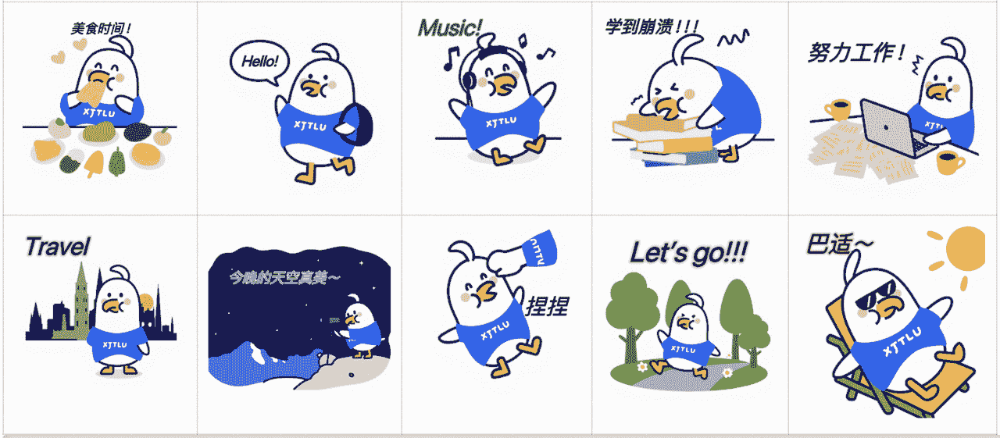

# 基于魔搭AIGC平台生成专属表情包

> 来源：[https://datawhaler.feishu.cn/docx/LolBd3wv3oxjpNxcq8dcH2TznJg](https://datawhaler.feishu.cn/docx/LolBd3wv3oxjpNxcq8dcH2TznJg)

首先打开链接，进入魔搭AIGC专区：https://modelscope.cn/aigc/home

点击模型训练：https://modelscope.cn/aigc/modelTraining

点击数据管理：https://modelscope.cn/aigc/modelTraining?tab=dataset

点击上传图片数据

上传表情包的数据集

**注意，表情包的风格最好要统一！**

然后点击智能打标，为图片进行打标

点击图片，可以单独处理

**如果表情包上有****l**ogo，可以在打标时加上"__ logo"

点击开始训练，进行LORA的训练

发起训练：https://modelscope.cn/aigc/modelTraining?datasetId=750&tab=train

**注**意底模的选择，比如我们想要动态表情表，就可以选择wan2.1-1.3b，通常情况下可以选择FLUX.1_dev

注意，模型触发词尽量选择生僻的单词！

点击开始训练

训练完成后选择第一个，点击开始生成，生成图片：https://modelscope.cn/aigc/imageGeneration?taskId=739&versionId=2932&tab=advanced

**注**意，提示词里要填入之前设置的模型触发词！提示词参考打标时的提示词生成的结果可能会更贴近训练图片的风格！

然后就可以生成自己的专属表情包了！

