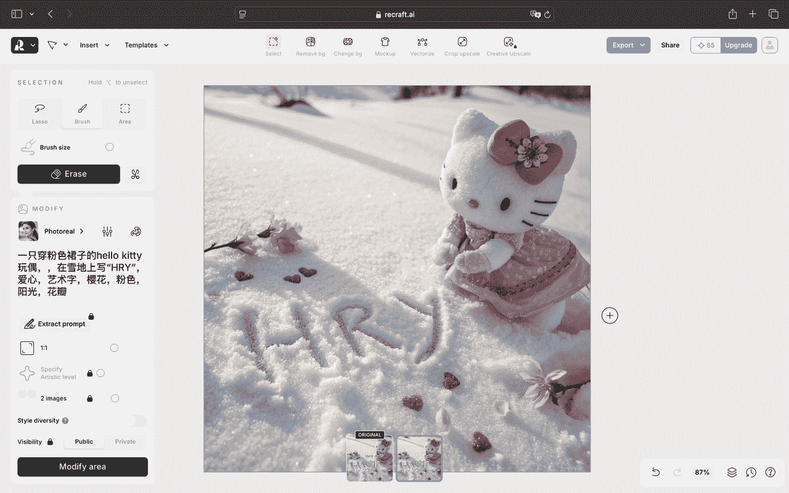
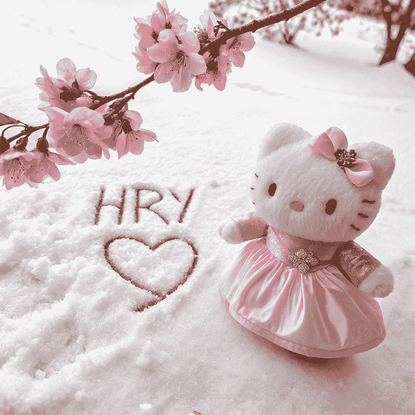

# 基于recraft生成专属头像

> 来源：[https://datawhaler.feishu.cn/docx/M3GzdoBGeoxMTEx28YRc2g78nAg](https://datawhaler.feishu.cn/docx/M3GzdoBGeoxMTEx28YRc2g78nAg)

网址：https://www.recraft.ai/projects

创建一个新的项目

---

进行模型的选择

---

这里选择Photorealism模型

---

根据自己的喜好对参数进行调整

---

输入提示词

> 提示词参考：一只穿粉色裙子的hello kitty玩偶，，在雪地上写“英文单词”，爱心，艺术字，樱花，粉色，阳光，花瓣

---

这里可以对图片进行局部的处理，上面是对图片进行局部消除，下面是对图片进行局部重绘

局部消除后的图片：

---

成品欣赏

