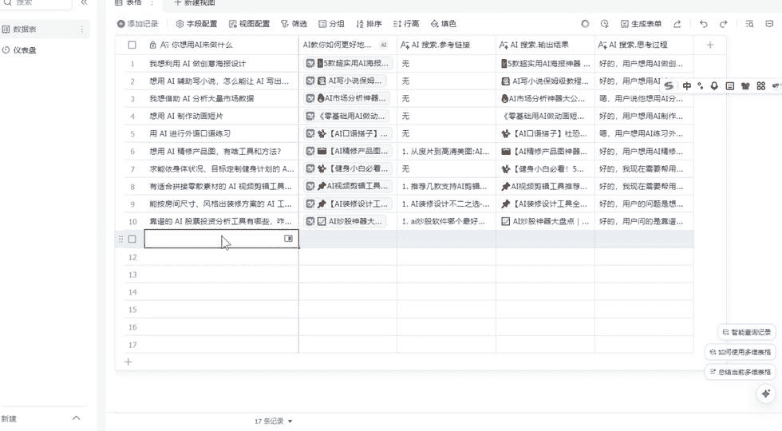
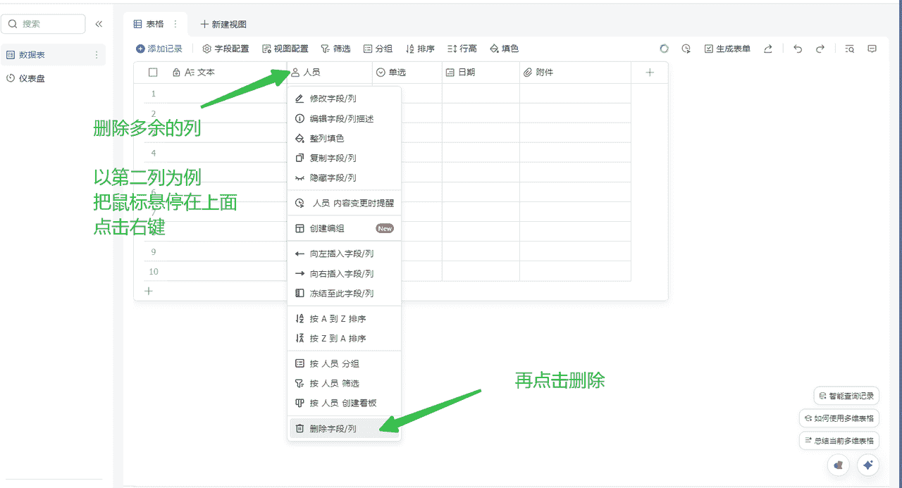
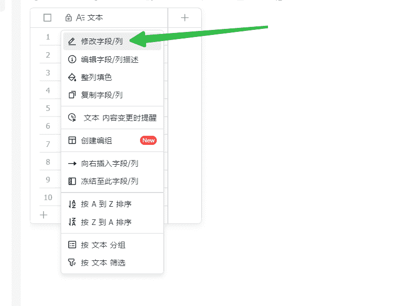
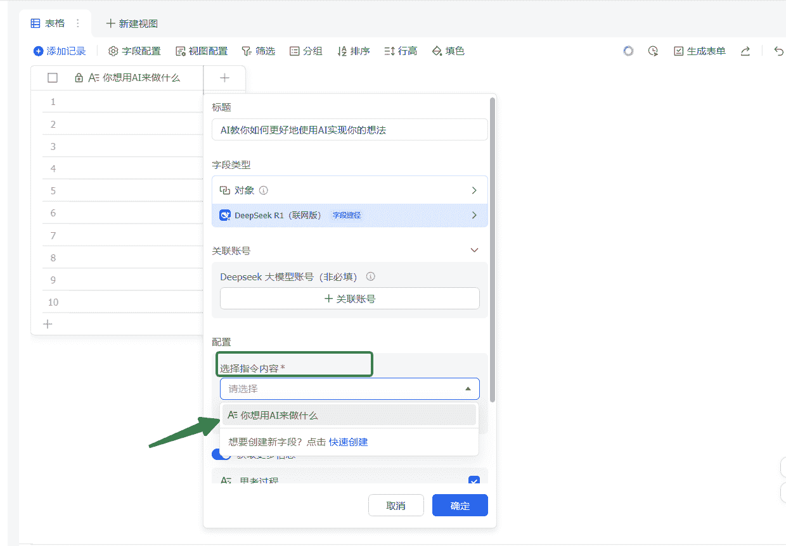

# Deepseek+飞书多维表格--小白入门篇

> 来源：[https://datawhaler.feishu.cn/docx/Q2GGdk7ABoHPNdxyZFucz4A2nAg](https://datawhaler.feishu.cn/docx/Q2GGdk7ABoHPNdxyZFucz4A2nAg)

# 目录

# 引言

[接入DeepSeek的"excel"：飞书多维表格超强AI工作流！](https://z5ewdrqx4l.feishu.cn/docx/HNmPdch10o70haxhFVIc5Gx1nDf)     之前写过一篇飞书多维表格接入AI工作流的教程：

但是那一篇不太利于大家快速上手实践，所以本文主要就是用一个小案例带着大家入门一个基本操作~

**在阅读本教程的过程中，如果感觉有哪些可以改进的地方，或者有哪些让你觉得受到启发的地方，都**可以利用飞书的评论功能选中你想评注的地方或者在文末进行评论，期待收到大家的反馈！

# 来个例子！

现在的AI这么火爆，但你会不会觉得想做的事情不清楚有什么好用的工具？

我们可以输入idea，让deepseek 进行一个头脑风暴！

这里录制了一个短视频，大家可以先直观感受下在表格中让10个deepseek同时工作的效果！

这里面做了这么一件事：我输入我想用AI做的事情，deepseek会帮我分析我想做的事情，列出做这件事效果较好的AI工具，把相关内容总结梳理，用📕文案的形式呈现。

[3月4日.mp4](https://internal-api-drive-stream.feishu.cn/space/api/box/stream/download/all/WGPjbaXxKo9UH9xEwVLc0Kv8nRm)

那么，如果你是一位自媒体博主，想要批量化产出📕文案的初稿，如果你同时输入了100个idea，就会有100篇文案批量化生成！

# 一起来复现

+   首先新建一个多维表格

在飞书的左侧边栏点击"云文档"

+   进入云文档之后，鼠标移到界面的右上角，点击新建

选中多维表格

再点击这个“新建多维表格”

+   好的，这个时候我们就有一个新的多维表格了，然后我们先去掉这个例子中不需要的列，只剩下第一列

+   然后可以把第一列改成自己想要的名称，也是点击右键，然后点修改，我在这里把它命名为“你想用AI来做什么"

+   然后我们新建一列，按照图中的指示，选择deepseek R1 联网版， 然后可以写上自己想取的标题，我这里命名为"AI教你如何更好地使用AI实现你的想法"

选中deepseek R1联网版之后，按照下图的指示来操作

选中我们的第一列，是为了让deepseek处理我们第一列的输入

然后把鼠标滚轮往下滑动，把下面这段提示词复制进去

> “用户会提出想用AI达成的事项，但不清楚如何借助AI高效完成。请依据用户输入进行分析，上网搜索筛选出处理该事项效果较好的AI工具，将相关内容总结梳理，以📕文案形式呈现 。”

这里用动图来演示

+   然后就可以输入你的idea啦

# 做一个自己的AI表格吧~

所[接入DeepSeek的"excel"：飞书多维表格超强AI工作流！](https://z5ewdrqx4l.feishu.cn/docx/HNmPdch10o70haxhFVIc5Gx1nDf)我们来总结一下，通过这个例子，我们能感受到这个东西好处在哪里呢？批量化生成、结构化呈现等等（具体的解释可以看上一篇 里面写了更多玩法，也有更多的小案例，希望对你有所启发）

+   如果你是一名自媒体从业者，你只需要输入内容主题和关键词，飞书多维表格就可以通过AI工作流帮你输出多篇高质量的文章、标题和摘要，以及相应的社交媒体推广文案和互动问题，助你快速提升内容创作效率和粉丝互动

+   如果你是一名老师，想为学生们批量制作单词卡片，你只需要输入单词列表，飞书多维表格就可以通过AI工作流帮你输出包含单词、释义、例句、词性等信息的单词卡片，以及配套的记忆方法和小测验，让学生们更轻松地掌握单词

+   如果你是一名家长，想要帮助孩子更好地学习，你只需要输入孩子的学习问题或知识点，飞书多维表格就可以通过AI工作流帮你输出详细的解答和学习资源推荐，以及根据孩子学习进度制定的学习计划和互动式巩固练习，让孩子的学习更加轻松有趣

+   如果你是...

动起手来，做一个自己的加入AI工作流的多维表格吧！