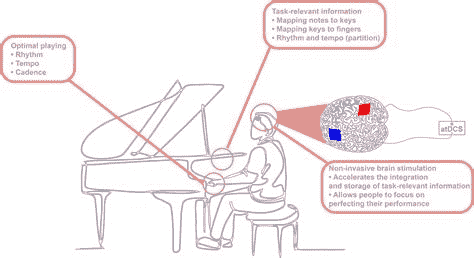

# 微学习13 | 为什么音乐领域也需要人工智能

> 来源：[https://datawhaler.feishu.cn/docx/DRRTd46fxoxauPxTfmNcgY5mnNb](https://datawhaler.feishu.cn/docx/DRRTd46fxoxauPxTfmNcgY5mnNb)

# 课程主题：**为什么音乐领域也需要人工智能？**

## 一、概述

人工智能正以颠覆性力量重构音乐领域的认知与实践边界。从演奏训练到作曲创新，从教育模式革新到治疗应用拓展，AI技术不仅提升了音乐活动的效率，更创造出人机协同的新型艺术范式。

我们将从音乐学习与教育、音乐创作等领域讨论人工智能带来的帮助和影响。希望通过今天的讨论，大家能更清晰地认识到AI在音乐领域的潜力，以及未来我们可以如何更好地运用它。

关键词：音乐人工智能（Music AI）

## 二、应用场景

### 1、人工智能在音乐学习与教育领域的应用

### 演奏训练

乐器演奏训练是一项复杂的学习。相比于传统的老师+助教的训练方式，AI智能陪练系统的出现，使得乐器演奏训练变得更加智能化和高效。

以钢琴演奏学习领域的Skoove应用为例，该应用通过摄像头和麦克风捕捉训练者的实时演奏动作，通过Fraunhofer IDMT研究所开发的一种旋律识别算法实现智能分析，这种算法能够处理多音符序列，确保用户在演奏过程中获得准确的指导，并将演奏的建议实时反馈给用户 [1]。

此外，人工智能技术甚至可以通过仅通过观看演奏视频来评估演奏者的技能水平。例如，内华达大学的研究显示，AI在仅使用视觉线索的情况下，技能水平预测的准确率为74%，而在结合音频信息的情况下，准确率提高到86% [2]。AI系统可以将演奏评估分解为多个音乐子类别，如音高、节奏、速度和动态等，并提供详细的反馈。

### 课程学习

人工智能技术可以分析学生的演奏数据，包括曲目难度、演奏的完成度（节奏、音准、技术缺陷），制定个性化学习路径，推荐针对性练习曲目和难度调整。机器学习算法能根据学生进度动态调整教学内容，确保学习效率，从而更好地实现“千人千面”的个性化教学。

### 音乐信息检索

普通的文本类型的音乐文献（如音乐理论、音乐评论等）可以通过PDF解析文本内容后，由大模型进行分析和总结。然而，还有一类音乐文献：乐谱。

在这个数字化的时代，当你打开网易云音乐，它总能准确地推荐你喜欢的歌曲；当你对着手机哼唱一段旋律，它能快速找到这首歌。这些"魔法"般的功能背后，都离不开一项重要的技术——音乐信息检索（Music Information Retrieval，简称MIR）。

计算机能听懂音乐吗？如果让计算机来"听"音乐，它会怎么做？与人类不同，计算机无法直接理解音乐的美感和情感。它需要将音乐转换成它能理解的"语言"——数字和数据。

就像我们学习音乐要从认识五线谱开始一样，计算机理解音乐也有自己的"入门课"。它首先会将音乐转换成波形图，接着计算机会创建频谱图，这就像是给音乐拍了一张"X光片"，显示出不同频率的能量分布。

计算机也要从最基础的要素开始学习：

+   **音高识别**：就像我们能分辨出do、re、mi一样，计算机需要准确识别每个音符的频率

+   **节奏感知**：理解音乐的时间结构，就像我们打拍子一样

+   **音色分析**：区分不同乐器的声音，就像我们能分辨出小提琴和钢琴的区别

掌握了基础后，计算机开始学习更复杂的音乐特征：

+   **和声分析**：识别和弦进行，就像我们在进行和声分析

+   **结构理解**：找出音乐的段落结构，比如识别出主题部分和变奏部分

+   **情感特征**：分析音乐所传达的情感色彩

这些"听音"能力让计算机可以完成许多令人惊叹的任务：

1.  智能音乐推荐

当你在音乐平台上听歌时，计算机会悄悄记录下你喜欢的音乐特征：也许你偏爱节奏明快的歌曲，或者喜欢特定风格的和声。它会在海量的音乐库中寻找符合你口味的歌曲，就像一位了解你音乐品味的好朋友。

1.  自动记谱助手

想象你正在创作一首新曲子，即兴演奏了一段旋律。计算机可以实时将你的演奏转换成乐谱，就像有一位助手在帮你记录灵感。

1.  音乐搜索引擎

对着手机哼唱一段旋律，计算机就能帮你找到这首歌。它就像一位记忆力超群的音乐图书管理员，能从数以万计的歌曲中找出你想要的那一首。

### 2、人工智能在音乐创作领域的应用

当我们谈论人工智能创作音乐时，不要把它想象成一个要取代音乐家的冰冷机器，而是要把它视为一位懂音乐、能激发灵感的创作伙伴。

还记得我们学习作曲时的基本步骤吗？从动机发展、确定调性、编写和声，到最后的配器。AI创作音乐也遵循类似的规律，只是它通过"学习"大量音乐作品来掌握这些规则。

想象一下，如果你听过上千首莫扎特的作品，你或许也能模仿出他的创作风格。AI就是通过分析海量的音乐作品，学习不同作曲家的创作特点、和声规则、配器技巧等。这个过程专业上称为"机器学习"，就像我们在师从名师时学习他们的创作经验一样。

AI是如何创作音乐的？

1.  旋律创作：就像我们写作曲作业时会思考："这个动机该如何发展？""下一个乐句怎么承接？"AI也会基于它学到的音乐规律，生成符合逻辑的旋律线条。它能分析音程关系的合理性、乐句的呼应结构、调性的和谐程度等。

1.  和声编排：AI也掌握了这些规则：正确的和弦进行、调性中各级和弦的运用、复杂的转调技巧。

1.  编曲配器：就像一个经验丰富的编曲家，AI能够为不同乐器分配合适的声部、平衡各个声部的音量关系、根据不同风格选择适当的配器方案。

使用AI进行音乐创作的速度非常惊人，能够在短时间内生产出大量的音乐，适合需要大量背景音乐的场景，比如游戏配乐、广告音乐。可以作为你的创意催化剂，生成的素材可能激发出你意想不到的音乐想法，为你提供灵感。

然而，我们也要认识到，AI无法真正理解音乐背后的故事和情感，难以表达深刻的人生感悟和情感体验，创作的内容往往是对已有音乐的重组和模仿，缺乏真正的艺术创新，难以形成独特的艺术风格。AI可以模仿贝多芬，但没法成为下一个贝多芬。

AI音乐创作工具种类繁多，比较流行的软件包括：

1.  旋律创作类工具

1.  Suno [4]：专注于创作流行音乐、可以生成完整的歌曲，包括人声，支持文字描述来生成音乐。使用方式非常简单：输入你想要的音乐风格描述，指定情感氛围和场景，系统会生成符合要求的完整歌曲。

1.  编曲工具

1.  AIVA [6]：特别适合影视配乐创作，可以生成完整的管弦乐编曲，支持自定义乐器组合。

## 三、总结与讨论

尽管AI在节奏和速度的精准度上可能超越人类，但在情感表达和创造性方面仍存在较大差距。AI的演奏缺乏人类演奏者的情感投入和独特风格。AI音乐工具就像是我们创作道路上的新乐器。它们不会替代我们的创造力，而是帮助我们更高效地实现音乐想法。工具永远是为艺术表达服务的，关键在于创作的音乐是否能“打动人心”。

## 四、参考资料

1.  [Web-based recognition of polyp](https://www.idmt.fraunhofer.de/en/Press_and_Media/press_releases/2016/skoove.html)honic tone sequences

1.  [A](https://www.classicfm.com/discover-music/instruments/piano/ai-judge-skills-by-watching-you-play/)I can judge your piano skills just by watching you play

1.  [百度百科：音乐信息检索](https://baike.baidu.com/item/%E9%9F%B3%E4%B9%90%E4%BF%A1%E6%81%AF%E6%A3%80%E7%B4%A2MIR/23473330)

1.  [Suno AI](https://suno.com/home)

1.  [MuseNet](https://openai.com/index/musenet/)

1.  [AVIA.ai](https://www.aiva.ai/)