# 2、语音识别/合成工具

> 来源：[https://datawhaler.feishu.cn/docx/UbZpdEdclo2Vi9xi2HWcsogUnfh](https://datawhaler.feishu.cn/docx/UbZpdEdclo2Vi9xi2HWcsogUnfh)

# 2.1 工具对比

语言合成工具对比表：

语言识别工具对比表：（更新中）

# 2.2 语音识别工具

## 2.2.1 SenseVoice使用指南

SenseVoice是由阿里云通义实验室研发的具有音频理解能力的音频基础模型，包括语音识别（ASR）、语种识别（LID）、语音情感识别（SER）和声学事件分类（AEC）或声学事件检测（AED）。基于超过40万小时的多语言、多场景语音数据训练，其识别精度已超越行业标杆Whisper模型，尤其在中文、粤语等语言场景中表现卓越。

### 核心功能

SenseVoice 专注于高精度多语言语音识别、情感辨识和音频事件检测。

+   多语言识别： 采用超过 40 万小时数据训练，支持超过 50 种语言，识别效果上优于 Whisper 模型。

+   富文本识别：

+   具备优秀的情感识别，能够在测试数据上达到和超过目前最佳情感识别模型的效果。

+   支持声音事件检测能力，支持音乐、掌声、笑声、哭声、咳嗽、喷嚏等多种常见人机交互事件进行检测。

+   高效推理： SenseVoice-Small 模型采用非自回归端到端框架，推理延迟极低，10s 音频推理仅耗时 70ms，15 倍优于 Whisper-Large。

+   微调定制： 具备便捷的微调脚本与策略，方便用户根据业务场景修复长尾样本问题。

+   服务部署： 具有完整的服务部署链路，支持多并发请求，支持客户端语言有，python、c++、html、java 与 c# 等。

### 性能评测

#### 多语言语音识别

在开源基准数据集（包括 AISHELL-1、AISHELL-2、Wenetspeech、Librispeech 和 Common Voice）上比较了 SenseVoice 与 Whisper 的多语言语音识别性能和推理效率。在中文和粤语识别效果上，SenseVoice-Small 模型具有明显的效果优势。

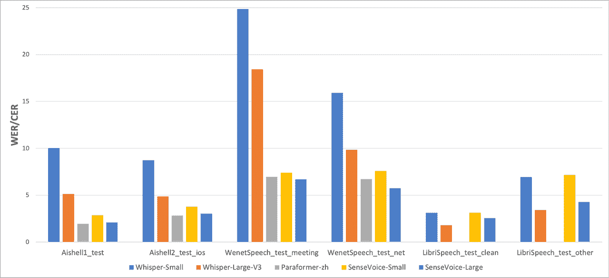

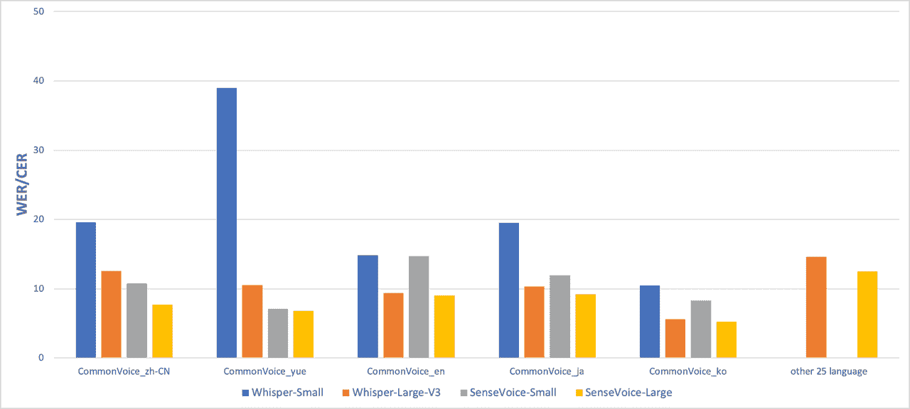

#### 情感识别

由于目前缺乏被广泛使用的情感识别测试指标和方法，SenseVoice在多个测试集的多种指标进行测试，并与近年来 Benchmark 上的多个结果进行了全面的对比。所选取的测试集同时包含中文 / 英文两种语言以及表演、影视剧、自然对话等多种风格的数据，在不进行目标数据微调的前提下，SenseVoice 能够在测试数据上达到和超过目前最佳情感识别模型的效果。

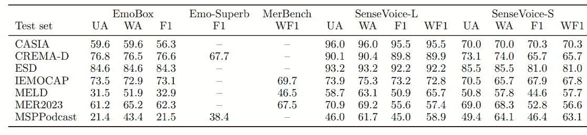

#### 推理效率

SenseVoice-small 模型采用非自回归端到端架构，推理延迟极低。在参数量与 Whisper-Small 模型相当的情况下，比 Whisper-Small 模型推理速度快 5 倍，比 Whisper-Large 模型快 15 倍。同时 SenseVoice-small 模型在音频时长增加的情况下，推理耗时也无明显增加。

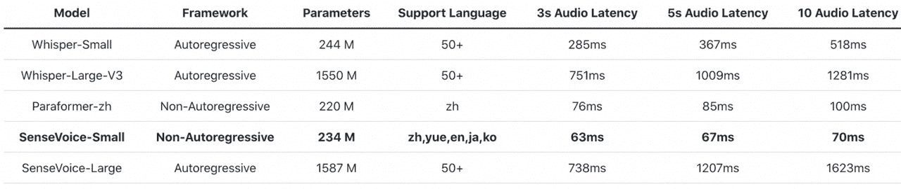

### 探索之旅的起点

+   官方 GitHub地址：[**https://github.com/Fu**](https://github.com/FunAudioLLM/SenseVoice)nAudioLLM/SenseVoice

+   在线体验：[**https://www.modelscope.cn/st**](https://www.modelscope.cn/studios/iic/SenseVoice)udios/iic/SenseVoice

### 安装部署

具体的最低要求可能依据实际应用场景有所不同，通常建议的硬件配置:

+   CPU： 多核处理器，堆荐Intel i7或以上级别

+   RAM：16GB内存，具体视应用复杂度与定

下面在colab上进行部署、运行。

打开colab地址链接 https://colab.research.google.com ，用google账号登录，然后点击连接（使用cpu即可）：

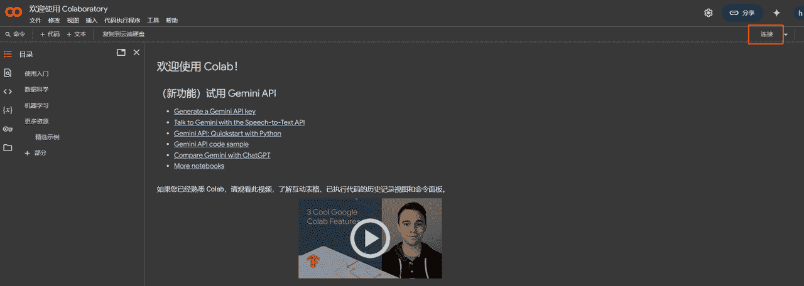

连接上后，添加部署代码

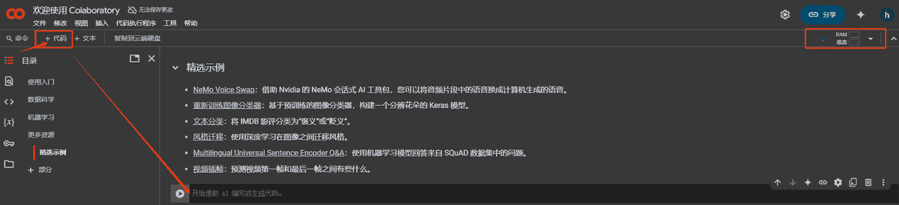

部署代码如下：

```
git clone https://github.com/FunAudioLLM/SenseVoice.git
cd SenseVoice
pip install -r requirements.txt
```

添加后，运行上述代码（点击下方红色箭头处）：


修改webui.py代码（将红色框处的代码用黄色框中代码替换），使得可以通过公网进行连接：

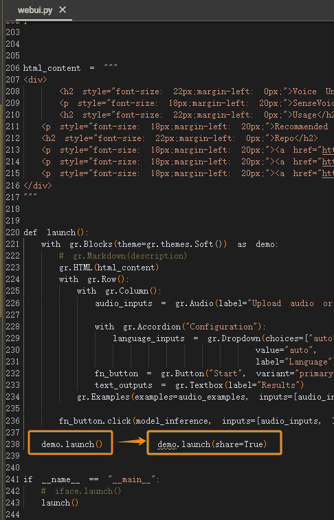

然后，添加启动WebUI代码：

```
python webui.py
```

运行上述代码（点击下方红色箭头处）：


等待一段时间，点击 Running on public URL: https://**.gradio.live <-这个就是可以访问的公网地址:

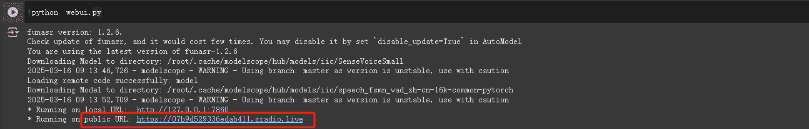

点击公网地址后，就进入了 WebUI 可视化界面了，这个时候就可以开始使用SenseVoice了。

### SenseVoice WebUI使用方法

SenseVoice WebUI的使用非常的简单：

+   在“1”处上传需要识别的音频

+   在“2”处选择音频的语言

+   点击“3” start就可以开始进行音频识别了

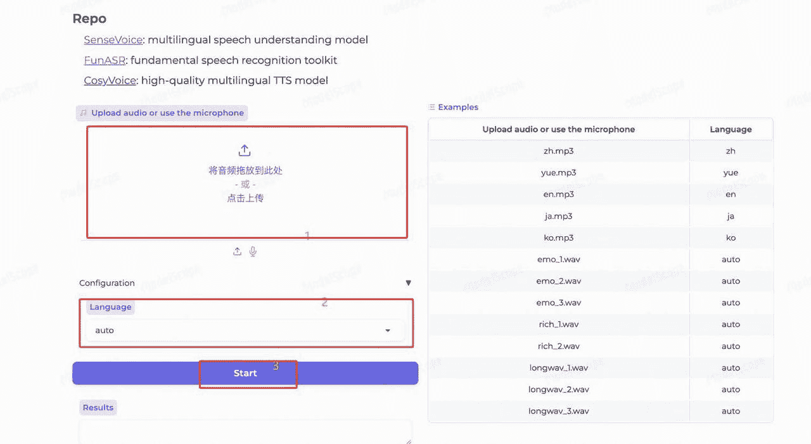

### 典型应用场景

利用本文的SenseVoice项目，你可以进行如下的一些工作：

+   实时语音转写：会议记录、直播字幕生成。

+   情感分析：客服质检、心理咨询场景的情绪监控。

+   多语言交互：跨境电商、国际会议的多语言实时翻译。

+   音频事件监控：智能家居中的异常声音检测（如婴儿哭声、玻璃破碎声）。

# 2.3 语音合成工具

## 2.3.1 ChatTTS-最强开源TTS

### ChatTTS简介

#### 独特魅力

+   **对话式 TTS**：ChatTTS 专为对话而生，无论是 LLM 助手的对话任务，还是日常的闲聊，都能以自然流畅的语音合成，让对话栩栩如生。

+   **细粒度控制**：这款模型精于细节，能够精准预测和调控韵律特征，从笑声、停顿到插入词，每一个细节都能随心所欲地掌控。

+   **卓越韵律**：在韵律的表现上，ChatTTS 超越了众多开源 TTS 模型，提供了预训练模型，为研究者和开发者打开了深入探索的大门。

+   **支持的语种**：中文、英文

#### 数据集和模型

+   主模型使用了 100,000+ 小时的中文和英文音频数据进行训练。

+   HuggingFace上的开源版本是一个在 40,000 小时数据上进行无监督微调的预训练模型。

#### 探索之旅的起点

+   官方 GitHub地址：https://github.com/2noise/ChatTTS

+   在线体验：https://chattts.com

下面就一起探索ChatTTS，相信跟随这些步骤，你也能生成出满意的AI语音。

### 安装部署，方案1-colab（**推荐**）

项目地址： [**https://github.com/6**](https://github.com/6drf21e/ChatTTS_colab)drf21e/ChatTTS_colab

打开项目地址链接，进入github主页，点击“OPEN IN COLAB”

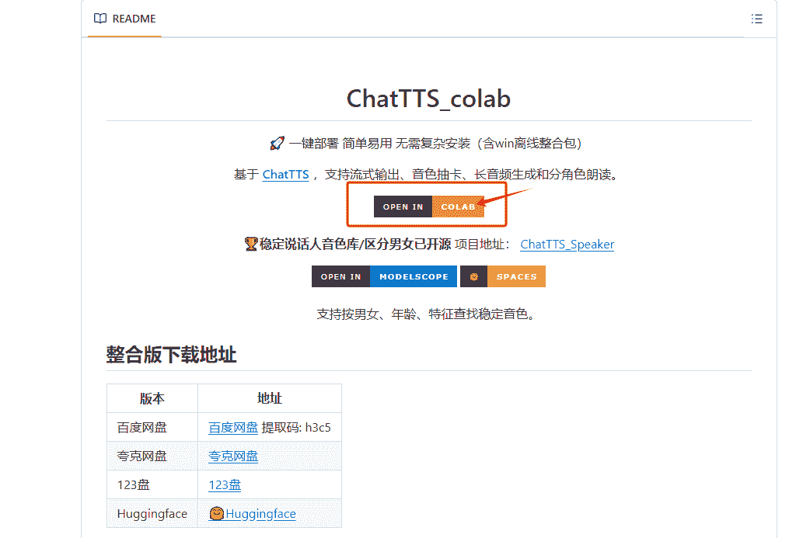

打开后，如下图所示，并在红框处，选择运行时类型为GPU，这里选的时T4 GPU

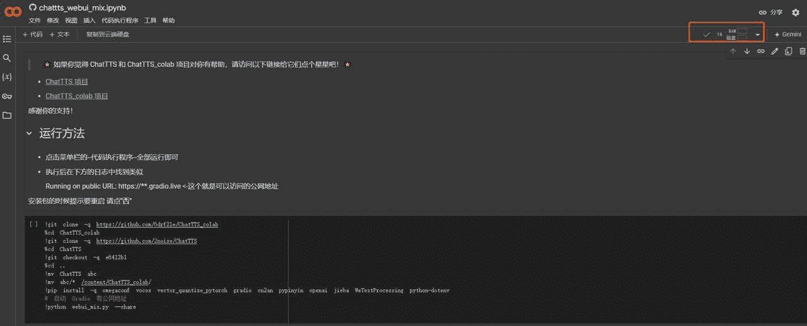

点击下方红色箭头处，一键部署加运行：

等待一段时间，点击 Running on public URL: https://**.gradio.live <-这个就是可以访问的公网地址

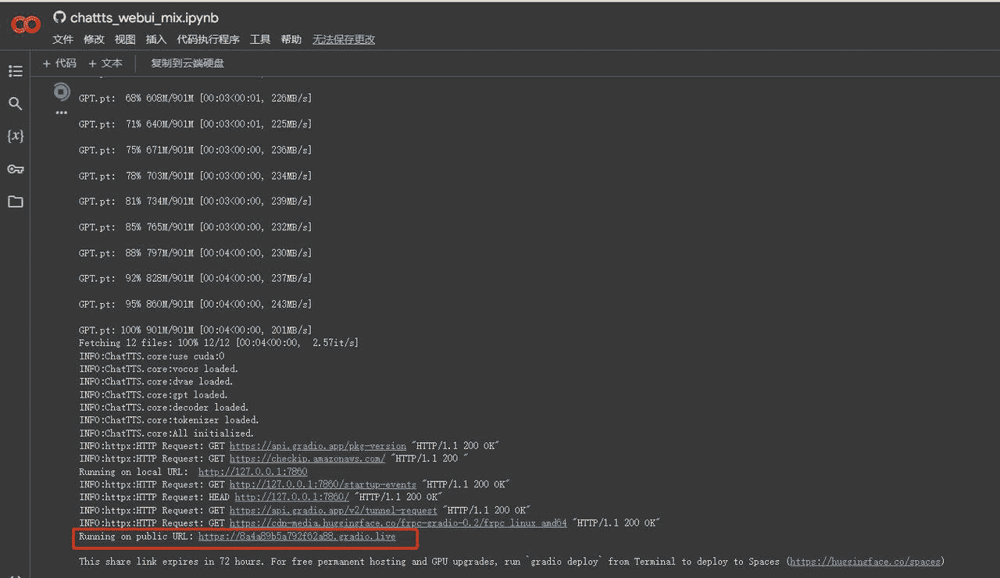

点击公网地址后，就进入了 WebUI 可视化界面了，这个时候就可以开始使用chatTTS了。

### 安装部署，方案2-本地安装

不在本地部署的话，可以直接跳过这一节。

#### 1、 克隆仓库与安装依赖指南

克隆 ChatTTS 仓库

```
git clone https://github.com/2noise/ChatTTS
cd ChatTTS
```

#### 2、安装依赖

直接安装

```
pip install --upgrade -r requirements.txt
```

使用 conda 安装

```
conda create -n chattts
conda activate chattts
pip install -r requirements.txt
```

#### 3、快速启动

确保在执行以下命令时，你处于项目根目录下。

启动方式

（1）. WebUI 可视化界面

使用WebUI，你可以直观地与 ChatTTS 交互：

```
python examples/web/webui.py
```

（2）. 命令行交互

通过命令行快速生成语音。生成的音频将保存至 ./output_audio_n.mp3：

```
python examples/cmd/run.py &quot;Your text 1.&quot; &quot;Your text 2.&quot;
```

### ChatTTS WebUI使用方法

分别依次按照下图1、2、3、4配置，即可生成语音，同时界面中还有许多参数可以调节，根据需求去对这些参加进行调节即可

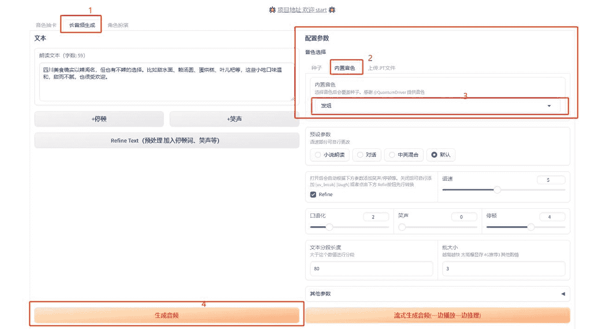

这段文字，“四川美食确实以辣闻名，但也有不辣的选择。比如甜水面、赖汤圆、蛋烘糕、叶儿粑等，这些小吃口味温和，甜而不腻，也很受欢迎”，根据上面的配置生成的语音如下，效果非常不错：


[6-chatTTS语音案例.wav](https://internal-api-drive-stream.feishu.cn/space/api/box/stream/download/all/NHambqZSAoeyzIx4jlOcBSRHnXq)

### 部分参数详解

在使用 ChatTTS 过程中，了解和调整以下关键参数非常重要：

#### Audio Seed

+   **含义**: 用于初始化随机数生成器的种子值。设置相同的 Audio Seed 可以确保重复生成一致的语音，便于实验和调试。

+   **推荐 Seed**:

+   3798 - 知性女

+   462 - 大舌头女

+   2424 - 低沉男

#### Refine Text

+   **建议**: 勾选此选项可以对输入文本进行优化或修改，提升语音的自然度和可理解性。

#### Audio Temperature

+   **含义**: 控制输出的随机性。数值越高，生成的语音越可能包含意外变化；数值较低则趋向于更平稳的输出。

#### Top_P 和 Top_K

##### Top_P

+   **核采样策略**: 定义概率累积值，模型将只从这个累积概率覆盖的最可能的词中选择下一个词。

##### Top_K

+   **限制词汇数量**: 设置为一个具体数值，模型将只从这最可能的 K 个词中选择下一个词。

#### 进阶使用技巧

除了基本的参数设置，你还可以进行更细粒度的控制，比如调整笑声、停顿和口音。以下是一些常用的控制标记：

+   [oral_(0-9)]: 控制口音强度

+   [laugh_(0-2)]: 控制笑声

+   [break_(0-7)]: 控制停顿时间

试试不同的组合，比如 [oral 2][laugh 0][break 4]，探索更多有趣的语音效果。

## 2.3.2 海螺AI语音-超强的TTS+语音克隆【免费】

海螺AI语音是MiniMax公司推出的一款革命性AI语音合成工具。它是基于T2A-01系列语音模型的文本转语音（TTS）工具，通过多语言支持、情感表达和音色克隆等能力，为用户提供高度拟人化的语音生成服务，其生成的语音自然流畅，逼真度高，可以满足大多数用户的需求。

### 一、海螺AI语音特色

+   **多语言与长文本处理**

+   语言覆盖：支持17种语言，包括中文（普通话与粤语）、英语、日语、韩语、阿拉伯语、西班牙语、法语、德语、俄语、乌克兰语等，满足全球化场景需求。

+   长文本支持：单次输入上限达10,000字符，可完整生成长篇内容（如有声书、会议记录），无需分段处理

+   **情感化语音生成**

+   情绪控制：提供7种基础情绪（开心、悲伤、愤怒、害怕、厌恶、惊讶、中性），并支持通过强度调节滑块精准控制情绪表达层级（如从“轻微愉悦”到“极度兴奋”）。

+   情感智能识别：模型可自动分析文本语义，匹配对应情绪，例如自动为悲伤台词添加“哽咽”效果。

+   **音色库与声音定制**

+   多样化音色选择：内置300+预置音色，按语言、性别、年龄（如青年、老年）、风格（诙谐、严肃、慈祥）分类，适配新闻播报、广告配音等场景。

+   语音克隆：上传10-60秒音频即可复刻专属音色，支持跨语言和跨情绪切换（如将“愤怒”音色转为“温柔”）。

+   参数微调：可调整语速（0.5-2倍速）、音高（低沉/尖锐）、音量等

+   **海螺AI语音的价格**
 目前海螺AI语音所有功能（包括声音克隆）均开放免费体验，用户注册后即可直接使用。未来商业化模式尚未公布。

### 二、海螺AI语音使用教程

海螺AI语音的使用非常简单，下面跟着小编一步一步进行实操。

#### 1、文本转语音-TTS

访问官网 https://hailuoai.com/audio，点击右上角的登录，用手机号进行验证码登录。注册好后界面如下图，依次进行如下操作：

“1”处选择“文生音”；

“2”处选择合适的模型，一般选最新的模型；

“3”处选择合适的音色，包括语音-男女生-方言-年龄等维度；

“4”处对音色效果进行调节；

“5”处选择输出的情绪；

“6”、“7”、“8”分别对语速、声调、音量进行调节。

“9”处填入文字内容。

“10”上面内容配置好后，点击“生成语音“便大功告成。

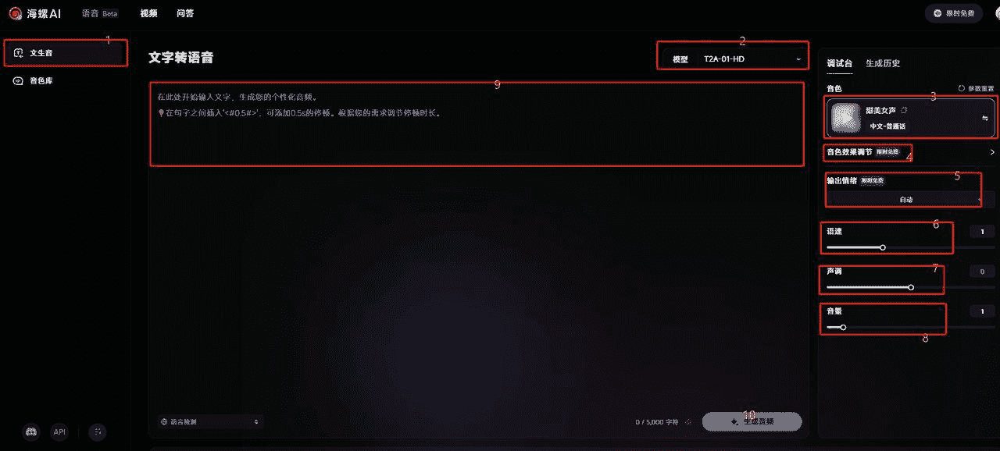

**中文TTS实测效果**

按照上面的方法，“3”处音色选择“甜美女生-中文-普通话”，生成了一些中文语音如下，效果非常不错：


[ch-01-开心.mp3](https://internal-api-drive-stream.feishu.cn/space/api/box/stream/download/all/OVDFbGRJqoZxWzxXy46c1UvTnQe)


[ch-02.mp3](https://internal-api-drive-stream.feishu.cn/space/api/box/stream/download/all/IiurbREsXogiiLxr6bWcPB1unLb)


[ch-03-s1.mp3](https://internal-api-drive-stream.feishu.cn/space/api/box/stream/download/all/FtDQb2yZ4obZz0x50MIcP3nyneg)


[ch-03-s1.5.mp3](https://internal-api-drive-stream.feishu.cn/space/api/box/stream/download/all/QfFbbdsSiohb0zxdH7Ncje5TnWe)


[ch-04.mp3](https://internal-api-drive-stream.feishu.cn/space/api/box/stream/download/all/I5DZbXytuoLg0gxzp0HcdKPonyd)


[ch-05.mp3](https://internal-api-drive-stream.feishu.cn/space/api/box/stream/download/all/If17bJEygonXBmxkR3ncDad8niX)

**英文TTS实测效果**

同样，也对英文语音进行了测试，“3”处音色选择“Graceful Lady”，生成的一些英文语音如下：


[en-01.mp3](https://internal-api-drive-stream.feishu.cn/space/api/box/stream/download/all/RiDMbSRUYogHhPxT6o7cUzcInlz)


[en-02.mp3](https://internal-api-drive-stream.feishu.cn/space/api/box/stream/download/all/XxBgby7bJoQzVPxnrOncxgndnDg)


[en-03-s1.mp3](https://internal-api-drive-stream.feishu.cn/space/api/box/stream/download/all/WRztbSYS3oe59DxFvDUckuKbnod)


[en-03-s1.5.mp3](https://internal-api-drive-stream.feishu.cn/space/api/box/stream/download/all/KlEub4atEo15a5x311ZcujewnOc)


[en-04.mp3](https://internal-api-drive-stream.feishu.cn/space/api/box/stream/download/all/NFj3bpA1hoyV4txUPKVc9pDVnIg)

#### 2、语音克隆

海螺AI的语音克隆功能目前只能在海外版使用，目前还是「完全免费」的，海外版官方地址 https://www.minimax.io/audio。海螺AI的声音克隆对中文支持很好。最短上传 10 秒音频，就可以克隆声音！让我们一起来看看吧~

打开海外版海螺AI，点击右上角的[Sign in]，用google账号登录即可。然后依次点击「Audio」-「Voices」-「Create your Voice Clone」，对应下图“1”、“2”、“3”的位置：

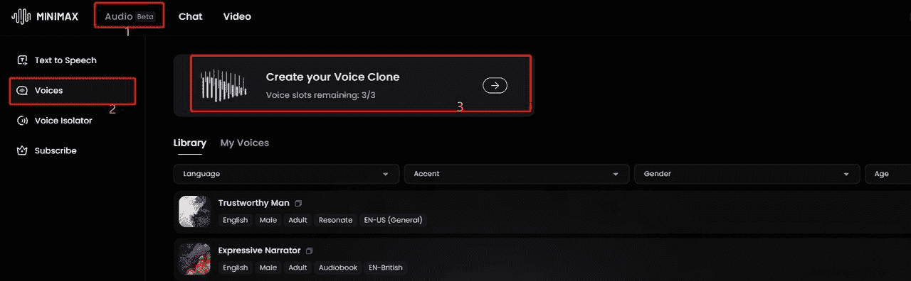

**第一步 导入克隆的语音素材**

可以上传语音文件（对应图中“1”），最多 10 个，每个不超过50M，也可以直接录音10-60 秒（对应图中“2”），「从音频样本中去噪」这个选项，根据自己的音频样本选择即可（对应图中“3”）。

需要注意的是，请上传在安静环境下录制的纯净人声录音。混响、多人对话、背景噪音等都会影响语音克隆质量。您可以使用噪音分离功能降低音频噪声，但这可能会影响声音细节的保留。因此建议在选择克隆素材时，尽量选取质量最佳的片段。

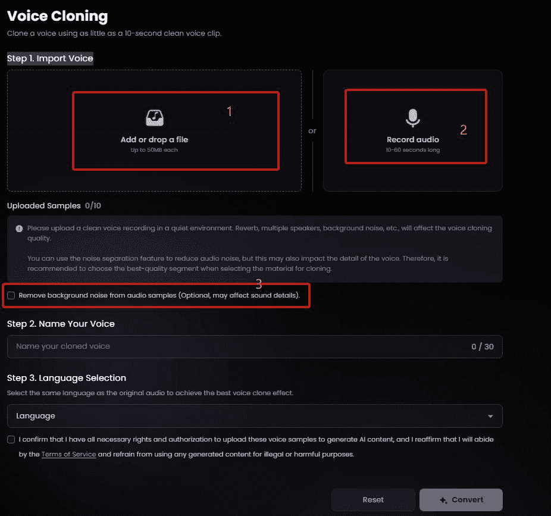

**第二步 给克隆的声音命名**


**第三步 选择克隆语言**

请选择与提供的语音素材相同的语言。


**第四步 完成克隆并使用**

完成上面步骤后，点击「Convert」，就可以等待克隆了。克隆好之后，就可以在文本转语音（Text to Speech）中，使用自己克隆的声音了。使用方法参考上面的文本转语音教程。

**中文语言克隆效果**

按照上面的步骤，使用了下面的中文语音作为训练的样本：


[ref1_voice_Operson_using-中文 [vocals].wav](https://internal-api-drive-stream.feishu.cn/space/api/box/stream/download/all/UleKbE5GzowWamx2rw9c2yI4nbc)

克隆完成后，利用生成的模型，生成了下面的语言，效果非常不错：


[ch-01.mp3](https://internal-api-drive-stream.feishu.cn/space/api/box/stream/download/all/AABJbMKmRo69BIxeez7cXMzMn4c)


[ch-05.mp3](https://internal-api-drive-stream.feishu.cn/space/api/box/stream/download/all/XlBLbolStoVG0GxjoM2cUqarnBf)

**英文语言克隆效果**

按照上面的步骤，使用了下面的英文语音作为训练的样本：


[ref3-vocal_the_last_one_voice-英文.wav](https://internal-api-drive-stream.feishu.cn/space/api/box/stream/download/all/CZ11b9ocZo6squxTXcKcKikhnib)

克隆完成后，利用生成的模型，生成了下面的语言：


[en-01.mp3](https://internal-api-drive-stream.feishu.cn/space/api/box/stream/download/all/HYTrbNIpoo619gxuhyvcJ2KunAh)


[en-04.mp3](https://internal-api-drive-stream.feishu.cn/space/api/box/stream/download/all/BjyYb0E66oi32gxxIwZctazinzg)

### **附-官网地址**

+   Hailuo AI（海外版）：

https://www.hailuo.ai/

+   海螺AI（国内版）：

https://hailuoai.com/

## 2.3.3 Fish-Speech

### 一. 介绍

Fish-Speech是由Fish Audio团队开发的[一款开源文本](https://zhida.zhihu.com/search?content_id=252980589&content_type=Article&match_order=1&q=VQ-GAN&zhida_source=entity)转[语音（TT](https://zhida.zhihu.com/search?content_id=252980589&content_type=Article&match_order=1&q=Llama&zhida_source=entity)S[）模型，](https://zhida.zhihu.com/search?content_id=252980589&content_type=Article&match_order=1&q=VITS&zhida_source=entity)它基于VQ-GAN、Llama和VITS等技术开发，采用了Transformer架构，这是一种在自然语言处理任务中表现卓越的神经网络结构。同时，它还使用了多任务学习方法和先进的神经网络声码器，以实现高质量的语音合成。Fish-Speech支持包括中文在内的多种主流语言，使得用户在跨文化交流中能够自如地表达自己。仅需15秒的音频样本，Fish-Speech便能迅速实现声音克隆，生成与目标声音高度相似的语音。

### 二. 本地部署流程

**环境推荐配置**

**系统：****Ubuntu22.04****，**

**显卡：4090，**

**显存：24G，****cuda12.1****  **

#### 创建虚拟环境

创建名称为“Fish-Speech”的虚拟环境并激活

```
conda create -n Fish-Speech python==3.8 -y
conda activate fish-speech
```

#### 安装pytorch

```
pip install torch==2.4.1 torchvision==0.19.1 torchaudio==2.4.1
```

#### 安装 sox + ffmpeg

```
apt install libsox-dev ffmpeg
```

#### 安装 pyaudio

```
apt install build-essential \   
     cmake \    
     libasound-dev \    
     portaudio19-dev \    
     libportaudio2 \    
     libportaudiocpp0
```

#### 下载fish-speech项目

```
git clone https://gitclone.com/github.com/fishaudio/fish-speech.git
```

#### 安装 fish-speech

```
cd fish-speech
pip install -e .[stable]
```

#### 7.推理

推理支持命令行, http api, 以及 webui 三种方式。（当前演示webui方式）

+   **下载模型**

+   从 huggingface 仓库下载所需的 vqgan 和 llama 模型。

```
huggingface-cli download fishaudio/fish-speech-1.5 --local-dir checkpoints/fish-speech-1.5
```

+   对于中国大陆用户，可使用 mirror 下载。

```
HF_ENDPOINT=https://hf-mirror.com huggingface-cli download fishaudio/fish-speech-1.5 --local-dir checkpoints/fish-speech-1.5
```

+   **WebUI推理**

可以使用以下命令来启动 WebUI:

```
# 在你本地的fish-speech目录下运行
python -m tools.run_webui \
    --llama-checkpoint-path &quot;checkpoints/fish-speech-1.5&quot; \
    --decoder-checkpoint-path &quot;checkpoints/fish-speech-1.5/firefly-gan-vq-fsq-8x1024-21hz-generator.pth&quot; \
    --decoder-config-name firefly_gan_vq
    
  #如果你想要加速推理，可以加上--compile参数。
```

你可以提前将label文件和参考音频文件保存到主目录下的 references 文件夹（需要自行创建），这样你可以直接在WebUI中调用它们。

你可以使用 Gradio 环境变量, 如 GRADIO_SHARE, GRADIO_SERVER_PORT, GRADIO_SERVER_NAME 来配置 WebUI.

Web页面如下：

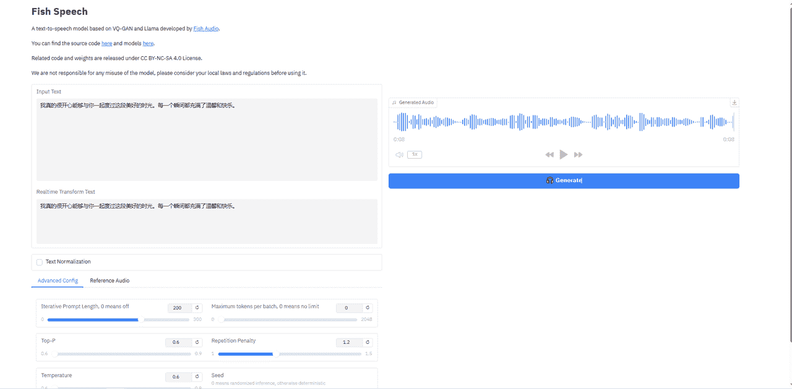

### 三. 效果展示

#### **中文句子 1**

```
人间灯火倒映湖中，她的渴望让静水泛起涟漪。若代价只是孤独，那就让这份愿望肆意流淌。
流入她所注视的世间，也流入她如湖水般澄澈的目光。
```

| **说话人** | **输入音频** | **合成音频** |
| --- | --- | --- |
| 纳西妲 (原神) |  |  |
| 随机说话人 1 |  |  |
| 随机说话人 2 |  |  |


[0_input.wav](https://internal-api-drive-stream.feishu.cn/space/api/box/stream/download/all/NNx8bBqCGordbMxZ8vzcJoJ2nhb)


[0_output.wav](https://internal-api-drive-stream.feishu.cn/space/api/box/stream/download/all/LJmgbPP0fon2fIx8M6UcLS9Pnke)


[1_output.wav](https://internal-api-drive-stream.feishu.cn/space/api/box/stream/download/all/BB1Ob7lTtosNGmxTPN3cCTb2nKh)


[2_output.wav](https://internal-api-drive-stream.feishu.cn/space/api/box/stream/download/all/GWakb0Li5omFvAxgUyfcZGVynXd)

可以听到，合成的语音很流畅，下面我们进行苛刻的中文句子测试。

#### 特殊中文句子 1

```
小王是个不怕折腾的年轻人，他总是充满活力地寻找各种机会。有一次，他决定自己创业开一家小店，但因为缺乏经验，在初期遇到了很多困难，甚至一度担心会折本。不过，通过不断地努力和调整策略，比如优化进货渠道避免商品积压造成损失，以及亲自设计店面布局吸引顾客，最终成功让生意步入正轨，并且没有再出现任何折断发展的迹象。
```

| **说话人** | **合成音频** |
| --- | --- |
| 随机说话人 |  |


[多音字测试.wav](https://internal-api-drive-stream.feishu.cn/space/api/box/stream/download/all/EvGubdpWfoQR6LxnBWzc9SU2nee)

可以看到在多音字的测试结果中，Fish-Speech模型没有做到百分百的正确，一个意外发现：”地“字没有正确发音，都发声为"di1"，所以下面我专门针对多音字”地“来测试下这个模型的性能。

#### 特殊中文句子 2

```
在广阔的田野地面上，孩子们欢快地奔跑着，他们兴奋地讨论着谁跑得最远、跳得最高。小明突然指着远处说：“看，那边的花开得多美丽地”。
```

可以听到，“地”字的发音正确率很低。后续，大家可以多测试下。

| **说话人** | **合成音频** |
| --- | --- |
| 随机说话人 |  |


[“地”字测试.wav](https://internal-api-drive-stream.feishu.cn/space/api/box/stream/download/all/GtXebwxGIoA3NxxHUPkcpIHWn1e)

#### 特殊中文句子 3

```
在学习语言的过程中，我们不仅要掌握听、说、读、写的基本技能，还需要了解背后的文化背景。比如，在日常交流中适当地使用一些English words 可以使我们的表达更加丰富多彩。特别是在国际化的今天，having some basic knowledge of different languages 是非常有帮助的。
```

| **说话人** | **合成音频** |
| --- | --- |
| 随机说话人 |  |


[中英夹杂 .wav](https://internal-api-drive-stream.feishu.cn/space/api/box/stream/download/all/Sc2rbTNfHoifk4xGaZQcwoVMn0g)

#### 英文句子 1

```
In the realm of advanced technology, the evolution of artificial intelligence stands as a 
monumental achievement. This dynamic field, constantly pushing the boundaries of what 
machines can do, has seen rapid growth and innovation. From deciphering complex data 
patterns to driving cars autonomously, AI&#x27;s applications are vast and diverse.
```

| **说话人** | **合成音频** |
| --- | --- |
| 随机说话人 |  |


[英文测试.wav](https://internal-api-drive-stream.feishu.cn/space/api/box/stream/download/all/Itu6bGj0Hob7Mux2Qb9cGWLAn8b)

英文听起来很不错，其他语言，大家可以线下自己试试。

#### [附-官网地址： Fish](https://fish.audio/zh-CN/) Audio官网

## 2.3.4 Edge-TTS

Edge-TTS是由微软推出的文本转语音Python库，通过微软Azure Cognitive Services转化文本为自然语音。适合需要语音功能的开发者，GitHub上超3000星。作为国内付费TTS服务的替代品，Edge-TTS支持40多种语言和300种声音，提供优质的语音输出，满足不同开发需求。该库提供了一个简单的API，可以将文本转换为语音，并且支持多种语言和声音。允许你在Python代码中或使用提供的命令行工具轻松访问Microsoft Edge的在线文字转语音服务。要使用Edge-TTS库，首先需要安装上Edge-TTS库，安装直接使用pip 进行安装即可。

### 安装edge-tts

使用pip安装

```
pip install edge-tts
```

### 基本使用

#### 2.1 命令行使用

##### **文本转语音**

```
edge-tts --text &quot;你好，世界！&quot; --write-media hello.mp3 
```

其中，"edge-tts"是命令，"text"后面跟着的是要合成的文字，"write-media"后面需要保存的语音文件（这里可以指定文件路径，用引号包围起来了。我的默认在当前用户名目下。）

注意:若不指定合成语言的话，默认语言和你的合成文本有关，若待合成的文本是中文，则合成的发音人默认是中文；若待合成的文本是英文，则合成的发音人默认是英文。那如何指定发音人呢？我们需要改变语音，来实现符合自己要求的语音。

##### **支持的语言和音色**

```
# 查看可用的声音角色列表，推荐 zh-CN-XiaoxiaoNeural 女性，声音好听，也有部分角色是方言
edge-tts --list-voices

Name: af-ZA-AdriNeural Gender: Female
........
........
........
Name: zh-CN-XiaoxiaoNeural Gender: Female
Name: zh-CN-XiaoyiNeural Gender: Female
Name: zh-CN-YunjianNeural Gender: Male
Name: zh-CN-YunxiNeural Gender: Male
Name: zh-CN-YunxiaNeural Gender: Male
Name: zh-CN-YunyangNeural Gender: Male
Name: zh-CN-liaoning-XiaobeiNeural Gender: Female
Name: zh-CN-shaanxi-XiaoniNeural Gender: Female
Name: zh-HK-HiuGaaiNeural Gender: Female
Name: zh-HK-HiuMaanNeural Gender: Female
Name: zh-HK-WanLungNeural Gender: Male
Name: zh-TW-HsiaoChenNeural Gender: Female
Name: zh-TW-HsiaoYuNeural Gender: Female
Name: zh-TW-YunJheNeural Gender: Male
Name: zu-ZA-ThandoNeural Gender: Female
Name: zu-ZA-ThembaNeural Gender: Male
```

这里会打印出来所有支持的语音（dge-tts支持英语、汉语、日语、韩语、法语等40多种语言，共300多种可选声音），查询结果中的Gender为声音的性别，Name为声音的名字，如zh-CN-YunjianNeural，其中zh表示语言，CN表示国家或地区，可以根据需求选择不同的声音。我们使用zh-CN-YunxiNeural，来听听zh-CN-YunxiNeural生成的语音。这里我们只需要添加--voice命令，来指定输出的语音。

```
edge-tts --voice zh-CN-YunxiNeural --text &quot;hello 大家好，这里是程序员盒子&quot; --write-media hello.mp3
```

##### 调整语速、音量和音调

当然edge-tts还支持调整语速与音量，我们只需要添加rate与volume指令。

```
edge-tts --voice zh-CN-YunxiNeural --rate=-4% --text &quot;hello 大家好&quot; --write-media hello1.mp3
edge-tts --voice zh-CN-YunxiNeural --volume=-4% --text &quot;hello 大家好&quot; --write-media hello1.mp3
```

rate=-4% 意思是语速降低4%，volume=-4%意思是音量降低4%，当然若是加号，便是增加多少。

#### 2.2 集成EdgeTTS（Python代码使用）

在上面的介绍中，我们使用的是命令的方式来运行合成语音文件，但是如果是个web产品，如何集成这个能力呢？其实我们就是希望可以得倒一个API接口，可以直接调用api，实现TTS功能的产品化。

这里使用python的FastApi提供了一个POST请求的接口，创建tts.py:

```
imp**ort **uvico**rn
i**mport edge_tts
from fastapi import FastAPI, Request, Body

app = FastAPI()
@app.post(&quot;/api/tts&quot;)
async def post_data(text: str = Body(&#x27;&#x27;, title = &#x27;文本&#x27;, embed = True),
                    voice: str = Body(&#x27;&#x27;, title = &#x27;语言参数&#x27;, embed = True),
                    name: str = Body(&#x27;&#x27;, title = &#x27;文件名&#x27;, embed = True),
                    rate: str = Body(&#x27;&#x27;, title = &#x27;文件名&#x27;, embed = True),
                    volume: str = Body(&#x27;&#x27;, title = &#x27;文件名&#x27;, embed = True)):
    output = &quot;/home/work/tts/result/&quot; + name + &quot;.mp3&quot;
    tts = edge_tts.Communicate(text = text, voice = voice, rate = rate, volume=volume)
    await tts.save(output)
    return {&quot;message&quot;: output}
if name == &#x27;main&#x27;:
    uvicorn.run(&#x27;tts:app&#x27;, host = &#x27;0.0.0.0&#x27;, post = 8080)
```

创建启动文件 tts.sh

```
nohup uvicorn tts:app --host 0.0.0.0 --port 8080 &gt;../tts/tts.log &amp;
```

这条命令意在后台启动服务并记录日志。nohup 命令可以让进程在用户退出终端后继续运行，而&符号则是将整个命令放到后台执行。日志会被重定向到 ../tts/tts.log 文件中。

--host 0.0.0.0表示允许搜索id可以访问这个api服务，--port 8080是访问端口（可以修改）。

后面可以通过curl方式调用edge-tts服务了，好啦，人人都可以搭建一套自己的TTS服务啦。

### 测试效果

现在让我们愉快的测试edge-tts的合成效果吧（为了体现对比性，我们所使用的测试文本和Fish Speech的测试文本相同）

#### **中文句子 1**

```
人间灯火倒映湖中，她的渴望让静水泛起涟漪。若代价只是孤独，那就让这份愿望肆意流淌。
流入她所注视的世间，也流入她如湖水般澄澈的目光。
```

| **说话人** | **合成音频** |
| --- | --- |
| 陕西方言的女声 |  |
| 台湾口音 |  |


[out1.mp3](https://internal-api-drive-stream.feishu.cn/space/api/box/stream/download/all/RhGobtiTfoZam4xChOVcNrj9ndg)


[out2.mp3](https://internal-api-drive-stream.feishu.cn/space/api/box/stream/download/all/XfcfbmriUos8ukxqcDfcudOfnxb)

#### 特殊中文句子 1

```
小王是个不怕折腾的年轻人，他总是充满活力地寻找各种机会。有一次，他决定自己创业开一家小店，但因为缺乏经验，在初期遇到了很多困难，甚至一度担心会折本。不过，通过不断地努力和调整策略，比如优化进货渠道避免商品积压造成损失，以及亲自设计店面布局吸引顾客，最终成功让生意步入正轨，并且没有再出现任何折断发展的迹象。
```

| **说话人** | **合成音频** |
| --- | --- |
| 随机说话人 |  |


[多音字测试.mp3](https://internal-api-drive-stream.feishu.cn/space/api/box/stream/download/all/XvUXbPIbpowjMlxYHCScttPsncb)

看以听到，和Fish-Speech相比，edge-tts对于多音字的发音，准确率很高，那我们也测试“地”字的发音

#### 特殊中文句子 2

```
在广阔的田野地面上，孩子们欢快地奔跑着，他们兴奋地讨论着谁跑得最远、跳得最高。小明突然指着远处说：“看，那边的花开得多美丽地”。
```

| **说话人** | **合成音频** |
| --- | --- |
| 随机说话人 |  |


[“地”字测试.mp3](https://internal-api-drive-stream.feishu.cn/space/api/box/stream/download/all/MZTEbyfSloVKsExIqvlcsb9Tntf)

针对“地”字的发音，edge-tts也很准确的发音正确

#### 特殊中文句子 3

```
在学习语言的过程中，我们不仅要掌握听、说、读、写的基本技能，还需要了解背后的文化背景。比如，在日常交流中适当地使用一些English words 可以使我们的表达更加丰富多彩。特别是在国际化的今天，having some basic knowledge of different languages 是非常有帮助的。
```

| **说话人** | **合成音频** |
| --- | --- |
| 随机说话人 |  |


[中英夹杂.mp3](https://internal-api-drive-stream.feishu.cn/space/api/box/stream/download/all/AjI5bWAfqoCLIWxaT7WcTQtRnpb)

总体而言，无需安装Microsoft Edge浏览器、不依赖Windows操作系统和API密钥，就能利用微软Edge提供的在线文本转语音功能。该项目是直接调用微软 Edge 浏览器的文本朗读有关 API 实现的文本转语音功能，不需要本地部署模型，使用简单，声音效果好。

### 缺点

+   无法控制情感

+   不支持音色克隆，只能用预定义音色