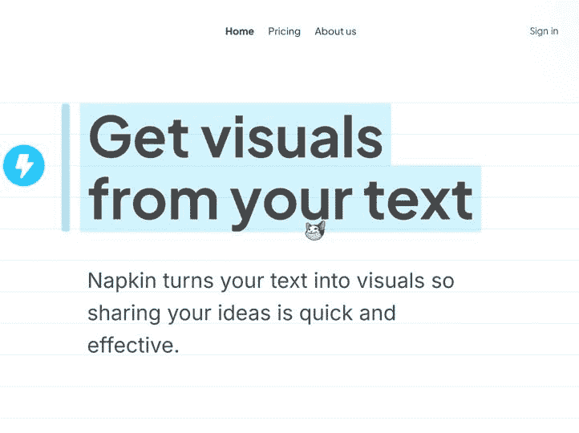
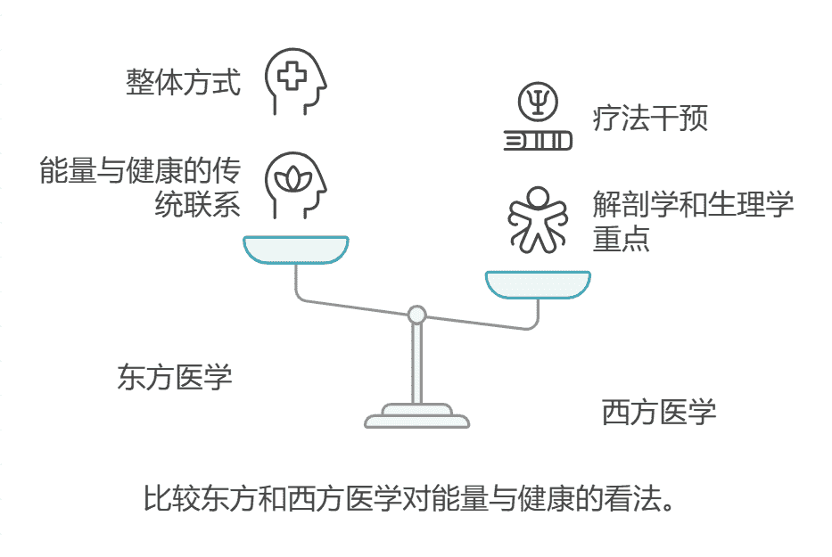
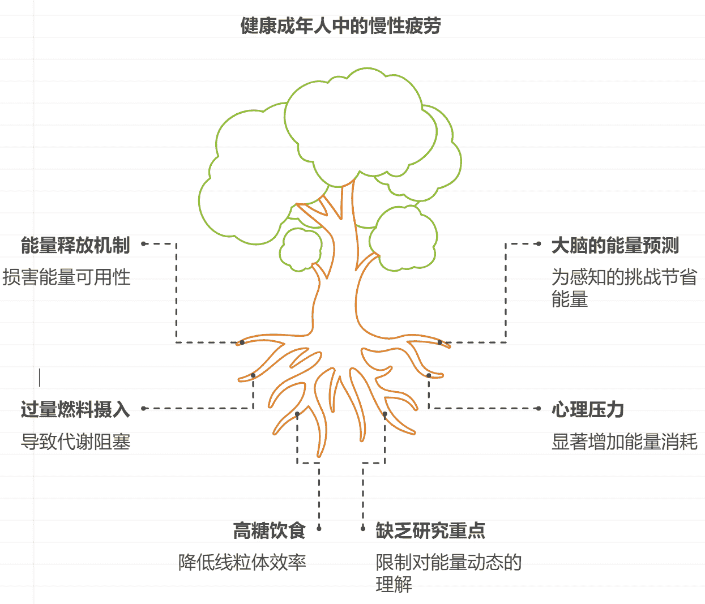
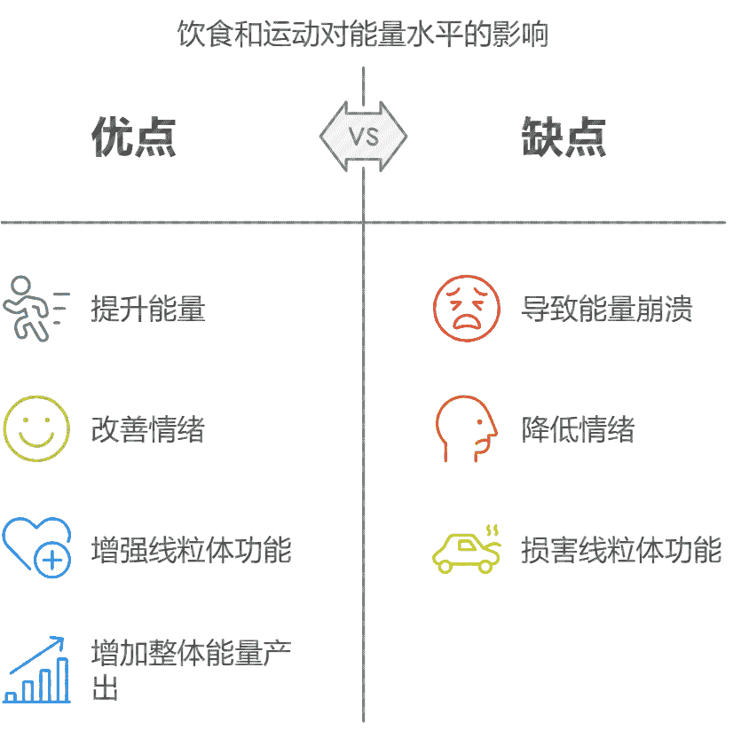
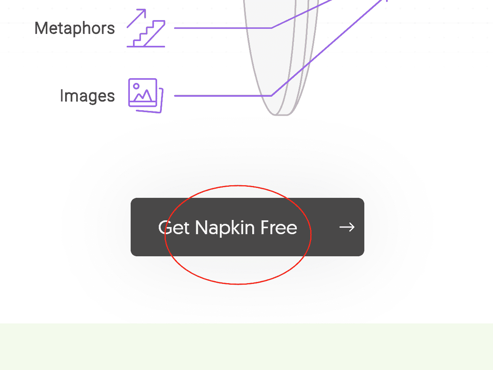
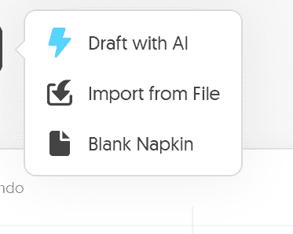
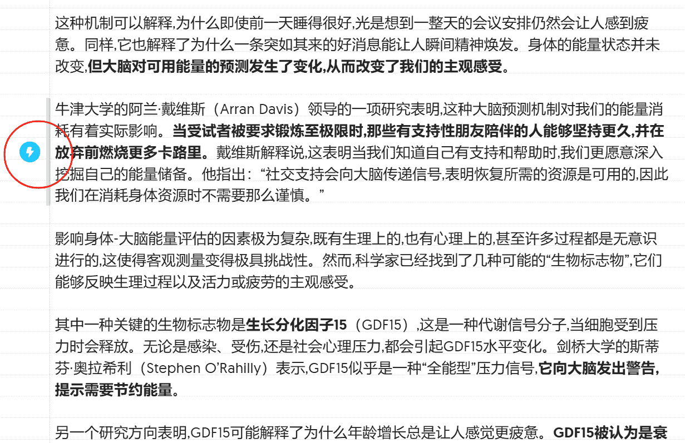
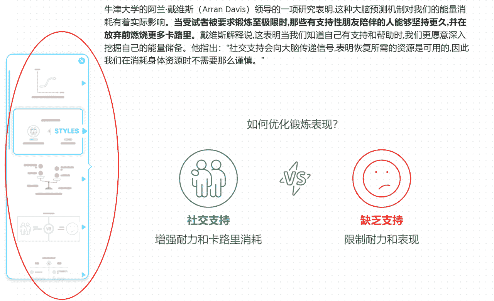
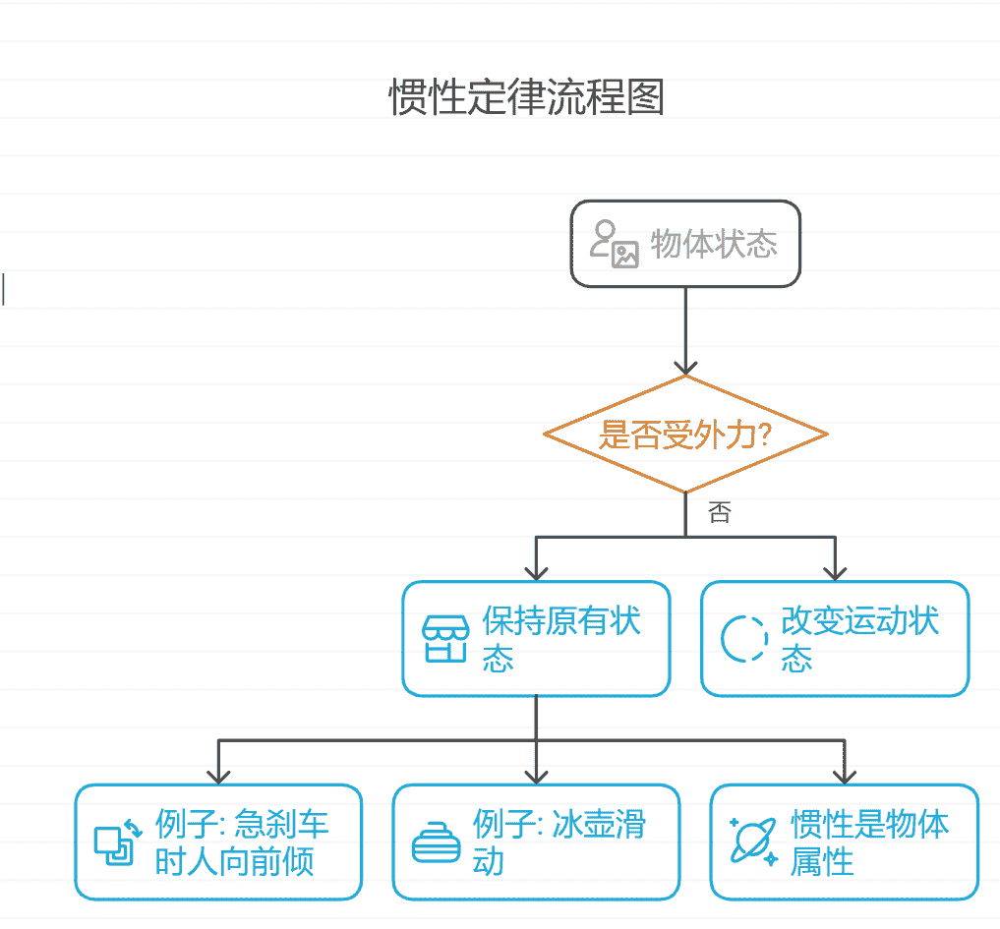
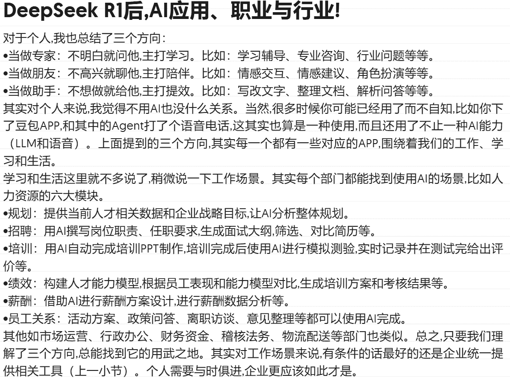

# Napkin AI：PPT配图

> 来源：[https://datawhaler.feishu.cn/docx/G1J2dJRJdozgdWxfC7ncg0eenBf](https://datawhaler.feishu.cn/docx/G1J2dJRJdozgdWxfC7ncg0eenBf)

不知道大家平时有没有遇到过这样的问题：短视频看久了，一看到密密麻麻的文字就晕字；准备做PPT汇报项目进展，却花了一半时间在画各种流程图上面。

作为一名之前工作需要高强度画PPT的人，我仍然记得一页PPT画一个小时的酸爽。虽然梳理逻辑的过程很舒服，但是也是真费时间。

最近就尝试了在可视化领域很出名的一款AI产品，Napkin AI。它最大的特点就是能一键将冗长的文字转化成各种图形。

Talk is cheap，我们先来看看效果：

[bandicam 2025-03-21 18-09-59-190.mp4](https://internal-api-drive-stream.feishu.cn/space/api/box/stream/download/all/EQyGbvhKeoy1V3xR0Yzcddh7nlf)

这里做了什么事情呢？其实就是我把一篇文章的内容，导入napkin，然后选中全文，让它生成了一张可视化的图。

这些信息图都是napkin生成的，整个过程不到1min，非常丝滑。

而且生成之后的文字和图形都可以修改，下载之后马上就能插入PPT里。节省了我们平时为了作图耗费的大量时间。

它是怎么做到的呢？

napkin用AI分析我们选中的文字，自动匹配后台的信息图模板，生成对应的成图供我们选择。

看到这里的朋友，可能想要开始尝试看看了，我这里也总结了零门槛操作步骤：

1.  进入官网。链接在这里：https://www.napkin.ai/

1.  点击进入napkin

1.  napkin提供了3种生成信息图的方式

1.  最上面一种：直接用napkin来生成文字，再生成对应的信息图。不太推荐

1.  中间：从文件里识别文字，生成信息图。适合已经有文档的情况

1.  最下面一种：napkin会给你一个空白文档，你可以自由粘贴文字进去，选择对应的文字生成信息图。是最自由的方式

1.  我们直接选择最下面一种方式，进入一个空白的文档。

1.  然后把要生成信息图的文字粘贴进来。如果不知道粘什么，这里提供了一个例子：https://mp.weixin.qq.com/s/FLKOEKQx6VB33oaugOtgBg

1.  我们直接点击蓝色闪电标志，生成这一段的信息图。

1.  等待几秒钟之后，对应的信息图就生成了。我们可以选择不同的模板、修改文字、图形位置等等。

1.  生成好的图形，可以下载下来，也可以直接截图放到要用的地方。

到这里，你就已经学会napkin的用法啦。

延伸思考，这个能力还可以应用到哪些场景呢？

> 高中物理老师：用来将知识点可视化

> 分析师：用来快速梳理公司发展历程

> 创作者：用来给文章配图，避免读者看到太长的文字“干噎酸奶”

刚好早上看到@长琴一篇写得很好的文章，来试试效果~

这张图非常形象，一下子就理解了个人应用AI的3个方向

此外，还可以用napkin来生成小红书封面、法律领域可以用来生成案情关系图等等，这里就不演示啦，留给各位试一试~

在使用napkin的过程中，其实也能发现一些不足之处。比如：

1.  提供图片给napkin，想让它根据图上的文字，生成信息图。目前napkin就做不到

1.  想让napkin生成excel中的图表，也做不到

1.  虽然模板比较多，但是图形风格都比较统一，自由度受到一定限制

以上这些问题都可以通过其他产品来解决，这里先留个坑。

目前能看到的一个趋势是，随着各种AI编程、文生3D产品的成熟，以及MCP这样的标准化协议的发展，未来文字可视化的工作会变得越来越简单。

我们在网络上将会接受到更多混合模态（就是图文视频等等的混合）的内容，信息理解门槛进一步下放。

> 更多内容会持续更新到公众号“二十一克重”，下周预计更新AI工具在数字营销领域的应用

> 欢迎催更！

---

> 本文作者：@椰子leaf

<https://datawhaler.feishu.cn/sync/LfRzdAExlsoykRbUZymc0Jrfngh>

# 欢迎投稿参与共建、下次微学习就学你的内容！

<https://datawhaler.feishu.cn/sync/CPNrdTvwgshasbb2UjecLzVinPe>