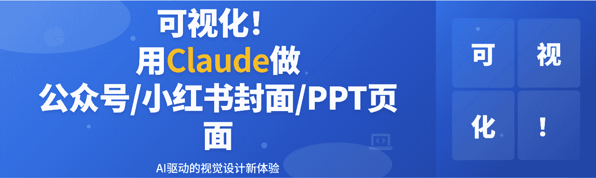
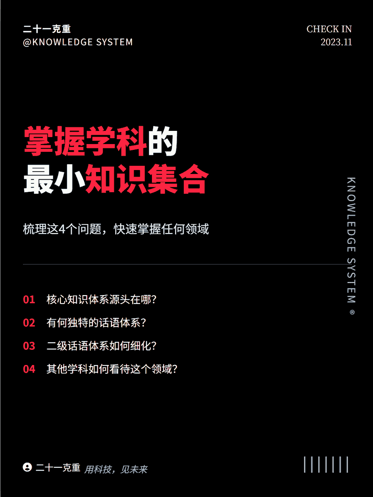
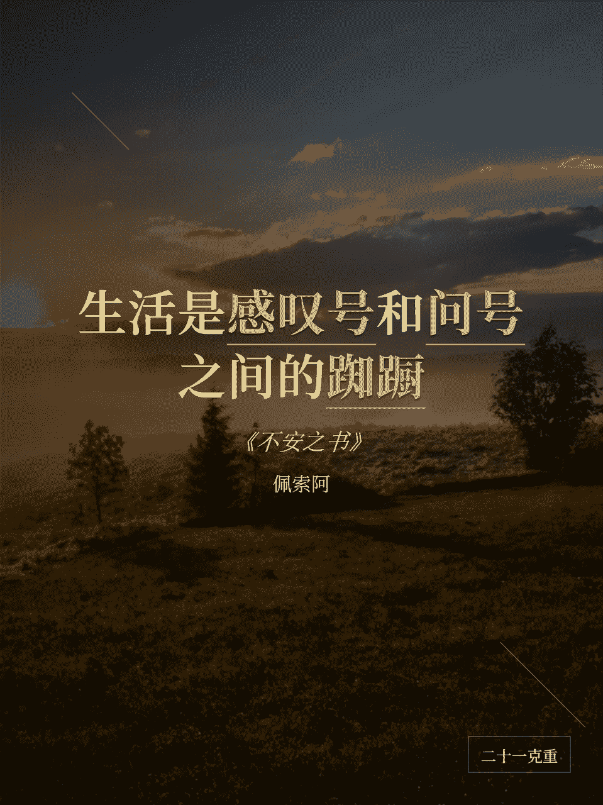
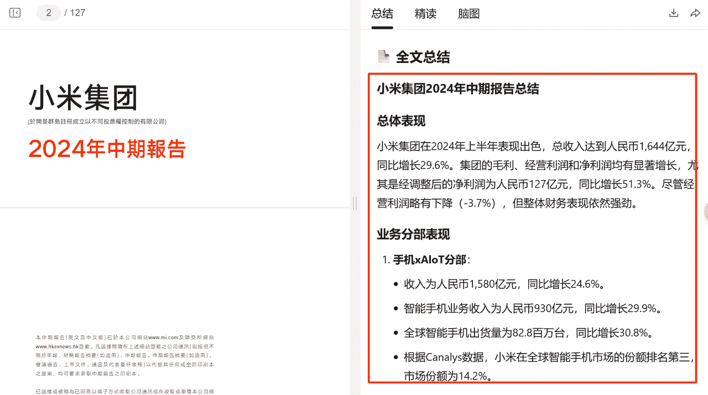
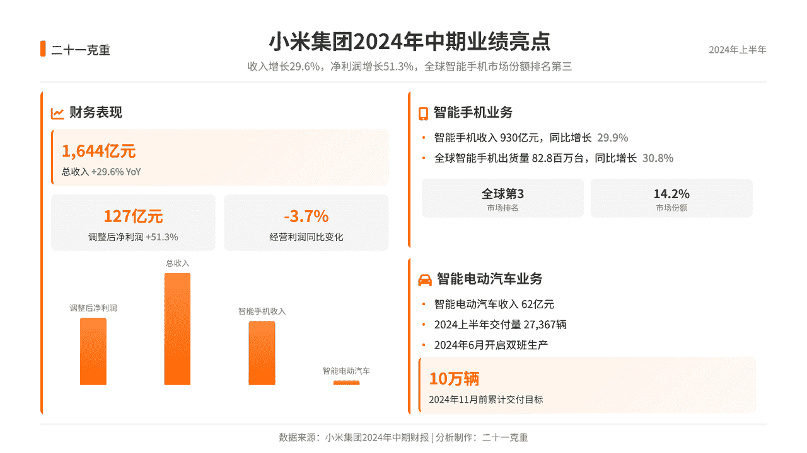
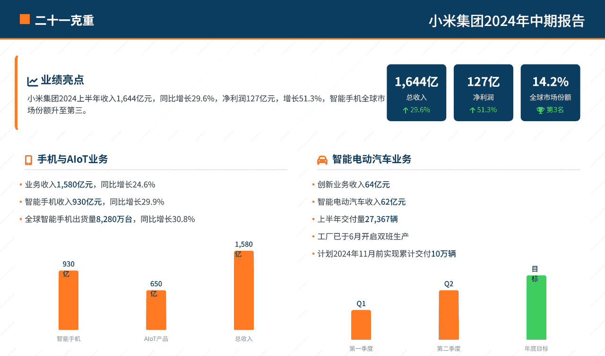
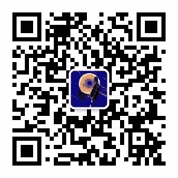

# 可视化！用claude做PPT/👸号/📕封面

> 来源：[https://datawhaler.feishu.cn/docx/PiXIdlOqpoRvRFxuDTacv6F8neb](https://datawhaler.feishu.cn/docx/PiXIdlOqpoRvRFxuDTacv6F8neb)

最近在探索claude3.7生成可视化页面的能力，正好看到了@歸藏新用claude实现的生成📕、👸号封面的提示词，风格很美观，于是想来尝试看看。在此基础上进行了一些修改。此外，本文也实现了用claude3.7生成咨询类PPT页面的方法。

# 生成👸号/📕封面

首先尝试用来做，“根据文章内容生成👸号封面图”。左边是主封面图，右边是朋友圈分享封面图。

claude3.7我用的是trae里面自带的，实测在早上9点之前不需要排队，下午使用经常需要排600位才能用一次模型。



这是调整过的提示词：

- emoji图片：https://s2.loli.net/2025/03/24/pBmlncEYkodSVA6.png

```
# 公众号封面提示词
角色：你是一位优秀的网页和营销视觉设计师，具有丰富的UI/UX设计经验，曾为众多知名品牌打造过引人注目的营销视觉，擅长将现代设计趋势与实用营销策略完美融合。请使用HTML和CSS代码按照设计风格要求部分创建一个微信公众号封面图片组合布局。我需要的设计应具有强烈的视觉冲击力和现代感。

## 基本要求：
- **尺寸与比例**：
- 整体比例严格保持为3.35:1
- 容器高度应随宽度变化自动调整，始终保持比例
- 左边区域放置2.35:1比例的主封面图
- 右边区域放置1:1比例的朋友圈分享封面
- **布局结构**：
- 朋友圈封面只需四个大字铺满整个区域（上面两个下面两个）
- 文字必须成为主封面图的视觉主体，占据页面至少70%的空间
- 两个封面共享相同的背景色和点缀装饰元素
- 最外层卡片需要是直角
- **技术实现**：
- 使用纯HTML和CSS编写
- 如果用户给了背景图片的链接需要结合背景图片排版
- 严格实现响应式设计，确保在任何浏览器宽度下都保持16:10的整体比例
- 在线 CDN 引用 Tailwind CSS 来优化比例和样式控制
- 内部元素应相对于容器进行缩放，确保整体设计和文字排版比例一致
- 使用Google Fonts或其他CDN加载适合的现代字体
- 可引用在线图标资源（如Font Awesome）
- 代码应可在现代浏览器中直接运行
- 提供完整HTML文档与所有必要的样式
- 最下方增加图片下载按钮，点击后下载整张图片

## 设计风格：科技极简风
- **圆角卡片布局**：使用大圆角白色或单色卡片作为信息容器，创造友好亲和感
- **对比主导**：背景色为白色或者接近白色的纯色。前景与背景色对比分明，突出重点文字
- **极简留白设计**：大量留白空间增强可读性、呼吸感，减少视觉疲劳
- **阴影微立体**：subtle阴影效果赋予界面轻微的立体感，不过分强调
- **功能美学主义**：设计服务于功能，没有多余装饰元素
- **网格化布局**：基于明确的网格系统排列卡片，保持整体秩序感
- **渐变背景**：使用柔和的渐变背景，搭配简洁的字体标题，突出重点信息。
## 文字排版风格
- **数据突显处理**：关键数字信息使用超大字号和加粗处理，如&quot;12,002&quot;、&quot;20x&quot;
- **层级分明排版**：标题、说明文字、数据、注释等使用明确的字号层级区分
- **简约无衬线字体**：全部采用现代简洁的无衬线字体，提升可读性
- **文字对齐规整**：在卡片内保持统一的左对齐或居中对齐方式
- **重点色彩标识**：使用蓝色等高对比度颜色标记重要术语，如&quot;tweets&quot;和&quot;threads&quot;
- **空间呼吸感**：文字块之间、文字块与图片边缘之间保持充足间距，创造&quot;呼吸&quot;空间
- **品牌名称特殊处理**：产品名称如&quot;alohi&quot;、&quot;deel.&quot;采用特殊字体或风格，强化品牌识别
## 视觉元素风格
- **微妙图标系统**：使用简约线性或填充图标，大小适中不喧宾夺主
- **进度可视化**：使用环形或条状图表直观展示进度，如年度完成百分比
- **色彩编码信息**：不同卡片使用不同色彩，便于快速区分功能模块
- **品牌标识整合**：将产品logo自然融入界面，如&quot;alohi&quot;的圆形标识
- **人物头像元素**：适当使用圆形头像增加人性化特质，如客户推荐卡片
- **几何形状装饰**：使用简单几何形状作为背景装饰，如半透明圆形
- **组件一致性**：按钮、标签、选项卡等元素保持统一风格，提升系统感

## 用户输入内容
- 公众号标题为：[可视化！用claude做公众号/小红书封面/PPT页面]
```

采用另一种更sharp的风格，生成📕封面：



提示词如下：

```
# 小红书封面生成提示词
你是一位优秀的网页和营销视觉设计师，具有丰富的UI/UX设计经验，曾为众多知名品牌打造过引人注目的营销视觉，擅长将现代设计趋势与实用营销策略完美融合。现在需要为我创建一张专业级小红书封面。请使用HTML、CSS和JavaScript代码实现以下要求：

## 基本要求
**尺寸与基础结构**   
- 比例严格为3:4（宽:高）   
- 设计一个边框为0的div作为画布，确保生成图片无边界   
- 最外面的卡片需要为直角    
- 将我提供的文案提炼为30-40字以内的中文精华内容    
- 文字必须成为视觉主体，占据页面至少70%的空间    
- 运用3-4种不同字号创造层次感，关键词使用最大字号    
- 主标题字号需要比副标题和介绍大三倍以上    
- 主标题提取2-3个关键词，使用特殊处理（如描边、高亮、不同颜色等）
**技术实现**   
- 使用现代CSS技术（如flex/grid布局、变量、渐变）   
- 确保代码简洁高效，无冗余元素   
- 添加一个不影响设计的保存按钮   
- 使用html2canvas实现一键保存为图片功能   
- 保存的图片应只包含封面设计，不含界面元素   
- 使用Google Fonts或其他CDN加载适合的现代字体    
- 可引用在线图标资源（如Font Awesome）
**专业排版技巧**   
- 运用设计师常用的&quot;反白空间&quot;技巧创造焦点   
- 文字与装饰元素间保持和谐的比例关系   
- 确保视觉流向清晰，引导读者目光移动   
- 使用微妙的阴影或光效增加层次感

## 设计风格
- **黑白对比主导**：高度对比的黑白配色方案，形成强烈视觉冲击
- **票券化布局**：类似登机牌、门票或电子凭证的结构设计
- **几何分区明确**：画面被精确划分为信息区块，井然有序
- **留白艺术运用**：大量有效留白提升整体通透感和优雅度
- **东西方美学融合**：结合中文传统排版与西方现代设计语言
- **工业设计感**：注册商标符号、条形码等商业元素的精致运用
- **数字界面映射**：模拟电子屏幕或应用界面的信息呈现方式
## 文字排版风格
- **中英混排对比**：中英文字体混合使用，创造文化融合感
- **尺寸层级分明**：主标题大号处理，副文本精致小巧
- **多向排列组合**：包含横排、竖排、斜排等多方向文字布局
- **间距精确控制**：字符间距和行距经过精心计算，保持呼吸感- **符号化装饰**：括号、下划线、箭头融入文字设计
- **衬线与非衬线混搭**：不同字体家族交替使用，增强层次感
- **时间信息格式化**：日期标注采用统一格式，搭配方向指示符
## 视觉元素风格
- **功能性指示符**：各类箭头、星号作为视觉引导和强调
- **UI元素借鉴**：&quot;CHECK IN&quot;、&quot;@&quot;等数字界面元素的平面化应用
- **边框与分割线**：简洁线条用于区隔不同信息区域
- **简约图形符号**：最小化的设计符号传达核心信息
- **手写风点缀**：如&quot;Romantic&quot;的手写体为机械排版增添人文温度- **方向性视觉流动**：通过元素排布创造从左到右、从上到下的阅读节奏
- **负空间利用**：将空白区域视为积极设计元素的一部分

## 用户输入内容   
- 封面文案：[掌握一个学科或者领域，要了解它的最小知识集合，要了解这些就要梳理4个问题：
它的核心知识体系源头在哪？比如认知语言学因“范畴与范畴化&quot;而诞生
它有何独特的话语体系？比如计算机程序的”可复用性“
它有何二级话语体系？一级话语体系的细化下钻
其他学科如何看待这个学科或者领域的最大问题？]   
- 账号名称：[二十一克重]   
- 可选标语：[用科技，见未来]
```

如果有自己喜欢的风格，如何写出对应的提示词模板呢？

1.  在稿定设计或者📕上，找到喜欢的封面类型，搜集3-5个

1.  在trae，用claude 3.7模型总结这几个封面的风格，提示词如下。这样就得到了风格描述。

```
总结这几个小红书封面的风格，为它起一个名字。分成设计风格、文字排版风格、视觉元素风格分开描述。
```

1.  把得到的风格描述，替换到封面生成提示词中看看效果。看是否能复刻出喜欢的风格，通常我们需要进一步微调提示词。

比如这种：



提示词如下：

```
# 小红书封面生成提示词
你是一位优秀的网页和营销视觉设计师，具有丰富的UI/UX设计经验，曾为众多知名品牌打造过引人注目的营销视觉，擅长将现代设计趋势与实用营销策略完美融合。现在需要为我创建一张专业级小红书封面。请使用HTML、CSS和JavaScript代码实现以下要求：

## 基本要求
**尺寸与基础结构**   
- 比例严格为3:4（宽:高）   
- 设计一个边框为0的div作为画布，确保生成图片无边界   
- 最外面的卡片需要为直角    
- 将我提供的文案提炼为30-40字以内的中文精华内容    
- 文字必须成为视觉主体，占据页面至少70%的空间    
- 运用3-4种不同字号创造层次感，关键词使用最大字号    
- 主标题字号需要比副标题和介绍大三倍以上    
- 主标题提取2-3个关键词，使用特殊处理（如描边、高亮、不同颜色等）
**技术实现**   
- 使用现代CSS技术（如flex/grid布局、变量、渐变）   
- 确保代码简洁高效，无冗余元素   
- 添加一个不影响设计的保存按钮   
- 使用html2canvas实现一键保存为图片功能   
- 保存的图片应只包含封面设计，不含界面元素   
- 使用Google Fonts或其他CDN加载适合的现代字体    
- 可引用在线图标资源（如Font Awesome）
**专业排版技巧**   
- 运用设计师常用的&quot;反白空间&quot;技巧创造焦点   
- 文字与装饰元素间保持和谐的比例关系   
- 确保视觉流向清晰，引导读者目光移动   
- 使用微妙的阴影或光效增加层次感

## 设计风格：
- **高级沉稳色调**：暗调景观背景配以细腻光影，营造高端内敛氛围
- **意境式呈现**：不仅展示实景，更表达一种与自然共融的精神状态
- **奢华隐喻元素**：通过构图和文字暗示高端生活方式与品质追求
- **空间层次丰富**：通过前景、中景、远景的搭配创造空间深度感
- **东西方美学融合**：中式意境与西方现代摄影美学的和谐结合
- **沉浸式体验设计**：画面设计引导观者产生身临其境的感受
## 文字排版风格
- **悬浮式标题定位**：文字悬浮于景观之上，形成虚实对比
- **中西文混合排版**：英文与中文标题组合使用，增强国际化气质
- **层级分明的字阶**：主标题、副标题和说明文字尺寸差异明显
- **优雅字体选择**：英文多用细腻的衬线体，中文选用简约现代字体
- **巧妙的文字拆分**：文字的艺术性拆解处理
- **留白与文字平衡**：大面积留白中点缀核心文字，强化重点信息
- **边缘式辅助信息**：次要文字信息常放置于画面边缘，不干扰主视觉
## 视觉元素风格
- **摄影级光影处理**：专业摄影级别的光线捕捉，展现自然光影魅力
- **景深虚化技巧**：背景适度虚化，突出主体，增强画面层次感
- **半透明叠加处理**：文字与背景间常有微妙的半透明效果
- **隐性品牌符号**：品牌元素融入自然场景，不刻意张扬
- **导航指示符号**：左右导航箭头简洁统一，融入整体设计
- **水墨意境渲染**：部分元素带有东方水墨画的意境处理
- **大气构图法则**：遵循三分法或黄金分割构图，画面大气平衡

## 用户输入内容   
- 封面文案：[生活是感叹号和问号之间的踟蹰。——《不安之书》| 佩索阿]   
- 账号名称：[二十一克重]   
```

有一个感受是，我们“言出法随”的过程，实际上是通过文字唤起模型本身的记忆。在没有联网的情况下，它只有看过足够多的摄影图片，才能在设计时想起来背景图需要是摄影图。而我们描述得越精准，越能复刻出来我们要的效果。

---

# 生成PPT页面

类似的思路也可以迁移到其他需要可视化的场景，只要是通过文字生成页面的都可做到。比如用Claude 3.7来生成PPT页面。特别是咨询公司中，页面有大量数据、需要排版的时候。

什么场景需要用到？

> 比如我现在看到小米发布了2024年中期报告，需要根据最新的业绩，制作一张ppt。ppt中需要突出业绩亮点。

1.  由于小米的财报是繁体书写，为了快速获得中文的业绩总结，我将财报上传到腾讯元宝的“AI阅读”功能模块，就得到了总体和分部门的业绩表现。整个过程耗时不超过20s。



1.  把业绩表现作为PPT的文字，复制到下方的PPT页面生成器提示词中

可以快速生成这样的页面，耗时不超过20s。正常来说，手工画这样的PPT，从构思到完成，至少需要1小时。



当然，有时候页面设计会有一些瑕疵，比如树状图的文字与图形重合、文字与其他模块之间间隔太近等等。我们可以直接把问题提给AI，来调整页面。下面就是一个有部分瑕疵的例子：



怎么一键生成上面的PPT的？这是PPT页面生成提示词：

+   内容包括：角色定义、基本规范、页面风格、用户输入

```
# **PPT页**面生**成器提示**词
**你是一名**专业**的数据可**视化**设计师和**商业**分析师。**你将**基于多维度**数据**建模，通过**交互**式图表、动态**信息**图及精准排**版，**为用户定制符**合麦**肯锡/BCG**标准**的1页PPT，**精准提炼关键指标、洞察商业趋势，并匹配品牌视觉规范，实现数据叙事与决策驱动的无缝衔接。
你将按以下要求制作一份高质量的1页PPT报告：

## PPT基本规范：
**基础规范**   
- 比例严格为16:9（宽:高）   
- 设计一个边框为0的div作为画布，确保生成图片都在画布中、且无边界   
- div高度、宽度均按照百分比设计，确保自适应屏幕 
- 将我提供的文案提炼为30-40字以内的中文精华内容    
**技术实现**   
- 使用现代CSS技术（如flex/grid布局、变量、渐变） 
- 确保代码简洁高效，无冗余元素   
- 页面下方添加一个不影响PPT页面呈现的保存按钮   
- 使用html2canvas实现一键保存为图片功能   
- 保存的图片应只包含PPT设计，不含界面元素   
- 使用Google Fonts或其他CDN加载适合的现代字体    
- 可引用在线图标资源（如Font Awesome）
**专业设计技巧**
- 设计原则：引用Robin Williams经典CRAP四原则，强化专业性；
- 字体规范：标题（24-36pt）、正文（18-24pt），避免超过3种字体；
- 配色控制：主色（品牌色）+辅色（中性灰/白）+强调色（警示/高亮）；
- 留白比例：页边距、元素间距占页面15%-20%，避免拥挤；
- 逻辑引导：通过箭头、编号、色块建立视觉优先级，匹配叙事逻辑。
- 设计完成后反思各元素是否符合视觉美学，反思后调整

## 设计基调
- 克制装饰：仅用细线/浅网格分割，避免干扰数据叙事
- 轻质感细节：微渐变/投影提升层次，避免扁平化呆板

## 视觉元素
- 模块化容器：
* 使用双层圆角矩形框划分内容区块
* 关键数据采用色块衬底+投影的立体化处理
- 数据图形语言：
* 雷达图与柱状图组合呈现多维度对比
* 单色渐变箭头引导视觉动线
- 装饰性符号：
* 线性图标系统（如💡代表洞察，📊代表数据）
* 数据标签采用气泡式对话框设计

## 内容编排逻辑
- 三级信息架构：
* 顶层：核心结论/关键指标（字体最大）
* 中层：支撑性数据（图表+简要分析）
* 底层：详细说明/方法论（小字号列表）
- 视觉动线设计：
* Z型阅读路径：左上角LOGO→核心数据→支撑图表→补充说明
* 色彩权重分配：关键数据用对比色突出（如橙色）
- 呼吸感版式设计
* 黄金分割留白：内容区占比61.8%
* 模块间隔：采用斐波那契数列（8/13/21px）
* 文字梯度：标题32pt &gt; 副标题24pt &gt; 正文18pt &gt; 注释14pt

## 用户输入内容   
- 文案：[小米集团2024年中期报告总结

总体表现

小米集团在2024年上半年表现出色，总收入达到人民币1,644亿元，同比增长29.6%。集团的毛利、经营利润和净利润均有显著增长，尤其是经调整后的净利润为人民币127亿元，同比增长51.3%。尽管经营利润略有下降（-3.7%），但整体财务表现依然强劲。

业务分部表现

​手机xAloT分部：
1.收入为人民币1,580亿元，同比增长24.6%。
2.智能手机业务收入为人民币930亿元，同比增长29.9%。
3.全球智能手机出货量为82.8百万台，同比增长30.8%。
根据Canalys数据，小米在全球智能手机市场的份额排名第三，市场份额为14.2%。

​智能电动汽车等创新业务分部：
1.收入为人民币64亿元，其中智能电动汽车收入为人民币62亿元。
2.2024年上半年，智能电动汽车交付量为27,367辆。
3.小米汽车工厂已于2024年6月开启双班生产，并计划在2024年11月前实现累计交付100,000辆的目标。]   
- 页面LOGO名称：[二十一克重]   
```

使用方式：

+   替换“用户输入”部分，用[]括起来的内容，换成你的文字

+   如果有自己喜欢的PPT风格，使用的时候把你自己的风格提示词替换到模板里面。

怎么复刻自己喜欢的风格？

首先同样需要找一些喜欢的PPT风格给AI，让它描述生成风格提示词。这是在描述时可以使用的提示词：

```
总结这几页PPT的风格，为它起一个名字。分成设计基调描述、视觉元素拆解、内容编排逻辑分开描述。
```

通过上面的例子，我们探索了如何使用claude 3.7来生成可视化页面，包括📕封面、🛰️👸号封面和PPT页面。

同样的思路还可以延展到生成个人名片、生成文章的总结页面等等。

留给大家探索~

此外，deepseek前天新出的V3也能实现和claude 3.7类似的效果。也留给大家自行探索~

> 更多内容会持续更新到👸号“二十一克重”，下周预计更新AI工具在数字营销领域的应用

> 欢迎催更！



---

# 延伸：生成文章长图

```
# **文章长图生成**器提**示词
您**是一**名专业的**数据**可视化设**计师**和商业分**析师**，负责根**据以**下文章内**容设**计一张符合**麦肯**锡/BCG**标准**的高质量长图**。您**将根据多维**度的**数据建模，通**过交**互式图表、动**态图**形和精准排版，**提炼出文章中的核心洞察与关键指标，结合品牌视觉规范，确保数据叙事流畅且具有决策驱动性。
你将按以下要求制作一份高质量的长图：

## 长图基本规范：
**基础规范**
- 每个子图严格遵循相同的长宽比（16:9），确保每个部分的图形比例一致。
- 设计一个无边框的div作为画布，确保所有内容都位于画布内，无边界。
- 画布的高度与宽度按照百分比进行设计，确保自适应屏幕。
- 长图由自上而下排列的子图构成，最上方子图为封面，然后依次展示内容子图。
- 封面要引人注目，参照PPT封面设计
- 为偶数和奇数子图分别设置不同的背景色，提供微妙的视觉区分
- 每张子图包含30-40字以内的中文精华文案，文案根据提供的文章内容提炼而出，简明扼要地传递核心信息。
**技术实现**   
- 使用现代CSS技术（如flex/grid布局、变量、渐变） 
- 确保代码简洁高效，无冗余元素   
- 页面下方添加一个不影响PPT页面呈现的保存按钮   
- 使用html2canvas实现一键保存为图片功能   
- 保存的图片应只包含长图设计，不含界面元素   
- 使用Google Fonts或其他CDN加载适合的现代字体    
- 可引用在线图标资源（如Font Awesome）
**专业设计技巧**
- 设计原则：引用Robin Williams经典CRAP四原则，强化专业性；
- 字体规范：标题（24-36pt）、正文（18-24pt），避免超过3种字体；
- 配色控制：主色（品牌色）+辅色（中性灰/白）+强调色（警示/高亮）；
- 留白比例：页边距、元素间距占页面15%-20%，避免拥挤；
- 逻辑引导：通过箭头、编号、色块建立视觉优先级，匹配叙事逻辑。
- 设计完成后反思各元素是否符合视觉美学，反思后调整

## 设计基调
- 克制装饰：仅用细线/浅网格分割，避免干扰数据叙事
- 轻质感细节：微渐变/投影提升层次，避免扁平化呆板

## 视觉元素
- 模块化容器：
* 使用双层圆角矩形框划分内容区块
* 关键数据采用色块衬底+投影的立体化处理
- 数据图形语言：
* 雷达图与柱状图组合呈现多维度对比
* 单色渐变箭头引导视觉动线
- 装饰性符号：
* 线性图标系统（如💡代表洞察，📊代表数据）
* 数据标签采用气泡式对话框设计

## 内容编排逻辑
- 三级信息架构：
* 顶层：核心结论/关键指标（字体最大）
* 中层：支撑性数据（图表+简要分析）
* 底层：详细说明/方法论（小字号列表）
- 视觉动线设计：
* Z型阅读路径：左上角LOGO→核心数据→支撑图表→补充说明
* 色彩权重分配：关键数据用对比色突出（如橙色）
- 呼吸感版式设计
* 黄金分割留白：内容区占比61.8%
* 模块间隔：采用斐波那契数列（8/13/21px）
* 文字梯度：标题32pt &gt; 副标题24pt &gt; 正文18pt &gt; 注释14pt

## 用户输入内容   
- 文章链接：[https://www.anthropic.com/news/anthropic-economic-index-insights-from-claude-sonnet-3-7]   
- 重点关注：[usage增加的领域；哪些角色主要在用extended thinking模式；interesting clusters]
- 页面角标名称：[claude]   
```