# 利用DeepSeek生成简历

> 来源：[https://datawhaler.feishu.cn/docx/QIsUd5JzboAmToxqX8NchOSfnec](https://datawhaler.feishu.cn/docx/QIsUd5JzboAmToxqX8NchOSfnec)

> 说在前面

> 找工作必不可少的就是需要简历，但是市面上很多制作简历的网站或者团队都是需要付费才能制作简历并下载简历。作为贫穷的打工人，AI的横空出世，无异于给打工人写简历找了一条免费的捷径之路。

# 怎么使用DeepSeek？

首先对于新手小白而言，最主要的一个问题就是 DeepSeek 如何登陆？

事实上，它提供了一个非常简便的方式，即可以直接通过网页版访问：https://www.deepseek.com/

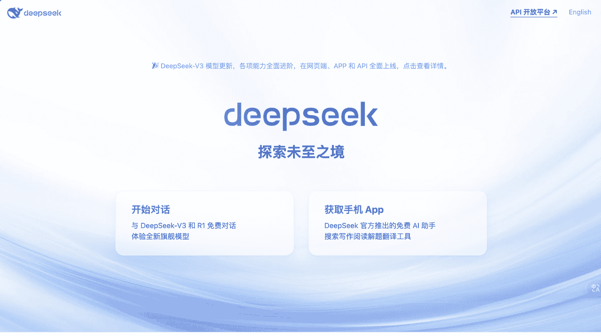

通过点击开始对话，就可以直接通过网页版进行问答了～

在进行问答之前，要先注册手机号哦～

> 冷知识！

> 如果日常手边没有电脑，那怎么办呢？

> DeepSeek 还拥有手机 App，在平常电脑不在身边的时候也能够作为自己的移动知识库～

# 如何制作简历？

在利用DeepSeek 制作简历时，我们需要提前准备什么？

我们要有一份自己的大概的生平经历，这样才能让DeepSeek拥有一个更好的回答。那么接下来就让我们开始实践吧！

## 生成简历

我预设了一个背景：

> 给我生成一份简历的html

> 我的名字叫文熠，97年生人，目前现居地浙江杭州，

> 本科毕业于浙江大学应用统计专业，2015年入学，2019年毕业

> 毕业于浙江大学应用统计硕士专业，2019年入学，2021年毕业

> 毕业之后在A公司工作，工作了三年，工作方向为AIOps方向，

> 我需要的简历的格式分为左右两列，左边一列主要展示个人信息，右边一列展示教育经历，工作经历，以及个人评价。

然后喂给DeepSeek，DeepSeek 随机会通过思考给我们一份 html 代码。

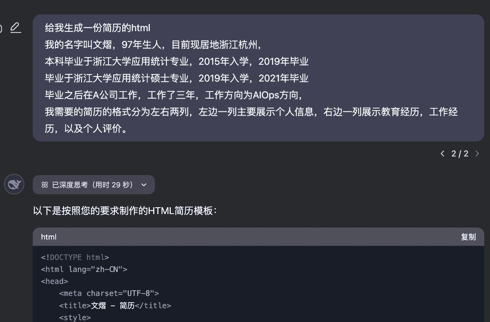

在生成 html 的同时，DeepSeek 还会告诉我们哪些需要进行修改：

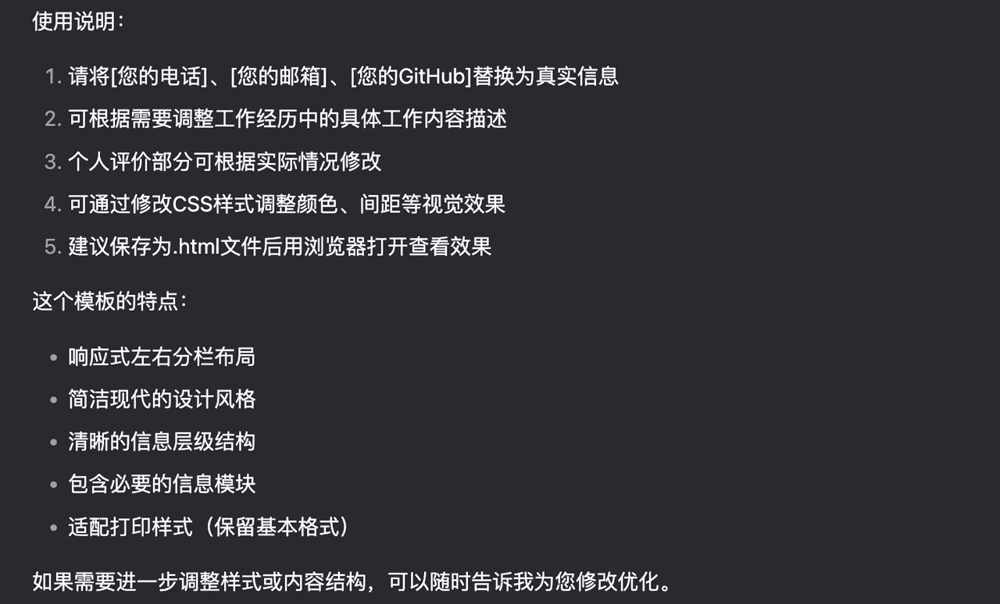

注意！这里有个小 tip，在以前，我们或许还需要将html 的代码复制到本地 txt 文件并且将后缀修改成 html ，但是现在的 DeepSeek 再一次王者归来，它可以直接在页面上生成 html 代码。

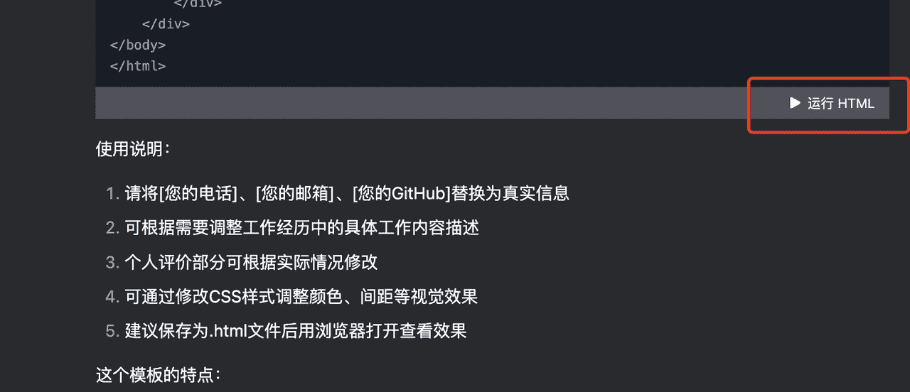

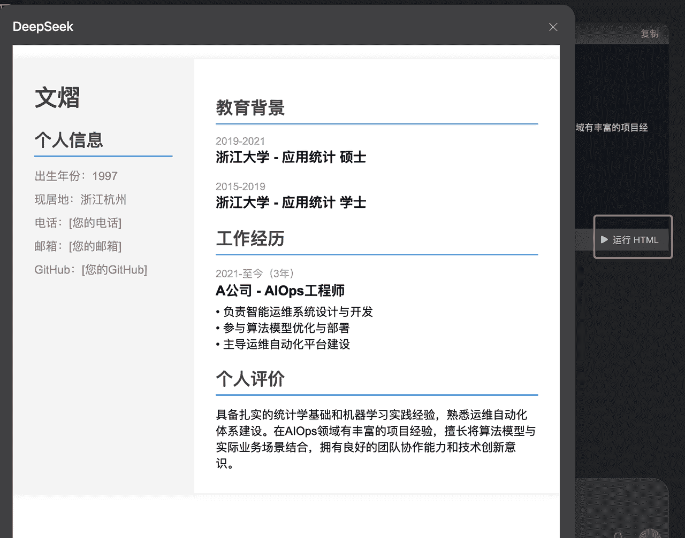

## 导出简历

在DeepSeek 给出的简历模版中，我们可以在预览完之后，就需要导出我们心仪的简历啦。导出步骤如下：

1.  点击右上角的“复制”按钮

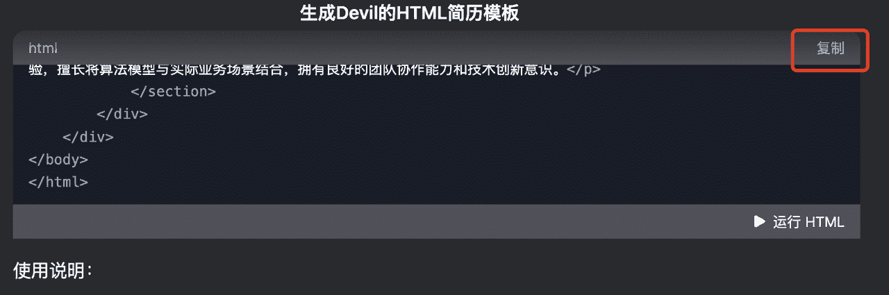

1.  在桌面新建一个 txt 文档，将我们复制的内容复制到文档里，随后保存关闭

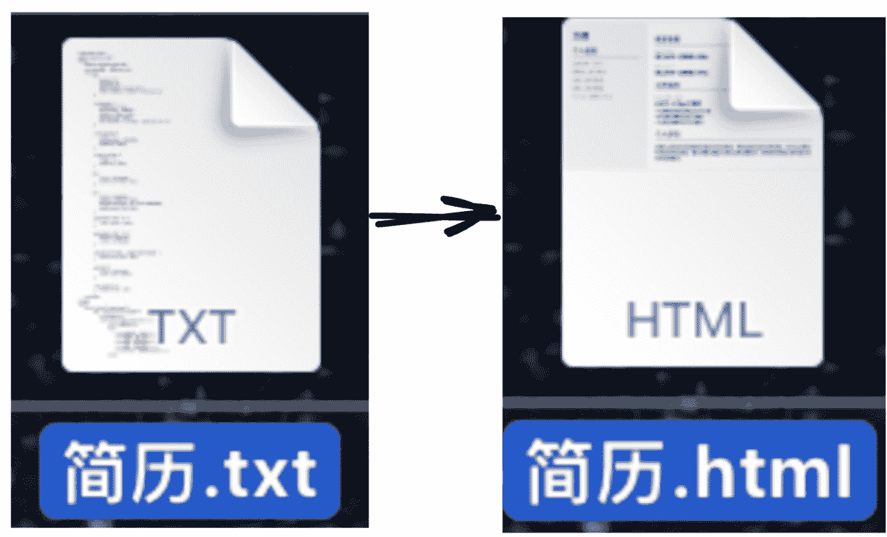

1.  打开“简历.html”，点击导出为 PDF，我们就能够拥有一份能打印的简历啦～

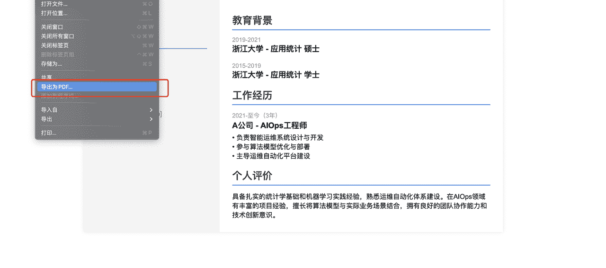

以上是关于实现自动生成简历的主要步骤。

# 如何制作精美的简历？

在了解了自动生成简历，我们接下来要思考一个新的问题！如何生成一份精美的简历？

## 格式修改

我们观察上面的简历，可以发现这不是A4格式的图，但是我们在打印的过程中往往是用A4的格式来打印的，所以我们需要对简历进行新的限定：

> 格式要求：

1.  A4格式输出，简历浓缩到1张 A4 纸上

1.  格式风格：左右排版，左边显示个人基本信息，包括头像，出生年月，现居地等信息，右边依次显示教育背景、工作经历、项目成果、技能证书、个人评价等内容

1.  我希望这是一份蓝色系色调的简历，左边以深蓝为主，分割线为白色；右边以白色为主，分割线颜色和左边的颜色相同

以上是我初步能想到的简历要求，如果有额外的简历需求，也可以添加进去

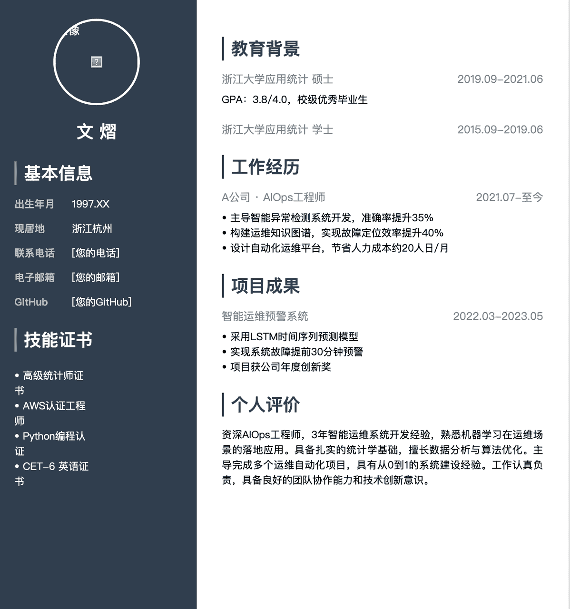

接下来，可以根据 DeepSeek 给出的内容，进行微调。当然你也许会发问：我都转化成了pdf了，那么我的头像应该怎么导入呢？不用担心！前文提到，我们用到的是 html 格式生成的简历，所以我们会有源代码，我们只需要在源代码中把头像的路径修改成我们需要上传的照片路径即可！

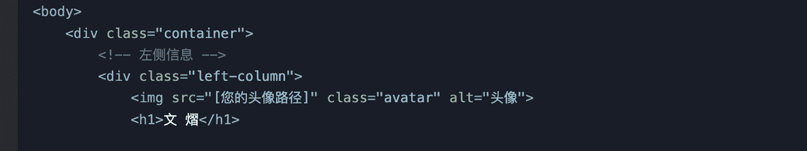

## 进阶技能如何复制简历网站的格式

我实在写不出格式修改的关键册，怎么办？

例如我想要下面这个风格的简历模版：

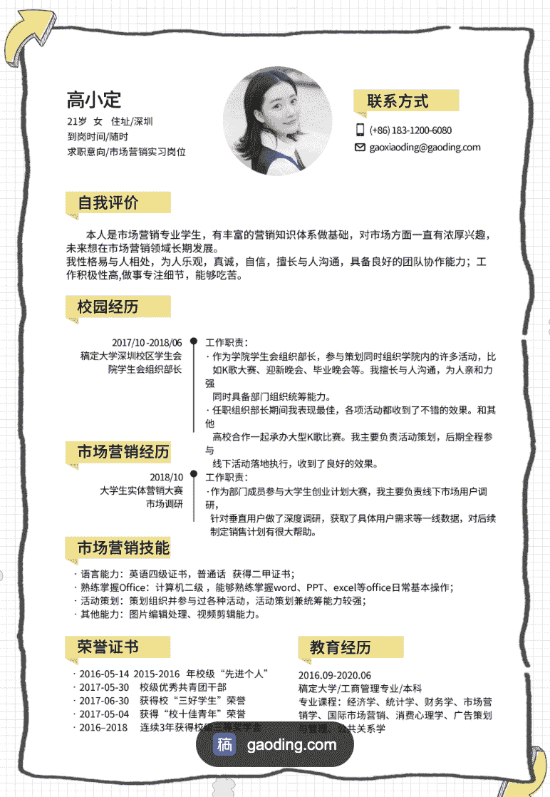

注意！DeepSeek 中的文档仅识别文字，那么我们可以用 kimi 来进行实现。

在这里其实我们可以看看推理过程中的内容，或许会给我们更多的启发！

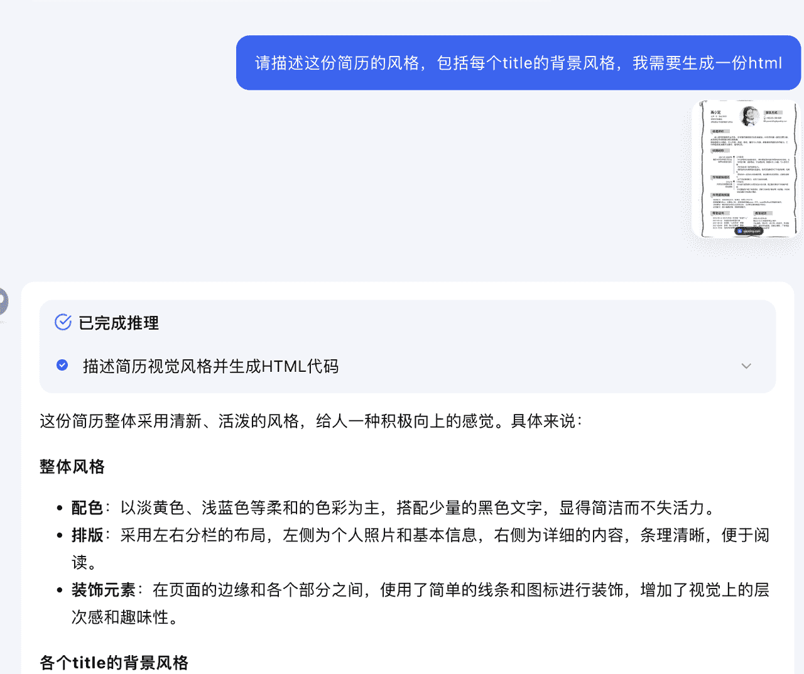

## 内容修改

我不会写工作经历，那怎么办？

我个人认为有两种方式：一种是罗列自己过去工作的经历，另一种是从boss 上找一些自己感兴趣的公司，利用他们的 JD 进行拆解，最终结合自己的工作经历汇总成一份工作内容。

这里我主要针对第二种方式进行解答：

1.  从 boss 上找到多份感兴趣的简历，然后利用文字识别识别出这些 JD 内容；

1.  将这些 JD 内容输入到 DeepSeek 中，让 DeepSeek 为我们识别出一些高频的硬技能词汇，并思考这些词汇是不适合自己的工作经历；

1.  罗列自己过去的工作经历，利用 STAR 法则，量化每一条工作；

以上是我对于工作内容修改的一些见地。

## 进阶技能：简历适配

有时候我们投递的岗位可能与简历的匹配度并不是很高，那么我们就需要根据 JD 进行修改，以提高匹配度。当然这里我学到过一个小 tip！利用同义词替换！例如自己的简历和岗位的 JD 中不同的词有相同的含义，那么可以进行同义替换～

#

---

> 写在最后！

> 简单来说，利用 DeepSeek 生成简历主要两步：将自己的内容以html的格式呈现，并调优 html，最后保存！

> 祝大家在所谓的“2025金三银四”中取得 offer！（当然，包括我～）