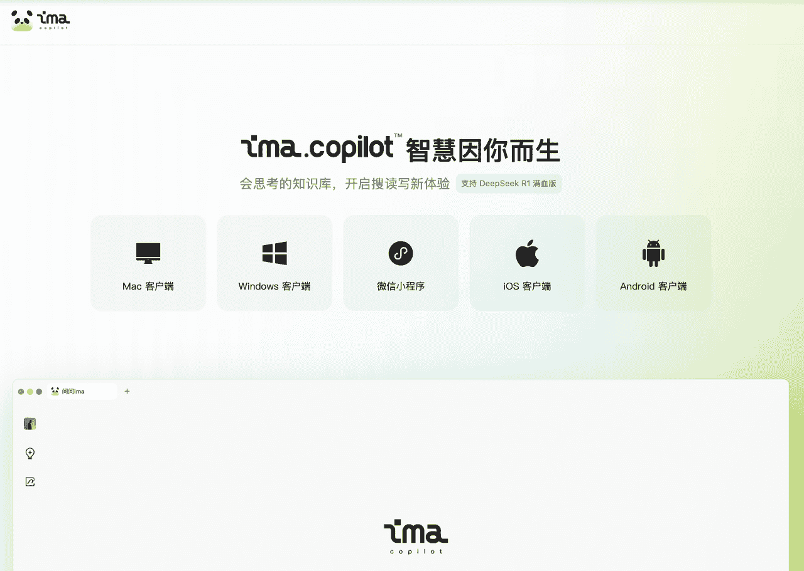
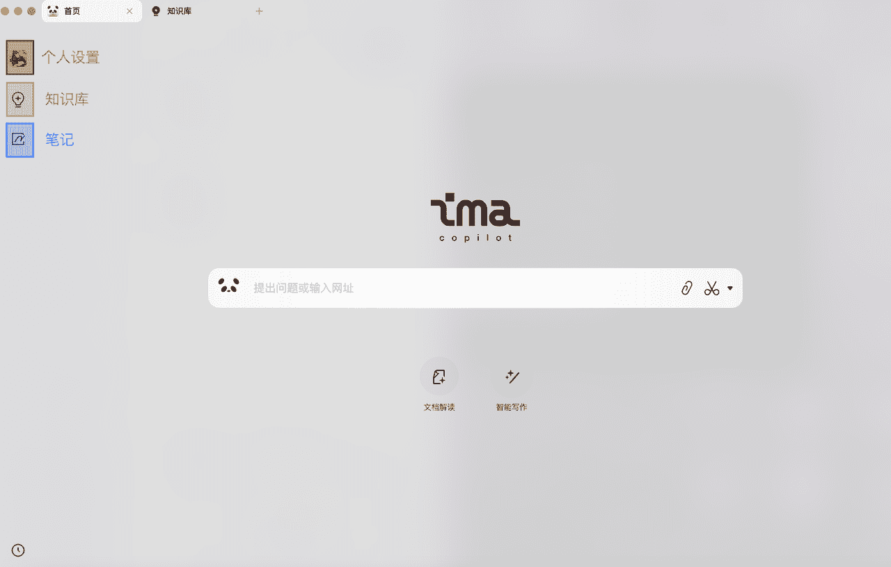
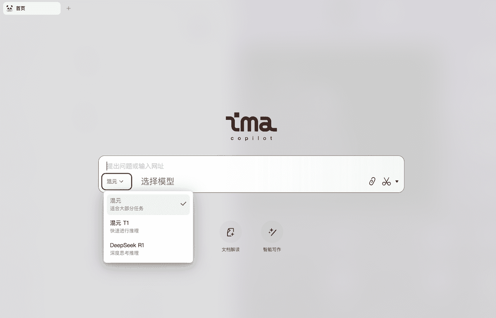
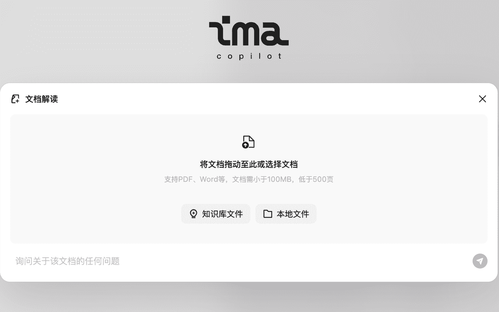
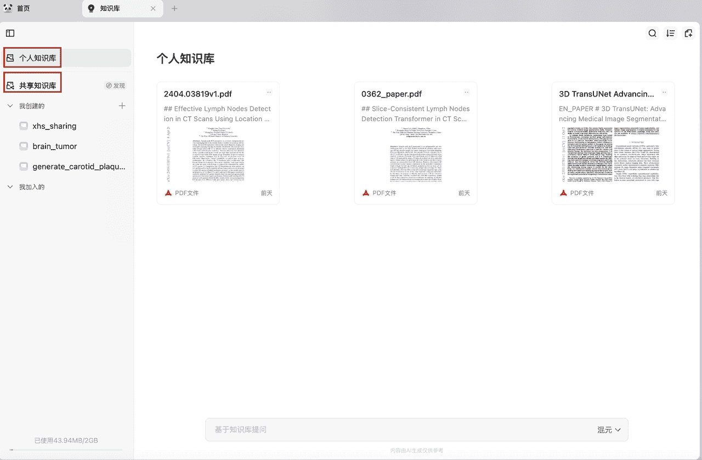
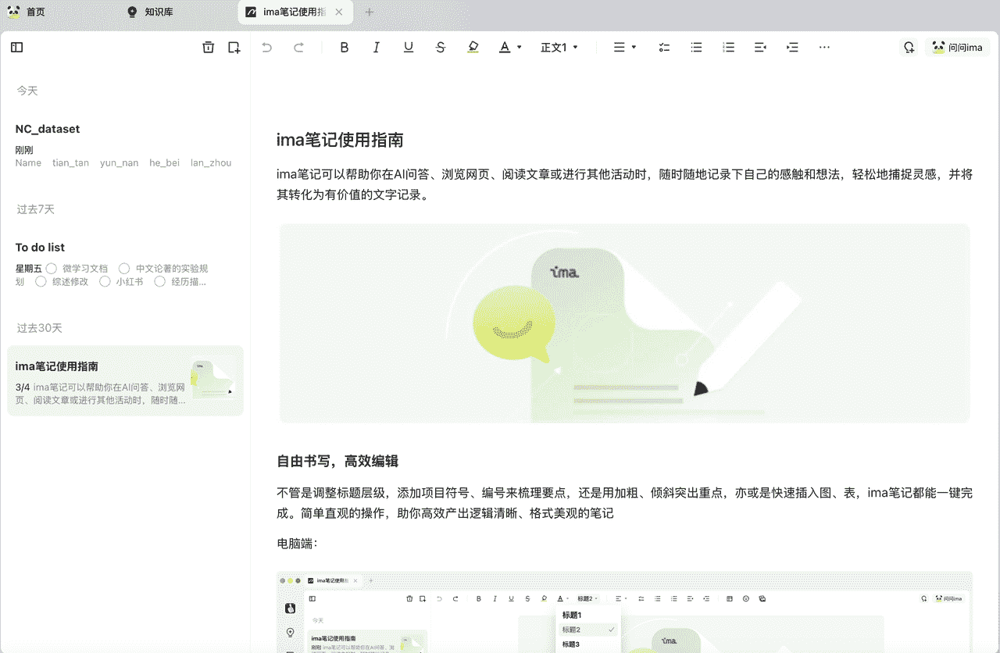

# " DeepSeek + " 打造个人知识库（入门篇）

> 来源：[https://datawhaler.feishu.cn/docx/MUk0dNCLvoHCmqxoxOYcE3Vanxd](https://datawhaler.feishu.cn/docx/MUk0dNCLvoHCmqxoxOYcE3Vanxd)

**“个人知识库”指个人用于存储、管理和组**织自己所拥有的各种知识资源的系统或集合。

+   我们希望获得丝滑的学习体验和工作体验，能够便捷地操作文档、资源，符合大脑的学习习惯和工作逻辑。

+   最早的个人知识库就是书架，个人电脑之后就出现了文件夹管理，随着信息来源的多样化出现了各类管理工具如时间管理工具Notion,笔记管理工具obsidian,文献管理工具zotero等。

+   当DeepSeek凭借优越的理解能力和较低的算力成本火爆全球的时候，我们能够对个人知识库有更多的想象，利用大模型强大的语言能力更好的管理知识、学习知识和运用知识。

接下来，为大家介绍最容易上手的一款个人知识库平台，来自腾讯的 ima。（如需更高阶的知识库工具请关注本文档的更新）

## 下载方式

+   目前可下载Mac、win、iOS、Android四个版本，并且支持小程序中的使用（这很重要哦，各个信息源的资料轻松入库）

+   下载地址：https://ima.qq.com

## 功能介绍

### 大模型问答

+   目前支持三个模型：混元（AI阅读、脑图生成功能优秀，支持多模态👍）、混元T1（混元自己的推理模型）、DeepSeek-R1(快来白嫖👀）

+   支持输入网址直接跳转（可以当作简易浏览器来使用）

+   支持文档AI阅读（可从知识库或本地上传文件）

+   支持智能写作，相当于提供一些写作的Agent。

### 知识库

+   首先有个人知识库和共享知识库，在建立个人知识库的基础上还可以邀请志同道合的小伙伴共享知识库。

+   知识库的信息源可以是文件上传、网页收藏、公众号收藏（通过小程序）等多源的。

+   在每个知识库内支持问答、打标签、选择性问答，同样支持三种问答模型。

### 笔记

+   具备一个笔记工具的基础功能，可以使用markdown编写

+   关键在于能够在以上任何使用这款工具的过程中把文字保存到笔记中，不再需要复制粘贴。

（AI阅读看到亮点句保存！这次总结输出质量高保存！脑图完美无误！）

## 使用心得

+   小组件加分！在浏览器或自己的本地文件夹中的任何文件，都可以先通过小组件用ima的大模型能力过滤一遍，再决定要不要加入知识库。

+   小程序加分！总所周知，公众号科研已经深入人心，导师随手发在群里的公众号链接再也不会忘啦！可以直接通过小程序保存到知识库中。

## 延展需求

+   目前容量有限，且上传速度有限，之前积累的文档等个人知识资源迁移效率较低。（最新更新到30G）

+   无法自动更新信息（目前似乎没有直接的平台可以实现，一般要依赖插件），如重点关注的期刊文章推送。