# 如何在DIFY构建个人知识库

> 来源：[https://datawhaler.feishu.cn/docx/OuKddqVJrozPV7x856Ic2DhWnsd](https://datawhaler.feishu.cn/docx/OuKddqVJrozPV7x856Ic2DhWnsd)

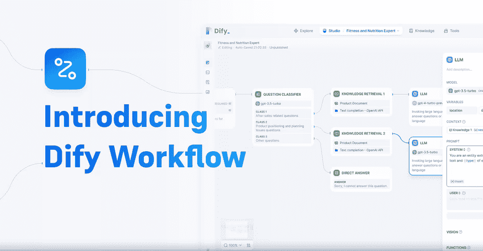

### 一、RAG 基础概念与 Dify 架构优势

#### 1.1 RAG 核心原理

+   检索增强生成：通过向量检索 + 语义重排序，将外部知识库与 LLM 结合，解决模型幻觉问题。

+   核心组件：

+   文档解析器：处理 PDF/Markdown 等格式文档

+   Embedding 模型：将文本转换为向量（如 BAAI/bge-large-zh）

+   向量数据库：存储向量索引（如 Weaviate/MyScale）

+   LLM：生成最终回答（如 GPT-4 / 通义千问等大语言模型）

#### 1.2 Dify 的 RAG 优势

+   可视化配置：无需代码即可完成知识库构建与工作流编排

+   混合检索：支持向量检索 + 全文检索 + 元数据过滤

+   多模型支持：兼容 OpenAI/Cohere/ 阿里云等主流模型

+   监控工具：内置 RAGAS 评估框架，实时分析检索效果

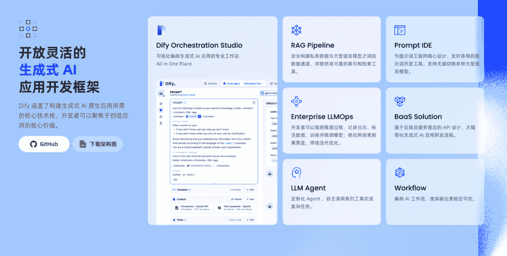

### 二、环境部署与基础配置

#### 2.1 快速部署（Docker 方式）

```
# 克隆Dify仓库
git clone https://github.com/langgenius/dify.git
cd dify/docker

# 启动中间件（数据库/向量库）
cp middleware.env.example middleware.env
docker compose -f docker-compose.middleware.yaml up -d

# 配置RAG参数（关键）
cp .env.example .env
vim .env
# 启用混合检索
VECTOR_SEARCH_MODE=hybrid
# 设置重排序模型
RERANK_MODEL=cohere-rerank
# 调整分块策略
CHUNK_SIZE=500CHUNK_OVERLAP=50
# 启动Dify
docker compose up -d
```

#### 2.2 网页端初始化

1.  访问 http://localhost:3000

1.  创建管理员账户

1.  配置模型供应商（以硅基流动为例）：

+   进入「设置」>「模型供应商」

+   选择「硅基流动」并输入 API Key

+   测试连接是否成功

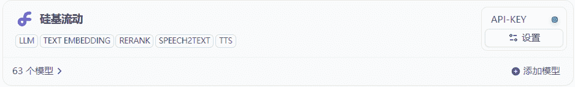

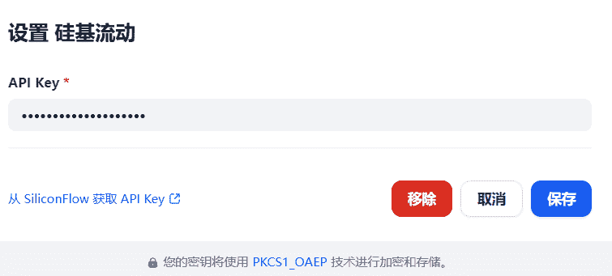

### 三、知识库构建与优化

#### 3.1 文档预处理

+   格式支持：PDF（文本型）、Markdown、HTML、DOCX、CSV（扫描版需 OCR）

+   推荐工具：

+   OCR：GOT-OCR2.0（开源）、Adobe Acrobat

+   格式转换：Zamzar（支持 1200 + 格式）

+   分段策略：

+   智能分段：按标题 / 列表符号自动分割

+   固定长度：500 字 / 段（推荐）

+   父子分段：主文档 + 子文档关联（处理长文档）

#### 3.2 上传与索引

1.  进入「知识库」>「创建数据集」

1.  选择「导入文件」并上传预处理后的文档

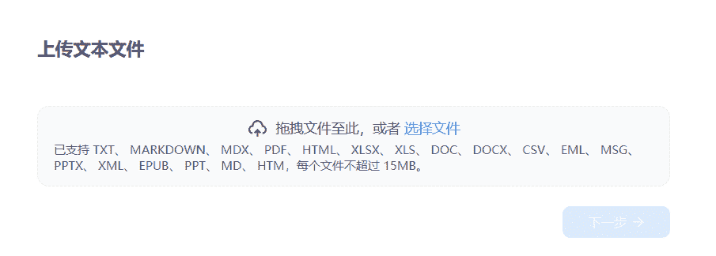

1.  配置索引参数：

+   Embedding 模型：BAAI/bge-large-zh-v1.5（中文）、BAAI/bge-large-en-v1.5（英文）（需在「模型供应商」配置 API Key）

+   检索模式：混合检索（向量 + 全文）模型：netease-youdao/bce-reranker-base_v1

+   重排序模型：Cohere Rerank（需在「模型供应商」配置 API Key）

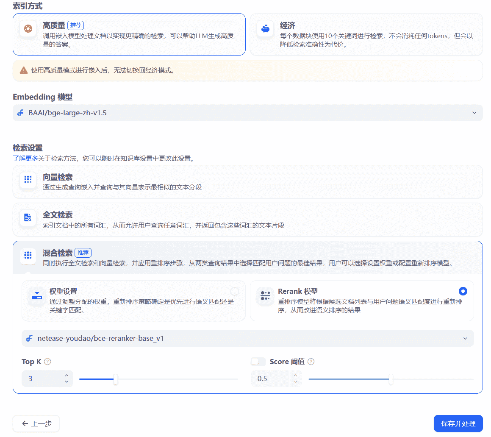

1.  点击「保存并处理」生成向量索引

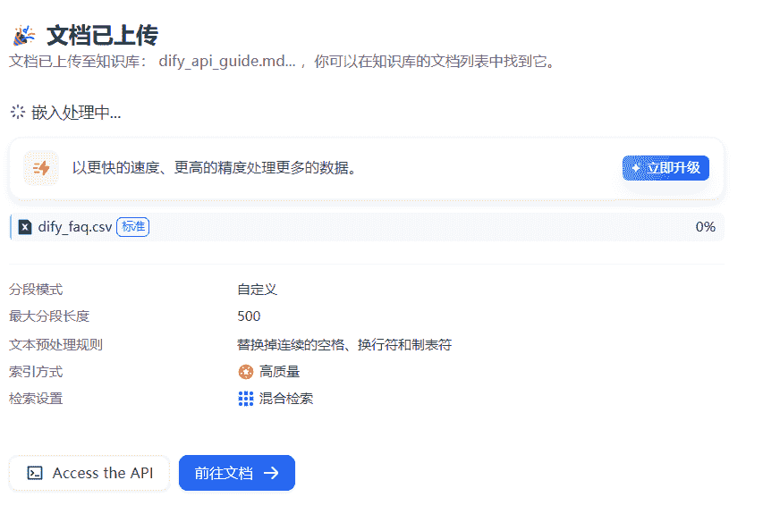

#### 3.3 检索测试

1.  进入数据集详情页

1.  检索测试案例：

1.  提问**“如何配置向量数据库”**

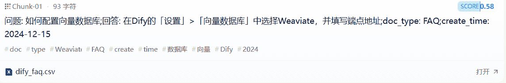

1.  提问 “API 的 filter 参数如何使用”

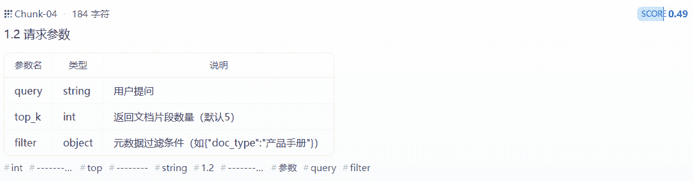

**均可以精准命中数据库内的内容**

1.  调整 TopK 参数（建议 5-10）和 Score 阈值（0.5-0.8）（可选）

### 四、RAG 工作流配置

#### 4.1 创建聊天机器人

1.  进入「Studio」>「创建应用」>「聊天机器人」

1.  配置基础信息：

+   模型选择：硅基流动（部分模型免费）、GPT-4（付费）、Claude 3（长上下文）

+   系统提示：限定回答风格（如 “技术文档式回答”）

+   回复格式：Markdown / 纯文本 / 代码块

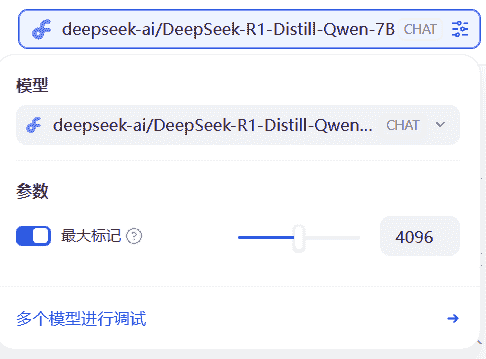

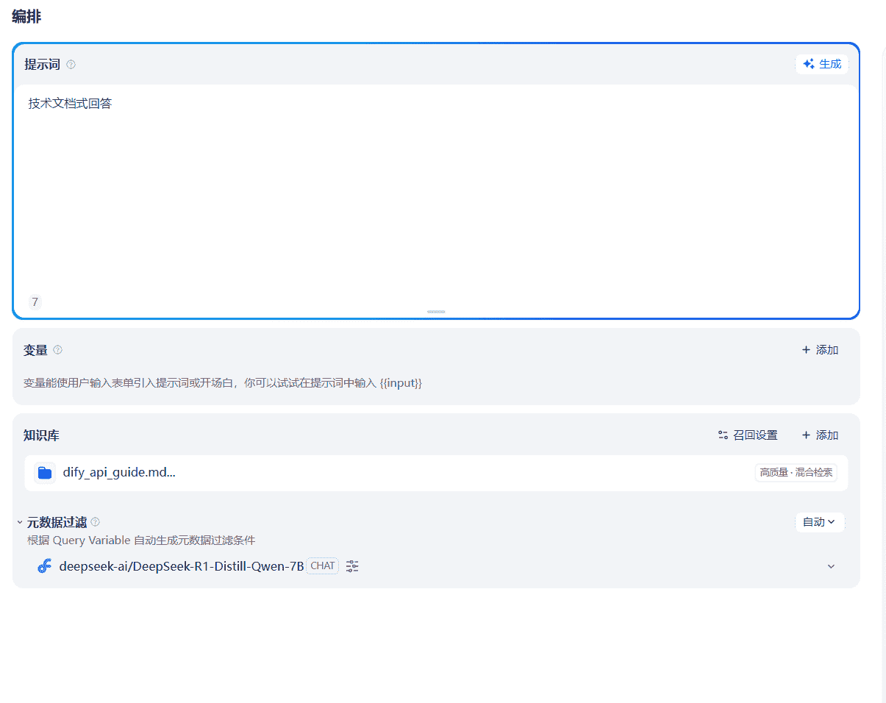

#### 4.2 关联知识库

1.  进入「上下文」>「添加数据集」

1.  选择已创建的知识库

1.  配置检索参数：

+   检索模式：继承数据集设置

+   上下文注入方式：前置（推荐）/ 后置

+   最大上下文长度：根据模型限制设置（如 GPT-4 为 8192 tokens）

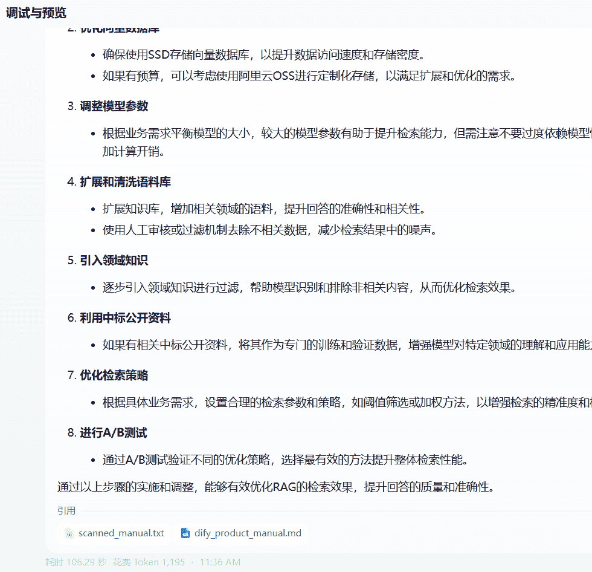

### 五、测试与优化

#### 5.1 效果验证

1.  使用「探索」功能进行问答测试：

+   精确问题：“Dify 1.1.0 的新特性”

+   模糊问题：“如何优化 RAG 检索效果”

+   跨文档问题：“比较 Dify 与 RAGFlow 的优缺点”

1.  查看「响应详情」：

+   检索到的文档片段

+   向量相似度分数

+   重排序后的排名

#### 5.2 性能优化

1.  向量数据库调优：

+   切换至 MyScale（SQL 向量库）提升速度

+   增加索引并行度（Weaviate 配置）

1.  模型选择：

+   轻量级模型：ChatGLM-6B（本地部署）

+   高性能模型：GPT-4 Turbo（低延迟）

1.  缓存策略：

+   启用 Redis 缓存（默认开启）

+   设置缓存过期时间（建议 5-15 分钟）

#### 5.3 常见问题排查

### 六、高级功能扩展

#### 6.1 混合架构（Dify+RAGFlow）

1.  部署 RAGFlow 并创建知识库

1.  在 Dify 中配置外部知识库：

+   API Endpoint：http://ragflow-host:8080/api/v1/dify

+   API Key：RAGFlow 生成的密钥

1.  结合 Dify 的工作流与 RAGFlow 的文档解析能力处理复杂文档

#### 6.2 自定义检索流程

1.  使用「HTTP 节点」调用外部服务：

+   步骤：用户问题 → Gitee AI Embedding → Zilliz 检索 → 结果整合

+   优势：精确控制检索范围（如按产品型号过滤）

1.  集成 OCR 服务处理扫描件：

+   调用阿里云百炼 / OCR.space API

+   预处理流程：扫描件 → OCR → 文本分段 → 向量索引