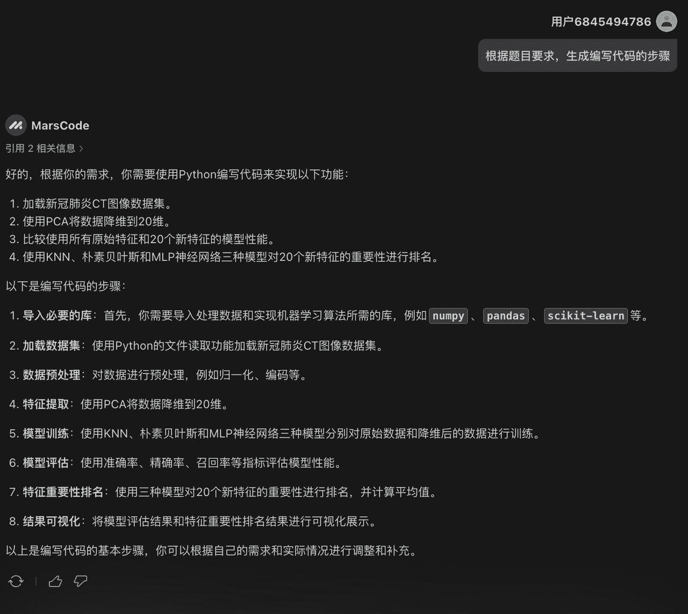
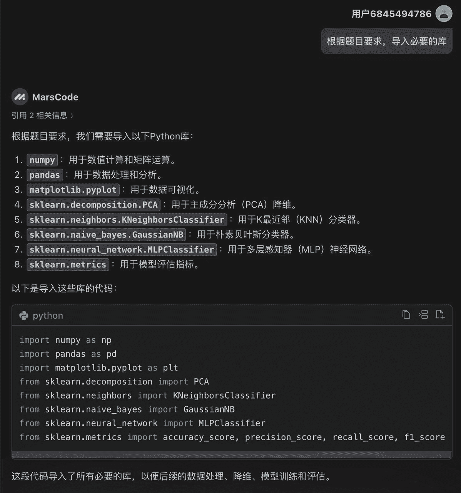
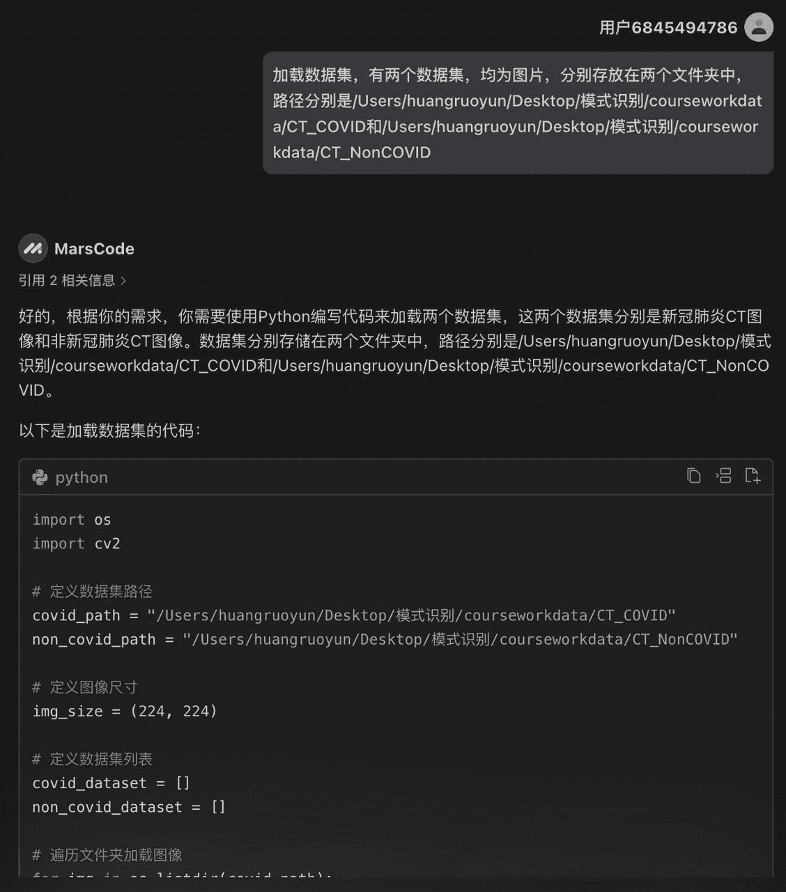
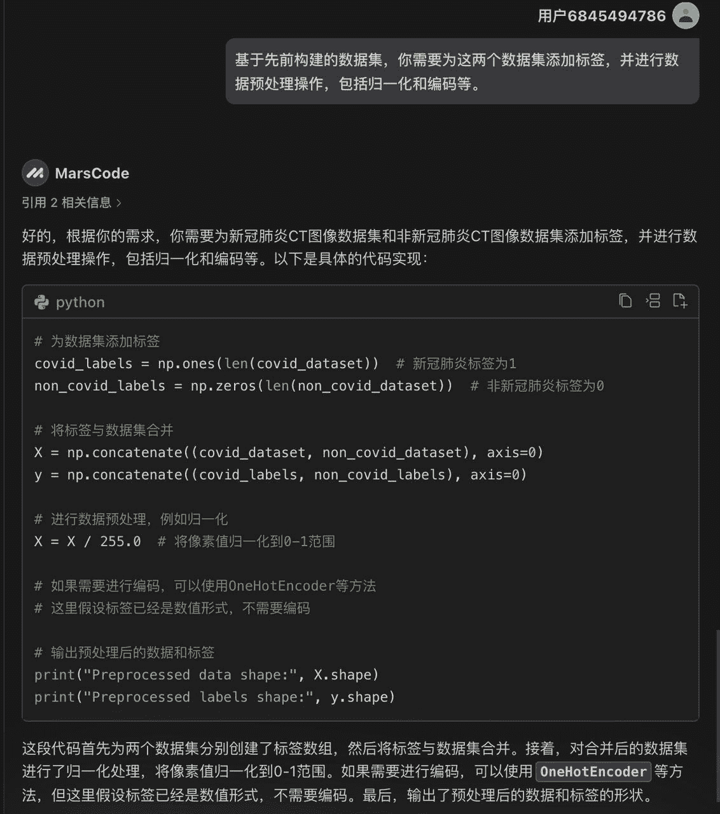
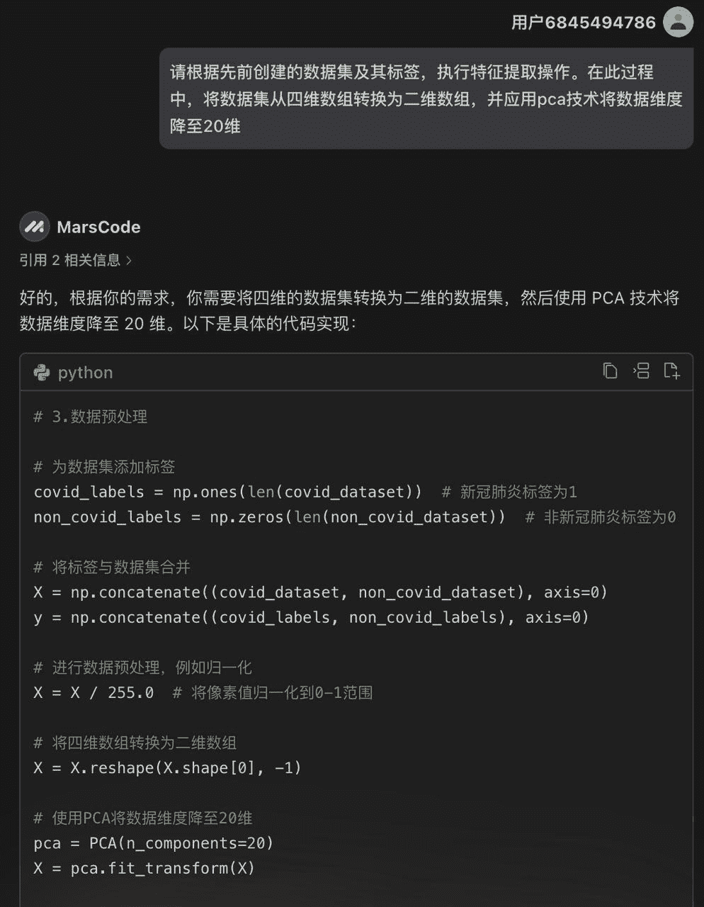
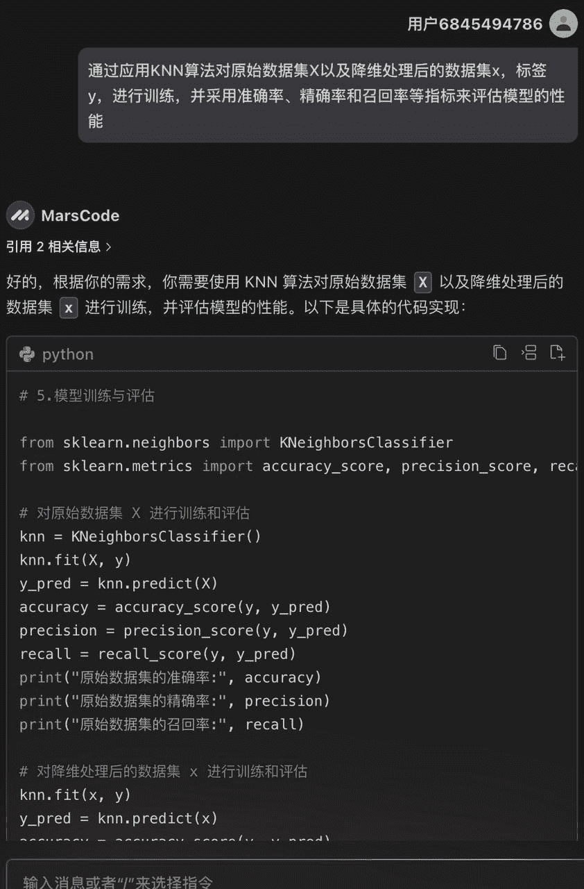
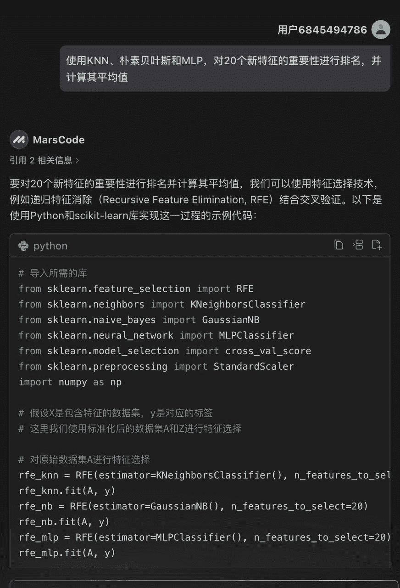

# 豆包MarsCode使用场景--学校作业（深度学习）

> 来源：[https://datawhaler.feishu.cn/docx/VJtQdvlw9otnz1xeiNhciaxanXb](https://datawhaler.feishu.cn/docx/VJtQdvlw9otnz1xeiNhciaxanXb)


[数据集.zip](https://internal-api-drive-stream.feishu.cn/space/api/box/stream/download/all/NxJ9bY4BAo6YHzx9ZHDcbKcEnaf)

### 本次案例是使用豆包MarsCode来完成学校的作业，以提高编程能力和解决问题的能力。

# 题目

> 机器学习（ML）能够从训练数据中学习，并且在预测新冠肺炎（Covid-19）方面比临床医生展现出更高的准确性。学生使用Python包加载图像数据（新冠肺炎CT图像），并将高维数据降维到低维数据（例如，维度=20）。新冠肺炎CT图像数据集包含397张非新冠肺炎图像和349张新冠肺炎图像。通过使用PCA降维，大约20个新特征可以在不损失太多准确性的情况下获得良好的分类性能。学生需要比较使用这20个新特征与使用所有原始特征的模型性能。将使用三种机器学习模型（K最近邻（KNN）分类器、朴素贝叶斯分类器和多层感知器（MLP）神经网络）来比较使用所有原始特征和20个新特征的模型性能。使用不同的机器学习模型算法将导致分类性能不同。这也会影响特征排名性能。学生需要使用这三个模型对20个新特征的重要性进行排名（学生可以将特征设置为特征排名的平均值）。

# 实践

## 根据题目要求生成编写代码的步骤

> prompt：根据题目要求，生成编写代码的步骤



接下来根据MarsCode生成的编写代码的步骤编写代码。

## Step1：导入必要的库

> prompt：根据题目要求，导入必要的库

```
import numpy as np
import pandas as pd
import matplotlib.pyplot as plt
from sklearn.decomposition import PCA
from sklearn.neighbors import KNeighborsClassifier
from sklearn.naive_bayes import GaussianNB
from sklearn.neural_network import MLPClassifier
from sklearn.metrics import accuracy_score, precision_score, recall_score, f1_score
```



## Step2：加载数据集

> prompt：加载数据集，有两个数据集，均为图片，分别存放在两个文件夹中，路径分别是/Users/huangruoyun/Desktop/模式识别/courseworkdata/CT_COVID和/Users/huangruoyun/Desktop/模式识别/courseworkdata/CT_NonCOVID

> （这里根据实际情况进行调整）

```
import os
import cv2

# 定义数据集路径
covid_path = &quot;/Users/huangruoyun/Desktop/模式识别/courseworkdata/CT_COVID&quot;
non_covid_path = &quot;/Users/huangruoyun/Desktop/模式识别/courseworkdata/CT_NonCOVID&quot;

# 定义图像尺寸
img_size = (224, 224)

# 定义数据集列表
covid_dataset = []
non_covid_dataset = []

# 遍历文件夹加载图像
for img in os.listdir(covid_path):
    # 读取图像
    img_path = os.path.join(covid_path, img)
    img = cv2.imread(img_path)
    # 调整图像尺寸
    img = cv2.resize(img, img_size)
    # 添加到数据集
    covid_dataset.append(img)

for img in os.listdir(non_covid_path):
    # 读取图像
    img_path = os.path.join(non_covid_path, img)
    img = cv2.imread(img_path)
    # 调整图像尺寸
    img = cv2.resize(img, img_size)
    # 添加到数据集
    non_covid_dataset.append(img)

# 将数据集转换为numpy数组
covid_dataset = np.array(covid_dataset)
non_covid_dataset = np.array(non_covid_dataset)
```



这一步创建了两个数据集covid_dataset和non_covid_dataset

## Step3：数据预处理

> prompt：基于先前构建的数据集，你需要为这两个数据集添加标签，并进行数据预处理操作，包括归一化和编码等。

```
# 为数据集添加标签
covid_labels = np.ones(len(covid_dataset))  # 新冠肺炎标签为1
non_covid_labels = np.zeros(len(non_covid_dataset))  # 非新冠肺炎标签为0

# 将标签与数据集合并
X = np.concatenate((covid_dataset, non_covid_dataset), axis=0)
y = np.concatenate((covid_labels, non_covid_labels), axis=0)

# 进行数据预处理，例如归一化
X = X / 255.0  # 将像素值归一化到0-1范围

# 如果需要进行编码，可以使用OneHotEncoder等方法
# 这里假设标签已经是数值形式，不需要编码

# 输出预处理后的数据和标签
print(&quot;Preprocessed data shape:&quot;, X.shape)
print(&quot;Preprocessed labels shape:&quot;, y.shape)
```



## Step4：特征提取

> prompt：请根据先前创建的数据集及其标签，执行特征提取操作。在此过程中，将数据集从四维数组转换为二维数组，并应用PCA技术将数据维度降至20维。

由于pca接收的数据是二维数组，需要将原来的四维数组转换为二维数组。

```
# 将四维数组转换为二维数组
A = X.reshape(X.shape[0], -1)

# 使用PCA将数据维度降至20维
pca = PCA(n_components=20)
Z = pca.fit_transform(A)

# 输出预处理后的数据和标签
print(&quot;Preprocessed data shape:&quot;, Z.shape)
print(&quot;Preprocessed labels shape:&quot;, y.shape)
```



## Step5：模型训练与模型评估

### KNN

> prompt：通过应用(KNN模型、朴素贝叶斯、MLP模型)对原始数据集A以及降维处理后的数据集Z，标签y，进行训练，并采用准确率、精确率和召回率等指标来评估模型的性能。

```
from sklearn.neighbors import KNeighborsClassifier
from sklearn.metrics import accuracy_score, precision_score, recall_score

# 对原始数据集 x 进行训练和评估
knn = KNeighborsClassifier()
knn.fit(A, y)
y_pred = knn.predict(A)
accuracy = accuracy_score(y, y_pred)
precision = precision_score(y, y_pred)
recall = recall_score(y, y_pred)
print(&quot;原始数据集的准确率:&quot;, accuracy)
print(&quot;原始数据集的精确率:&quot;, precision)
print(&quot;原始数据集的召回率:&quot;, recall)

# 对降维处理后的数据集 Z 进行训练和评估
knn.fit(Z, y)
y_pred = knn.predict(Z)
accuracy = accuracy_score(y, y_pred)
precision = precision_score(y, y_pred)
recall = recall_score(y, y_pred)
print(&quot;降维处理后数据集的准确率:&quot;, accuracy)
print(&quot;降维处理后数据集的精确率:&quot;, precision)
print(&quot;降维处理后数据集的召回率:&quot;, recall)
```

（图片上的prompt有误）



### 朴素贝叶斯

```
from sklearn.naive_bayes import GaussianNB
from sklearn.metrics import accuracy_score, precision_score, recall_score

# 对原始数据集 X 进行训练和评估
nb = GaussianNB()
nb.fit(A, y)
y_pred = nb.predict(A)
accuracy = accuracy_score(y, y_pred)
precision = precision_score(y, y_pred)
recall = recall_score(y, y_pred)
print(&quot;原始数据集的准确率:&quot;, accuracy)
print(&quot;原始数据集的精确率:&quot;, precision)
print(&quot;原始数据集的召回率:&quot;, recall)

# 对降维处理后的数据集 x 进行训练和评估
nb.fit(Z, y)
y_pred = nb.predict(Z)
accuracy = accuracy_score(y, y_pred)
precision = precision_score(y, y_pred)
recall = recall_score(y, y_pred)
print(&quot;降维处理后数据集的准确率:&quot;, accuracy)
print(&quot;降维处理后数据集的精确率:&quot;, precision)
print(&quot;降维处理后数据集的召回率:&quot;, recall)

```

### MLP

```
from sklearn.neural_network import MLPClassifier
from sklearn.metrics import accuracy_score, precision_score, recall_score

# 对原始数据集 X 进行训练和评估
mlp = MLPClassifier()
mlp.fit(A, y)
y_pred = mlp.predict(A)
accuracy = accuracy_score(y, y_pred)
precision = precision_score(y, y_pred)
recall = recall_score(y, y_pred)
print(&quot;原始数据集的准确率:&quot;, accuracy)
print(&quot;原始数据集的精确率:&quot;, precision)
print(&quot;原始数据集的召回率:&quot;, recall)

# 对降维处理后的数据集 x 进行训练和评估
mlp.fit(Z, y)
y_pred = mlp.predict(Z)
accuracy = accuracy_score(y, y_pred)
precision = precision_score(y, y_pred)
recall = recall_score(y, y_pred)
print(&quot;降维处理后数据集的准确率:&quot;, accuracy)
print(&quot;降维处理后数据集的精确率:&quot;, precision)
print(&quot;降维处理后数据集的召回率:&quot;, recall)

```

## Step6：特征重要性排名

> prompt：使用KNN、朴素贝叶斯和MLP，对20个新特征的重要性进行排名，并计算其平均值。

```
# 导入所需的库
from sklearn.feature_selection import RFE
from sklearn.neighbors import KNeighborsClassifier
from sklearn.naive_bayes import GaussianNB
from sklearn.neural_network import MLPClassifier
from sklearn.model_selection import cross_val_score
from sklearn.preprocessing import StandardScaler
import numpy as np

# 假设X是包含特征的数据集，y是对应的标签
# 这里我们使用标准化后的数据集A和Z进行特征选择

# 对原始数据集Z进行特征选择
rfe_knn = RFE(estimator=KNeighborsClassifier(), n_features_to_select=20)
rfe_knn.fit(Z, y)
rfe_nb = RFE(estimator=GaussianNB(), n_features_to_select=20)
rfe_nb.fit(Z, y)
rfe_mlp = RFE(estimator=MLPClassifier(), n_features_to_select=20)
rfe_mlp.fit(Z, y)

# 获取特征排名
ranking_knn = rfe_knn.ranking_
ranking_nb = rfe_nb.ranking_
ranking_mlp = rfe_mlp.ranking_

# 计算平均排名
average_ranking = np.mean([ranking_knn, ranking_nb, ranking_mlp], axis=0)

# 输出平均排名
print(&quot;Average feature ranking:&quot;, average_ranking)
```



# 总结

### 总体来说，利用MarsCode完成作业不仅可以为作业提供思路，还能显著提高效率。然而，MarsCode也可能出现代码错误的问题。这里展示的代码是我经过部分修改后的版本。展示的prompt也应根据具体情况进行适当调整。