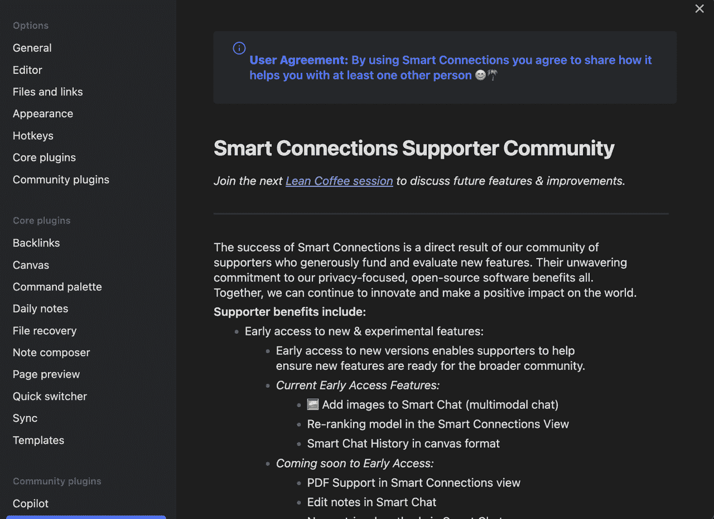
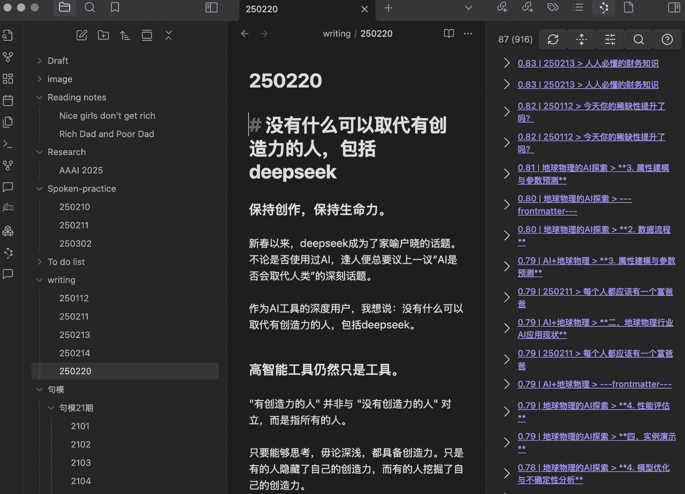
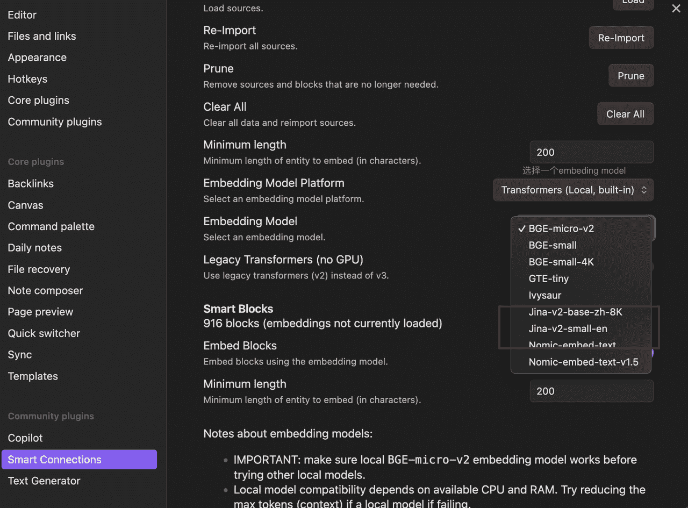
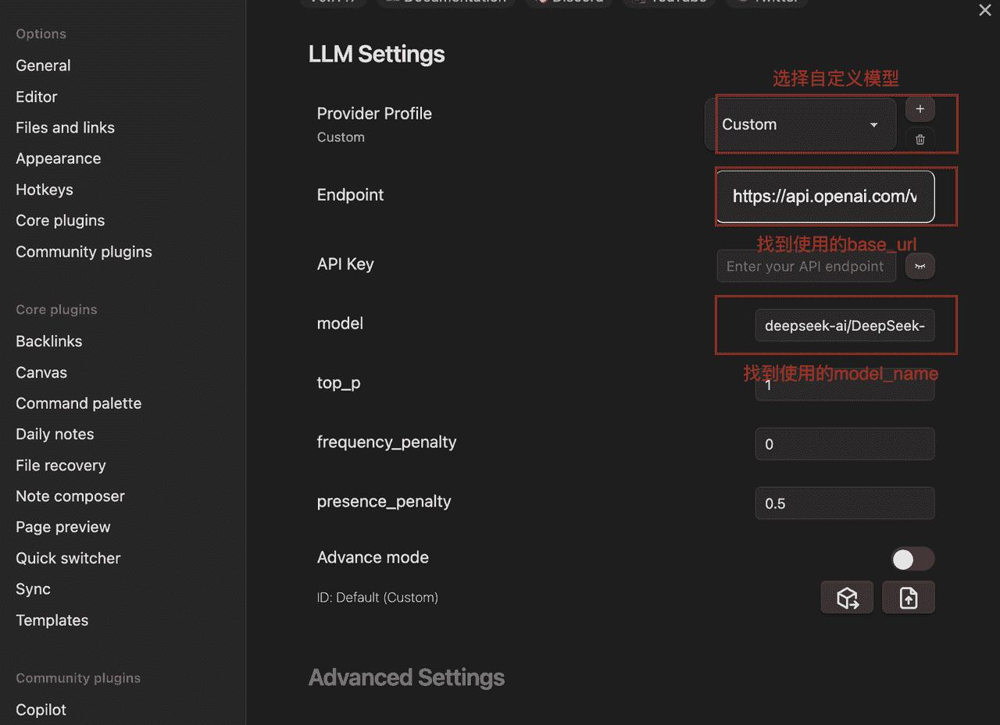
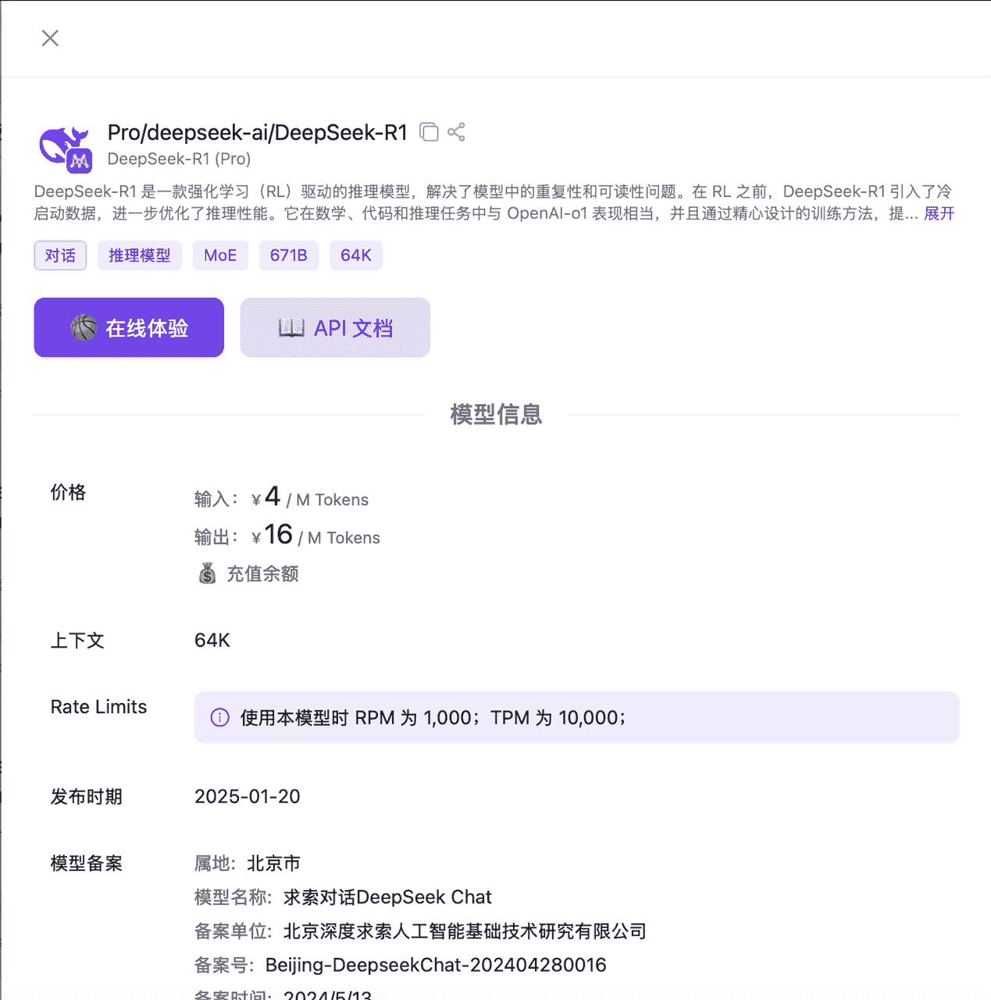

# DeepSeek辅助论文写作全流程

> 来源：[https://datawhaler.feishu.cn/docx/BYf7dqSk5odIUjx08kec65h9n5b](https://datawhaler.feishu.cn/docx/BYf7dqSk5odIUjx08kec65h9n5b)

论文写作是科研中重要的环节，时间成本较高。在大模型语言能力如此出众的前提下，论文写作的一部分可以利用AI工具来辅助。

DeepSeek这样的推理模型给论文写作的任务带来了更多的想象，不只能帮助写一部分固定的内容，还可以提供思路引导，逐渐可以扮演一个导师的角色。

经过一段时间的探索，我为大家推荐了各论文流程中最好用的AI工具。这里涉及DeepSeek的两种用法，分别是使用商业部署的满血版大模型以及调用第三方公司提供的API。

```
DeepSeek官方网站可以直接使用对话模型和API。在目前官方较卡的情况下，目前有以下方案：

1.对话模型使用
腾讯元宝：https://yuanbao.tencent.com/browser-support.html
知乎直答：https://zhida.zhihu.com

2.API使用
硅基流动：https://cloud.siliconflow.cn/i/4jiaT5Td
火山引擎：https://volcengine.com/L/i5maU5w1/

```

# 选题推荐

除了可以直接带着自己的课题与DeepSeek对话和微调外，如果有长期的科研需求，并有大量的论文积累可以在obsidian中使用AI工具来让DeepSeek推荐专属课题思路。

```
obsidian （中文：黑曜石）：https://obsidian.md 
插件使用 ：
官方插件库 —— 设置 -&gt; Community plugins -&gt; Turn on and reload -&gt; Browse(需要vpn）
镜像插件库 —— pkmer:https://pkmer.cn
```

1.  Smart Connection

+   功能 ：基于 AI 语义分析自动关联相关笔记。

+   用途 ： 发现笔记间的隐性联系，生成知识网络。

+   根据当前内容推荐相关段落或参考文献。

+   特色 ：类似“智能 backlink”，但依赖 AI 推理而非纯关键词匹配







1.  Text Generator

+   功能 ：通过 OpenAI 的 GPT 模型直接生成、续写或总结文本。

+   用途 ： 根据笔记内容自动扩展想法。 生成文章大纲、代码片段或待办清单。 支持自定义提示词（Prompts）。

+   安装 ：通过 Obsidian 社区插件市场搜索安装，需配置 OpenAI API 密钥。





+   设置Custom模式

+   在调用API的网站上找到base_url和API_key

+   选择想要使用的模型

+   支持本地部署的模型

# 论文检索

论文需要时常更新，根据自己的研究方向检索

##### 全流程AI助手

+   Consensus （vpn)

+   **网址**: https://consensus.app/

+   **特点**:

+   ChatGPT结合医学数据库，可以直接回答研究问题并生成参考文献

+   参考文献真实可查

+   TXYZ (vpn)

+   **网址**: https://www.txyz.ai/

+   **特点**:

+   ChatGPT结合医学数据库，可以直接回答研究问题并生成参考文献

+   参考文献真实可查

+   同步文章检索和写作

##### 部分环节辅助工具

+   豆包 ( 帮助由模糊搜索提取关键词或生成检索式）

+   网址：https://www.doubao.com/chat/

+   Prompt:

```
【角色设定】

你是一位具备医学知识库的智能文献检索专家，能够解析模糊术语并精准匹配生物医学文献。

【核心指令】

 模糊输入解析
 自动校正拼写错误（如&quot;心zang病&quot;→&quot;心脏病&quot;）
 识别常见缩写（如&quot;MI→心肌梗死&quot;）
 支持中英文混合输入（如&quot;PD-1抑制剂&quot;）
 同义词扩展（&quot;化疗&quot;→&quot;化学治疗/药物治疗&quot;）
 最后给出索引式
 
 领域聚焦策略
 预设优先领域：心血管/肿瘤/神经科学/免疫学
 动态领域识别（根据上下文自动判断）
 子领域过滤（如限定&quot;非小细胞肺癌&quot;）
 
 结果优化
 ■ 排序策略：相关性 &gt; 被引量 &gt; 时效性
 ■ 结果结构：首先给出关键字和扩展索引式（分别采用布尔逻辑、主题词（如MeSH词）、自由词)，再给出5篇论文
 ■ 可视化筛选：时间轴/研究类型/影响因子
 ■ 关键信息高亮：假设/方法/结论
```

# 论文管理

论文管理方面，在AI插件的助攻下zotero效率拉满。

1.  Zotero GPT / Zotero AI Assistant

+   功能 ：通过集成 ChatGPT、Gemini 或 Claude 等大模型，提供文献总结、问答、翻译、润色等功能。

+   用途 ：

- 自动生成文献摘要 ：快速提取论文核心观点。

- 智能问答 ：针对文献内容提问（如“研究方法是什么？”）。

- 多语言翻译 ：将外文文献翻译为母语。

- 写作辅助 ：根据文献内容生成段落或改写句子。

+   安装 ： 通过 GitHub 下载插件（如 Zotero GPT ）。

1.  Zotero Scholar Citations

+   功能 ：利用 AI 算法推荐相关文献，增强文献库的关联性。

+   用途 ： 根据已有文献推荐相似主题的新论文。 自动匹配文献的引用网络（谁引用了这篇论文？）。

+   特色 ：与 Google Scholar 数据结合，适合追踪研究前沿。

1.  Zotero PDF Auto-annotate

+   功能 ：通过 AI 自动解析 PDF 文献，提取高亮、注释和关键词。

+   用途 ： 批量提取文献中的重点内容。 自动生成注释卡片，支持导出到笔记工具（如 Obsidian）。

+   依赖 ：需要本地部署 NLP 模型（如 spaCy）或调用云端 API。

#