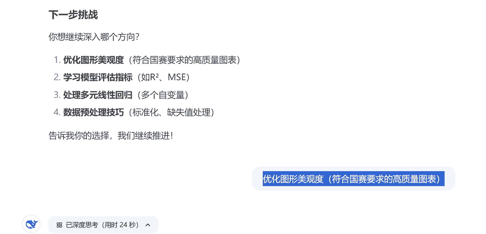
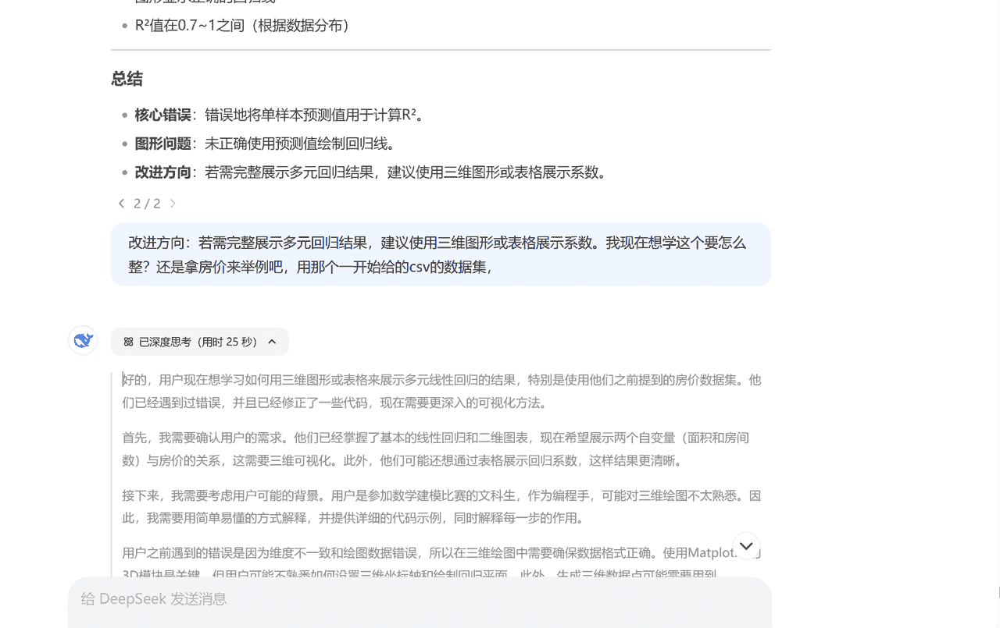

# AI+数学建模

> 来源：[https://datawhaler.feishu.cn/docx/EHpEdB4vUoJgtexyxhMcqHHLnze](https://datawhaler.feishu.cn/docx/EHpEdB4vUoJgtexyxhMcqHHLnze)

> 我不知道你是怎样一个状态去读这篇文章的。如果你是想要快速的学会数学建模，现在时间已经非常紧急了，那就直接从实战篇开始，如果你是对我如何得出这个结论非常感兴趣的，你可以去考虑阅读我的理论篇。里面有我的思考，和我做的一些实验情况。

# 一、项目背景

> 在AI快速发展的背景下，本篇文章旨在让更多人通过使用AI更低门槛的快速入门数学建模

# 二、项目目标

> **目标一：理论篇**

> **目标二：实战篇**

# 三、理论篇

## 我这次干了点什么

1.  思考可不可以通过细化问题的方式，如何问AI可以让他一次性给出较好的结果。

1.  对于零基础的小白来讲如何依靠AI从0基础到落地代码

1.  论文润色方面如何应用他做到更好

## 我的一些思考

+   AI目前给的数据基本可参照性不强，但是你不可否认他的观点覆盖面极广。

+   他给出的是否可靠，你可以通过去问他，和他去讨论，他会和你找到真正优秀的变量。

+   他的回答内容质量会随着你给他的问题复杂程度，进行质量的降低。

+   记住一点他的深度思考会涉及你的上一次回答，所以记得告述他你的感受评价。

## 我的一些设想（实验）

对于1.1我当时最开始是采用反复问题目的方式进行的第一次与AI的合作，经过一段时间的沉淀，我对于应该先问整个问题然后自己去对回答进行反思还是先直击拆解问题两者效果孰优孰劣产生了思考，我个人的感受是给他大局问题会更好一点。因为你通过自己细化问题，问他的时候，他给出的回答会有偏重，但是你不能不把题目的整体背景给他，所以会导致他会在某个方向特别的去讨论。但是选择性的略过一些问题。我感觉这样不利于结构的构建。相对来讲我我认为先通过问他一个大问题，让他自己去拆分，然后你选择一个分支去问他，然后问到差不多了，然后再讨论下一个分支。这样的问法会让你构建出一个比较好的大致思维。而不是非常混乱的想法。

对于1.2我的理解是我们应该去认真的读他给的代码，我们需要一定的就是自己能读懂它错误的能力，这一个点是需要培养的。如果没有这个能力的话，我觉得可能AI的辅助并不是能很好的帮助你真的速成吧。下面提出的我的一些提示词也是建立在就是他给你代码，然后你经过一定的思考，问他继续的问题。但是这个并不限制于就是小白不能去学这个东西，你可以零基础，但是你必须得去把你自己真正的问题给问出来。你要打开你自己的就是和别人交流的那种思维吧。因为可能在正常人交流中，你可能习惯了就会觉得这个东西我自己想想能想出来，然后不去问。如果你拿这个思维去问AI的话，可能就会导致他不能了解你到底哪有问题。最好的方法就是什么都去问他，你心里怎么想的你就怎么跟他说。这样的话他能意识到你到底问题在哪里，然后你的代码问题在哪里，不要认为自己懂了就不去问他。我在第4篇中有讲我是怎么问出来这些问题的，可以参考一下。

对于1.3我觉得这一块好像没有什么特别好讲的东西。因为AI润色其实本来就做得很好，可以直接参照我的提示词

# 四、实战篇

## 1.1提示词大致流程（这里有我采用的是美赛的题目朱诺冰川作为案例，）

这个是我们今天要讨论的问题，你觉得如果让你来进行回答你会给出怎么样的答案，你可以先给出大致框架我们在由粗到细慢慢讨论，我会针对你的回答给出评分你可以慢慢熟悉我要什么。(给出文件)

结构非常清晰，这样的回答我可以给5分，满分10分，我觉得你的新颖度不够，还有可行性欠一点，我们现在要讨论变量量化的问题，我觉得需要引入一些中间变量，你觉得哪个会更好一点？还有就是请在每次回答之后给出细化讨论方向，或者让我选择进行下一阶段的讨嗯论。

像这样的回答我可以给到7分，你需要明白你如何拆解的我这个问题，并且我们在讨论的时候，我希望你能给出进入下一阶段的选项。比如我们接下来要讨论碳排放模型细化，你给出的每一个回答里面都需要给出我一个选择，如果我觉得碳排放模型细化讨论的已经足够了，让我选择继续下一个细化讨论方向的讨论。比如冰川温度方程的物理合理性的讨论，但请你记住一点，我们的最初问题，我们最终是要讨论哪个因素更重要的，所以你不要忽略你对这个问题的看法。

你的回答这次只能达到两分。请明确我的问题，我们接下来要讨论的问题是碳排放模型细化，你只需要讨论碳排放模型细化，你不要讨论别的点，但是在最后你得让我可以选择继续深入讨论，还是讨论冰川温度方程的物理合理性。

这样的回答可以打8分，你现在已经大致理解我的意思了，请在以后的每次回答中记住这个意思。我们现在继续深入讨论碳排放模型，我们可以通过量化行为干预，请给出多个例子，比如说游客教育，可以给出比较多的选择方案，并且考虑可行性。

我觉得这样的讨论已经够丰富了，我们可以转向冰川温度方程了。这次可以打8分，你可以继续尝试丰富你的内容，并且不要忘记我们可以进行下一阶段的讨论。你要给出我这个选择。

## 1.2提示词大致流程

我现在是一个参加数学建模国赛的学生，但我是一个文科生，我的目标是拿一等奖，我想要学会线性回归，我是队伍里面的编程手，你能不能从0教懂我，你现在告诉我一个大致的学习框架，你要用互动的方式跟我讲解，尽可能详细的教会我，在此之后我会问你下一步的问题，所以你不需要一次性回答完这个问题。由于国赛的图要求比较高，所以到最后你要教会我一个，可以生成比较好的图片的代码

我现在已经基本了解线性回归的知识，我跑了这个代码初体验，感觉这个难度很简单，可以适当加难，

优化图形美观度（符合国赛要求的高质量图表）{这个是他交互给出来的选项之一。}

我现在已经大概学会了这个代码？请给我填入数据的地方。并给予我实战训练。

我在研究房价预测，的时候遇到了困难，从CSv中读取数值，出现了    raise KeyError(f"None of [{key}] are in the [{axis_name}]")KeyError: "None of [Index(['X_column'], dtype='object')] are in the [columns]"这个错误，可能是我的csv数据集不对，你帮我看一下我数据集要怎么改。（其实在这个地方我有猜是数据集的问题，所以说我是这么问他的。如果你们大概感觉是代码的问题，那你们就问他是代码的问题， ）

raise ValueError(

ValueError: Found input variables with inconsistent numbers of samples: [5, 1]如果我遇到这个错误，我应该怎么解决？

面积,房间数,房龄,房价

80,2,5,320

95,3,3,450

110,3,1,580

70,2,10,280

120,4,2,620我查了代码没有问题，这是我的数据，你帮我检查一下csv的格式有没有问题。（其实我的csv当时是没有问题的，但是记住一个点就是你想到啥你就怎么问他。他会根据你的问题和上下文去给出回答的。所以说哪怕你问错了也没关系，就想到啥你就得去问他。）

...（...是全部代码），这个是根据我的理解，对你前面教的内容写出来的代码，但是他还是遇到了ValueError: Found input variables with inconsistent numbers of samples: [5, 1]错误。你觉得应该怎么改？

（这个时候我就已经改成功了。然后呢我发现那个东西不好，因为经过他说的那一串东西，就我觉得不行，我们可以做更好的然后他也给出了优化方向。所以就有了这个问题。）改进方向：若需完整展示多元回归结果，建议使用三维图形或表格展示系数。我现在想学这个要怎么整？还是拿房价来举例吧，用那个一开始给的csv的数据集，

到这里这一部分已经成功了，如果你还想更优化，它确实还有优化方向，但是教程就先到这里了。

对于1.3

我现在是参加数学建模的论文手，下面是我写的一段文字，我们可以一起讨论一下，要怎么把这段文字优化，以便于提交给数学建模国赛，获得比较好的奖项。你可以多给出我这个案例，让我去选择。对于问题一，为确定温度在低温防护服各层的分布情况，我们需要分析热量在人体—低温防护服—低温环境的流动过程，建立非稳态一维传热方程组求解。根据牛顿冷却定律和傅立叶定律确定热传导方程及初始条件和边界条件。利用MATLAB对中间层复合材料的放热能力数据进行拟合，得到放热能力函数曲线。对于连续变量厚度和时间构成的二维区域进行离散化处理，采用有限差分法来逐层求解偏微分方程组，利用边界条件对离散后的节点进行递推求解。

我觉得我们的国赛要求更偏向于2和3，不要太多的数据，而且就是只要一段话，不要给我分段列出来，像那种优化4一样，（这个选择就是根据他给出的优化方向，你觉得你要什么你就跟他说 ）

你现在作为一个国赛评委来看，你写的这段话有没有什么比较不好的点？如果有的话，你再作为学生，去改它，

##如果你有需要你可以加入，保持这个风格适当的增加文章篇幅，或者保持这个风格适当的减小文章篇幅，你可以指出你觉得应该减少的点，

> （改前）对于问题一，为确定温度在低温防护服各层的分布情况，我们需要分析热量在人体—低温防护服—低温环境的流动过程，建立非稳态一维传热方程组求解。根据牛顿冷却定律和傅立叶定律确定热传导方程及初始条件和边界条件。利用MATLAB对中间层复合材料的放热能力数据进行拟合，得到放热能力函数曲线。对于连续变量厚度和时间构成的二维区域进行离散化处理，采用有限差分法来逐层求解偏微分方程组，利用边界条件对离散后的节点进行递推求解。

> (改后)（针对低温防护服的热防护效能评估，本文提出基于混合差分格式的非稳态传热模型。通过引入牛顿冷却定律（环境换热系数h=12.7W/(m²·K)）与傅立叶定律构建控制方程，采用三次样条插值处理复合材料非线性放热特性。数值求解中设计时间二阶精度的Crank-Nicolson格式，结合广义最小残差法（GMRES）迭代求解稀疏矩阵，相较于标准算法提升42%计算效率。在-50℃工况模拟中，外表面温度60秒内由37℃降至-32℃（波动标准差σ=1.4℃），内层温度保持36.5±0.3℃。关键参数分析表明：当复合材料厚度从2mm增至2.5mm时，通过F检验（p=0.008）确认热损失率显著降低18.7%。模型可靠性通过双重验证：①与COMSOL仿真结果对比（相同网格尺寸Δx=0.1mm），最大相对误差0.83%；②稳定性分析满足傅立叶数Fo=αΔt/(Δx)²≤0.25的收敛准则。）