# 多模态整理学习文档及自动化录入知识库

> 来源：[https://datawhaler.feishu.cn/docx/RRbGd2GapoDbR0xvbgDcQdvhnvh](https://datawhaler.feishu.cn/docx/RRbGd2GapoDbR0xvbgDcQdvhnvh)

# 一、需求

+   基于[扣子](https://www.coze.cn/)多模态识别和python脚本，自动化整理网上英文PDF学习文档，且数据自动化录入到飞书知识库，便于后续学习。

+   使用**多模态大模型**主要是解决的是，针对复杂的PDF内容布局，日常需要人工一条一条复制或OCR识别，然后录入到知识库，此流程过于繁琐机械化，且效果不理想。

# 二、效果

## 1. 要提取的PDF文档部分内容

如果用人工一条一条复制或者用**OCR识别**，然后存到知识库，流程繁琐机械化，且效果不理想。

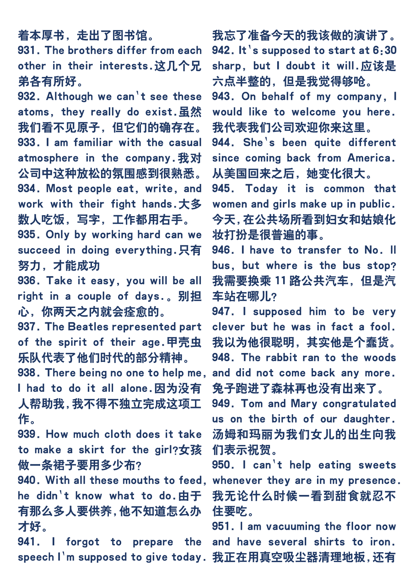

## 2. 使用python脚本进行根据页面切分转化为图像

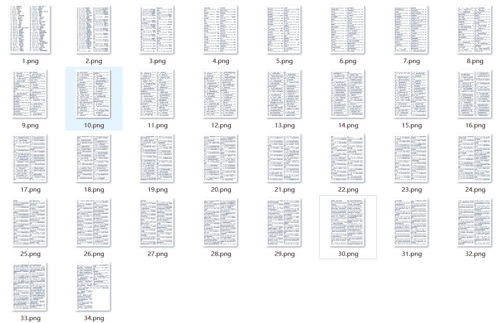

## 3. 批量上传图片到工作流，进行多模态识别及传到多维表格

批量上传图片和知识库多维表格链接效果，如下：

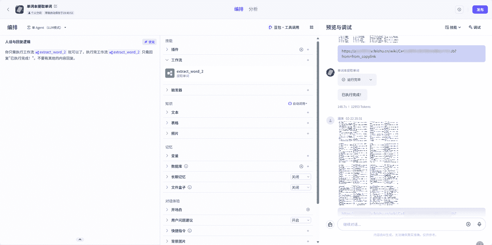

**多维表格**效果，如下：

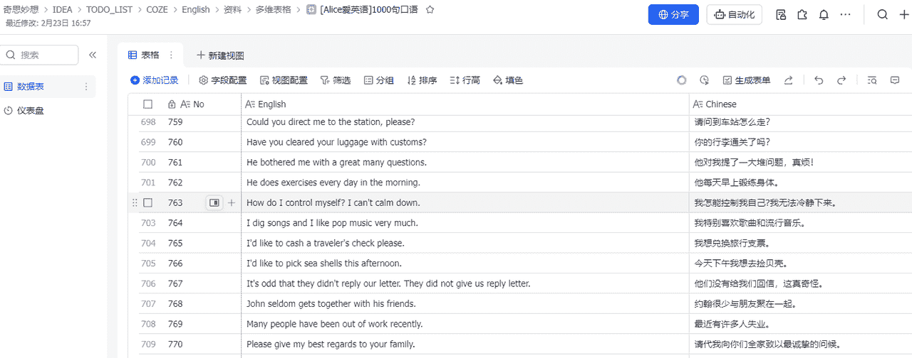

# 三、实现思路

1.  由于扣子工作流直接读取上传文件内容不佳，所以先使用python脚本将PDF文件按页码自动化切分为图片集。

1.  到飞书创建多维表格，并自定义字段名称及类型，然后修改分享权限为互联网获得链接的人可编辑。

1.  在扣子资源库创建个提取图片的中中英文内容的工作流。

(1)循环使用多模态豆包·视觉理解·Pro识别图片并提取图片中英文文本。

(2)使用代码组件，将大模型识别结果文本提取出来，并转化为能上传到飞书多维表格插件的请求格式。

(3)使用扣子官方的飞书多维表格插件，将数据自动录入到2步骤先前飞书所创建的多维表格中。

故，工作流已经搭建完成，并发布。

1.  在扣子项目开发中创建智能体，填写人设与回复逻辑、工作流，然后发布。

1.  将PDF的图片集直接上传到扣子平台，然后自动整理到飞书知识库。

# 四、实现

## 1. 新建飞书多维表格

(1) 登录飞书客户端，新建多维表格。


（2）分别新建三个文本类型字段：No、English、Chinese。

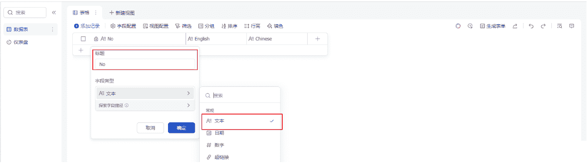

(3)设置分享权限为互联网获得链接的人。

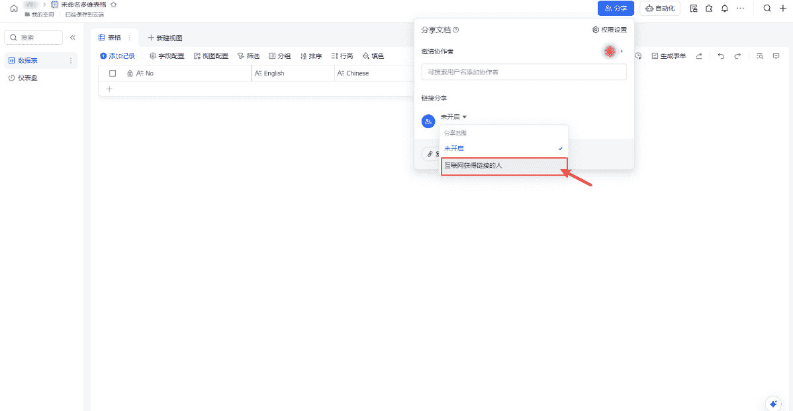


> **该链接就是后续****扣子工作流的飞书多维表格插件****的URL**

## 2. 搭建工作流

### 工作流整体总览

到新增插件节点上搜索飞书多维表格，然后找到add_records。

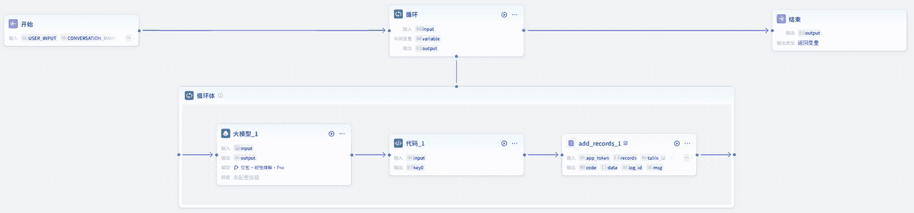

#### 1. 开始

新建变量：

+   input：Array<Image>

+   feishu_url：String


#### 2. 循环

+   循环类型：使用数组循环

+   参数：

+   input：开始-input Array<Image>

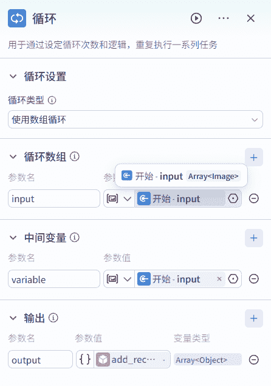

+   中间变量：

+   variable：开始-input Array<Image>

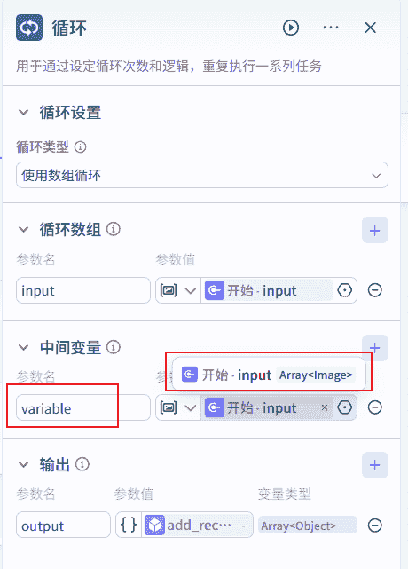

+   输出：

+   output：

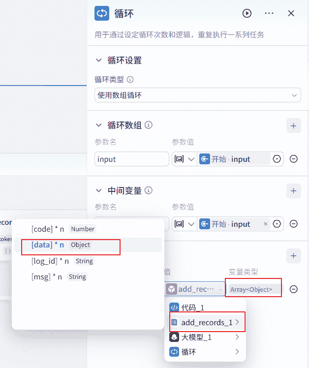

> 至此，工作流已经搭好了。最后发布。

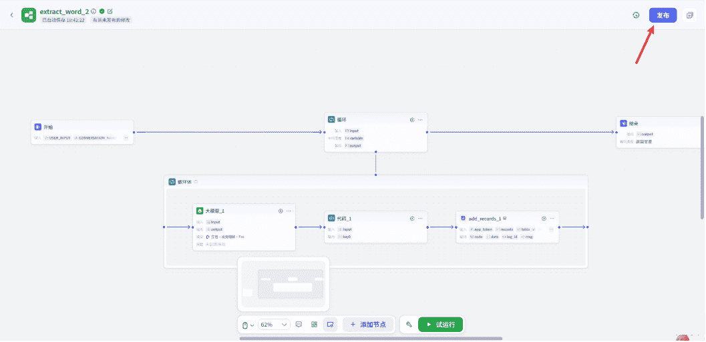

#### 3. 循环体

##### 3.1.  循环体-大模型

+   大模型类型：豆包·视觉理解·Pro

+   输入：

+   input：item

+   系统提示词：

```
你是高级版面ocr助手，帮我提取图片里的文本，并保持原来图片上的版面布局，然后你输出的内容变成markdown的json对象数组。
格式示例如下：
[
 { &quot;No&quot;: 61, &quot;English&quot;: &quot;Is it yours?&quot;, &quot;Chinese&quot;: &quot;这是你的吗?&quot; }
],并且对象中的&quot;English&quot;只要英文，不要有中文内容， &quot;Chinese&quot;只要中文内容。
```

+   用户提示词：

```
图片如下：{{input}}
```

+   输出：

+   output：String

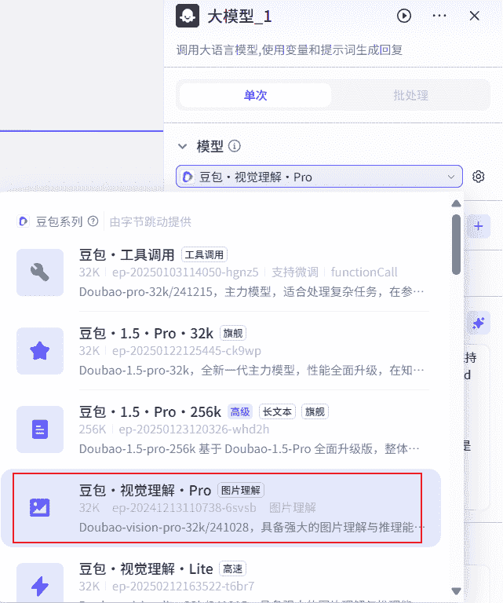

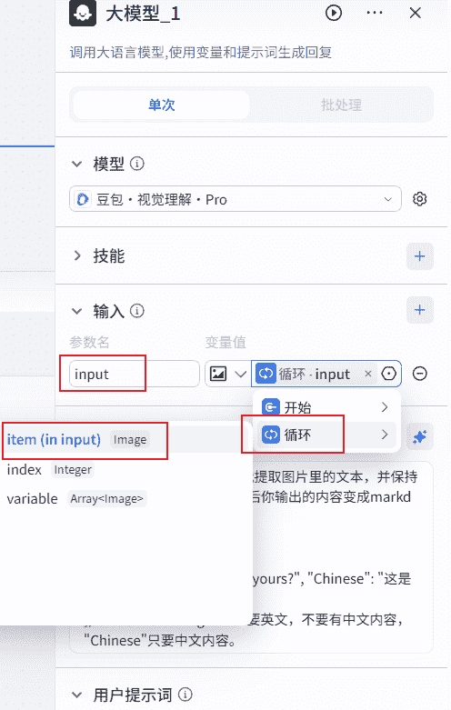

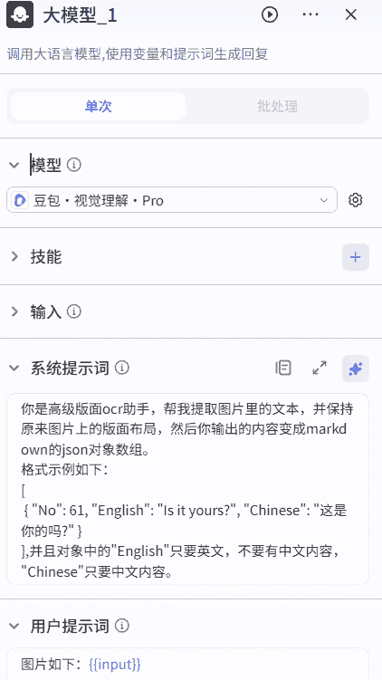

##### 3.2.  循环体-代码

+   输入：

+   input：

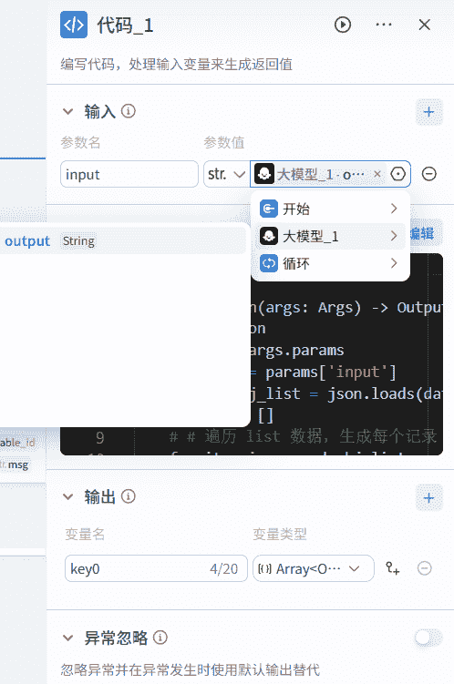

+   python代码：

```
async def main(args: Args) -&gt; Output:
    import json
    params = args.params
    data_str = params[&#x27;input&#x27;]
    record_obj_list = json.loads(data_str)
    records = []
    # # 遍历 list 数据，生成每个记录
    for item in record_obj_list:
        record = {&quot;fields&quot;: &quot;{}&quot;}  # 初始化 record
        fields = {}
        fields[&quot;No&quot;] = str(item[&quot;No&quot;])
        fields[&quot;English&quot;] = item[&quot;English&quot;]
        fields[&quot;Chinese&quot;] = item[&quot;Chinese&quot;]
    #     # 将 fields 转换为 JSON 字符串
        record[&quot;fields&quot;] = json.dumps(fields, ensure_ascii=False)
        
    #     # 将 record 添加到 records 列表
        records.append(record)

    # 返回包含 records 的对象
    ret: Output = {
        &quot;key0&quot;: records
        # &quot;key0&quot;: python_obj
    }
    return ret
```

+   输出：

+   key0：Array<Object>

##### 3.3.  循环体-add_records

到新增插件节点上搜索飞书多维表格，然后找到add_records。

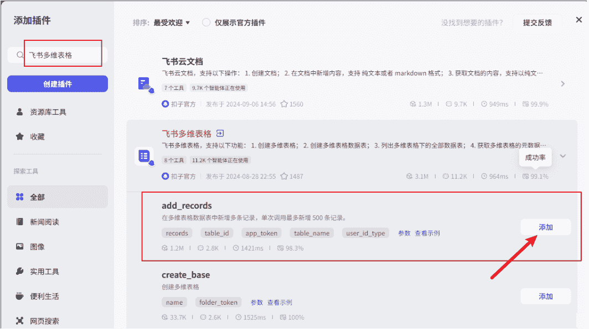

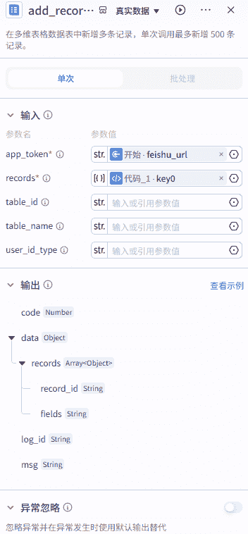

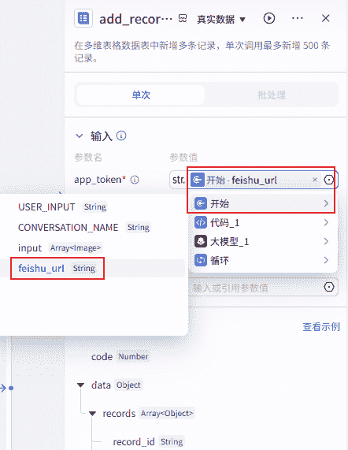

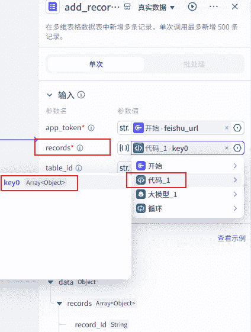

#### 4. 结束


## 3. 创建智能体


> 多维表格URL在**飞书的多维表格的分享**复制链接。


+   人设逻辑文本：

```
你只需执行工作流{工作流}就可以了，执行完工作流{工作流}只需回复&quot;已执行完成！&quot;。不要有其他的内容回复。
```

## 4. PDF文件按照页码自动切分转化为图片

源代码链接：

[https://gitee.com/heididi/c](https://gitee.com/heididi/cutting_pdf_to_images)utting_pdf_to_images

### (1) 克隆项目

```
git clone https://gitee.com/heididi/cutting_pdf_to_images.git
```

### (2) 安装依赖

```
pip install -r requirements.txt
```

此外，pdf2image 依赖于 poppler-utils，这需要在系统中安装 Poppler。

+   Windows：可以从Poppler for Windows下载并安装。

链接：<https://github.com/oschwartz10612/poppler-windows/releases/>

操作步骤：

1. 下载 poppler-xx.xx.xx-x86_64.zip 文件。

2. 解压文件。

3. 将解压后的文件夹的bin目录添加到系统的环境变量path中。

4. 记得重启电脑。

5. 验证安装是否成功。在命令行中输入pdfinfo，如果输出了帮助信息，则安装成功。

示例：


将bin目录添加到环境变量中：


+   macOS：可以使用Homebrew安装。

```
bash brew install poppler  
```

+   Linux：可以使用包管理器安装。

```
bash  sudo apt-get install poppler-utils  
```

### (3) 运行程序

1.  修改main.py中的pdf_path和image_path为自己的路径。

1.  然后运行命令：

```
python main.py
```

程序会将pdf文件夹中的所有pdf文件按照页码自动切分转化为图片，并保存到images文件夹中。

### (4) 注意事项

+   程序会将pdf文件夹中的所有pdf文件按照页码自动切分转化为图片，并保存到images文件夹中。

### 示例

（1）运行前文件目录，将要分割的pdf文件放在pdf文件夹中。


（2）并编辑main.py中的pdf_path和image_path为自己的路径。


（3）运行命令后文件目录：


现在，就已经完成将pdf文件按页数切割成图片了。