# NotebookLM使用教程：AI提效助手（适合工作党、学生党）

> 来源：[https://datawhaler.feishu.cn/docx/EuF8dm9xSoDENPxOqupcZrkunzf](https://datawhaler.feishu.cn/docx/EuF8dm9xSoDENPxOqupcZrkunzf)

> 亲**测好用的AI**提效工具之NotebookLM（文献梳理、量子速读、生成播客、会议纪要...）本教程依然是从小白的视角去学习如何使用此AI工具，适合想要利用AI提效的工作党、学生党，快来试试 NotebookLM 吧！

## 什么是 NotebookLM？ 📚

No**tebookLM **是** Google 推出的一款智**能笔**记助手****，它能帮你快****速理解和分析各种文**档内容。不管是学习、工作，还是研究，它都能帮你事半功倍！在我经常用到的场景中，帮我写文献综述（带引用）、量子速读快速了解一个新的领域、生成博客参与讨论（目前只支持英文）、或者把和别人交流讨论的过程录成mp3，然后用它转成会议纪要......这些场景真的有实实在在帮助到我！所以推荐推荐推荐！

网址：https://notebooklm.google/

快来新建一个属于自己的notebook吧！！！（需要科学上网）

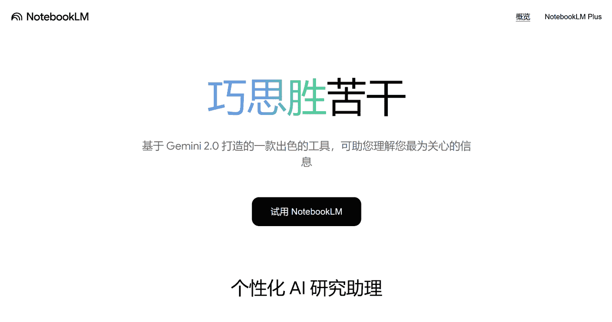

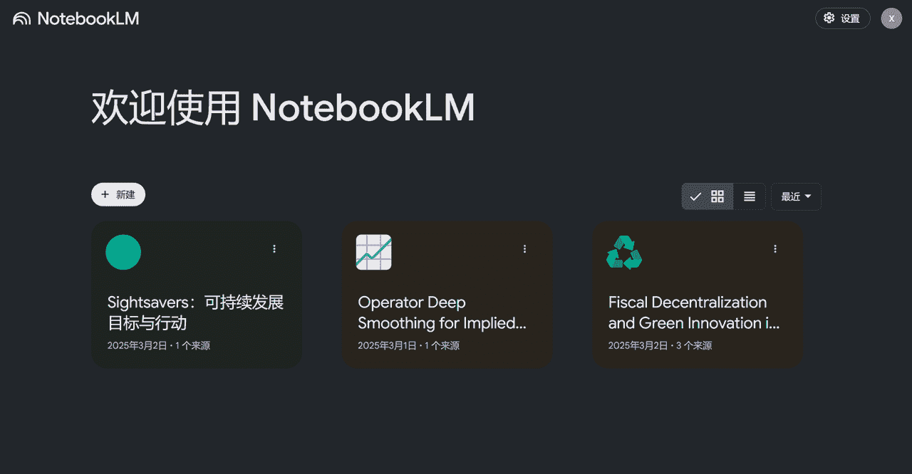

### 为什么选择 NotebookLM？

+   🎯 超强的文本理解能力

+   💡 智能问答和总结功能

+   📝 可以保存笔记和对话记录

+   🔒 安全可靠的数据保护

+   🆓 完全免费使用（欸！真香！）

## 使用场景详解 🎯

### 2.1 文献梳理助手

**使用步骤：**

1.  上传文献PDF，导入来源（最多可支持50篇文献）

1.  点击Studio下的小方框（时间轴、简报文档等等）

1.  自由聊天，比如研究主要观点、创新点、局限性、研究方法、实验设计等

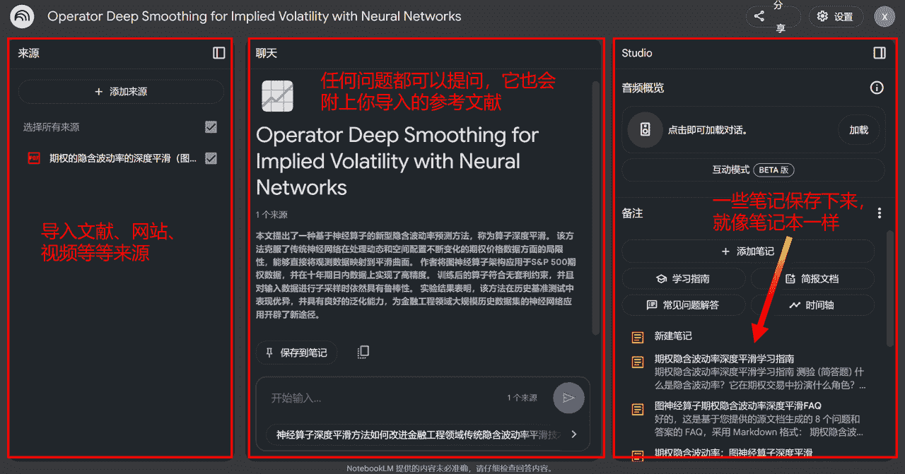

时间线（发展历程）、简报文档、自由聊天（带引用文献）：（这不就是文献综述的过程吗？）

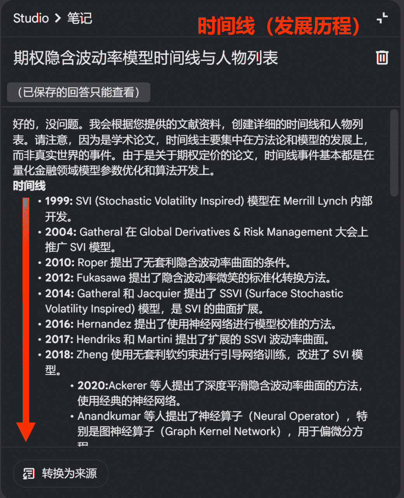

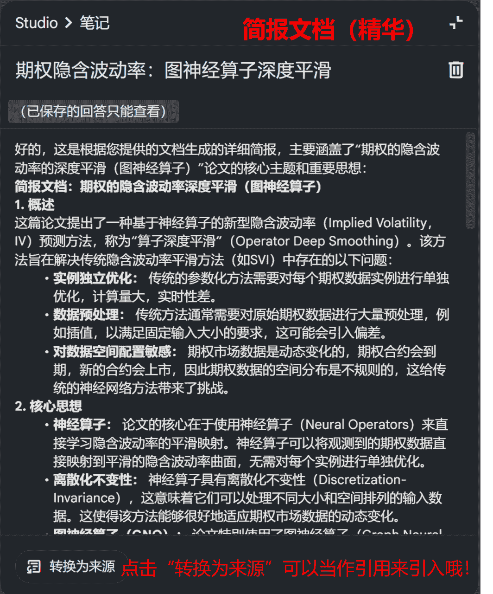

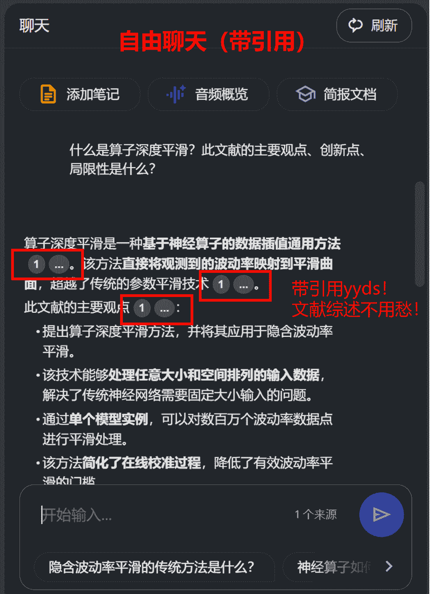

### 2.2 量子速读（快速了解一个新的领域）

一般来说，快速了解一个新的领域在NotebookLM里面就是四部曲，分别是：学习指南、简报文档、常见问题解答、时间轴。看完这四个文档，通过提问-回答的方式、时间线等方式大致就可以快速了解一个新的领域。对于我们不管在科研场景，还是工作场景，难免碰到自己不熟悉的领域，这样是一种量子速读的方式！

面对大量文档不知从何下手？可以试试这样：

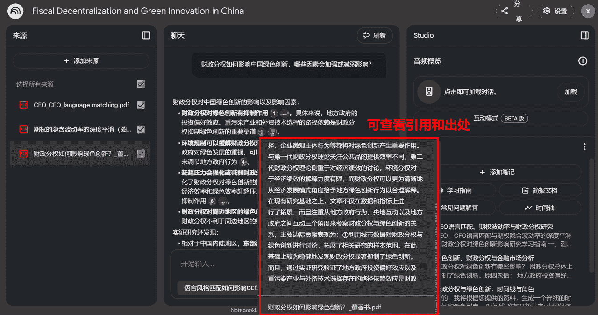

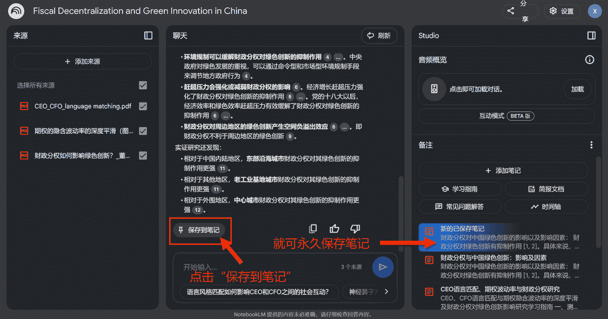

### 2.3 简历助手（模拟面试）

针**对简历模拟面试，提问问题，通**过客观的视角来分析自己的优劣势，以及和岗位的匹配度！也可以加入播客对话锻炼英文hhhh（祝大家都有满意的offer！）

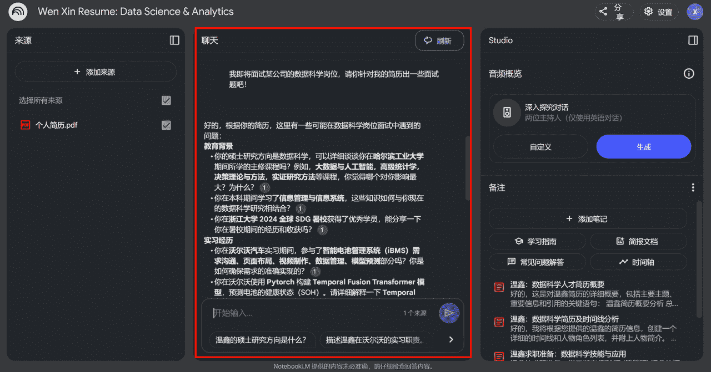

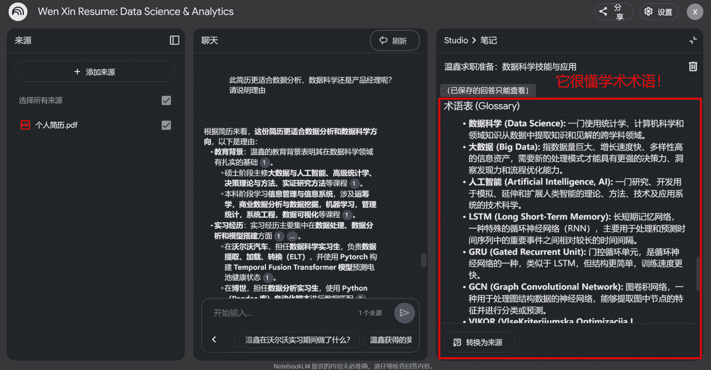

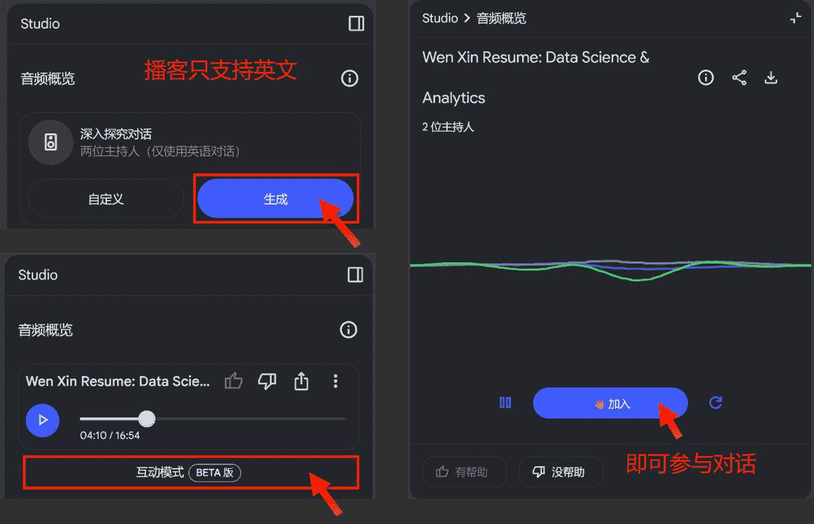

**一起**来看看和两位AI主持人的对话吧（感动到了！泪目😭，原来这就是松弛感）：

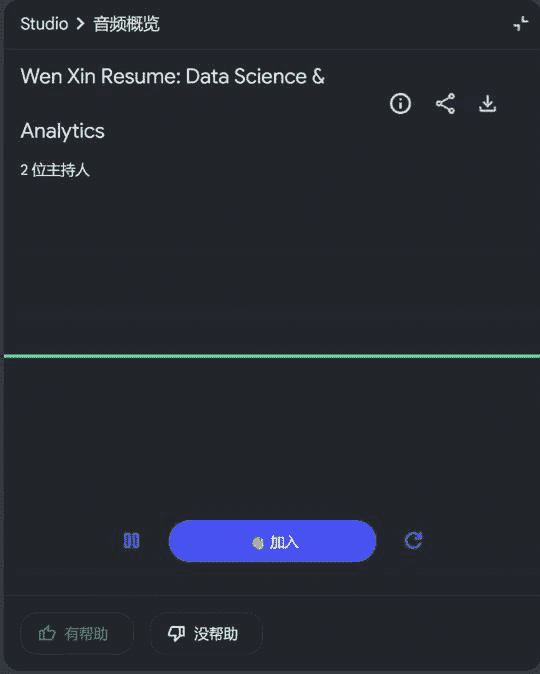

[【视频】.mp4](https://internal-api-drive-stream.feishu.cn/space/api/box/stream/download/all/CJeQbrmY3omlh0xcvGkcpNbun5e)

### 2.4 会议纪要神器

开会记录太慢？让 NotebookLM 来帮忙：

1.  上传会议录音

1.  自动生成：

+   会议主要议题

+   关键决策点

+   任务分配清单

+   后续行动计划

+   时间线

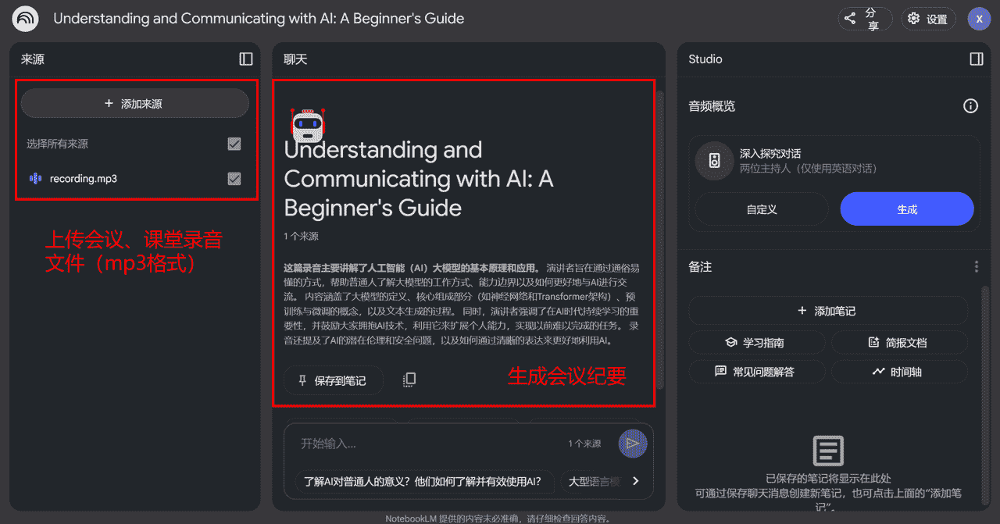

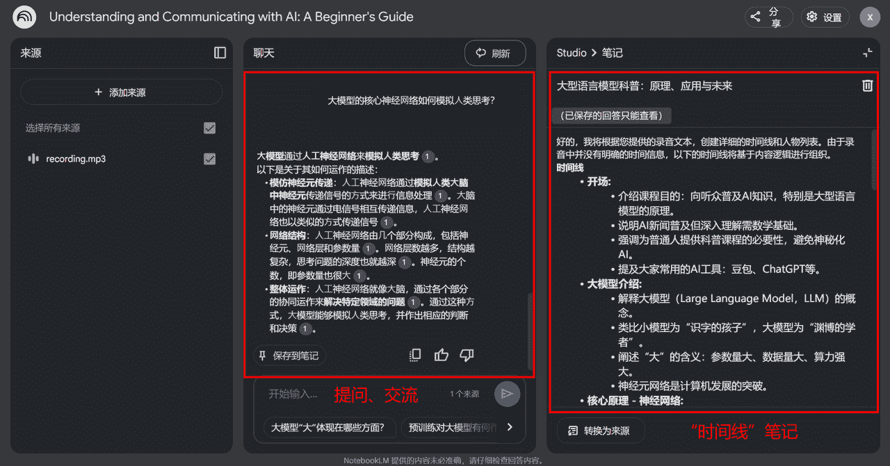

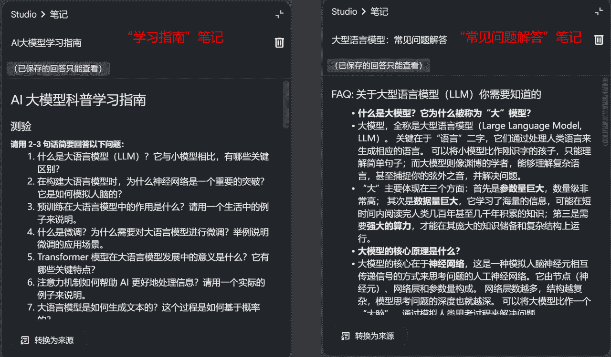

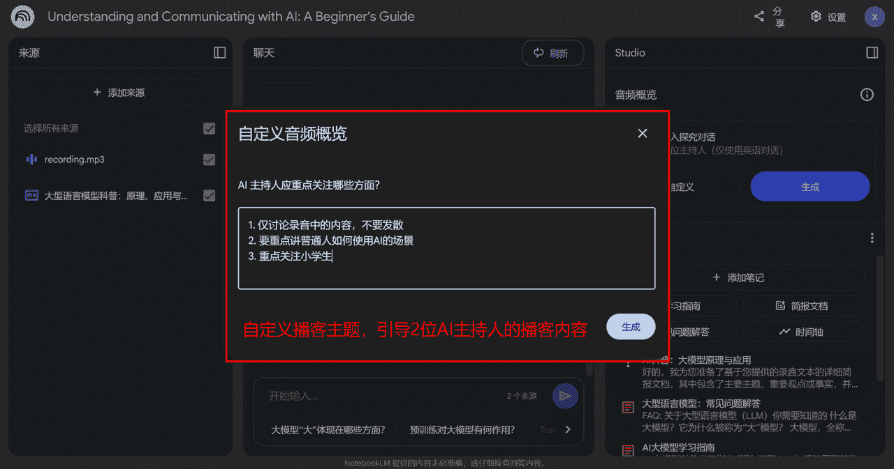

> **小技巧：**

+   用清晰的问题引导AI（同时也用自定义的场景来引导AI播客）

+   要求按照时间顺序整理（很清晰！）

+   遇到重点内容可“转为笔记”保存在右侧栏

还有更多实用场景 🎮！！！！！

### 2.5 学习笔记助手

还在为做笔记烦恼吗？NotebookLM可以帮你：

1.  课程内容整理与总结

1.  知识点关联分析

1.  生成复习重点

1.  制作思维导图

（都是细糠啊啊啊啊！早知道高中就这么学习来着！）

> 使用技巧：

+   上传课件或教材PDF

+   设置不同的学习目标

+   通过提问深化理解

+   用时间轴梳理知识脉络

### 2.6 研究方案规划

科研工作者的得力助手：

1.  实验方案设计

1.  数据分析建议

1.  研究思路拓展

1.  相关工作推荐

> 操作步骤：

+   上传相关领域文献

+   描述研究目标和现有条件

+   让AI提供方案建议

+   追问细节和可能的问题

### 2.7 创意写作助手

激发你的创作灵感：

1.  内容框架设计

1.  素材整理与扩充

1.  多角度写作建议

1.  风格调整与润色

> 实用技巧：

+   上传参考资料

+   设定写作风格和目标读者

+   通过对话激发灵感

+   保存优秀表达方式

## 使用小贴士 💡

1.  **提问技巧**

+   问题要具体明确（做好领导——“清晰的指令”）

+   善用追问深入话题（有效的互动）

1.  **效率提升**

+   保存常用提示语

+   建立知识库

1.  **注意事项**

+   定期保存重要内容（点击“转为笔记”or“来源”）

+   检查AI生成的内容（因为AI有“幻觉”，所以需要人为的再看看~）

+   关键信息需要核实（yep）

## 常见问题解答 ❓

Q：NotebookLM 支持哪些文件格式？

A：支持 PDF、Markdown、txt等常见文本格式，还支持网站、youtube视频链接以及Google幻灯片（识别图片）

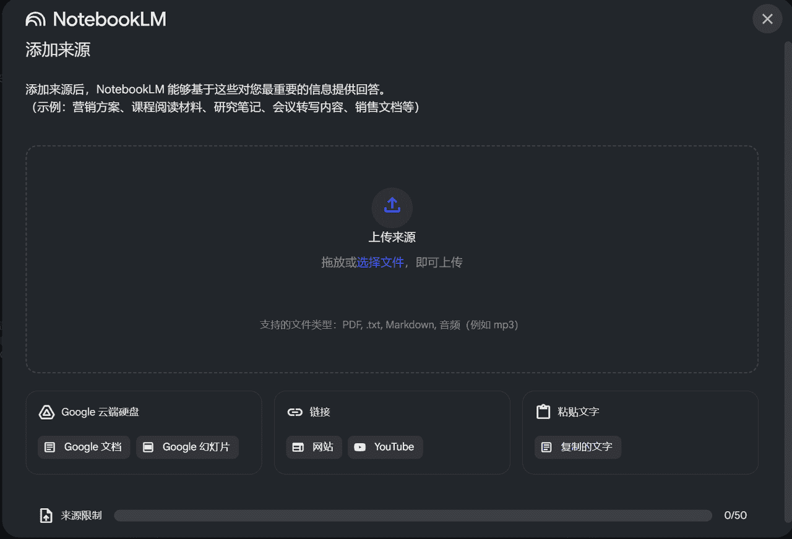

**Q：可以同时处理多个文档吗？**

A：可以，建议相关文档一起上传（最多50篇文献），便于对比分析。尤其是论**文党需要写**文献综述的部分，那简直香的不要不要的了！有引用、有来源，妥妥直接成品（温馨提示：当然还是要人为的过一下哈~）

**Q：生成的内容准确吗？**

A：AI生成内容仅供参考，重要信息请务必核实。（任何AI工具都会有，因为本质是基于概率的，会产生“幻觉”）

## 结语 🎉

NotebookLM 是我们学习工作的得力助手，希望这份教程能帮你快速上手，提升效率！在工作场合或者学习场合，学会第一时间link到AI工具，使用AI工具辅助我们学习，真的很高效！最后：工具只是辅助，关键还是要培养自己的思考能力~

祝你使用愉快！ 🌈