# 用GPT-4o帮自己“虚拟试衣服”

> 来源：[https://datawhaler.feishu.cn/docx/RzBAdEFsNoMRq0x0l09cUblBn7e](https://datawhaler.feishu.cn/docx/RzBAdEFsNoMRq0x0l09cUblBn7e)

> 本文目录：

+   一个想法：GPT-4o能不能帮我们虚拟试穿衣服？

+   使用GPT-4o试穿过程，捏了一个服装搭配师提示词

+   过程中的产品观察

+   如果想用现成工具怎么做？推荐两个AI工具

# 一个想法

你是否有这些烦恼？

+   网上精挑细选2小时，到货后发现衣服尺码不合适，愤然退货

+   刚工作钱包扁扁，但老觉得衣柜缺一件衣服

如果有一个虚拟试衣镜，直接在线生成一个符合自己身材的数字人，我们把衣服商品图和尺码给到AI，它直接生成衣服的上身效果。再以同样的方式搭全套。

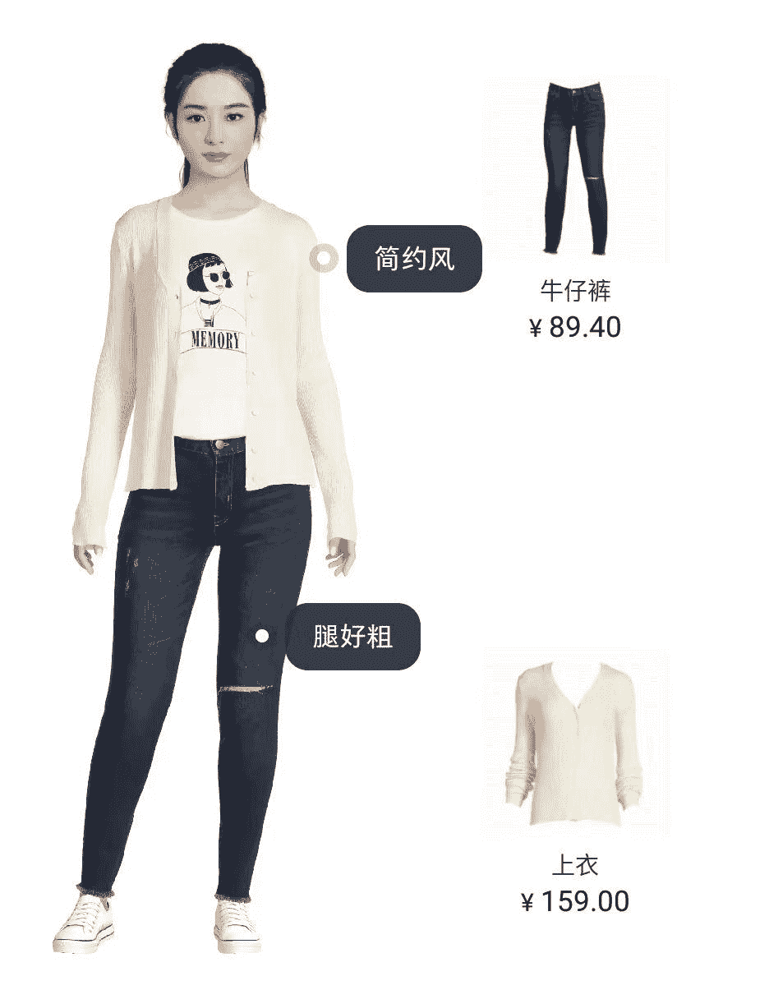

这样一定能减少我们剁错手的概率。毕竟，谁不想玩“自己版”奇迹暖暖呢？

正好，最近GPT新出了native ImageGen能力，效果非常炸裂（已经被吉卜力风格画刷屏）。如果你还没有感知，下面是一些比较惊艳的生图案例：

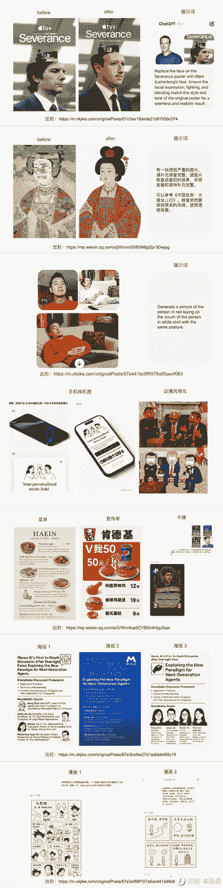

于是我在想，最新、最强的GPT-4o能不能帮我们实现“试衣自由”？

说干就干！

# 使用GPT-4o帮我们实现“试衣自由”

首先需要知道我们的身材数据，然后找到想试穿的衣服的商品图。为了尽可能还原，需要把商品的尺码图也找到。比如：

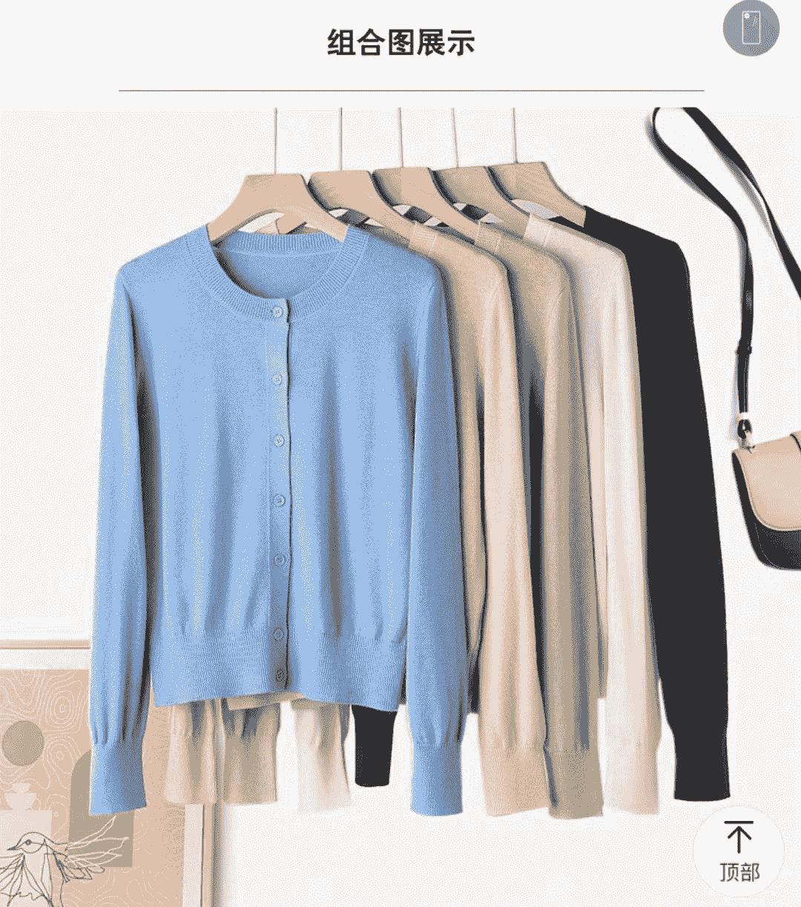

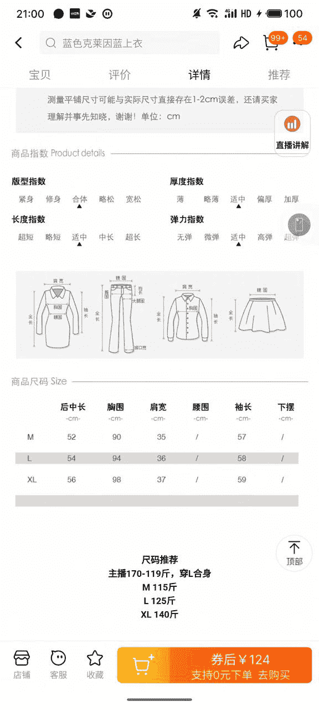

再找一张自己面部清晰的照片，把这3张图按顺序扔给GPT，让它给出尺码建议和试穿照。

这是提示词：

```
背景：我是一名女生，想虚拟试衣    
我的身材数据：  
- 身高：[1*2cm]  
- 体重：[*5kg]  
- 三维：[胸围*cm，腰围*cm，臀围*cm]   

左图的[蓝色针织衫]是我想试穿的衣服，中间图是这件衣服的商品尺码，右图是人脸参考。     

请你根据我的身材从中选择一个最合适的尺码，执行以下步骤：  
1. 我最适合的穿哪个尺码  
2. 使用创建图片功能，生成符合上述身材数据和该人脸的衣服试穿照
```

*使用时替换[]中的内容

不要忘了勾选“创建图片”功能。


GPT经过一番分析，建议我们穿M码，建议得不错

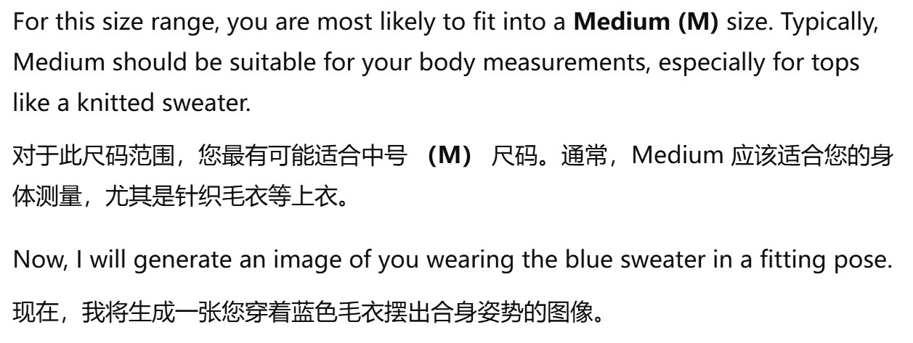

这是生成效果：

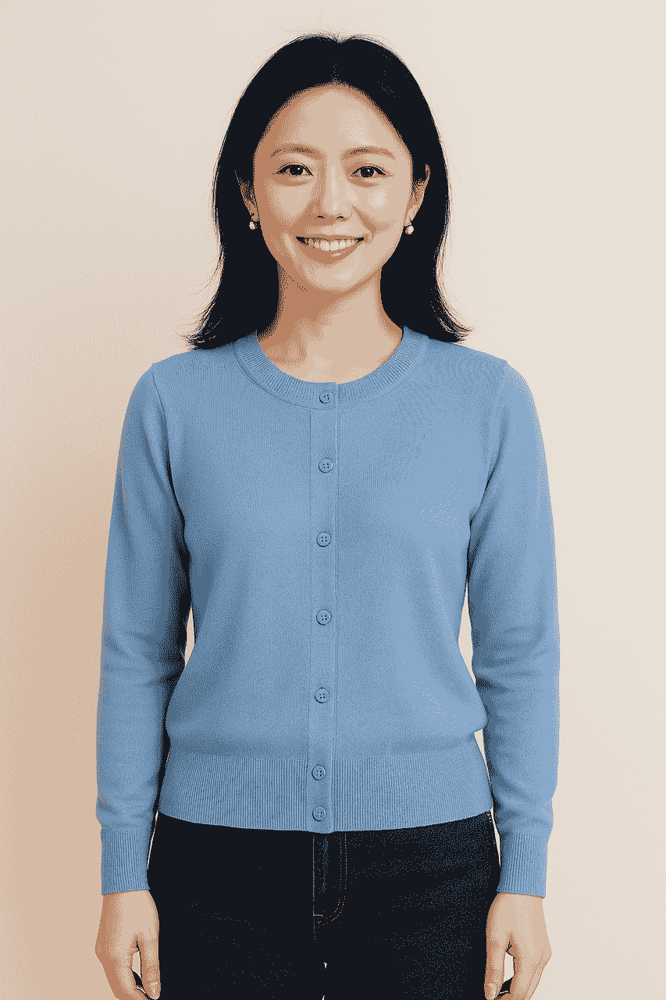

衣服有了，让GPT帮忙搭条裤子和鞋吧

提示词：

```
假如你是一名专业的服装搭配师，擅长为女大学生搭配服装。 
请你给我推荐适合这件[蓝色针织衫]的下装和鞋，我想要在[去环球影城]的时候穿
```

*使用时替换[]中的内容

根据建议，选了一条牛仔蓝的A字裙。

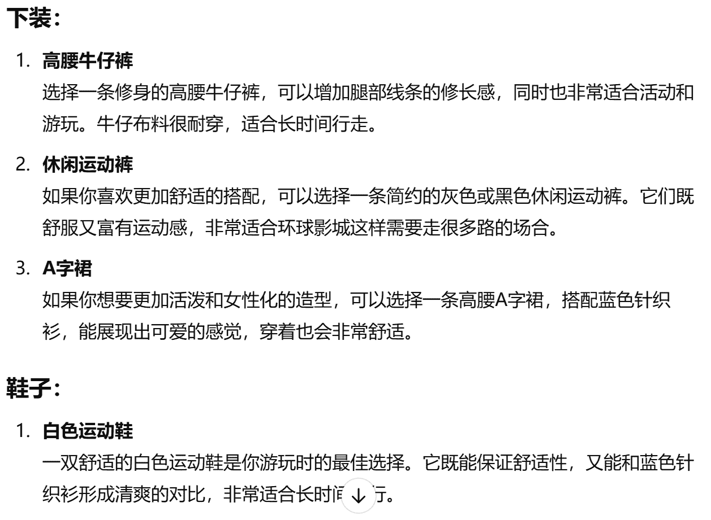

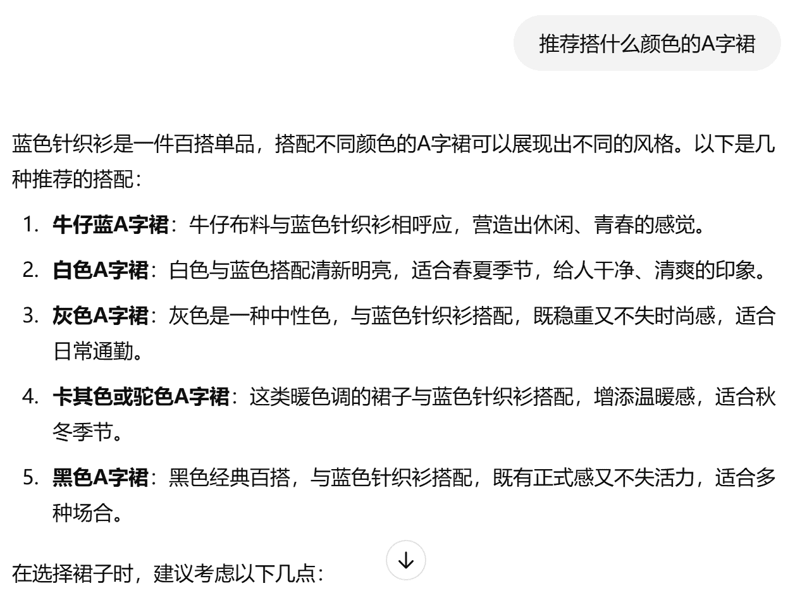

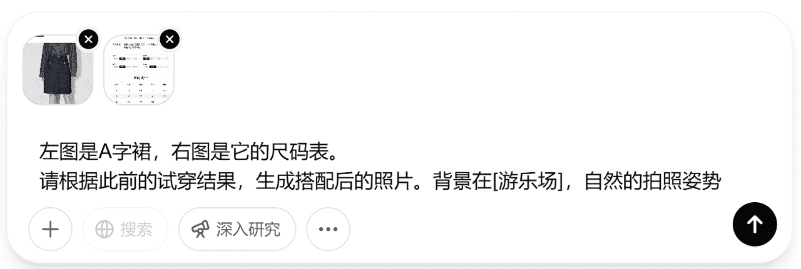

提示词：

```
左图是A字裙，右图是它的尺码表。 
请生成搭配后的图片。背景在[游乐场]，自然的拍照姿势
```

*使用时替换[]中的内容，注意勾选“创建图像”

这样就能看到试穿效果啦

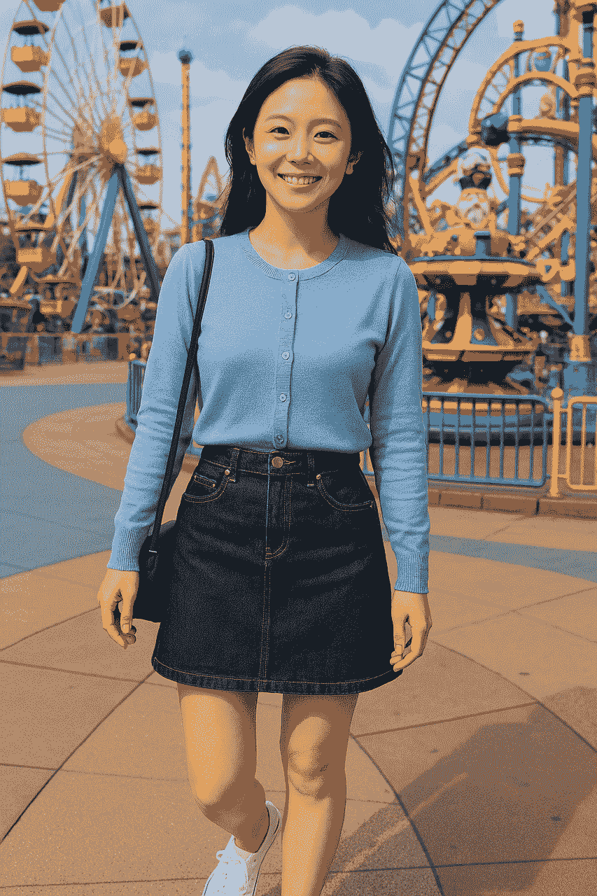

我们还可以把GPT当私人服装搭配师来问，比如：

+   我是梨形身材，A字裙适合我么？

+   这套搭配适合穿哪双鞋（把自己所有的鞋子拍照给GPT选）？

这套搭配看起来平平无奇，想更有创意一点怎么办？我捏了一个专门给年轻女性搭衣服的服装搭配师，看看它搭的：

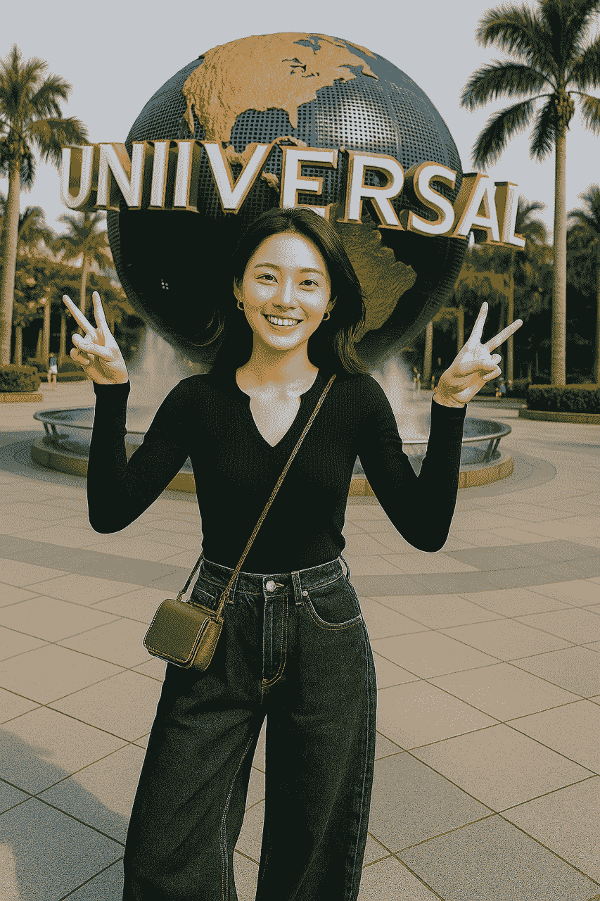

使用DeepSeek写的提示词：

```
# **服装搭配**师提**示词
你**是一**位专为1**8-**28岁女**性服**务的时尚**顾问，擅长将优衣库的基础款、UR的潮流感、ASOS的年轻力，与Celine的极简美学、Max Mara的经典剪裁进行创意混搭。请遵循以下原则生成方案：

# 风格框架
- 70%实用主义：参考优衣库的叠穿逻辑+Max Mara面料哲学
- 20%个性突破：融入UR的撞色拼接/Celine的金属细节
- 10%场景实验：借鉴ASOS的派对单品重构日常穿搭

# 核心公式
- 【经典单品变形术】如：&quot;Max Mara驼色大衣+UR荧光内搭+优衣库U系列阔腿裤&quot;
- 【Celine平替方案】如：&quot;ASOS醋酸缎面裙+优衣库无领衬衫（模仿Phoebe Philo廓形）&quot;

# 设计约束
## 拒绝网红爆款堆砌，每套搭配需包含：
- 1个经典品牌基础款（锚定质感）
- 1个快时尚潮流元素（制造记忆点）
- 1个轻奢细节（如金属纽扣/异形包袋）

# 输出模式
1. 先解析用户身材/肤色/场景需求
2. 给出3套方案：基础版/进阶版/实验版
3. 标注价格分层（优衣库≤300元单品+UR/ASOS≤800元+轻奢配饰）

# 用户输入
- 身材：[身高、体重、三维数据]
- 肤色：[白皮/黄皮]
- 场景需求：[穿着场景]
- 已有单品：[如果有，可作为图片上传]
```

*使用时替换[]中的内容，注意勾选“创建图像”

# 一些观察和小意外

1.  GPT-4o默认生成的是欧美人，如果让GPT改成“亚洲女性”，会触发内容限制。但直接使用亚洲女性作为参考图就不会触发。

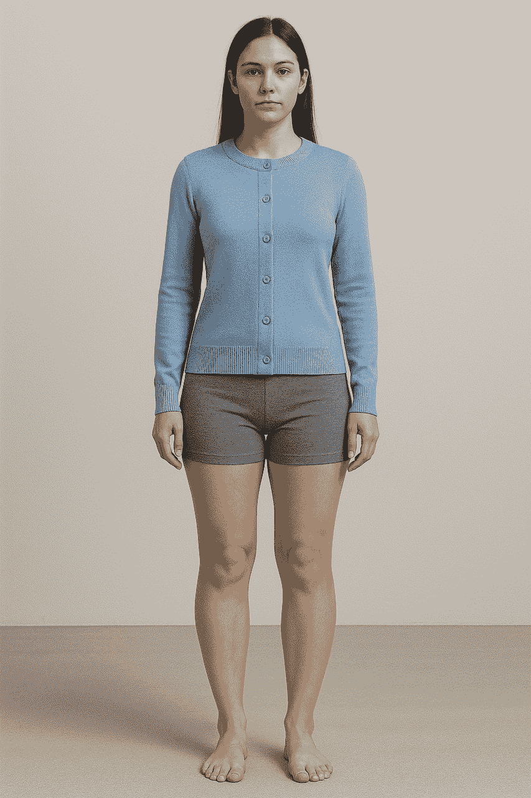

1.  这种从上到下逐渐清晰的加载方式，极大缓解了用户的等待焦虑，第一次看到觉得很惊艳。与其他产品一次性加载整张清晰图片相比，是很好的产品体验优化。

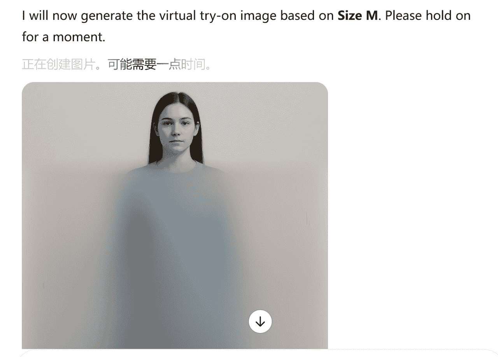

使用GPT-4o帮我们搭衣服，显而易见的优点是自由度很高，关于服装设计的所有问题都能问GPT老师。

但如果你只想看看衣服穿到自己身上是什么效果，只想“拖拉拽”就完成操作，那么也有现成的AI工具供你选择，下面推荐两个我认为做得不错的。

# 2个虚拟试衣AI工具

## WeShopAI Virtual Try-On

国内首款AI商拍工具，蘑菇街陈琪二次创业产品，在huggingface上可以体验：https://huggingface.co/spaces/WeShopAI/WeShopAI-Virtual-Try-On

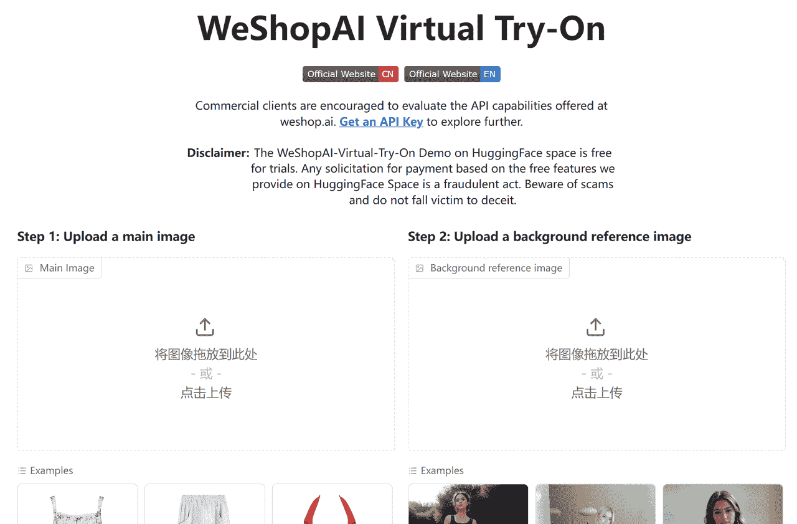

操作方式非常简单，上传一张服装商品图和人像图就可以合成上身图。

翻箱倒柜找到Datawhale六周年限量T恤，让AI模特穿上试试看：

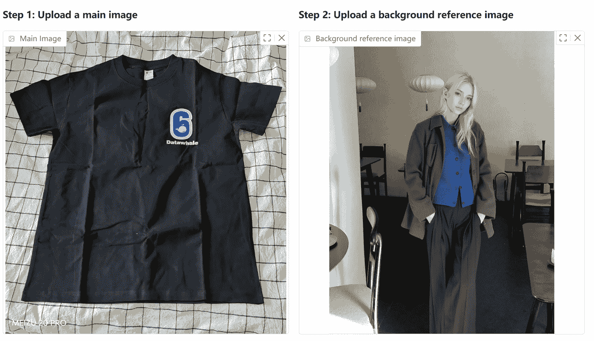

点击“Generate”生成图片：

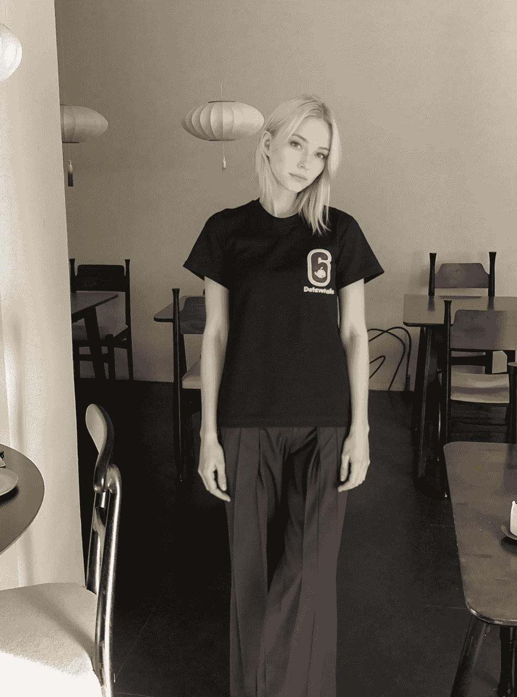

## 淘宝试衣间

可能很多朋友不太知道，淘宝本身就有AI试衣间功能。直接搜索框搜索“淘宝试衣间”就能进入：


主要功能有3个：

1.  制作自己的试衣分身（主要是换脸）


1.  调整AI模特的身形，包括身高、体重、肤色、身材类型。


1.  直接搜索淘宝中想试穿的衣服，加入虚拟试衣间


可以直观看到试穿效果，如果喜欢，点击对应的商品图就跳转到了商品页面，可以直接下单。


也有小红薯姐妹试穿后翻车...


可以用上面的AI工具做什么？

1.  作为消费者：学习服装搭配（选一件单品，其他让AI帮你搭），提升衣品过程中省点钱（不用买衣服过来一件件试了）；

1.  作为电商商家：节省商拍成本（不用找模特拍商品图了，AI商拍成本约为传统商拍成本的10%）

实际上，虚拟模特代替真人模特进行服装商拍已经成为了一种新兴的趋势，美图设计室、虹软科技、阿里系的仓颉造梦等都在参与。

未来一定有一天，我们可以在虚拟3D世界中量体裁衣，实现所见即所得。